<p align="center"><a href="https://omni-ai-tts.vercel.app">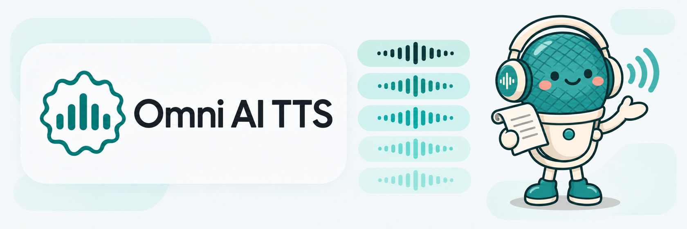</a></p>

<h1 align="center">Omni AI TTS</h1>

<p align="center"><strong>성우 찾기부터 음성 파일까지, 다섯 공급자를 한 작업실에서</strong></p>

<p align="center">
  <em>Typecast · ElevenLabs · Fish Audio · Airy · Gemini 성우를 미리 듣고 담아 두고,<br>
  대본의 숫자 발음을 검수한 뒤 문단마다 다른 성우로 한국어 음성을 만들어 받는 개인 TTS 작업실입니다.</em>
</p>

<p align="center">
  <a href="https://omni-ai-tts.vercel.app"><strong>공개 데모 써 보기 →</strong></a> &nbsp;&middot;&nbsp; <a href="docs/adr/"><strong>설계 결정(ADR) 보기</strong></a><br>
  <sub>로그인 없이 예시 데이터로 작업실을 써 볼 수 있습니다. 공급자를 부르지 않고 미리 만든 샘플로 들려 주며, 데이터는 매일 처음 상태로 돌아갑니다.</sub>
</p>

<p align="center">
  
  
  
  
  
  
  
  
</p>

<p align="center">
  <strong>다섯 공급자 성우 캐스팅 &middot; 음성 작업실 &middot; 드라마 장면 &middot; 한국어 숫자 발음 검수 &middot; 대본 보관함 &middot; 내 목소리 클론 &middot; 프리셋 &middot; 로그인 없는 공개 데모</strong>
</p>

<p align="center">
  <a href="#무엇을-하나요">무엇을 하나요</a> &middot;
  <a href="#화면-둘러보기">화면 둘러보기</a> &middot;
  <a href="#작업-흐름">작업 흐름</a> &middot;
  <a href="#기술-스택과-구조">기술과 구조</a> &middot;
  <a href="#설계에서-지킨-것">설계 결정</a> &middot;
  <a href="#빠른-시작">빠른 시작</a> &middot;
  <a href="#배포">배포</a> &middot;
  <a href="#문서-지도">문서</a>
</p>

---

## 무엇을 하나요

유튜브 내레이션, 오디오 드라마, 교육 영상처럼 한국어 음성을 자주 만드는 사람은 공급자마다 다른 사이트를 오갑니다. 성우 목록, 설정, 요금, 파일 형식이 모두 다르고, 대본의 숫자("1,523억 달러", "12.4%")를 어떻게 읽을지도 매번 손봐야 합니다. Omni AI TTS는 이 일을 한 작업실로 모았습니다.

<table>
  <tr>
    <td width="33%" valign="top"><strong>다섯 공급자 성우를 한 목록에서</strong><br>Typecast·ElevenLabs·Fish Audio·Airy·Gemini 성우를 탭 하나로 오가며 공급자마다 주는 필터로 찾고, 기본 샘플과 내 문장으로 미리 듣습니다.</td>
    <td width="33%" valign="top"><strong>문단마다 다른 성우</strong><br>대본을 문단 카드로 나눠 문단마다 성우·설정을 고르고, 이어 듣고, 한 파일(WAV)·문단별(zip)·자막(SRT)으로 받습니다.</td>
    <td width="33%" valign="top"><strong>한국어 숫자 발음 검수</strong><br>금액·날짜·시각·단위·전화번호를 항목별로 확인해 발음용 대본으로 만들고, 원문은 그대로 둡니다.</td>
  </tr>
  <tr>
    <td valign="top"><strong>두 사람 이상의 드라마 장면</strong><br>화자마다 성우를 붙인 대본을 Fish Audio로 한 장면처럼 연기시키고, 장면 파일과 대사별 파일을 받습니다.</td>
    <td valign="top"><strong>내 목소리 클론</strong><br>녹음이나 파일로 내 목소리를 Fish Audio·Gemini에 등록해 같은 작업에 씁니다. 원본 녹음은 서버 메모리에서만 다룹니다.</td>
    <td valign="top"><strong>다시 찾기 쉬운 정리</strong><br>성우 보관함(즐겨찾기·자주 사용·채널·분류), 프리셋, 대본 보관함(한글 검색)으로 다음 작업을 빨리 시작합니다.</td>
  </tr>
</table>

> [!NOTE]
> **유료 호출은 항상 먼저 묻습니다.** 생성·시험 생성·클론처럼 공급자 크레딧을 쓰는 호출은 예상 사용량을 보여 주는 확인 창을 거치고, 같은 조합의 결과는 다시 쓰며, 자동으로 다시 시도하지 않습니다. 공개 데모는 공급자 키가 없는 별도 배포라 유료 호출이 일어나지 않습니다.

## 화면 둘러보기

<p align="center">
  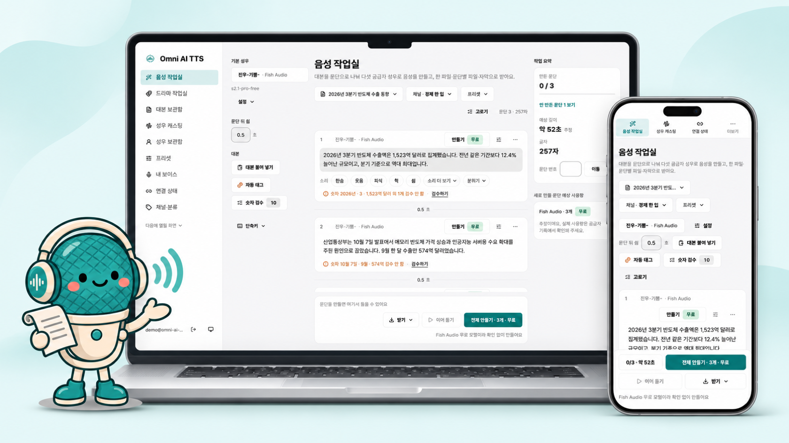
</p>

<p align="center">
  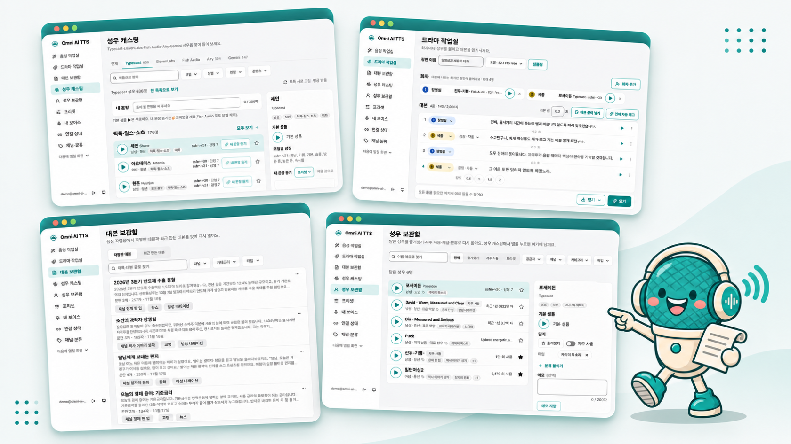
  <br><sub>위 두 장은 실제 스크린샷을 바탕으로 만든 소개 그림입니다. 아래는 실제 화면 그대로입니다.</sub>
</p>

<p align="center">
  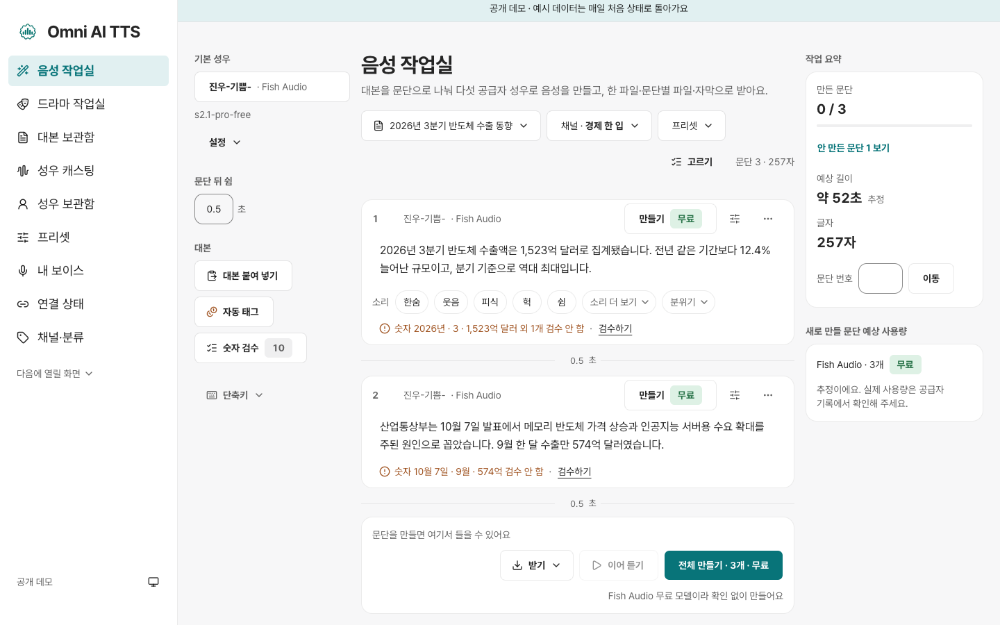
  <br><sub>음성 작업실</sub>
</p>

<table>
  <tr>
    <th width="50%" align="center">성우 캐스팅</th>
    <th width="50%" align="center">드라마 작업실</th>
  </tr>
  <tr>
    <td align="center">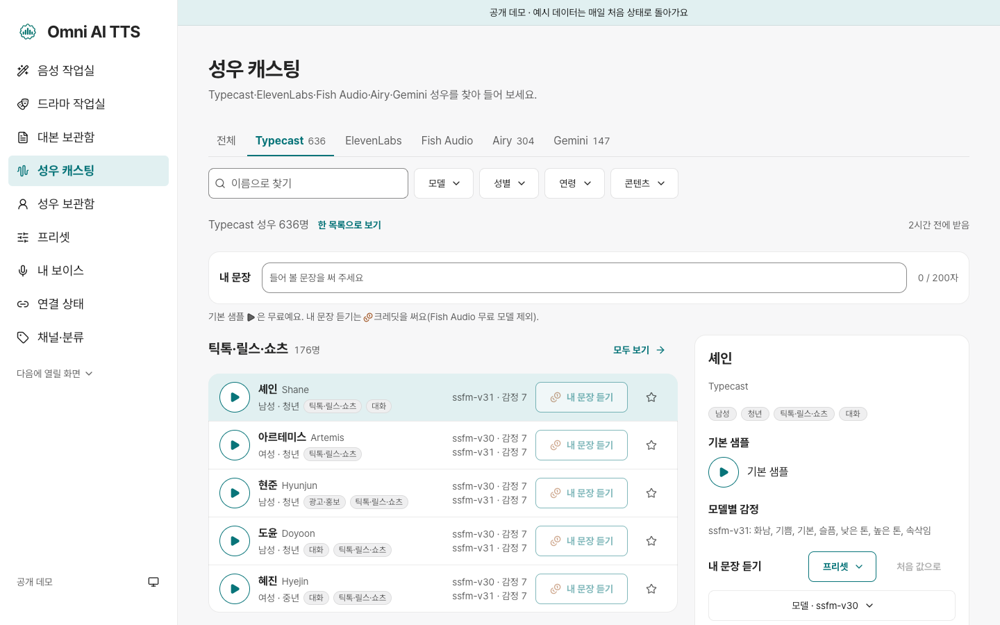</td>
    <td align="center">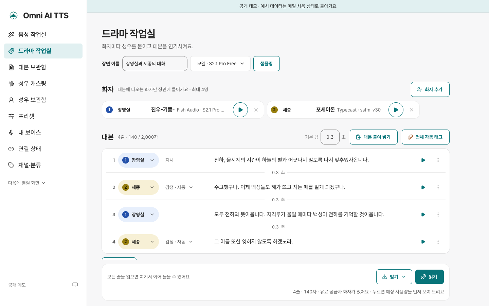</td>
  </tr>
  <tr>
    <th align="center">대본 보관함</th>
    <th align="center">성우 보관함</th>
  </tr>
  <tr>
    <td align="center">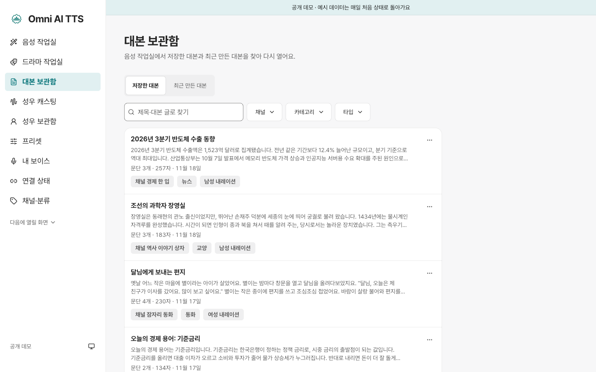</td>
    <td align="center">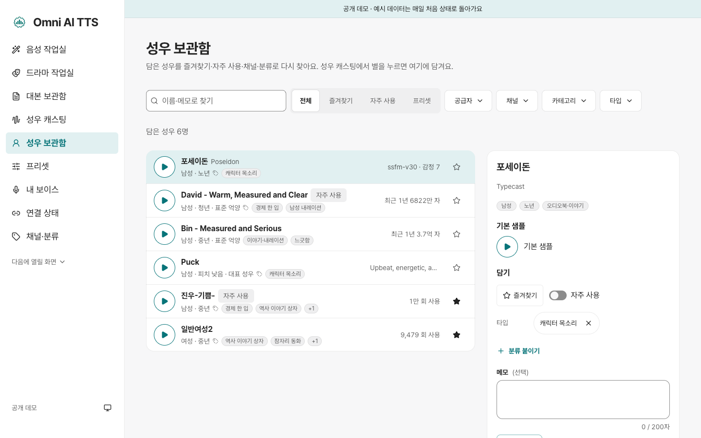</td>
  </tr>
  <tr>
    <th align="center">프리셋</th>
    <th align="center">다크 테마</th>
  </tr>
  <tr>
    <td align="center">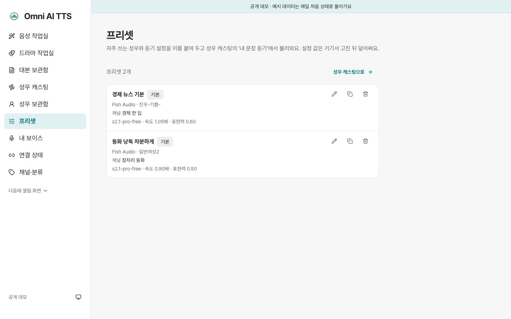</td>
    <td align="center">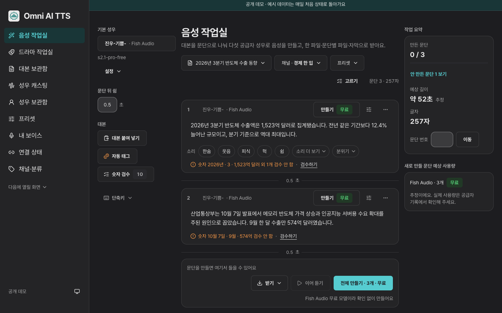</td>
  </tr>
</table>

<details>
<summary><b>휴대폰 화면(390px)</b></summary>
<br>
<p align="center">
  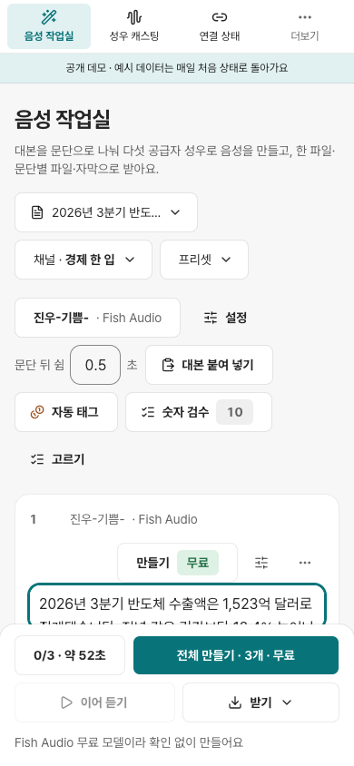
  &nbsp;&nbsp;
  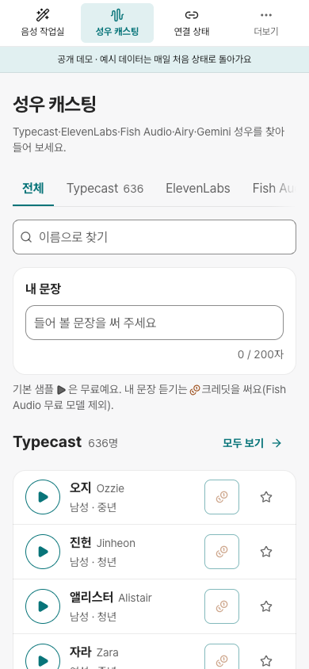
</p>
</details>

> [!TIP]
> 스크린샷은 공개 데모에서 예시 데이터로 찍었습니다. 화면 위의 띠와 '공개 데모' 표시는 데모에서만 보입니다. 성우 목록은 공급자의 실제 공개 목록입니다.

## 작업 흐름

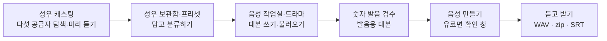

1. **성우 고르기**: 성우 캐스팅에서 공급자별 필터로 찾고 기본 샘플이나 내 문장으로 들어 본 뒤 보관함에 담습니다.
2. **대본과 검수**: 음성 작업실에 대본을 붙여 넣거나 대본 보관함에서 불러오고, 숫자 읽기를 항목별로 확인합니다.
3. **만들고 받기**: 문단을 하나씩 또는 전체를 만들고, 이어 듣고, 한 파일·문단별·자막으로 받습니다.

자세한 사용법은 [작업실 사용 안내](docs/guides/using-the-studio.md)에 있습니다.

## 기술 스택과 구조

| 영역 | 사용 |
|---|---|
| 앱 | Next.js 16 App Router, React 19, TanStack Query, Tailwind CSS 4, shadcn/ui(`packages/ui`) |
| API | oRPC(`/api/rpc` 하나, 모든 사용자 데이터는 `protectedProcedure`), zod 입력 검증 |
| 인증 | Better Auth 1.7(이메일·비밀번호, 공개 가입 막음, 로그인 시도 제한 DB 저장) |
| DB | PostgreSQL 18, Drizzle ORM, Neon(로컬은 컨테이너) |
| 배포 | Vercel(Fluid compute), 본인용 작업실과 공개 데모를 같은 코드로 따로 배포 |
| 품질 | TypeScript, Biome, Vitest(API·화면 자동 테스트 1,900여 개), Turborepo |

```text
apps/web            Next.js 앱(화면, /api/rpc·/api/auth 진입점, proxy)
packages/api        oRPC 라우터, 공급자 연동(providers/), 소유자 판정
packages/auth       Better Auth 설정
packages/db         Drizzle 스키마와 마이그레이션
packages/ui         공용 UI 부품과 디자인 토큰(globals.css)
docs/               요구사항, 로드맵, 화면 브리프, ADR, 가이드
```

## 설계에서 지킨 것

- **본인용과 공개 데모를 나눈다**: 본인용 작업실은 세션 이메일이 `OWNER_EMAILS`의 이메일 하나와 같을 때만 열리고 공개 가입은 서버에서 막습니다([ADR 0012](docs/adr/0012-session-owner-single-allowlist.md)). 공개 데모는 공급자 키 없는 별도 배포라, 데모 모드가 잘못 켜져도 키가 있으면 소유자를 정하지 않습니다([ADR 0015](docs/adr/0015-public-demo-separate-deploy.md)).
- **공급자 키는 서버에만**: 모든 공급자 호출은 `/api/rpc`의 보호 프로시저를 거치고, 키는 Vercel 환경 변수와 로컬 `.env`에만 둡니다.
- **늦게 온 결과도 잃지 않는다**: 공급자 응답이 시간 제한 뒤에 오면 응답 뒤 작업(Next `after`)으로 저장해, 이미 과금된 결과를 버리지 않습니다([ADR 0013](docs/adr/0013-first-deploy-vercel-neon-singapore.md)).
- **오디오는 4.5MB 응답 한도 안에서**: 작업실 결과는 3MiB 조각으로 받고 잇기는 브라우저에서 합니다([ADR 0006](docs/adr/0006-studio-audio-in-generation-record.md), [0007](docs/adr/0007-paragraph-join-in-browser.md)).
- **목록은 Postgres 캐시로**: 공급자 성우 목록을 3단 캐시로 줄여 호출과 지연을 아낍니다([ADR 0003](docs/adr/0003-postgres-cache.md)).
- **숫자 읽기는 자체 규칙**: 한국어 숫자 발음을 규칙 엔진으로 제안하고 사람이 확정합니다([ADR 0009](docs/adr/0009-number-reading-own-rules.md)).

모든 결정은 [docs/adr/](docs/adr/)에 있습니다.

## 빠른 시작

필요한 것: Node.js 22 이상(24 권장), pnpm, Docker 또는 Podman.

```bash
pnpm install
```

```bash
pnpm db:start
```

`apps/web/.env`를 [`.env.example`](apps/web/.env.example)을 보고 채운 뒤 마이그레이션을 적용합니다.

```bash
pnpm --filter @tts-pilot-app/db db:migrate
```

소유자 계정을 만듭니다(이메일은 `.env`의 `OWNER_EMAILS`와 같게, 비밀번호 12자 이상).

```bash
pnpm owner:create
```

개발 서버를 띄우고 [http://localhost:3001](http://localhost:3001)을 엽니다.

```bash
pnpm dev:web
```

자세한 내용은 [개발 안내](docs/guides/development.md)에 있습니다.

## 배포

릴리스한 커밋만 배포합니다. 같은 커밋을 본인용과 공개 데모 두 곳에 올립니다.

```bash
pnpm release --title "<영어 제목>"
```

```bash
pnpm vercel:deploy production --target studio
```

```bash
pnpm vercel:deploy production --target demo
```

> [!IMPORTANT]
> 배포 스크립트는 대상마다 모드(`APP_MODE`)와 공급자 키 이름을 검사합니다. 공개 데모에 공급자 키가 있거나 본인용에 데모 모드가 켜져 있으면 배포를 멈춥니다.

절차는 [배포와 운영 안내](docs/guides/deployment.md)와 [소유자 계정](docs/owner-account.md)에 있습니다.

## 문서 지도

| 문서 | 내용 |
|---|---|
| [작업실 사용 안내](docs/guides/using-the-studio.md) | 화면별 사용법과 작업 흐름 |
| [개발 안내](docs/guides/development.md) | 로컬 실행, 테스트, 구조, 개발 절차 |
| [배포와 운영 안내](docs/guides/deployment.md) | 릴리스, 배포, 환경 변수, 운영 DB, 되돌리기 |
| [제품 맥락](PRODUCT.md) · [용어](GLOSSARY.md) · [서비스 현재 모습](docs/domain/project.md) | 무엇을 왜 만드는지, 화면·API·데이터 표 |
| [요구사항](docs/plans/tts-service-requirements.md) · [구현 로드맵](docs/plans/implementation-roadmap.md) | REQ-01~13과 TASK 순서 |
| [화면 브리프](docs/briefs/) · [디자인 시스템](DESIGN.md) | 화면별 설계와 토큰 |
| [ADR](docs/adr/) | 되돌리기 어려운 결정과 이유 |

---

<p align="center">
  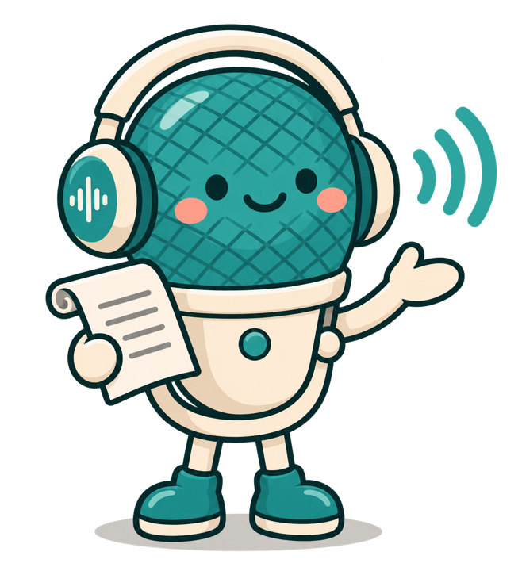<br>
  <sub>Typecast, ElevenLabs, Fish Audio, Airy, Gemini는 각 회사의 상표입니다. 이 프로젝트는 각 공급자의 공식 API를 사용합니다.</sub>
</p>
