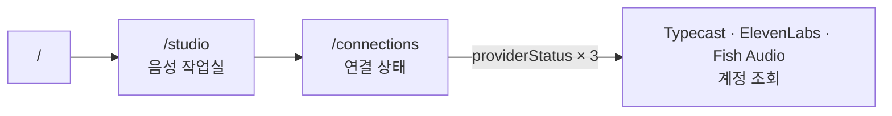

# 프로젝트 개관

이 문서는 서비스의 현재 모습을 적는다. 용어는 `GLOSSARY.md`, 결정 이유는 `docs/adr/`, 대상 사용자와 제품 어조는 `PRODUCT.md`(impeccable 스킬이 만든다)에 둔다. 기능을 바꾼 라운드는 닫기 전에 이 문서를 갱신하거나 대조표에 `N/A: 사유`를 적는다.

갱신은 해당 절의 표와 문장을 고치는 것이다. 날짜별 절이나 진행 경과를 덧붙이지 않는다(경과는 `tasks/archive/`에 남는다). 계획 중인 기능은 `기능` 표에 `계획` 상태로 넣고 스펙을 링크한다. 표의 `용어` 칸에는 `GLOSSARY.md`의 용어를 그대로 적는다.

## 한 줄 요약
개인 콘텐츠 제작자가 Typecast·ElevenLabs·Fish Audio 성우와 대본을 재사용하는 TTS 작업실을 계획 중이며, 현재 앱은 로컬 관리자 모드의 작업실 틀(T1), 공급자 연결 상태 화면(T2), 별도 HTML 시안 단계다.

## 사용자와 권한
| 역할 | 할 수 있는 일 | 확인 위치 |
|---|---|---|
| 로컬 관리자 | 로그인 없이 모든 기능. 개발 서버(`127.0.0.1`)에서만. production에서는 보호 프로시저가 모두 거절된다 | `packages/api/src/owner.ts`, `protectedProcedure`, `apps/web/src/context.ts` |

## 주요 흐름
사용자가 목적을 이루는 흐름을 화면(URL)과 프로시저로 그린다. 흐름이 바뀐 라운드에서 고친다.

## 기능
| 기능 | 상태 | 화면 | API | 스펙 |
|---|---|---|---|---|
| 작업실 틀 (로컬 관리자 모드) | 구현 | `/studio` | 없음(`healthCheck`는 동작 점검용) | [T1 스펙](../plans/tasks/T01-app-foundation.md) |
| 공급자 연결 상태 | 구현 | `/connections` | `providerStatus` | [T2 스펙](../plans/tasks/T02-provider-status.md) |
| 로그인 (소유자 전용) | 계획 | 없음 | 없음 | [구현 로드맵 T14](../plans/implementation-roadmap.md) |
| TTS 작업실 (P0) | 계획 | 없음 (HTML 시안 `docs/prototypes/tts-studio/index.html`) | 없음 | [요구사항](../plans/tts-service-requirements.md), [실서비스 기획·설계안](../briefs/tts-app-design.md), [구현 로드맵](../plans/implementation-roadmap.md) |

상태는 `계획`, `구현`, `중단` 가운데 하나다.

## 화면과 URL
| URL | 화면 | 보호 | 파일 |
|---|---|---|---|
| `/` | `/studio`로 이동 | 없음 | `apps/web/src/app/page.tsx` |
| `/studio` | 음성 작업실(제작 흐름 지도, 연결 상태 링크) | 없음(로컬 관리자 모드) | `apps/web/src/app/(app)/studio/page.tsx` |
| `/connections` | 연결 상태(세 공급자의 연결 상태와 잔여 사용량, 공급자별 다시 확인) | 없음(데이터는 `protectedProcedure`가 막는다. 소유자가 없으면 주소 안내) | `apps/web/src/app/(app)/connections/page.tsx` |
| (없는 주소) | 페이지를 찾을 수 없어요(앱 틀 안, 작업실로 가기) | 없음 | `apps/web/src/app/not-found.tsx` |

## API (oRPC)
| 프로시저 | 용어 | 보호 | 입력 | 설명 |
|---|---|---|---|---|
| `healthCheck` | 해당 없음 | 공개 | 없음 | 상태 확인 |
| `providerStatus` | 연결 상태, 잔여 사용량 | 보호(`protectedProcedure`) | `{ provider: "typecast" \| "elevenlabs" \| "fish_audio" }` | 서버 키로 공급자 계정을 한 번 조회해 연결 상태 8종과 잔여 사용량을 돌려준다. 키가 없으면 공급자를 부르지 않고 `no_key`다. 공급자 문제는 던지지 않고 값으로 돌려준다 |

## 데이터 모델과 코드 매핑
| 테이블 | 용어 | 스키마 파일 | 소유자 컬럼 | 설명 |
|---|---|---|---|---|
| `user` | 사용자 | `packages/db/src/schema/auth.ts` | 해당 없음 | Better Auth 생성물 (`pnpm auth:generate`) |
| `session`, `account`, `verification` | 해당 없음 | `packages/db/src/schema/auth.ts` | 해당 없음 | Better Auth 내부 테이블 |

## 범위 밖
아직 하지 않기로 한 것과 그 이유. 뒤로 미룬 기능도 여기에 옮긴다.

## UI 설계 산출물 (실제 서비스와 구분)

2026-09-26 개인 작업실 우선으로 제품 범위를 확정했다. `PRODUCT.md`가 제품 맥락이며 공개 가입·결제·팀은 후속이다. `docs/prototypes/tts-studio/index.html`은 별도 HTML UI 프로토타입이고 위 Next.js 라우트에 연결된 기능이 아니다. 실제 TTS·클론·DB 연결은 아직 구현 전이다. 앱 이관 순서와 검증 기준은 `docs/plans/tts-ui-first-implementation.md`에 있다.

용어사전은 [GLOSSARY.md](../../GLOSSARY.md)에 정리했다. 전체 성우 탐색(공급자 분류와 개인 타입 구분), 공급자별 즐겨찾기와 자주 사용의 계약은 [요구사항](../plans/tts-service-requirements.md)에 있으며 아직 실제 API·DB 기능은 아니다.

공급자별 생성 옵션과 추천·찾기·체인저·가져오기 흐름의 확장 설계는 [옵션·제작 도구 계획](../plans/tts-provider-options-and-tools.md)에 있다. Vrew식 자막 기능은 후속 요청 대상으로 유지한다.

HTML의 성우 분류는 [확정 브리프](../briefs/tts-voice-classification.md)에 따라 항목 관리·성우별 태그 배정·검색/필터를 연결하고 브라우저 로컬에 보존하는 시연이다. 대본·프리셋 분류 편집과 실제 DB 동기화는 후속이다. 성우 선택 창과 성우 보관함의 조건 줄은 공급자 분류 가운데 그 공급자 목록 API가 조회 조건이나 응답 필드로 주는 것만 보여 준다. 내 보이스 칩만 앱 기록(클론 소유)으로 거른다([공급자별 성우 필터 브리프](../briefs/tts-voice-provider-filters.md)). 실제 목록 조회와 페이지 나눔은 후속이다. 성우 캐스팅 페이지(`#casting`)는 성우를 먼저 고르는 화면이다. 조건이 없을 때는 API가 주는 인기 정렬(ElevenLabs·Fish Audio)과 콘텐츠(use_cases, Fish Audio는 태그)로 묶은 둘러보기를 먼저 보인다. 공급자 성우를 찾고, 기본 샘플과 내 대본으로 한 명씩 시험 생성해 듣고, 채널·카테고리·타입에 넣고 빼고, 작업실 기본 성우로 가져간다([성우 캐스팅 브리프](../briefs/tts-voice-casting.md)). 시험 생성은 시연이다. 실제 앱에서는 유료 생성 호출로 다룬다(REQ-03). 성우 보관함은 분류 정리용으로 남는다.

제작 도구 HTML은 로컬 파일·녹음 원본 준비, TXT/CSV/SRT/DOCX 파싱과 화자 배정, 문단 감정 계획 적용을 포함한다. 추천/유사 검색/변환/클론 결과는 명시적 시연이며 실제 API·DB가 아니다. 상세 범위: [전체 흐름 브리프](../briefs/tts-production-tools.md).

gowith 로그인 작업실 조사를 반영해 HTML 작업실을 문단 중심으로 설계했다. 대본은 늘 문단 카드 목록이고(한 덩어리 대본은 문단 1개), 좌측 레일(문단 일괄 작업·AI 보이스 도구), 우측 레일(작업 요약·역할별 성우·작업 설정·결과), 하단 작업 바(요약·시연 재생·음량·내려받기), 성우·도구 드로어로 구성한다. 프로젝트 보관함과 임시 작업 복구 배너, 보이스 디자인, 녹음 가이드, 사용량 내역, 다크 모드도 포함한다. 검토용 결과 선택(생성·AI 보이스 도구·감정 자동화의 성공과 실패)은 내비 하단 `시연 모드` 한곳에 모았다. 모두 시연이며 실제 기능은 `tasks/todo.md`의 P1-11~16, P2-09, P3-08 등으로 추적한다. 상세: [반영 브리프](../briefs/tts-gowith-reflection.md).

서비스별 공식 재조사와 후속 구현 순서는 [조사 기반 UX 설계](../plans/tts-research-driven-ux.md)에 있다. 제작 도구는 작업실 좌측 레일(좁은 화면은 툴바 `AI 도구`)에 상시 노출하고 드로어에서 열며, 가져오기에서 작업실 대본과 기존 문단 배정을 다시 편집할 수 있다. Vrew 참고 자막·영상 기능은 후속 구현으로 구분한다.

HTML 기준 실제 앱의 화면·상태·데이터 경계와 단계별 완료 조건은 [실서비스 기획·설계안](../briefs/tts-app-design.md)에 정리했다. 검토용 제안이며 현재 라우트·API·DB의 구현 상태는 위 표와 같다.
