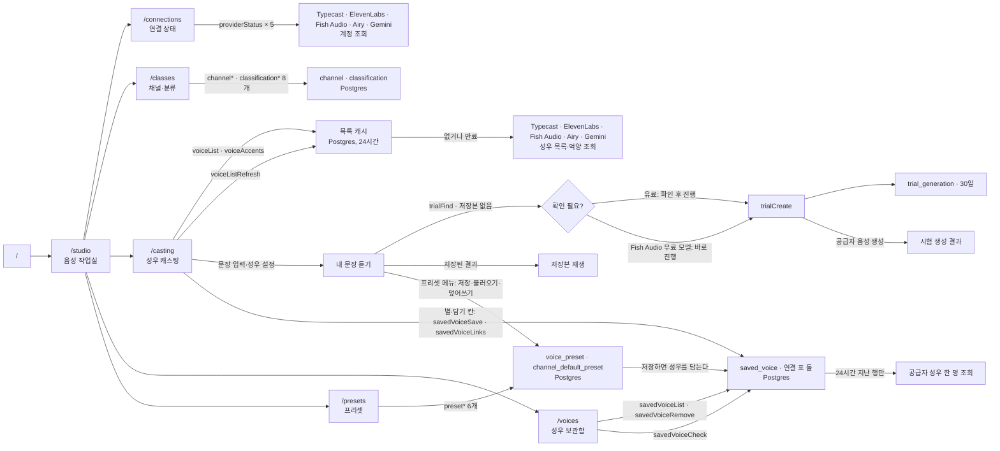

# 프로젝트 개관

이 문서는 서비스의 현재 모습을 적는다. 용어는 `GLOSSARY.md`, 결정 이유는 `docs/adr/`, 대상 사용자와 제품 어조는 `PRODUCT.md`(impeccable 스킬이 만든다)에 둔다. 기능을 바꾼 라운드는 닫기 전에 이 문서를 갱신하거나 대조표에 `N/A: 사유`를 적는다.

갱신은 해당 절의 표와 문장을 고치는 것이다. 날짜별 절이나 진행 경과를 덧붙이지 않는다(경과는 `tasks/archive/`에 남는다). 계획 중인 기능은 `기능` 표에 `계획` 상태로 넣고 스펙을 링크한다. 표의 `용어` 칸에는 `GLOSSARY.md`의 용어를 그대로 적는다.

## 한 줄 요약
개인 콘텐츠 제작자가 Typecast·ElevenLabs·Fish Audio·Airy·Gemini 성우와 대본을 재사용하는 TTS 작업실이다. 현재 앱은 로컬 관리자 모드의 작업실 틀(T1), 공급자 연결 상태(T2), 다섯 공급자 성우 캐스팅(T3·T4, Airy는 T7.5, Gemini는 T7.6), 성우별 내 문장 듣기(T5), 채널·카테고리·타입 관리(T6), 성우 보관함(T7), 프리셋(T8)을 제공한다.

## 사용자와 권한
| 역할 | 할 수 있는 일 | 확인 위치 |
|---|---|---|
| 로컬 관리자 | 서버가 정한 `context.ownerId` 한 명만 사용한다. `development`·`test`의 루프백 Host에서만 소유자가 생기며, Better Auth 가입이 열려 있어도 세션은 공급자 권한에 쓰지 않는다. production에서는 보호 프로시저가 모두 거절된다 | `packages/api/src/owner.ts`, `protectedProcedure`, `apps/web/src/context.ts` |

## 주요 흐름
사용자가 목적을 이루는 흐름을 화면(URL)과 프로시저로 그린다. 흐름이 바뀐 라운드에서 고친다.

## 기능
| 기능 | 상태 | 화면 | API | 스펙 |
|---|---|---|---|---|
| 작업실 틀 (로컬 관리자 모드) | 구현 | `/studio` | 없음(`healthCheck`는 동작 점검용) | [T1 스펙](../plans/tasks/T01-app-foundation.md) |
| 공급자 연결 상태 | 구현 | `/connections` | `providerStatus` | [T2 스펙](../plans/tasks/T02-provider-status.md) |
| 성우 캐스팅(다섯 공급자) | 구현 | `/casting` | `voiceList`, `voiceAccents`, `voiceListRefresh` | [T4 스펙](../plans/tasks/T04-casting-three-providers.md), [T3 스펙](../plans/tasks/T03-typecast-voices.md)(Typecast 판), [T7.5 스펙](../plans/tasks/T07.5-airy-provider.md)(Airy 추가), [T7.6 스펙](../plans/tasks/T07.6-gemini-provider.md), [T7.6 계획](../plans/tasks/T07.6-gemini-provider-plan.md)(Gemini 추가) |
| 내 문장 듣기(시험 생성) | 구현 | `/casting` | `trialModels`, `trialFind`, `trialCreate`, `trialList`, `trialAudio`, `trialDelete` | [T5 스펙](../plans/tasks/T05-my-sentence-listening.md), [T5 계획](../plans/tasks/T05-my-sentence-listening-plan.md) |
| 채널·분류 관리(채널, 카테고리, 타입 만들기·고치기·지우기) | 구현 | `/classes` | `channelList`, `channelCreate`, `channelUpdate`, `channelDelete`, `classificationList`, `classificationCreate`, `classificationUpdate`, `classificationDelete` | [T6 스펙](../plans/tasks/T06-channels-and-classifications.md), [T6 계획](../plans/tasks/T06-channels-and-classifications-plan.md), [채널·분류 브리프](../briefs/classes.md) |
| 성우 보관함(담기, 즐겨찾기·자주 사용·메모, 채널·카테고리·타입 붙이기, 필터, 현재 이용 불가 확인) | 구현 | `/voices`, `/casting`(행의 별, 패널의 담기 칸), `/classes`('성우 N명' 링크) | `savedVoiceList`, `savedVoiceSave`, `savedVoiceLinks`, `savedVoiceRemove`, `savedVoiceCheck`, `channelList`·`classificationList`의 `voiceCount` | [T7 스펙](../plans/tasks/T07-voice-library.md), [T7 계획](../plans/tasks/T07-voice-library-plan.md), [성우 보관함 브리프](../briefs/voices.md) |
| 프리셋(성우·모델·듣기 설정 저장, 불러오기·덮어쓰기, 이름·채널·채널 기본 고치기·복제·지우기) | 구현 | `/presets`, `/casting`('내 문장 듣기' 머리의 '프리셋' 메뉴), `/voices`('프리셋' 보기, 빼기 확인 문구) | `presetList`, `presetCreate`, `presetOverwrite`, `presetUpdate`, `presetDuplicate`, `presetRemove` | [T8 스펙](../plans/tasks/T08-presets.md), [T8 계획](../plans/tasks/T08-presets-plan.md), [프리셋 브리프](../briefs/presets.md), [ADR 0005](../adr/0005-channel-default-preset.md) |
| 로그인 (소유자 전용) | 계획 | 없음 | 없음 | [구현 로드맵 T14](../plans/implementation-roadmap.md) |
| TTS 작업실 (P0) | 계획 | 없음 (HTML 시안 `docs/prototypes/tts-studio/index.html`) | 없음 | [요구사항](../plans/tts-service-requirements.md), [실서비스 기획·설계안](../briefs/tts-app-design.md), [구현 로드맵](../plans/implementation-roadmap.md) |

상태는 `계획`, `구현`, `중단` 가운데 하나다.

## 화면과 URL
| URL | 화면 | 보호 | 파일 |
|---|---|---|---|
| `/` | `/studio`로 이동 | 없음 | `apps/web/src/app/page.tsx` |
| `/studio` | 음성 작업실(제작 흐름 지도: 채널 단계는 `/classes` 링크, 성우 단계는 `/casting` 링크, 연결 상태 링크) | 없음(로컬 관리자 모드) | `apps/web/src/app/(app)/studio/page.tsx` |
| `/connections` | 연결 상태(다섯 공급자의 연결 상태와 잔여 사용량, 공급자별 다시 확인, 카드 1280px 이상 3열·768~1279px 2열·767px 이하 1열. Gemini 카드는 잔액 조회 API가 없어 잔여 사용량 대신 안내 한 줄) | 없음(데이터는 `protectedProcedure`가 막는다. 소유자가 없으면 주소 안내) | `apps/web/src/app/(app)/connections/page.tsx` |
| `/casting` | 성우 캐스팅: 공급자 탭(전체·Typecast·ElevenLabs·Fish Audio·Airy·Gemini. Gemini는 한국어 성우와 대표 성우, 조건 줄은 구분·성별·피치·억양·콘텐츠·페르소나, 대표 성우만 참고 음성), 출처 전환, 조건 줄, 성우 행·더 보기, 위쪽 문장 바와 행의 '내 문장 듣기', 패널의 이용 조건·내 문장 듣기('프리셋' 메뉴: 저장·불러오기·덮어쓰기·'프리셋 관리' → `/presets`)·담기 칸·내 문장 결과 구역, 행 오른쪽 끝의 별(즐겨찾기, 담은 성우의 내 분류 칩·자주 사용 배지), 유료 생성 확인 창, 기본 샘플 재생(Gemini 대표 성우는 참고 음성). 담기 칸은 즐겨찾기·자주 사용·분류 붙이기(펼침에서 없는 이름 바로 만들기)·메모·'보관함에서 빼기'(확인 창)다 | 없음(데이터는 `protectedProcedure`, 소유자가 없으면 주소 안내) | `apps/web/src/app/(app)/casting/page.tsx` |
| `/voices` | 성우 보관함: 담은 성우를 최근 담은 순 행 목록으로 보이고(캐스팅과 같은 행, 별과 내 분류 칩, 내 문장 듣기는 없음), 이름 검색·보기(전체·즐겨찾기·자주 사용·프리셋, '프리셋'은 프리셋에 쓰는 담은 성우만)·공급자(Gemini 포함 다섯)·채널·카테고리·타입 조건 줄(그룹 안은 하나라도 맞으면, 그룹끼리는 모두 맞아야. 값은 주소 쿼리 `q`·`view`·`provider`·`channel`·`category`·`type`에 남는다), 상태 줄, 패널(기본 샘플·이용 조건·담기 칸, 현재 이용 불가 안내). 화면을 열면 24시간 지난 담은 성우를 서버가 공급자에 한 명씩 확인한다. 빈 상태는 '성우 캐스팅에서 찾기'. 1199px 이하 패널은 서랍 | 없음(데이터는 `protectedProcedure`가 막는다. 소유자가 없으면 주소 안내) | `apps/web/src/app/(app)/voices/page.tsx` |
| `/presets` | 프리셋: 이름순 한 목록(`/classes`와 같은 그릇). 줄마다 이름과 '기본' 배지, "{공급자} · {성우 이름}", 채널, 설정 요약, 상태 배지('성우를 다시 골라 주세요'·'현재 이용 불가'·'처음 값으로 바뀐 값 있음')와 고치기(입력 창)·복제(창 없이 바로)·지우기(확인 창). 개수 줄과 '성우 캐스팅으로' 링크, 빈 상태. 설정 값은 여기서 고치지 않고 캐스팅에서 덮어쓴다 | 없음(데이터는 `protectedProcedure`가 막는다. 소유자가 없으면 주소 안내) | `apps/web/src/app/(app)/presets/page.tsx` |
| `/classes` | 채널·분류: 채널·카테고리·타입 세 묶음을 위아래로 보이고(이름순), 묶음마다 만들기, 행마다 고치기(입력 창)·지우기(확인 창). 행마다 연결된 담은 성우가 있으면 '성우 N명' 링크(그 항목으로 걸러진 `/voices`로 간다), 삭제 확인 창에 "연결된 성우 N명은 보관함에 그대로 남고, 이 {그룹} 연결만 풀려요."가 붙는다. 767px 이하 메뉴는 위 막대 4칸 그대로이고 이 화면과 `/voices`는 더보기 안 '열린 화면' 줄에 있다 | 없음(데이터는 `protectedProcedure`가 막는다. 소유자가 없으면 주소 안내) | `apps/web/src/app/(app)/classes/page.tsx` |
| (없는 주소) | 페이지를 찾을 수 없어요(앱 틀 안, 작업실로 가기) | 없음 | `apps/web/src/app/not-found.tsx` |
| (화면 오류) | 문제가 생겼어요(앱 틀 안, 다시 시도하기: 실패한 조회를 처음 상태로 되돌려 다시 부름) | 없음 | `apps/web/src/app/(app)/error.tsx` |

## API (oRPC)
| 프로시저 | 용어 | 보호 | 입력 | 설명 |
|---|---|---|---|---|
| `healthCheck` | 해당 없음 | 공개 | 없음 | 상태 확인 |
| `providerStatus` | 연결 상태, 잔여 사용량 | 보호(`protectedProcedure`) | `{ provider: "typecast" \| "elevenlabs" \| "fish_audio" \| "airy" \| "gemini" }` | 서버 키로 공급자 계정을 조회해(Fish Audio는 API 충전 잔액 뒤 웹 플랜 크레딧까지 두 번. Gemini는 잔액 조회 API가 없어 한국어 성우 1명 조회로 키만 확인하고 잔여 사용량은 null) 연결 상태 8종과 잔여 사용량을 돌려준다. 키가 없으면 공급자를 부르지 않고 `no_key`다. 공급자 문제는 던지지 않고 값으로 돌려준다 |
| `voiceList` | 성우, 성우 카탈로그, 공개 성우 라이브러리, 계정 성우, 공급자 분류(콘텐츠), 기본 샘플, 참고 음성, 목록 캐시 | 보호(`protectedProcedure`) | 유니온: `{ provider: "typecast" }` \| `{ provider: "airy" }`(출처 공개, 조건 없음, 카탈로그 샘플) \| `{ provider: "gemini" }`(출처 공개, 조건 없음, 한국어 성우 117명과 대표 성우 30명을 한 번에, 조건은 화면이 거른다. 대표 성우만 참고 음성) \| `{ provider: "elevenlabs", source: "public", page, query }` \| `{ provider: "elevenlabs", source: "account", cursor, query }` \| `{ provider: "fish_audio", source, page, query }` | 서버 키로 성우 목록 한 페이지(100명씩, Typecast는 공개 성우 전체)를 목록 캐시를 거쳐 돌려준다. 출력은 성우 배열, `next`, `total`, `windowLimited`, 받은 시각 `fetchedAt`, `stale`이다. 공급자가 실패해도 지난 목록(만료 뒤 7일 안)이 있으면 `stale`(사유, 429면 `retryAt`)을 붙여 돌려준다. 계정 목록 행만 소유자별이다. 키가 없으면 공급자와 DB를 부르지 않고 `PRECONDITION_FAILED`. 지난 목록이 없으면 사유(`data.reason`)를 붙여 던진다 |
| `voiceAccents` | 공급자 분류, 목록 캐시 | 보호(`protectedProcedure`) | `{ language }` | ElevenLabs 억양 목록(억양 조건의 선택지). 공개 캐시 행을 쓴다. 입력 검사를 통과하지 못하는 값은 선택지에서 뺀다. 키가 없으면 `PRECONDITION_FAILED`, 지난 목록은 `stale` |
| `voiceListRefresh` | 목록 캐시, 계정 성우 | 보호(`protectedProcedure`) | `{ provider }` | '목록 새로 고침'. 공급자를 부르지 않고 그 공급자의 공개·억양 행과 이 소유자의 계정 행을 만료로 바꾼다(행은 지우지 않아 다시 받기가 실패해도 지난 목록을 보인다). 429 대기 시각 전이면 아무것도 바꾸지 않고 `retryAt`을 돌려준다. 화면이 이어서 그 공급자의 열린 목록(지금 목록과 '전체' 묶음)을 다시 받는다. 조건이 '전체' 묶음과 다르면 공급자 호출이 2회다(최종 리뷰 2026-10-05) |
| `trialModels` | 예상 사용량 | 보호(`protectedProcedure`) | 없음 | ElevenLabs 모델별 크레딧 배율을 목록 캐시에서 읽는다. 일반 조회 실패는 배율 1로 계산하지만, 조회 중 429 또는 새 대기 시각은 시험 생성을 중단한다 |
| `trialFind` | 저장된 결과 | 보호(`protectedProcedure`) | `TrialRequest` | 같은 소유자·공급자·성우·모델·정리된 설정·문장의 완료 결과를 찾는다. 있으면 오디오를 돌려주고 보관 만료를 30일 뒤로 늘린다. 공급자를 부르지 않는다 |
| `trialCreate` | 시험 생성, 말투 지시, 예상 사용량 | 보호(`protectedProcedure`) | `{ requestId, request }` | 키 없음·Fish Audio 무료 기간 종료를 먼저 확인한다. 기존 요청 ID는 429 대기 확인보다 먼저 상태·결과를 재생하고, 새 요청은 429 대기·모델 배율 확인과 기록 선점 뒤 한 번 생성한다. DB 실패면 공급자를 부르지 않으며 자동 재시도하지 않는다. 정상 Fish Audio 무료 모델은 확인 창 없이 생성한다. Airy는 언어·말투를 받고 예상 크레딧은 한국어 1.5배 올림이다. Gemini는 모델(Flash·Flash-Lite)과 말투 지시(100자)를 받고 `store: false`로 한 번 부르며 자동 재시도하지 않고 WAV를 돌려준다. 429에 `Retry-After`가 없으면 60초 대기다. 예상 사용량은 가정한 길이(1초 5글자) × 25토큰 × 단가를 `usd_micro`로 센 추정 금액이다 |
| `trialList` | 저장된 결과 | 보호(`protectedProcedure`) | `{ provider, voiceId }` | 해당 성우의 완료 결과 최신 20개를 오디오 없이 돌려준다 |
| `trialAudio` | 저장된 결과 | 보호(`protectedProcedure`) | `{ id }` | 소유자의 완료 오디오를 돌려주고 보관 만료를 30일 뒤로 늘린다 |
| `trialDelete` | 저장된 결과 | 보호(`protectedProcedure`) | `{ id }` | 진행 중이 아닌 소유자 결과를 앱 DB에서 지운다. 공급자 기록은 지우지 않는다 |
| `channelList` | 채널, 성우 보관함 | 보호(`protectedProcedure`) | 없음 | 이 소유자의 채널 `{ id, name, memo, url, voiceCount }` 배열(`voiceCount`는 연결된 담은 성우 수). 정렬은 화면이 이름순으로 한다 |
| `channelCreate` | 채널 | 보호(`protectedProcedure`) | `{ name, memo, url }` | 채널을 만든다. 같은 소유자에 대소문자만 다른 같은 이름이 있으면 `CONFLICT`(`data.reason: "duplicate_name"`, 이름 유니크 인덱스 위반만) |
| `channelUpdate` | 채널 | 보호(`protectedProcedure`) | `{ id, name, memo, url }` | 소유자의 채널을 고친다. 없거나 남의 것이면 `NOT_FOUND`(구분하지 않는다). 같은 이름이면 `CONFLICT` |
| `channelDelete` | 채널 | 보호(`protectedProcedure`) | `{ id }` | 소유자의 채널을 지우고 `{ deleted: true }`. 없거나 남의 것이면 `NOT_FOUND` |
| `classificationList` | 분류, 카테고리, 타입, 성우 보관함 | 보호(`protectedProcedure`) | 없음 | 이 소유자의 카테고리·타입 `{ id, kind, name, memo, voiceCount }` 배열(`voiceCount`는 연결된 담은 성우 수)(`kind`는 `category`·`type`). 정렬은 화면이 한다 |
| `classificationCreate` | 분류, 카테고리, 타입 | 보호(`protectedProcedure`) | `{ kind, name, memo }` | 카테고리 또는 타입을 만든다. 같은 소유자·같은 `kind` 안 같은 이름이면 `CONFLICT`(다른 `kind`와는 같아도 된다) |
| `classificationUpdate` | 분류, 카테고리, 타입 | 보호(`protectedProcedure`) | `{ id, name, memo }` | 소유자의 분류를 고친다. `kind`는 바꿀 수 없다. 없거나 남의 것이면 `NOT_FOUND`, 같은 이름이면 `CONFLICT` |
| `classificationDelete` | 분류, 카테고리, 타입 | 보호(`protectedProcedure`) | `{ id }` | 소유자의 분류를 지우고 `{ deleted: true }`. 없거나 남의 것이면 `NOT_FOUND` |
| `savedVoiceList` | 성우 보관함, 즐겨찾기 성우, 자주 사용하는 성우, 현재 이용 불가 | 보호(`protectedProcedure`) | 없음 | 이 소유자의 담은 성우 전부를 최근 담은 순으로 돌려준다. 항목은 `{ id, voice, favorite, frequent, memo, unavailable, channelIds, classificationIds }`이고 `checkedAt`·`savedAt`은 내보내지 않는다. 저장한 정보가 계약과 어긋난 옛 행은 이름 자리에 성우 id를 보인다. 성우 캐스팅의 별·칩·담기 칸도 이 목록으로 담겼는지 안다 |
| `savedVoiceSave` | 성우 보관함, 즐겨찾기 성우, 자주 사용하는 성우 | 보호(`protectedProcedure`) | `{ voice, favorite?, frequent?, memo? }` | 담기이자 바꾸기. 소유자 + 공급자 + 성우 id로 upsert한다(유니크 + `on conflict`라 동시에 두 번 담아도 한 행). 없으면 만들고(확인 시각은 지금), 있으면 정보·출처와 준 필드만 바꾼다. 다른 탭에서 뺀 성우도 다시 담긴다. `voice`는 목록에서 받은 값이라 서버가 다시 검사한다: 계약 모양, 샘플 주소가 https이고 그 공급자 호스트(Gemini는 경로까지)이며 해석 가능(`isSampleUrl`, 포트·사용자 정보가 붙은 주소는 거절), JSON 20,000자 이하, voiceId `[A-Za-z0-9_-]` 1~200자, Typecast·Airy·Gemini는 출처 `public`만. 메모는 채널·분류 메모 규칙(0~200자)이다. 담은 성우 한 명을 돌려준다 |
| `savedVoiceLinks` | 성우 보관함, 채널, 카테고리, 타입 | 보호(`protectedProcedure`) | `{ voice, channelIds, classificationIds }` | 한 트랜잭션에서 그 성우를 담고(이미 있으면 정보·출처를 넘긴 값으로 바꾼다) 채널·분류 연결을 이 목록으로 바꾼다. 목록은 각 50개까지이고 중복은 합친다. 하나라도 이 소유자 것이 아니거나 없으면(연결 중 지워져 외래 키 위반인 경우 포함) `NOT_FOUND`이고 담기까지 되돌린다. 담은 성우 한 명을 돌려준다 |
| `savedVoiceRemove` | 성우 보관함 | 보호(`protectedProcedure`) | `{ id }` | '보관함에서 빼기'. 소유자의 담은 성우를 지우고(연결도 함께 지워진다) `{ deleted: true }`. 없거나 남의 것이면 `NOT_FOUND` |
| `savedVoiceCheck` | 현재 이용 불가, 성우 보관함 | 보호(`protectedProcedure`) | 없음 | 확인한 적 없거나 마지막 확인이 24시간 지난 행 가운데 오래된 순 40명을 공급자에 한 명씩 조회하고 `savedVoiceList`와 같은 목록을 돌려준다. ElevenLabs 공개 라이브러리 성우는 조회 방법이 없어 확인하지 않는다(이용 불가로 만들지 않는다). 공급자마다 동시 2건(한 건 10초 제한)이고 공급자끼리는 서로 기다리지 않는다. 키가 없는 공급자와 대기 시각 전인 공급자는 건너뛴다. 공급자가 "없다"고 답하면 `unavailable`을 켜고, 성공하면 저장한 정보를 새 값으로 바꾸고 끈다. `rate_limit`이면 대기 시각(`Retry-After`가 없으면 60초 뒤)을 기록하고 그 공급자를 멈춘다. `provider_auth`·`no_permission`·`quota`면 기록 없이 그 공급자를 멈춘다. 5xx·시간 초과 같은 그 밖의 실패는 그 행을 그대로 둔다. Airy는 한 명 조회가 없어 확인 한 번에 공식 목록을 한 번 불러 id를 찾고, 없으면 unavailable이다. 공식 목록이 비거나 실패하면 판정하지 않는다. 카탈로그만 실패하면 저장한 샘플이 비워진다(T7.5-02). Gemini도 한 명 조회가 404라 같은 방식으로 한국어·대표 목록에서 id를 찾는다 |
| `presetList` | 프리셋, 채널 기본 프리셋 | 보호(`protectedProcedure`) | 없음 | 이 소유자의 프리셋 `{ id, name, provider, settings, savedVoiceId, voice, unavailable, channelId, channelDefault, fixed }` 배열. 서버는 정렬하지 않고 화면이 이름순으로 한다. `settings`는 읽을 때 공급자 설정 계약으로 다시 검사하고, 쓸 수 없는 값은 처음 값으로 바꿔 `fixed`를 켠다. 담은 성우가 빠졌으면 `savedVoiceId`·`voice`가 null이다 |
| `presetCreate` | 프리셋, 채널 기본 프리셋, 성우 보관함 | 보호(`protectedProcedure`) | `{ name, provider, voice, settings, channelId, channelDefault }` | 한 트랜잭션에서 고른 채널이 내 것인지 보고, 성우를 보관함에 담고(즐겨찾기·자주 사용·메모는 그대로), 프리셋을 만들고, `channelDefault`면 그 채널의 기본을 이 프리셋으로 바꾼다. 같은 소유자 안 대소문자만 다른 같은 이름이면 `CONFLICT`(`data.reason: "duplicate_name"`, 이름 유니크 인덱스 위반만). 없거나 남의 채널·고르는 사이 지워진 채널·성우는 `NOT_FOUND`. 공급자를 부르지 않는다 |
| `presetOverwrite` | 프리셋, 성우 보관함 | 보호(`protectedProcedure`) | `{ id, provider, voice, settings }` | '덮어쓰기'. 프리셋의 성우(보관함에 담음)와 설정을 바꾼다. 이름·채널·기본은 그대로다. 프리셋의 공급자와 다르면 `BAD_REQUEST`(설정 칸이 공급자마다 달라 공급자를 바꾸지 않는다). 없거나 남의 것이면 `NOT_FOUND` |
| `presetUpdate` | 프리셋, 채널 기본 프리셋 | 보호(`protectedProcedure`) | `{ id, name, channelId, channelDefault }` | 이름·채널·채널 기본을 고친다. 설정과 성우는 바꾸지 않는다. 채널을 바꾸거나 비우면 이전 채널의 기본 지정을 풀고, `channelDefault`면 새 채널의 기본을 이 프리셋으로 바꾼다. 같은 이름이면 `CONFLICT`, 없거나 남의 프리셋·채널이면 `NOT_FOUND` |
| `presetDuplicate` | 프리셋 | 보호(`protectedProcedure`) | `{ id }` | 프리셋을 복제한다. 새 이름은 '{이름} 사본', '{이름} 사본 2'… 순서로 비어 있는 첫 이름이고, 채널 기본은 복제하지 않는다(채널마다 하나). 없거나 남의 것이면 `NOT_FOUND`, 같은 이름과 겹치면 `CONFLICT` |
| `presetRemove` | 프리셋, 채널 기본 프리셋 | 보호(`protectedProcedure`) | `{ id }` | 소유자의 프리셋을 지우고 `{ deleted: true }`. 그 프리셋의 채널 기본 지정도 함께 지워진다. 이미 만든 내 문장 결과는 그대로다. 없거나 남의 것이면 `NOT_FOUND` |

채널·분류 입력 규칙(`packages/api/src/classification-rules.ts`, 화면과 서버가 같이 쓴다)은 아래와 같다. 원문이 1,000자를 넘으면 규칙을 보기 전에 입력 검증이 거절한다. 입력은 서버가 정한 `context.ownerId`로만 소유자를 정하고 `ownerId` 같은 키는 버려진다. 이름 중복 말고 저장소 오류는 `INTERNAL_SERVER_ERROR`로 오류 이름·DB 코드 한 줄만 로그에 남긴다.
- 이름·메모 정리: 보이지 않는 글자(C0·C1 제어 문자, 폭 없는 공백, 단어 결합자, BOM, 양방향 제어 문자 U+202A~202E·U+2066~2069)를 지우고 한글 채움 문자는 공백으로 본다. 이모지를 잇는 ZWJ(U+200D)는 남긴다. 이어서 NFC, 앞뒤 공백 제거, 연속 공백(줄바꿈·탭·전각 공백 포함)을 하나로 바꾼다.
- 길이(코드 포인트): 이름 1~40자, 메모 0~200자(비면 없음), 채널 주소 0~500자.
- 채널 주소: 앞뒤 공백만 지우고 그대로 저장한다(비면 없음). `http:`·`https:`만 받고, 제어 문자가 들어 있으면 거절한다.

## 데이터 모델과 코드 매핑
| 테이블 | 용어 | 스키마 파일 | 소유자 컬럼 | 설명 |
|---|---|---|---|---|
| `user` | 사용자 | `packages/db/src/schema/auth.ts` | 해당 없음 | Better Auth 생성물 (`pnpm auth:generate`) |
| `session`, `account`, `verification` | 해당 없음 | `packages/db/src/schema/auth.ts` | 해당 없음 | Better Auth 내부 테이블 |
| `provider_list_cache` | 목록 캐시(코드 `providerListCache`) | `packages/db/src/schema/provider-cache.ts` | `owner_id`(null 허용, `user` 외래 키 없음) | 공급자 성우 목록 한 페이지를 조건별로 24시간 보관한다([ADR 0003](../adr/0003-postgres-cache.md)). 키는 소유자·공급자·목록 종류(`public`·`account`·`accents`)·정규화한 조건의 해시·계약 판(`CONTRACT_VERSION`)이고 `NULLS NOT DISTINCT` 유니크다. 계정 목록 행만 소유자 id가 있고 공개·억양 행은 null(소유자끼리 함께 씀). 지워도 되는 데이터라 `user` 외래 키를 걸지 않는다. 만료 뒤 7일이 지난 행은 쓰기 때 지운다 |
| `provider_cooldown` | 공급자 대기 시각(코드 `providerCooldown`) | `packages/db/src/schema/provider-cache.ts` | 해당 없음(공급자별 한 행) | 공급자 429 `Retry-After`로 정한 다음 호출 가능 시각(1시간 상한). 그 전에는 그 공급자를 부르지 않는다. 서버 인스턴스끼리 메모리를 나누지 않으므로 DB에 둔다. T4 목록과 T5 시험 생성이 이 표를 쓴다 |
| `channel` | 채널 | `packages/db/src/schema/classification.ts` | `owner_id`(서버가 정한 소유자, `user` 외래 키 없음, [ADR 0004](../adr/0004-channel-classification-storage.md)) | 채널 이름·메모(null 허용)·채널 주소(`url`, null 허용). 같은 소유자 안에서 `lower(name)` 유니크 인덱스 `channel_name`으로 대소문자만 다른 중복을 막는다. 프리셋(`voice_preset.channel_id`, `on delete set null`)이 하나만 가리키고, 채널 기본은 `channel_default_preset`이 따로 가리킨다([ADR 0005](../adr/0005-channel-default-preset.md)). 저장 대본(T12)이 하나만 가리킬 예정이다 |
| `classification` | 분류, 카테고리, 타입 | `packages/db/src/schema/classification.ts` | `owner_id`(서버가 정한 소유자, `user` 외래 키 없음, [ADR 0004](../adr/0004-channel-classification-storage.md)) | 카테고리와 타입을 한 표에 `kind`(`category`·`type`, check `classification_kind`)로 둔다. 이름·메모(null 허용). `(owner_id, kind, lower(name))` 유니크 인덱스 `classification_name`이 같은 `kind` 안 중복을 막는다(카테고리 '경제'와 타입 '경제'는 가능). 성우(`saved_voice_classification`)에 여러 개 붙고, 저장 대본(T12)에도 붙일 예정이다 |
| `saved_voice` | 성우 보관함, 즐겨찾기 성우, 자주 사용하는 성우, 현재 이용 불가 | `packages/db/src/schema/saved-voice.ts` | `owner_id`(서버가 정한 소유자, `user` 외래 키 없음, [ADR 0004](../adr/0004-channel-classification-storage.md)와 같다) | 담기 = 행 하나. `(owner_id, provider, voice_id)` 유니크 `saved_voice_voice`가 같은 성우를 한 번만 담고 담기 upsert의 충돌 대상이다. `source`(`public`·`account`)는 담은 출처일 뿐 키가 아니다. `favorite`·`frequent`(기본 false), `memo`(null 허용), `voice`(담을 때와 확인에 성공할 때 받은 계약 `Voice` jsonb, 읽을 때 `voiceSchema`로 다시 검사), `unavailable`(공급자가 없다고 답했다), `checked_at`(마지막 확인 시각, 담을 때는 지금), `saved_at`. 인덱스 `saved_voice_owner_saved(owner_id, saved_at desc)`, check `saved_voice_provider`(다섯 공급자, T7.6 마이그레이션)·`saved_voice_source`. 즐겨찾기·자주 사용을 꺼도 남고 '보관함에서 빼기'(`savedVoiceRemove`)로만 지워진다. 프리셋(`voice_preset.saved_voice_id`)이 이 행을 가리키고, 프리셋을 만들면 성우가 여기에 담긴다. 작업실 성우 고르기·최근 사용(T9), 내 보이스(T13)가 이 행에 붙을 예정이다 |
| `saved_voice_channel` | 성우 보관함, 채널 | `packages/db/src/schema/saved-voice.ts` | 없음(`saved_voice`를 따라간다. 붙일 때 `savedVoiceLinks`가 그 채널이 같은 소유자 것인지 검사한다) | 성우 ↔ 채널 연결. 기본 키 `(saved_voice_id, channel_id)`, 두 컬럼 모두 외래 키 `on delete cascade`(어느 쪽을 지워도 연결만 지워지고 성우는 남는다), 채널 쪽 인덱스 `saved_voice_channel_channel`. `channelList`의 `voiceCount`가 이 표의 행 수다 |
| `saved_voice_classification` | 성우 보관함, 분류, 카테고리, 타입 | `packages/db/src/schema/saved-voice.ts` | 없음(위와 같다) | 성우 ↔ 카테고리·타입 연결. 기본 키 `(saved_voice_id, classification_id)`, 두 컬럼 모두 외래 키 `on delete cascade`, 분류 쪽 인덱스 `saved_voice_classification_classification`. `classificationList`의 `voiceCount`가 이 표의 행 수다 |
| `voice_preset` | 프리셋 | `packages/db/src/schema/preset.ts` | `owner_id`(서버가 정한 소유자, `user` 외래 키 없음, ADR 0004와 같다) | 한 공급자의 담은 성우·설정 조합에 이름을 붙인 것. `name`, `provider`(check `voice_preset_provider`, 다섯 공급자), `saved_voice_id`(→ `saved_voice`, `on delete set null`, null이면 '성우를 다시 골라 주세요'), `settings`(모델 포함 그 공급자 설정 jsonb, 쓸 때 정리하고 읽을 때 `readSettings`로 다시 검사), `channel_id`(→ `channel`, `on delete set null`). `(owner_id, lower(name))` 유니크 인덱스 `voice_preset_name`이 대소문자만 다른 중복을 막는다(동시 저장 포함). `saved_voice_id`·`channel_id` 인덱스는 보관함 빼기·채널 지우기의 set null이 쓴다. 성우를 보관함에서 빼거나 채널을 지워도 프리셋은 남는다 |
| `channel_default_preset` | 채널 기본 프리셋 | `packages/db/src/schema/preset.ts` | 없음(`channel`·`voice_preset`을 따라간다. 기본 지정 때 프로시저가 같은 트랜잭션에서 프리셋의 채널과 맞춘다) | 채널 ↔ 기본 프리셋 연결. 기본 키 `channel_id`(채널마다 하나), `preset_id`는 유니크 인덱스(프리셋은 한 채널의 기본만 된다). 두 컬럼 모두 외래 키 `on delete cascade`라 채널이나 프리셋을 지우면 이 줄만 지워진다. 채널과 프리셋이 서로 가리키지 않게 따로 둔 표다([ADR 0005](../adr/0005-channel-default-preset.md)) |
| `trial_generation` | 생성 기록, 저장된 결과 | `packages/db/src/schema/trial-generation.ts` | `owner_id`(서버가 정한 소유자) | 요청 ID를 공급자 호출 전에 소유자별로 선점하고 상태·정리된 요청·예상 사용량을 기록한다. 공급자 검사 제약에 `airy`(T7.5)와 `gemini`(T7.6)가 들어 있다. 사용량 단위(`usage_unit`)는 `credit`·`byte`·`free`·`usd_micro`이고 `usd_micro`는 Gemini 추정 금액(백만분의 1달러 정수, 생성 때 정한 값)이다. 완료된 오디오를 bytea로 저장하며 형식은 `audio_type`이다(MP3 `audio/mpeg`, Gemini WAV `audio/wav`, 없으면 MP3로 본다). 완료 결과는 마지막 재생 뒤 30일 보관한다. 만료 행은 새 결과를 저장할 때 정리하고 사용자가 결과를 지울 수 있다. 동시 생성은 소유자별 한 건이다 |

DB 컨테이너(Podman, 5433)가 꺼져 있으면 목록 캐시 없이 동작한다. 연결·질의가 3초 안에 안 되면 `[voiceCache]` 실패 줄만 남기고 목록 공급자를 바로 부르므로, 같은 조건도 매번 공급자를 부른다. 유료 시험 생성은 생성 기록·429 대기 조회가 실패하면 공급자를 부르지 않는다. 채널·분류는 캐시가 아니라 원본이라 DB가 꺼져 있으면 목록 조회와 저장이 실패하고 `/classes`가 오류와 '다시 불러오기'를 보인다. 성우 보관함(`saved_voice`)도 원본이라 같다: 담기·연결이 실패하면 저장 실패 알림이 뜨고 별·칩은 서버 값으로 돌아간다. 목록 조회가 실패하면 `/voices`는 오류와 '다시 불러오기'를 보인다(알림 없음). 이용 가능 확인의 실패는 알리지 않는다. 이용 가능 확인은 공급자를 읽기로만 부르고(조회 과금 문구가 다섯 공급자 문서에 없다), 확인에 실패해도 담은 성우 목록은 저장한 정보 그대로 보인다.

## 범위 밖
아직 하지 않기로 한 것과 그 이유. 뒤로 미룬 기능도 여기에 옮긴다.

## UI 설계 산출물 (실제 서비스와 구분)

2026-09-26 개인 작업실 우선으로 제품 범위를 확정했다. `PRODUCT.md`가 제품 맥락이며 공개 결제·팀은 후속이다. `docs/prototypes/tts-studio/index.html`은 별도 HTML UI 프로토타입이고 위 Next.js 라우트에 연결되지 않는다. 실제 앱의 현재 기능은 이 문서의 기능·API·데이터 표를 따른다. HTML 시안의 대본 제작 도구와 클론 등 나머지 기능은 해당 로드맵 순서를 따른다.

용어사전은 [GLOSSARY.md](../../GLOSSARY.md)에 정리했다. 전체 성우 탐색(공급자 분류와 개인 타입 구분)의 계약은 [요구사항](../plans/tts-service-requirements.md)에 있으며 아직 실제 API·DB 기능은 아니다. 즐겨찾기와 자주 사용은 T7에서 `saved_voice`로 구현했다. 자주 사용 순위·최근 사용(T9)은 아직 없다. 프리셋 포함 여부는 성우 보관함의 '프리셋' 보기로 거른다(T8).

공급자별 생성 옵션과 추천·찾기·체인저·가져오기 흐름의 확장 설계는 [옵션·제작 도구 계획](../plans/tts-provider-options-and-tools.md)에 있다. Vrew식 자막 기능은 후속 요청 대상으로 유지한다.

HTML의 성우 분류는 [확정 브리프](../briefs/tts-voice-classification.md)에 따라 항목 관리·성우별 태그 배정·검색/필터를 연결하고 브라우저 로컬에 보존하는 시연이다. 대본·프리셋 분류 편집과 실제 DB 동기화는 후속이다. 성우 선택 창과 성우 보관함의 조건 줄은 공급자 분류 가운데 그 공급자 목록 API가 조회 조건이나 응답 필드로 주는 것만 보여 준다. 내 보이스 칩만 앱 기록(클론 소유)으로 거른다([공급자별 성우 필터 브리프](../briefs/tts-voice-provider-filters.md)). 실제 목록 조회와 페이지 나눔은 후속이다. 성우 캐스팅 페이지(`#casting`)는 성우를 먼저 고르는 화면이다. 조건이 없을 때는 API가 주는 인기 정렬(ElevenLabs·Fish Audio)과 콘텐츠(use_cases, Fish Audio는 태그)로 묶은 둘러보기를 먼저 보인다. 공급자 성우를 찾고, 기본 샘플과 내 대본으로 한 명씩 시험 생성해 듣고, 채널·카테고리·타입에 넣고 빼고, 작업실 기본 성우로 가져간다([성우 캐스팅 브리프](../briefs/tts-voice-casting.md)). 시험 생성은 시연이다. 실제 앱에서는 유료 생성 호출로 다룬다(REQ-03). 성우 보관함은 분류 정리용으로 남는다.

제작 도구 HTML은 로컬 파일·녹음 원본 준비, TXT/CSV/SRT/DOCX 파싱과 화자 배정, 문단 감정 계획 적용을 포함한다. 추천/유사 검색/변환/클론 결과는 명시적 시연이며 실제 API·DB가 아니다. 상세 범위: [전체 흐름 브리프](../briefs/tts-production-tools.md).

gowith 로그인 작업실 조사를 반영해 HTML 작업실을 문단 중심으로 설계했다. 대본은 늘 문단 카드 목록이고(한 덩어리 대본은 문단 1개), 좌측 레일(문단 일괄 작업·AI 보이스 도구), 우측 레일(작업 요약·역할별 성우·작업 설정·결과), 하단 작업 바(요약·시연 재생·음량·내려받기), 성우·도구 드로어로 구성한다. 프로젝트 보관함과 임시 작업 복구 배너, 보이스 디자인, 녹음 가이드, 사용량 내역, 다크 모드도 포함한다. 검토용 결과 선택(생성·AI 보이스 도구·감정 자동화의 성공과 실패)은 내비 하단 `시연 모드` 한곳에 모았다. 모두 시연이며 실제 기능은 `tasks/todo.md`의 P1-11~16, P2-09, P3-08 등으로 추적한다. 상세: [반영 브리프](../briefs/tts-gowith-reflection.md).

서비스별 공식 재조사와 후속 구현 순서는 [조사 기반 UX 설계](../plans/tts-research-driven-ux.md)에 있다. 제작 도구는 작업실 좌측 레일(좁은 화면은 툴바 `AI 도구`)에 상시 노출하고 드로어에서 열며, 가져오기에서 작업실 대본과 기존 문단 배정을 다시 편집할 수 있다. Vrew 참고 자막·영상 기능은 후속 구현으로 구분한다.

HTML 기준 실제 앱의 화면·상태·데이터 경계와 단계별 완료 조건은 [실서비스 기획·설계안](../briefs/tts-app-design.md)에 정리했다. 검토용 제안이며 현재 라우트·API·DB의 구현 상태는 위 표와 같다.
