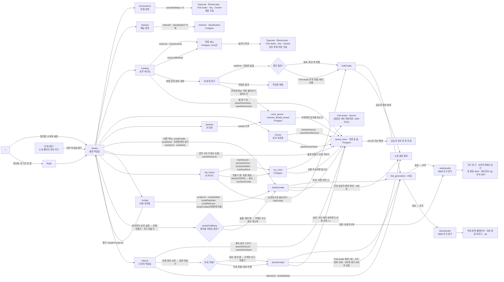

# 프로젝트 개관

이 문서는 서비스의 현재 모습을 적는다. 용어는 `GLOSSARY.md`, 결정 이유는 `docs/adr/`, 대상 사용자와 제품 어조는 `PRODUCT.md`(impeccable 스킬이 만든다)에 둔다. 기능을 바꾼 라운드는 닫기 전에 이 문서를 갱신하거나 대조표에 `N/A: 사유`를 적는다.

갱신은 해당 절의 표와 문장을 고치는 것이다. 날짜별 절이나 진행 경과를 덧붙이지 않는다(경과는 `tasks/archive/`에 남는다). 계획 중인 기능은 `기능` 표에 `계획` 상태로 넣고 스펙을 링크한다. 표의 `용어` 칸에는 `GLOSSARY.md`의 용어를 그대로 적는다.

## 한 줄 요약
개인 콘텐츠 제작자가 Typecast·ElevenLabs·Fish Audio·Airy·Gemini 성우와 대본을 재사용하는 TTS 작업실이다. 현재 앱은 소유자 한 명이 로그인해 쓰는 작업실 틀(T1, 로그인은 T14), 공급자 연결 상태(T2), 다섯 공급자 성우 캐스팅(T3·T4, Airy는 T7.5, Gemini는 T7.6), 성우별 내 문장 듣기(T5), 채널·카테고리·타입 관리(T6), 성우 보관함(T7), 프리셋(T8), 문단 작업실(T9의 음성 작업실을 T10-a가 다섯 공급자 문단 작업실로 다시 만듦, T11 숫자 발음 검수), Fish Audio 드라마 장면 생성(T9.5, 드라마 작업실)을 제공한다.

## 사용자와 권한
| 역할 | 할 수 있는 일 | 확인 위치 |
|---|---|---|
| 소유자 | 이메일·비밀번호로 로그인한 세션의 이메일이 서버 환경 변수 `OWNER_EMAILS`를 정리한 값 정확히 하나와 같을 때만 `context.ownerId = user.id`다(T14, [ADR 0012](../adr/0012-session-owner-single-allowlist.md)). 목록이 비거나 둘 이상이면 아무도 소유자가 아니다. 공개 가입은 서버에서 막히고(`disableSignUp`), 계정은 로컬 DB에서만 `pnpm owner:create`로 만든다([계정 안내](../owner-account.md)). 로그인하지 않으면 `/`·`/login` 밖의 페이지는 `/login`으로 간다(proxy 쿠키 확인 + `(app)/layout`의 서버 판정) | `packages/api/src/owner.ts`, `apps/web/src/context.ts`(`readOwner`·`getOwnerSession`), `apps/web/src/proxy.ts`, `protectedProcedure` |
| 배포 | 같은 코드를 두 곳에 배포한다(T15-a2, [ADR 0015](../adr/0015-public-demo-separate-deploy.md)): 본인용 작업실 `https://omni-ai-tts-studio.vercel.app`(`APP_MODE=owner`, 공급자 키, 운영 DB, 검색 노출 막음)과 공개 데모 `https://omni-ai-tts.vercel.app`(`APP_MODE=demo`, 공급자 키 없음, 예시 데이터 Neon `live` 브랜치, 매일 초기화). 두 곳 모두 Vercel Hobby `sin1`, Firewall로 한국 밖 접속 거절. 로그인은 IP당 1분 5회(본인용). `/api/rpc` 최대 300초, 늦은 결과는 `after`로 저장 | `apps/web/vercel.json`, `apps/web/next.config.ts`, `scripts/vercel-deploy.mjs`, `.github/workflows/demo-reset.yml` |
| 방문자(공개 데모) | 로그인 없이 공개 데모 전체를 쓴다. 세션 없이 예시 소유자(`OWNER_EMAILS`의 데모 계정)로 정해지고, 공급자·OpenAI 키가 하나라도 있으면 소유자를 정하지 않는다. 만들기·시험 생성·드라마는 데모 샘플을 돌려주고 클론·자동 태그·목록 새로 고침은 공급자를 부르지 않는다. 인증 경로는 404 | `apps/web/src/context.ts`, `packages/api/src/owner.ts`, `packages/api/src/demo/client.ts`, `apps/web/src/app/api/auth/[...all]/route.ts` |
| 로그인하지 않은 사람(본인용) | `/`와 다른 화면은 `/login`으로 간다. 데이터는 `protectedProcedure`가 막는다 | `apps/web/src/proxy.ts`, `apps/web/src/app/page.tsx` |
| 소유자가 아닌 로그인 사용자 | '접근 권한 없음'과 로그아웃만 본다(`/`에서는 공개 소개 페이지). 보호 프로시저는 모두 `UNAUTHORIZED` | `apps/web/src/app/login/page.tsx` |

## 주요 흐름
사용자가 목적을 이루는 흐름을 화면(URL)과 프로시저로 그린다. 흐름이 바뀐 라운드에서 고친다.

문단 작업실 흐름은 이렇다. 대본을 문단 카드로 나누고(빈 줄 기준 붙여 넣기, 카드 ⋯의 나누기·합치기), 기본 성우를 정하면 문단마다 다섯 공급자의 담은 성우나 프리셋을 따로 붙이고 '설정'으로 바꿀 수 있다. 문단 뒤 쉼은 0.1초 단위(처음 0.5초)다. 화면은 문단마다 요청을 만들어 `studioFindMany`로 저장된 결과를 한 번에 찾고(입력이 0.6초 멈춘 뒤, 모르는 서명만), 찾은 문단은 '만듦'으로 보인다. '전체 만들기'는 안 만든 문단을 차례로 한 번에 하나씩 `studioCreate`로 보낸다. 유료이거나 처리 여부 미확인 문단이 있으면 먼저 확인 창(공급자별 예상 사용량)을 거치고, 보내기 직전에 문단을 다시 봐서 고쳐졌으면 보내지 않고 '안 만듦'으로 남긴다. 카드 '만들기'는 한 문단만 같은 길로 만든다. 응답에는 오디오가 없고 화면이 `studioAudio`로 3MiB씩 받아 합친다. 180초 안에 답이 없으면 '처리 여부 미확인'으로 두고 자동으로 다시 요청하지 않으며, 늦게 오는 오디오로 같은 기록이 완료로 바뀌는 것은 Typecast만이다. 받기('한 파일로 받기 (WAV)'·'문단마다 받기 (zip)'·'자막 받기 (SRT)')와 이어 듣기는 공급자를 부르지 않는다. 문단 결과 오디오를 한 파일로 잇는 일은 서버가 아니라 브라우저(Web Audio)가 한다([ADR 0007](../adr/0007-paragraph-join-in-browser.md)).

숫자 발음 검수(T11)는 공급자를 부르지 않는다. 화면이 문단 원문에서 교정 항목(숫자 표기)을 찾아 한글 읽기를 제안하고(자체 규칙 엔진, 숫자 검수 창을 열 때 Typecast AutoTag 읽기를 참고 후보로 함께 보임, [ADR 0009](../adr/0009-number-reading-own-rules.md)), 사용자가 숫자 검수 창에서 항목마다 적용·원문 유지·직접 입력을 고른다. 결정은 그 문단의 임시 작업에 결정할 때의 원문과 함께 남고, 원문이 바뀌면 그 문단 결정이 무효가 된다. 요청·글자 수·상한·예상 사용량·저장된 결과 찾기는 결정을 반영한 발음용 대본 기준이고, 검수하지 않은 숫자는 원문대로 보낸다. 검수 안 한 숫자가 있는 문단을 만들면 무료여도 확인 창이 '검수하기'·'원문대로 만들기'를 묻는다. 재생기·자막(SRT)·파일 이름과 자동 태그 추천은 원문을 쓴다.

드라마 작업실 흐름은 이렇다. 화자(최대 4명)마다 다섯 공급자의 담은 성우나 프리셋을 붙이고(전체 목록에서 고르면 보관함에도 담긴다), 줄 단위 대본(화자·연기 지시·대사, 한 줄이 번호·화자 칩·지시·대사·동작의 한 층 격자)을 쓰거나 `이름: 대사`로 붙여 넣는다. 줄에는 그 화자 공급자가 받는 연기 값(지시, 대사 안 태그, Typecast 감정과 강도, Airy 말투)을 넣는다. 알약은 마지막으로 포커스한 줄 바로 아래 도구줄에서 누르고, 줄 메뉴의 '연기 지시 넣기'가 그 도구줄로 포커스를 옮긴다. 화자가 모두 Fish Audio이면 머리에서 모델(`s2.1-pro-free`·`s2.1-pro`·`drama-3`)을 고르고 막대의 '장면 만들기'를 누른다(붙은 ▾ '다른 방법'에 '줄마다 읽기'). 유료 모델 둘은 확인 창을 거친다. `dramaCreate`가 장면 전체를 Fish Audio 한 번의 요청으로 만들고(`<|speaker:N|>` + `reference_id` 배열, PCM으로 받아 서버가 WAV 머리를 붙임) 응답의 시각 정보로 줄 구간을 나눠 기록한다. 시각 정보가 없거나 글자가 맞지 않으면 장면만 저장하고 대사별 파일은 '나누지 못함'이다. 같은 대본으로 테이크를 여러 번 만들 수 있고, 화면이 `dramaAudio`로 3MiB씩 받은 장면 WAV를 줄 구간으로 잘라 대사 파일(WAV)을 만든다. 무대에 테이크가 있으면 막대가 테이크 모드가 되어 결과 칸에 테이크 넘기기와 장면 플레이어를 보이고, '받기' 메뉴가 그 테이크의 '장면 파일 (WAV)'·'쉼 넣어 한 파일로 (WAV)'(줄마다 고른 테이크 조각을 줄 사이 쉼으로 이음)·'대사별 파일 (zip)'(줄마다 고른 테이크의 대사 파일)을 낸다. 줄 ▶는 나뉜 같은 대본 테이크의 그 줄 조각을 틀고, 같은 대본 테이크가 둘 이상이면 줄마다 '받을 테이크 ▾'로 고른다. 무대는 테이크가 있거나 만드는 중일 때만 그리며 캡션·안내·시간축(누르면 막대 플레이어가 그 줄부터)·대사별 파일 안내·'모든 줄을 이 테이크로'를 둔다. 듣기·받기·무대에 올리기는 공급자를 부르지 않는다. 180초 안에 답이 없으면 '처리 여부 미확인'으로 두고 자동으로 다시 요청하지 않으며, 요청은 300초까지 뒤에서 기다려 그 안에 오디오가 오면 같은 테이크가 완료로 바뀐다.

'읽기'는 화자에 다섯 공급자 성우가 섞여도 줄 순서대로 그 화자 성우로 듣는다. 누르면 읽을 줄을 `trialFindMany`로 한 번에 찾고(오디오 없음), 줄 차례에 찾은 줄은 `trialAudio`로 소리를 받는다. 찾지 못한 줄은 `trialFind`를 한 번 더 부르고 그래도 없을 때만 `trialCreate`로 만든다. 줄마다 내 문장 듣기(`kind = 'trial'`) 생성 기록을 쓰므로 같은 조합은 공급자를 다시 부르지 않는다. 줄의 ▶는 테이크 모드가 아니면 그 줄 하나만 같은 길로 읽는다('이 줄만 읽기'. 저장된 소리는 호출 없이 틀고, 새로 만들 줄이 유료·미확인이면 읽기 확인 창, 무료면 바로 만든다). 막대의 '받기' 메뉴(테이크 모드가 아닐 때)는 읽지 않아도 누른 때의 대본 전체를 읽기와 같은 길(재생 없이, 줄을 한 줄씩 차례로)로 준비해 '한 파일로 받기 (WAV)', '줄마다 받기 (zip)'(공급자 형식 그대로 zip 하나)로 낸다. 모든 줄 소리가 이 화면에 준비되면 결과 칸에 '이어 듣기' 단추가 생기고, 아니면 회색 안내다. 주 버튼 '읽기'에는 쓰인 화자에 유료 공급자가 있으면 `Coins`가 붙는다. 받는 동안 '읽기' 버튼은 '멈춤 · 받는 중 N/M줄'이다. 줄은 보낼 글(줄 앞 지시 포함) 200자까지다. 새로 만들 유료 줄이 있거나 앞 읽기에서 처리 여부를 모르고 끝난 줄이 있으면 확인 창을 거친다.

'줄 사이 쉼'(코드 `gap`)은 대본을 한 파일로 받을 때 앞 줄 소리가 끝난 곳부터 다음 줄 소리가 시작하는 곳까지 넣는 시간이다. 장면 기본 쉼 하나(처음 값 0.3초, 대본 머리의 '기본 쉼' 칸)와 마지막 줄을 뺀 줄 아래 가름선의 숫자 칸(줄 `gap`, 비우면 기본 쉼, 있으면 '기본으로' 단추)이 있고 0~5초, 0.1초 단위다. '이어 듣기'와 '한 파일로 받기'(그리고 테이크 모드의 '쉼 넣어 한 파일로')는 준비한 대본 전체를 대본 순서로 브라우저 Web Audio(`OfflineAudioContext.decodeAudioData`)가 풀어 줄마다 앞뒤 무음을 줄이고 쉼을 넣어 44.1kHz 16비트 모노 WAV 한 파일로 잇는다(`apps/web/src/lib/sound-join.ts`). 서버·API·데이터 모델은 그대로이고 공급자를 부르지 않는다. 쉼을 바꿔도 이미 준비한 소리는 다시 쓰므로 다시 받으면 바로 다시 잇는다.

'전체 자동 태그'는 대본을 OpenAI 텍스트 모델(`gpt-6-luna`, 3번 실패하면 Gemini `gemini-3.8-flash`)로 보내 줄마다 그 화자 공급자·모델이 받는 연기 값을 제안받는 기능이다. `dramaAutoTag`가 서버에서 공급자별 허용 값으로 검사하고(대사 글자는 바꾸지 않는다) 화면이 미리 보기를 보여 준 뒤 모두 바꾸기를 하면 줄에 넣는다. DB 기록과 `provider_cooldown`을 쓰지 않는다.

화자(T10-b)는 붙여 넣은 대본의 `이름: 대사` 줄로 문단에 붙는다(드라마와 같은 줄 해석, 이름은 보내는 글에서 빠진다, 시각·주소 줄은 화자가 아니다). 화자는 20명까지이고 붙여 넣기는 목록에 없는 이름만 더한다. 화자에 성우를 정하면 자기 성우가 없는 그 화자의 문단이 따르고(문단 자기 성우 → 화자 성우 → 기본 성우), 비우면 기본 성우를 따른다. 화자 이름은 요청·조합 키에 들지 않아 화자 성우를 바꾸면 그 문단들이 '안 만듦'이 된다(같은 조합으로 되돌리면 저장된 결과를 쓴다). 문단이 0개인 화자만 지울 수 있고 지우면 되돌리기 알림이 뜬다. '고르기'(일괄 작업)는 고른 문단의 성우(프리셋이면 설정도)·화자·쉼·따르기·지우기를 한 번에 바꾸고 되돌리기 알림 하나를 띄우며, 공급자를 부르지 않고 전체 만들기 중에는 잠긴다. 이어 듣기 중에는 재생 중인 문단을 카드 '듣는 중'과 막대 '문단 N 재생 중' 링크로 알리고 이전·다음 문단으로 옮긴다(대본을 고쳐 파일이 낡으면 이 표시만 사라지고 소리는 계속된다).

음성 작업실에는 '도구줄'(태그 도구줄)과 '자동 태그 추천'이 있다. 마지막으로 대본 칸에 포커스한 문단 아래 도구줄이 그 문단 공급자·모델이 받는 태그 알약(Fish Audio S2.1·ElevenLabs v3·v4는 소리·분위기, Gemini는 꺾쇠 소리)을 커서 자리에 넣는다. Typecast·Airy·ElevenLabs v2·flash 문단은 안내를 보이고 보낼 때 태그를 모두 뺀다(Gemini는 목록 밖 태그, Fish S2.1·ElevenLabs v3·v4는 꺾쇠 태그를 뺀다). 영어 태그 모양만 태그로 보고 `<삼국지>`·`[속보]` 같은 한글 글은 남긴다. '자동 태그 추천'은 보낼 수 있는 문단을 묶음(합계 2,000자·50문단)으로 나눠 `studioAutoTag`로 보내 소리 태그와 감정·말투를 제안받고, 미리 보기에서 고른 문단만 바꾼다. 확인 창을 거치며 묶음마다 OpenAI 텍스트 최대 3회 + 실패하면 Gemini 1회(최대 4회, 화면은 다시 보내지 않음)이고 DB를 쓰지 않는다.

## 기능
| 기능 | 상태 | 화면 | API | 스펙 |
|---|---|---|---|---|
| 작업실 틀과 로그인(소유자 전용) | 구현 | `/studio`(T9에서 편집기, T10-a에서 문단 작업실이 됨) | 없음(`healthCheck`는 동작 점검용). 로그인·로그아웃은 Better Auth 라우트(`/api/auth/*`) | [T1 스펙](../plans/tasks/T01-app-foundation.md), [T14 스펙](../plans/tasks/T14-owner-login.md) |
| 공급자 연결 상태 | 구현 | `/connections` | `providerStatus` | [T2 스펙](../plans/tasks/T02-provider-status.md) |
| 성우 캐스팅(다섯 공급자) | 구현 | `/casting` | `voiceList`, `voiceAccents`, `voiceListRefresh` | [T4 스펙](../plans/tasks/T04-casting-three-providers.md), [T3 스펙](../plans/tasks/T03-typecast-voices.md)(Typecast 판), [T7.5 스펙](../plans/tasks/T07.5-airy-provider.md)(Airy 추가), [T7.6 스펙](../plans/tasks/T07.6-gemini-provider.md), [T7.6 계획](../plans/tasks/T07.6-gemini-provider-plan.md)(Gemini 추가) |
| 내 문장 듣기(시험 생성) | 구현 | `/casting` | `trialModels`, `trialFind`, `trialCreate`, `trialList`, `trialAudio`, `trialDelete` | [T5 스펙](../plans/tasks/T05-my-sentence-listening.md), [T5 계획](../plans/tasks/T05-my-sentence-listening-plan.md) |
| 채널·분류 관리(채널, 카테고리, 타입 만들기·고치기·지우기) | 구현 | `/classes` | `channelList`, `channelCreate`, `channelUpdate`, `channelDelete`, `classificationList`, `classificationCreate`, `classificationUpdate`, `classificationDelete` | [T6 스펙](../plans/tasks/T06-channels-and-classifications.md), [T6 계획](../plans/tasks/T06-channels-and-classifications-plan.md), [채널·분류 브리프](../briefs/classes.md) |
| 성우 보관함(담기, 즐겨찾기·자주 사용·메모, 채널·카테고리·타입 붙이기, 필터, 현재 이용 불가 확인) | 구현 | `/voices`, `/casting`(행의 별, 패널의 담기 칸), `/classes`('성우 N명' 링크) | `savedVoiceList`, `savedVoiceSave`, `savedVoiceLinks`, `savedVoiceRemove`, `savedVoiceCheck`, `channelList`·`classificationList`의 `voiceCount` | [T7 스펙](../plans/tasks/T07-voice-library.md), [T7 계획](../plans/tasks/T07-voice-library-plan.md), [성우 보관함 브리프](../briefs/voices.md) |
| 프리셋(성우·모델·듣기 설정 저장, 불러오기·덮어쓰기, 이름·채널·채널 기본 고치기·복제·지우기) | 구현 | `/presets`, `/casting`('내 문장 듣기' 머리의 '프리셋' 메뉴), `/voices`('프리셋' 보기, 빼기 확인 문구) | `presetList`, `presetCreate`, `presetOverwrite`, `presetUpdate`, `presetDuplicate`, `presetRemove` | [T8 스펙](../plans/tasks/T08-presets.md), [T8 계획](../plans/tasks/T08-presets-plan.md), [프리셋 브리프](../briefs/presets.md), [ADR 0005](../adr/0005-channel-default-preset.md) |
| 문단 작업실(다섯 공급자 음성 생성, 대본을 문단 카드 최대 200장으로 나눔, 문단 대본 상한 Airy 1,600자·나머지 2,000자, 기본 성우와 문단별 성우·설정·프리셋, 화자와 화자 성우(T10-b), 고르기 일괄 작업(T10-b), 문단 뒤 쉼, 붙여 넣기, 전체 만들기·이어서 만들기·멈추기, 카드 만들기·듣기, 작업 요약, 한 파일(WAV)·문단마다(zip)·자막(SRT) 받기, 이어 듣기(재생 문단 강조·이전·다음, T10-b), 태그 도구줄, 받지 않는 태그 빼기, 자동 태그 추천, 임시 작업, 사용 이력) | 구현 | `/studio` | `studioCreate`, `studioFind`, `studioFindMany`, `studioAudio`, `studioAutoTag`, `savedVoiceList`의 `lastUsedAt`·`useCount` | [T10 스펙](../plans/tasks/T10-paragraph-studio.md), [음성 작업실 브리프](../briefs/studio.md), [ADR 0006](../adr/0006-studio-audio-in-generation-record.md), [ADR 0007](../adr/0007-paragraph-join-in-browser.md), 앞 단계: [T9 스펙](../plans/tasks/T09-studio-typecast.md) |
| 드라마 작업실(Fish Audio 다화자 장면은 화자가 모두 Fish Audio일 때만, 화자 1~4명·다섯 공급자 성우와 프리셋, 줄 단위 대본 50줄, 장면 상한 `floor(2,000 × min(1, 속도))`자, 테이크, 대사 파일, 이전 테이크 20개, 읽기(줄마다 내 문장 듣기 기록), 줄 사이 쉼(대본 머리의 기본 쉼·줄 사이 가름선, 0.1초 단위), 상황별 받기 메뉴(테이크 모드: 장면 파일·쉼 넣어 한 파일로·대사별 파일, 그 밖: 한 파일로 받기·줄마다 받기, 읽지 않아도 대본 전체)와 결과 칸의 이어 듣기, 줄 ▶(이 줄만 읽기), 전체 자동 태그, 임시 작업, 사용 이력) | 구현 | `/drama`(메뉴 '음성 작업실' 바로 아래, `bar: false`) | `dramaCreate`, `dramaList`, `dramaAudio`, `dramaDelete`, `dramaAutoTag`, `trialFindMany`, `trialFind`, `trialCreate`, `trialAudio`, `savedVoiceList`의 `lastUsedAt`·`useCount` | [T9.5 스펙](../plans/tasks/T09.5-drama-studio.md), [T9.5 계획](../plans/tasks/T09.5-drama-studio-plan.md), [드라마 작업실 브리프](../briefs/drama.md), [Fish Audio Drama 3 조사](../research/fish-audio-drama-3.md) |
| 숫자 발음 검수(교정 항목 찾기와 한글 읽기 제안, 항목별 적용·원문 유지·직접 입력·되돌리기, 확실한 것 모두 적용, 발음용 대본 복사, 만들기 전 미검수 확인) | 구현 | `/studio`(카드 숫자 줄, '숫자 검수' 버튼, 숫자 검수 창) | 없음(브라우저 안에서만, 요청 글이 발음용 대본) | [T11 스펙](../plans/tasks/T11-number-reading.md) |
| 로그인 (소유자 전용) | 계획 | 없음 | 없음 | [구현 로드맵 T14](../plans/implementation-roadmap.md) |
| 대본 보관함(문단 작업실 작업을 제목·채널·분류와 함께 저장, 연결된 대본 저장·판 조건 충돌, 보관함에서 이어 넣기·바꾸기, 미저장 경고, 만들기를 누른 작업의 최근 대본 20개, 제목·원문 검색과 채널·분류 거르기, 무한 스크롤) | 구현 | `/scripts`, `/studio`(머리 '대본' 메뉴·새 대본으로 저장·보관함에서 넣기·미저장 경고·충돌 창, `?script=`로 열기) | `scriptList`, `scriptGet`, `scriptCreate`, `scriptSave`, `scriptUpdate`, `scriptDuplicate`, `scriptRemove`, `scriptRecordRecent` | [T12 스펙](../plans/tasks/T12-script-library.md), [T12 계획](../plans/tasks/T12-script-library-plan.md), [대본 보관함 브리프](../briefs/scripts.md), [ADR 0010](../adr/0010-script-library-trigram-search.md) |
| 내 보이스(Fish Audio·Gemini 클론: 녹음·파일 → 브라우저 WAV 변환 → 본인 음성 동의 → 보내기, 요청 id 선점·만들기 1건, 상태 6가지, 사용 가능이면 성우 보관함 자동 담기, 지우기는 삭제 대기 뒤 공급자 삭제 확인, 세 합성 경로 클론 검사, 앱 밖 클론은 가져오지 않음) | 구현 | `/my-voices`(만들기·들어보기·지우기 창), 메뉴 '내 보이스' | `myVoiceList`, `myVoiceCreate`, `myVoiceCheck`, `myVoiceDelete`, `myVoiceSave`, `trialCreate`·`studioCreate`·`dramaCreate`(클론 검사), `savedVoiceSave`·`savedVoiceLinks`·`presetCreate`·`presetOverwrite`(담기 매핑 검사) | [T13 스펙](../plans/tasks/T13-my-voice.md), [T13 계획](../plans/tasks/T13-my-voice-plan.md), [내 보이스 브리프](../briefs/my-voices.md), [ADR 0011](../adr/0011-clone-source-in-memory.md) |
| TTS 작업실 나머지 (P0: Typecast·ElevenLabs 클론 T13-b, 드라마 대본 저장은 백로그 T12-01, 드라마 숫자 검수와 프리셋 교정 모드는 백로그) | 계획 | 없음 (HTML 시안 `docs/prototypes/tts-studio/index.html`) | 없음 | [요구사항](../plans/tts-service-requirements.md), [실서비스 기획·설계안](../briefs/tts-app-design.md), [구현 로드맵](../plans/implementation-roadmap.md) |

상태는 `계획`, `구현`, `중단` 가운데 하나다.

## 화면과 URL
앱 화면 공통(2026-11-19 R2, [앱 화면 공통 정리](../briefs/app-polish.md), `DESIGN.md` "앱 정리 규칙"): 사이드바 세 묶음(만들기 / 성우와 대본 / 설정), 휴대폰 위 막대 음성 작업실·성우 캐스팅·드라마 작업실·더보기, 공개 데모에서는 '다음에 열릴 화면'과 '연결 상태'를 메뉴에서 숨김(주소는 열림), 목록 화면 768px·탐색 화면 1152px 열, 빈 목록은 마스코트 빈 상태 + 다음 행동, 작업실은 대본이 비면 빈 상태(붙여 넣기·저장한 대본 열기·직접 쓰기)이고 휴대폰에서 조건 줄·레일·하단 막대를 숨김. 아래 표의 연결 상태 카드 열 수는 768px 한 열로 바뀌었다.

| URL | 화면 | 보호 | 파일 |
|---|---|---|---|
| `/` | 공개 데모: 소개 페이지 4판([랜딩 브리프](../briefs/landing.md), 2026-11-19, 증명 장면)(떠 있는 막대 '데모 작업실 열기'(`/studio?example=1`)·현재 섹션 표시·메뉴 들어 보기·해 보기·드라마·FAQ, 히어로 = 오디션 무대(`#listen`, lg 이상 2열, 같은 문장의 파형 줄 다섯·원문/발음용 전환·'모두 이어 듣기'·줄 누르면 그 줄만 재생, 재생 중 감독 마스코트 반응, 주 행동 '데모 작업실 열기' → `/studio?example=1`), 숫자 놀이터(`#try`, 방문자 입력을 브라우저의 숫자 읽기 엔진으로 한글 읽기, 서버 호출 없음), 같은 문단 다른 연기(`#acting`, 연기 칩 넷·마스코트 얼굴·Fish Audio 샘플), 드라마 장면(`#drama`, 두 화자 자막 줄 강조·대사별 파일과 SRT 분해 도해·내 목소리 카드), 작업 흐름(2×2 크롭), 비용 재현(가짜 UI, 확인 창 → 호출 1 / 저장된 결과 호출 0), 실제 화면 투어 6탭, FAQ(JSON-LD), 마지막 행동 '데모 작업실 열기', 바닥에 GitHub 링크와 ProKit 표시). 소리는 페이지 전체에서 한 번에 하나, 자동 재생 없음. 본인용: 소개 페이지 없이 소유자면 `/studio`, 아니면 `/login` | 공개 데모는 공개, 본인용은 리다이렉트만 | `apps/web/src/app/page.tsx`, `apps/web/src/components/landing/` |
| `/login` | 로그인: 메뉴 없는 판(심볼+글자 로고, 안내 한 줄, 이메일·비밀번호, 오류 한 줄, '로그인'). `?next=`(앱 안 경로만)로 돌아간다. 이미 소유자면 `next`로, 소유자가 아닌 로그인 사용자는 '접근 권한 없음' 판과 '로그아웃'. 공개 데모에서는 `/studio`로 보내고, 키가 남아 데모가 닫혔으면 '공개 데모 설정 오류' 안내 | 공개 | `apps/web/src/app/login/page.tsx` |
| `/studio` | 음성 작업실(문단 작업실): 공개 데모에서 `?example=1`로 들어오고 작업실이 비어 있으면 예시 대본(숫자·연기 태그가 든 3문단)을 문단 카드로 한 번 채우고 주소의 `example`을 지운다(랜딩 4판). 머리의 채널 고르기·'프리셋' 메뉴, 작업 설정(기본 성우, 화자 칸(화자가 있을 때: 색 원·이름·문단 수·성우 단추·지우기), 문단 뒤 쉼, '대본 붙여 넣기'), 머리 '고르기'와 목록 위 고르기 막대(모두 고르기·N/M개 고름·성우·화자·쉼·따르기·지우기·끝내기), 문단 카드 목록(카드마다 고르기 체크(고르기 중)·번호·화자 표식·성우·상태 '만듦'/'안 만듦'/'확인 중'·듣기 또는 만들기·'설정'·⋯ 메뉴, 대본 칸 `N / 상한자`, 카드 사이 쉼 가름선), 작업 요약(만든 문단 N/M, 예상 길이, 글자 수, 공급자별 예상 사용량, '자동 태그' 버튼(작업 설정 '대본' 칸·작업 띠), 문단 카드 대본 칸 아래 태그 도구줄, 숫자가 있는 카드의 숫자 줄(발음용 대본 판·'숫자 N개 검수 안 함 · 검수하기'), '숫자 검수' 버튼(자동 태그 옆)과 숫자 검수 창, 처음 멈춘·막힌·안 만든 문단으로 가는 링크(멈춘 → 막힌 → 안 만든 순)), 가운데 열 바닥에 붙은 막대(결과 플레이어와 이어 듣기 중 이전·다음 문단·'문단 N 재생 중', 진행 한 줄, '전체 만들기'·'이어서 만들기'·'멈추기', '받기' 메뉴), 유료 확인 창. 본문 폭에 따라 3단·2단·1단. 머리 맨 앞 '대본' 메뉴(연결된 대본 제목·저장 안 됨 점, '저장'·'새 대본으로 저장…'·'보관함에서 넣기…'·'대본 보관함' 링크)와 새 대본으로 저장 창·보관함에서 넣기 창(이어 넣기·바꾸기)·미저장 경고·충돌 창, `?script=<id>`로 오면 그 대본의 바꾸기 확인 뒤 주소에서 뺌. 대본·성우·설정·채널·화자는 이 브라우저에 임시 작업으로 남고(작업 id·연결된 대본 포함), 저장은 대본 보관함에 한다 | 로그인한 소유자(`(app)/layout`, 아니면 `/login`). 데이터는 `protectedProcedure`가 막고, 쓰는 중 세션이 끝나면 '로그인이 끝났어요' 안내 | `apps/web/src/app/(app)/studio/page.tsx` |
| `/drama` | 드라마 작업실: 머리(장면 이름, 모델 고르기, '샘플링' 창), 화자 띠(한 줄 띠: 색 원·이름·성우 버튼·기본 샘플·빼기, 구역 머리의 '화자 추가' 4명까지, 성우 고르기 창 '담은 성우'·'프리셋'·'전체' 탭), 대본 머리('기본 쉼' 칸(초)·'대본 붙여 넣기'·'전체 자동 태그'), 대본(한 층 줄 격자: 번호·화자 칩·지시 칸·대사 칸·'받을 테이크 ▾'·줄 ▶·줄 메뉴, 마지막 줄을 뺀 줄 아래 가름선의 쉼 숫자 칸(초)과 '기본으로', 글자 수, 하단 '줄 추가'와 Enter 도움 줄), 도구줄(마지막으로 포커스한 줄 아래: 연기 지시 알약 다섯 개와 '{묶음} 더 보기'·'분위기'·'범위' 메뉴, Drama 3은 '지시 쓰는 법', Typecast는 강도), 화면 바닥에 고정된 하단 막대(결과 칸: 테이크 모드는 테이크 넘기기와 장면 플레이어, 혼합 대본은 '이어 듣기' 또는 회색 안내 / 동작 칸: '받기' 메뉴와 주 버튼 / 한 줄 칸: 예상 줄·막는 이유·오류. 주 버튼은 Fish 대본이면 '장면 만들기'와 붙은 ▾ '다른 방법'의 '줄마다 읽기', 혼합 대본이면 '읽기'. '받기' 메뉴는 테이크 모드면 장면 파일 (WAV)·쉼 넣어 한 파일로 (WAV)·대사별 파일 (zip), 아니면 한 파일로 받기 (WAV)·줄마다 받기 (zip)), 유료 확인 창·읽기 확인 창·'전체 자동 태그' 미리 보기 창, 무대(테이크가 있거나 만드는 중일 때만: 캡션·안내·시간축·대사별 파일 안내와 '모든 줄을 이 테이크로'), 이전 테이크(최근 20개, 무대에 올리기·지우기, 처리 여부 미확인 줄). 화자·대본·모델·샘플링·장면 이름·줄 사이 쉼(`gap`, 줄 `gap`)은 이 브라우저에 임시 작업으로 남는다(`tts-pilot:drama:v1`) | 로그인한 소유자(`(app)/layout`, 아니면 `/login`). 데이터는 `protectedProcedure`가 막고, 쓰는 중 세션이 끝나면 '로그인이 끝났어요' 안내 | `apps/web/src/app/(app)/drama/page.tsx` |
| `/connections` | 연결 상태(다섯 공급자의 연결 상태와 잔여 사용량, 공급자별 다시 확인, 카드 1280px 이상 3열·768~1279px 2열·767px 이하 1열. Gemini 카드는 잔액 조회 API가 없어 잔여 사용량 대신 안내 한 줄) | 로그인한 소유자(`(app)/layout`, 아니면 `/login`). 데이터는 `protectedProcedure`가 막고, 쓰는 중 세션이 끝나면 '로그인이 끝났어요' 안내 | `apps/web/src/app/(app)/connections/page.tsx` |
| `/casting` | 성우 캐스팅: 공급자 탭(전체·Typecast·ElevenLabs·Fish Audio·Airy·Gemini. '전체' 탭은 검색 칸과 공통 성별(여성·남성)·연령(청년·중년·노년)을 다섯 묶음에 그 공급자 값으로 걸고 '모두 보기 →'가 조건을 그 탭으로 가져간다. Airy·Gemini는 연령 정보가 없어 연령을 고르면 0명과 사유 문구. Gemini는 한국어 성우와 대표 성우, 조건 줄은 구분·성별·피치·억양·콘텐츠·페르소나, 대표 성우만 참고 음성), 출처 전환, 조건 줄, 성우 행·더 보기, 위쪽 문장 바와 행의 '내 문장 듣기', 패널의 이용 조건·내 문장 듣기('프리셋' 메뉴: 저장·불러오기·덮어쓰기·'프리셋 관리' → `/presets`)·담기 칸·내 문장 결과 구역, 행 오른쪽 끝의 별(즐겨찾기, 담은 성우의 내 분류 칩·자주 사용 배지), 유료 생성 확인 창, 기본 샘플 재생(Gemini 대표 성우는 참고 음성). 담기 칸은 즐겨찾기·자주 사용·분류 붙이기(펼침에서 없는 이름 바로 만들기)·메모·'보관함에서 빼기'(확인 창)다 | 로그인한 소유자(`(app)/layout`, 아니면 `/login`). 데이터는 `protectedProcedure`가 막고, 쓰는 중 세션이 끝나면 '로그인이 끝났어요' 안내 | `apps/web/src/app/(app)/casting/page.tsx` |
| `/voices` | 성우 보관함: 담은 성우를 행 목록으로 보이고(캐스팅과 같은 행, 별과 내 분류 칩, 내 문장 듣기는 없음), 이름 검색·보기(전체·즐겨찾기·자주 사용·프리셋, '프리셋'은 프리셋에 쓰는 담은 성우만)·공급자(Gemini 포함 다섯)·채널·카테고리·타입·성별·연령(각각 하나)·콘텐츠·분위기(공급자 태그를 한국어 공통 묶음으로 합친 것) 조건 줄(그룹 안은 하나라도 맞으면, 그룹끼리는 모두 맞아야. 값은 주소 쿼리 `q`·`view`·`provider`·`channel`·`category`·`type`·`gender`·`age`·`content`·`mood`에 남는다), 상태 줄(정렬: 최근 담은 순 기본·최근 쓴 순·사용 횟수순·이름순·서비스 인기순, 주소 `sort`, 서비스 인기순은 서비스별 묶음 머리), 패널(기본 샘플·이용 조건·담기 칸, 현재 이용 불가 안내). 화면을 열면 24시간 지난 담은 성우를 서버가 공급자에 한 명씩 확인한다. 빈 상태는 '성우 캐스팅에서 찾기'. 1199px 이하 패널은 서랍 | 로그인한 소유자(`(app)/layout`, 아니면 `/login`). 데이터는 `protectedProcedure`가 막고, 쓰는 중 세션이 끝나면 '로그인이 끝났어요' 안내 | `apps/web/src/app/(app)/voices/page.tsx` |
| `/presets` | 프리셋: 이름순 한 목록(`/classes`와 같은 그릇). 줄마다 이름과 '기본' 배지, "{공급자} · {성우 이름}", 채널, 설정 요약, 상태 배지('성우를 다시 골라 주세요'·'현재 이용 불가'·'처음 값으로 바뀐 값 있음')와 고치기(입력 창)·복제(창 없이 바로)·지우기(확인 창). 개수 줄과 '성우 캐스팅으로' 링크, 빈 상태. 설정 값은 여기서 고치지 않고 캐스팅에서 덮어쓴다 | 로그인한 소유자(`(app)/layout`, 아니면 `/login`). 데이터는 `protectedProcedure`가 막고, 쓰는 중 세션이 끝나면 '로그인이 끝났어요' 안내 | `apps/web/src/app/(app)/presets/page.tsx` |
| `/scripts` | 대본 보관함: 구역 전환('저장한 대본'·'최근 만든 대본', 주소 `?view=recent`), 저장한 대본의 조건 줄(검색 '제목·대본 글로 찾기', 채널 하나, 카테고리·타입 여러 개, 주소에 남음), 한 목록(줄 전체가 '열기' 링크 → `/studio?script=<id>`, 제목·원문 두 줄·문단 수·글자 수·바꾼 때·채널·분류 칩, 줄 오른쪽 ⋯ 메뉴: 고치기(제목·채널·분류 창)·복제·지우기(확인 창) / 최근: 보관함에 저장·지우기), 30개씩 무한 스크롤과 '더 보기', 빈·검색 없음·오류 상태 | 로그인한 소유자(`(app)/layout`, 아니면 `/login`). 데이터는 `protectedProcedure`가 막고, 쓰는 중 세션이 끝나면 '로그인이 끝났어요' 안내 | `apps/web/src/app/(app)/scripts/page.tsx` |
| `/my-voices` | 내 보이스: 본문 위 '만들기' 하나, 클론 목록(이름·상태 배지·공급자·만든 날·프리셋 수·사유 줄, 상태별 주 동작 '내 문장으로 들어보기'·'상태 확인'·'다시 시도' + ⋯ 메뉴 '성우 보관함에서 보기'·'다시 담기'·'지우기'·'목록에서 치우기'), 만들기 창(공급자·이름 → 원본 녹음·파일 → Gemini 동의 문장 → 확인·보내기), 들어보기 창(캐스팅 내 문장 듣기 부품), 지우기 확인. 빈·로딩·오류·키 없음·세션 끝남 상태 | 로그인한 소유자(`(app)/layout`, 아니면 `/login`). 데이터는 `protectedProcedure` | `apps/web/src/app/(app)/my-voices/page.tsx`, `apps/web/src/components/my-voices.tsx` |
| `/classes` | 채널·분류: 채널·카테고리·타입 세 묶음을 위아래로 보이고(이름순), 묶음마다 만들기, 행마다 고치기(입력 창)·지우기(확인 창). 행마다 연결된 담은 성우가 있으면 '성우 N명' 링크(그 항목으로 걸러진 `/voices`로 간다), 삭제 확인 창에 "연결된 성우 N명은 보관함에 그대로 남고, 이 {그룹} 연결만 풀려요."가 붙는다. 767px 이하 메뉴는 위 막대 4칸 그대로이고 이 화면과 `/voices`는 더보기 안 '열린 화면' 줄에 있다 | 로그인한 소유자(`(app)/layout`, 아니면 `/login`). 데이터는 `protectedProcedure`가 막고, 쓰는 중 세션이 끝나면 '로그인이 끝났어요' 안내 | `apps/web/src/app/(app)/classes/page.tsx` |
| (없는 주소) | 페이지를 찾을 수 없어요(앱 틀 안, 작업실로 가기) | 없음 | `apps/web/src/app/not-found.tsx` |
| (화면 오류) | 문제가 생겼어요(앱 틀 안, 다시 시도하기: 실패한 조회를 처음 상태로 되돌려 다시 부름) | 없음 | `apps/web/src/app/(app)/error.tsx` |

## API (oRPC)
| 프로시저 | 용어 | 보호 | 입력 | 설명 |
|---|---|---|---|---|
| `healthCheck` | 해당 없음 | 공개 | 없음 | 상태 확인 |
| `providerStatus` | 연결 상태, 잔여 사용량 | 보호(`protectedProcedure`) | `{ provider: "typecast" \| "elevenlabs" \| "fish_audio" \| "airy" \| "gemini" }` | 서버 키로 공급자 계정을 조회해(Fish Audio는 API 충전 잔액 뒤 웹 플랜 크레딧까지 두 번. Gemini는 잔액 조회 API가 없어 한국어 성우 1명 조회로 키만 확인하고 잔여 사용량은 null) 연결 상태 8종과 잔여 사용량을 돌려준다. 키가 없으면 공급자를 부르지 않고 `no_key`다. 공급자 문제는 던지지 않고 값으로 돌려준다 |
| `voiceList` | 성우, 성우 카탈로그, 공개 성우 라이브러리, 계정 성우, 공급자 분류(콘텐츠), 기본 샘플, 참고 음성, 목록 캐시 | 보호(`protectedProcedure`) | 유니온: `{ provider: "typecast" }` \| `{ provider: "airy" }`(출처 공개, 조건 없음, 카탈로그 샘플) \| `{ provider: "gemini" }`(출처 공개, 조건 없음, 한국어 성우 117명과 대표 성우 30명을 한 번에, 조건은 화면이 거른다. 대표 성우만 참고 음성) \| `{ provider: "elevenlabs", source: "public", page, query }` \| `{ provider: "elevenlabs", source: "account", cursor, query }` \| `{ provider: "fish_audio", source, page, query }` | 서버 키로 성우 목록 한 페이지(100명씩, Typecast는 공개 성우 전체)를 목록 캐시를 거쳐 돌려준다. 출력은 성우 배열, `next`, `total`, `windowLimited`, 받은 시각 `fetchedAt`, `stale`이다. 공급자가 실패해도 지난 목록(만료 뒤 7일 안)이 있으면 `stale`(사유, 429면 `retryAt`)을 붙여 돌려준다. 계정 목록 행만 소유자별이다. 키가 없으면 공급자와 DB를 부르지 않고 `PRECONDITION_FAILED`. 지난 목록이 없으면 사유(`data.reason`)를 붙여 던진다 |
| `voiceAccents` | 공급자 분류, 목록 캐시 | 보호(`protectedProcedure`) | `{ language }` | ElevenLabs 억양 목록(억양 조건의 선택지). 공개 캐시 행을 쓴다. 입력 검사를 통과하지 못하는 값은 선택지에서 뺀다. 키가 없으면 `PRECONDITION_FAILED`, 지난 목록은 `stale` |
| `voiceListRefresh` | 목록 캐시, 계정 성우 | 보호(`protectedProcedure`) | `{ provider }` | '목록 새로 고침'. 공급자를 부르지 않고 그 공급자의 공개·억양 행과 이 소유자의 계정 행을 만료로 바꾼다(행은 지우지 않아 다시 받기가 실패해도 지난 목록을 보인다). 429 대기 시각 전이면 아무것도 바꾸지 않고 `retryAt`을 돌려준다. 화면이 이어서 그 공급자의 열린 목록(지금 목록과 '전체' 묶음)을 다시 받는다. 조건이 '전체' 묶음과 다르면 공급자 호출이 2회다(최종 리뷰 2026-10-05) |
| `trialModels` | 예상 사용량 | 보호(`protectedProcedure`) | 없음 | ElevenLabs 모델별 크레딧 배율을 목록 캐시에서 읽는다. 일반 조회 실패는 배율 1로 계산하지만, 조회 중 429 또는 새 대기 시각은 시험 생성을 중단한다 |
| `trialFind` | 저장된 결과 | 보호(`protectedProcedure`) | `TrialRequest` | 같은 소유자·공급자·성우·모델·정리된 설정·문장의 완료 결과를 내 문장(`kind = 'trial'`) 기록에서 찾는다. 있으면 오디오를 돌려주고 보관 만료를 30일 뒤로 늘린다. 공급자를 부르지 않는다 |
| `trialFindMany` | 저장된 결과, 줄 읽기 | 보호(`protectedProcedure`) | `TrialRequest` 1~50개 | 드라마 작업실 '읽기'가 읽을 줄을 한 번에 찾는다. 같은 길이의 `{ id, createdAt, usage }` 또는 null을 돌려주는 읽기 전용이다. 오디오를 보내지 않고 보관 만료를 늘리지 않으며 공급자를 부르지 않는다 |
| `trialCreate` | 시험 생성, 말투 지시, 예상 사용량 | 보호(`protectedProcedure`) | `{ requestId, request }` | 키 없음·Fish Audio 무료 기간 종료를 먼저 확인한다. 기존 요청 ID는 429 대기 확인보다 먼저 상태·결과를 재생하고, 새 요청은 429 대기·모델 배율 확인과 기록 선점 뒤 한 번 생성한다. DB 실패면 공급자를 부르지 않으며 자동 재시도하지 않는다. 정상 Fish Audio 무료 모델은 확인 창 없이 생성한다. Airy는 언어·말투를 받고 예상 크레딧은 한국어 1.5배 올림이다. Gemini는 모델(Flash·Flash-Lite)과 말투 지시(100자)를 받고 `store: false`로 한 번 부르며 자동 재시도하지 않고 WAV를 돌려준다. 429에 `Retry-After`가 없으면 60초 대기다. 예상 사용량은 가정한 길이(1초 5글자) × 25토큰 × 단가를 `usd_micro`로 센 추정 금액이다 |
| `trialList` | 저장된 결과 | 보호(`protectedProcedure`) | `{ provider, voiceId }` | 해당 성우의 내 문장(`kind = 'trial'`) 완료 결과 최신 20개를 오디오 없이 돌려준다 |
| `trialAudio` | 저장된 결과 | 보호(`protectedProcedure`) | `{ id }` | 소유자의 내 문장(`kind = 'trial'`) 완료 오디오를 돌려주고 보관 만료를 30일 뒤로 늘린다 |
| `trialDelete` | 저장된 결과 | 보호(`protectedProcedure`) | `{ id }` | 진행 중이 아닌 소유자의 내 문장(`kind = 'trial'`) 결과를 앱 DB에서 지운다. 공급자 기록은 지우지 않는다 |
| `studioCreate` | 음성 생성, 생성 기록, 사용 이력, 예상 사용량 | 보호(`protectedProcedure`) | `{ requestId: uuid, request }`(`request`는 공급자 다섯(Typecast·ElevenLabs·Fish Audio·Airy·Gemini)별 요청 계약 + 대본 `text` NFC 정리 뒤 1~상한 코드 포인트, 상한은 Airy 1,600자(`AIRY_TEXT_MAX`)·나머지 2,000자(`studioTextMax`)) | 작업실의 유일한 유료 경로이고 호출 하나가 문단 하나다. 순서는 무료 모델 종료(Fish `s2.1-pro-free`, `free_ended`) → 키 없음 → 기존 요청 id 재생 → 성우 검사 → 429 대기 확인 → ElevenLabs 배율 조회(`rateFor`, 시험 생성과 같은 함수) → 추정 → 선점 → 합성 → 저장이다. 성우 검사는 요청의 성우를 이 소유자의 그 공급자 담은 성우(이용 불가 아님)에서 서버가 다시 찾고, 없으면 공급자 호출과 기록 없이 `BAD_REQUEST`(`data.reason: "voice_unavailable"`)다. 빈 대본·상한 초과는 처리기에 들어가기 전 입력 검사에서 `BAD_REQUEST`다. 공급자 응답은 180초 기다리고(`STUDIO_TIMEOUT_MS`) 넘으면 `unknown_outcome`으로 기록이 미확인이 되며 자동 재시도하지 않는다. 늦은 결과는 Typecast만 받는다. 그 오디오는 같은 기록을 `unknown`에서 `done`으로 바꾸고 사용 이력을 올린다(`saveLate`, 32MiB 초과나 그사이 지워진 기록은 저장하지 않는다). 나머지 네 공급자는 시간 초과 때 요청을 끊어 늦은 결과가 없다. 오디오는 32MiB까지 저장하고 넘으면 `audio_too_large`다. 오디오 저장이 실패하면 `unknown_outcome`으로 알린다. 출력 `{ id, createdAt, usage, bytes }`에 오디오가 없다. 성공하면(늦은 성공 포함) 같은 소유자·공급자·voice id의 `saved_voice`에 `use_count + 1`·`last_used_at = now()`(보관함에서 빠졌으면 그대로)이고, 저장된 결과 찾기·실패·미확인은 세지 않는다. 동시 1건은 내 문장·드라마와 합쳐 센다(`in_progress`) |
| `studioFind` | 저장된 결과 | 보호(`protectedProcedure`) | `request` | 같은 소유자·성우·모델·정리된 설정·대본의 완료 결과를 작업실(`kind = 'studio'`) 기록에서 찾아 `{ id, createdAt, usage, bytes }` 또는 `null`을 돌려준다. 공급자를 부르지 않는다. 조합 키에 화면 `kind`가 들어가 내 문장 결과와 섞이지 않는다. 화면은 보내기 직전 문단 하나를 다시 확인할 때 쓴다 |
| `studioFindMany` | 저장된 결과, 문단 제작 계획 | 보호(`protectedProcedure`) | `request` 1~200개(`PARAGRAPHS_MAX`) 배열. 하나라도 계약을 넘으면 배열 전체가 거절된다 | 요청마다 같은 소유자·조합 키의 저장된 결과를 쿼리 1회로 찾아 요청 순서 그대로 `{ id, createdAt, status, usage, bytes } \| null` 배열(`status`는 `done`·`unknown`)로 돌려준다. 공급자를 0회 부르고 보관 기한도 늘리지 않는다. 소유자 조건은 서버의 `ownerId`다. 원문 입력이 최대 수 MB(200 × 8,000 UTF-16)라 Vercel 4.5MB 본문 한도는 T15에서 다시 본다 |
| `studioAudio` | 저장된 결과 | 보호(`protectedProcedure`) | `{ id, part }` | 완료 오디오의 `part`번째 3MiB 조각(`STUDIO_PART_BYTES`)을 File로 돌려준다. 조각 하나가 배포 응답 4.5MB 상한 안에 든다. 0번 조각을 받을 때 보관 만료를 30일 뒤로 늘린다. 없는 id·남의 기록·만료·완료가 아닌 기록·범위 밖 조각은 `NOT_FOUND`(구분하지 않는다) |
| `studioAutoTag` | 음성 작업실, 자동 태그 추천, 도구줄, 연기 지시, 감정 팔레트, 말투 | 보호(`protectedProcedure`) | `{ paragraphs 1~50개 { provider, model, emotions, text, direction, feel? } }`(글은 공급자 상한까지, 합계 2,000자. `direction`은 Gemini 말투 지시, `feel` = Typecast 감정·강도 또는 Airy 말투) | 유료 OpenAI 텍스트 모델(`gpt-6-luna`)을 묶음마다 불러(실패하면 최대 3회, 그래도 실패하거나 키가 없으면 Gemini `gemini-3.8-flash` 1회, 묶음당 최대 4회, 시도 사이 대기 없음) 문단마다 소리 태그와 감정·말투를 제안받고, 서버가 문단마다 그 성우의 허용 값으로 검사한다(태그를 뺀 글이 같아야 하고 줄바꿈을 지킨다. 새 태그는 그 공급자·모델의 소리 목록 값(Fish S2.1·ElevenLabs v3·v4는 분위기 `[값]`도)이고, 문단마다 `max(2, ⌈글자 수 ÷ 100⌉)`개까지다. 새 태그가 없는 제안은 받지 않는다. 어긋난 부분은 원래 값). 출력 `{ paragraphs, skipped }`는 입력과 같은 수이고 `skipped`는 태그를 받지 않는 문단 수다. 받을 문단이 없으면 공급자를 부르지 않는다. 두 키가 모두 없으면 `no_key`, OpenAI 키·권한·결제·한도 문제가 마지막 실패이거나 둘 다 없으면 `providerCode: "openai_account"`, 답이 형식에 맞지 않으면 `provider_input`(`providerCode: "auto_tag_reply"`, data에 대본 없음)이다. 키·결제 실패와 입력 거절은 OpenAI를 다시 부르지 않고 바로 Gemini로 간다(ADR 0008). DB와 `provider_cooldown`을 쓰지 않는다 |
| `dramaCreate` | 드라마 작업실, 테이크, 장면, 화자 ↔ `speakers`, 생성 기록, 사용 이력, 예상 사용량 | 보호(`protectedProcedure`) | `{ requestId: uuid, request }`(`request` = 모델(`s2.1-pro-free`·`s2.1-pro`·`drama-3`), 장면 이름 0~40자, `speakers` 1~4개 `{ name, voiceId }`, `lines` 1~50개 `{ speaker, direction, text }`, `settings`(속도·연기 변화). 합계 `floor(2,000 × min(1, 속도))`자) | 드라마 작업실의 유일한 유료 경로. 순서는 무료 기간 확인 → 키 없음 → 기존 요청 id 재생 → 성우 검사 → 429 대기 확인 → 추정 → 선점 → 합성 → 저장이다. 성우 검사는 대본에 쓰인 화자의 성우만 이 소유자의 담은 Fish Audio 성우(이용 불가 아님)에서 서버가 다시 찾고, 없으면 `BAD_REQUEST`(`data.reason: "voice_unavailable"`)다. `s2.1-pro-free`는 2026-11-30 0시(KST)부터 `free_ended`로 거절한다(공급자 종료일보다 하루 이르다. 화면은 '11월 29일까지'). 모델 값은 Fish `model` 헤더에 그대로 넣는다. 합성(`synthesizeScene`)은 180초 동안 기다린 뒤 `unknown_outcome`으로 알리고, 공급자 요청 자체는 300초 상한(`SCENE_LATE_MAX_MS`)까지 살려 둔다. 그 안에 도착한 결과는 같은 기록을 `unknown`에서 `done`으로 바꾸고 사용 이력을 올린다(`saveLate`). 응답이 오디오 32MiB(`STUDIO_AUDIO_MAX`)를 넘으면 `audio_too_large`(늦은 결과면 저장하지 않는다). 줄 나누기는 지시·태그를 뺀 대사 글자를 세그먼트와 비교하고 세그먼트마다 시각이 단조인지 본다. 하나라도 어긋나면 장면만 저장하고 `segments`가 null이다(응답 정렬의 모양이 깨졌거나 합친 길이가 PCM과 맞지 않을 때만 로그 `[drama] 정렬 버림: 모양|길이`가 남고, 글자·시각 검사에서 버린 것은 로그가 없으며 나누기 예외는 `[drama] 나누기 실패`로 남는다). 실패 기록은 `recordFailure` 한 곳을 거친다. 출력 `{ id, createdAt, usage, bytes, segments }`에 오디오가 없다. 같은 대본이어도 요청 id가 다르면 새 테이크다. 동시 1건은 내 문장·음성 작업실과 합쳐 센다(`in_progress`) |
| `dramaAutoTag` | 드라마 작업실, 전체 자동 태그(감정 자동화), 연기 지시, 감정 팔레트, 말투, 화자 | 보호(`protectedProcedure`) | `{ mode: scene\|read, speakers 1~4개 { name, provider, model, emotions }, lines 1~50개 { speaker, direction, text, feel } }`(`feel` = Typecast 감정·강도, Airy 말투. 대본 합계 2,000자) | OpenAI 텍스트 모델(`gpt-6-luna`)을 최대 3회, 실패하면 Gemini(`gemini-3.8-flash`)를 1회(최대 4회, `studioAutoTag`와 같은 호출 순서) 불러 줄마다 연기 값을 제안받고, 서버가 그 화자 공급자·모델의 허용 값으로 검사한다. 대사 글자는 바꾸지 않고 어긋난 부분만 원래 값으로 둔다. 출력 `{ lines, skipped }`는 입력과 같은 줄 수이고 `skipped`는 태그를 받지 않는 줄(ElevenLabs v2·flash) 수다. 받을 줄이 없으면 공급자를 부르지 않는다. 두 키가 모두 없으면 `no_key`, OpenAI 키·결제·한도 문제가 마지막 실패이거나 둘 다 없으면 `providerCode: "openai_account"`, 응답이 형식에 맞지 않으면 `provider_input`이다. DB와 `provider_cooldown`을 쓰지 않는다 |
| `dramaList` | 드라마 작업실, 테이크, 생성 기록 | 보호(`protectedProcedure`) | 없음 | 소유자의 드라마(`kind = 'drama'`) 기록 가운데 완료·처리 여부 미확인 최신 20개를 오디오 없이 `{ id, createdAt, status, usage, bytes, segments, request }`로 돌려준다(부분 인덱스 `trial_generation_drama`). 공급자를 부르지 않는다 |
| `dramaAudio` | 드라마 작업실, 테이크 | 보호(`protectedProcedure`) | `{ id, part }` | 완료 테이크 오디오(WAV)의 `part`번째 3MiB 조각을 File로 돌려준다. 화면이 조각을 이어 장면 WAV로 쓰고 `segments`의 구간으로 대사 파일(WAV)을 자른다. 0번 조각이 보관 만료를 30일 뒤로 늘린다. 없는 id·남의 기록·만료·완료가 아닌 기록·범위 밖 조각은 `NOT_FOUND` |
| `dramaDelete` | 드라마 작업실, 테이크 | 보호(`protectedProcedure`) | `{ id }` | 진행 중이 아닌 소유자의 드라마 테이크를 앱 DB에서 지우고 `{ deleted: true }`. 공급자 기록은 지우지 않는다 |
| `channelList` | 채널, 성우 보관함 | 보호(`protectedProcedure`) | 없음 | 이 소유자의 채널 `{ id, name, memo, url, voiceCount }` 배열(`voiceCount`는 연결된 담은 성우 수). 정렬은 화면이 이름순으로 한다 |
| `channelCreate` | 채널 | 보호(`protectedProcedure`) | `{ name, memo, url }` | 채널을 만든다. 같은 소유자에 대소문자만 다른 같은 이름이 있으면 `CONFLICT`(`data.reason: "duplicate_name"`, 이름 유니크 인덱스 위반만) |
| `channelUpdate` | 채널 | 보호(`protectedProcedure`) | `{ id, name, memo, url }` | 소유자의 채널을 고친다. 없거나 남의 것이면 `NOT_FOUND`(구분하지 않는다). 같은 이름이면 `CONFLICT` |
| `channelDelete` | 채널 | 보호(`protectedProcedure`) | `{ id }` | 소유자의 채널을 지우고 `{ deleted: true }`. 없거나 남의 것이면 `NOT_FOUND` |
| `classificationList` | 분류, 카테고리, 타입, 성우 보관함 | 보호(`protectedProcedure`) | 없음 | 이 소유자의 카테고리·타입 `{ id, kind, name, memo, voiceCount }` 배열(`voiceCount`는 연결된 담은 성우 수)(`kind`는 `category`·`type`). 정렬은 화면이 한다 |
| `classificationCreate` | 분류, 카테고리, 타입 | 보호(`protectedProcedure`) | `{ kind, name, memo }` | 카테고리 또는 타입을 만든다. 같은 소유자·같은 `kind` 안 같은 이름이면 `CONFLICT`(다른 `kind`와는 같아도 된다) |
| `classificationUpdate` | 분류, 카테고리, 타입 | 보호(`protectedProcedure`) | `{ id, name, memo }` | 소유자의 분류를 고친다. `kind`는 바꿀 수 없다. 없거나 남의 것이면 `NOT_FOUND`, 같은 이름이면 `CONFLICT` |
| `classificationDelete` | 분류, 카테고리, 타입 | 보호(`protectedProcedure`) | `{ id }` | 소유자의 분류를 지우고 `{ deleted: true }`. 없거나 남의 것이면 `NOT_FOUND` |
| `savedVoiceList` | 성우 보관함, 즐겨찾기 성우, 자주 사용하는 성우, 현재 이용 불가, 사용 이력 | 보호(`protectedProcedure`) | 없음 | 이 소유자의 담은 성우 전부를 최근 담은 순으로 돌려준다. 항목은 `{ id, voice, favorite, frequent, memo, unavailable, channelIds, classificationIds, lastUsedAt, useCount }`이고(`lastUsedAt`은 ISO 시각 또는 null, `useCount`는 작업실 생성 성공 횟수), `checkedAt`·`savedAt`은 내보내지 않는다. 저장한 정보가 계약과 어긋난 옛 행은 이름 자리에 성우 id를 보인다. 성우 캐스팅의 별·칩·담기 칸도 이 목록으로 담겼는지 안다 |
| `savedVoiceSave` | 성우 보관함, 즐겨찾기 성우, 자주 사용하는 성우 | 보호(`protectedProcedure`) | `{ voice, favorite?, frequent?, memo? }` | 담기이자 바꾸기. 소유자 + 공급자 + 성우 id로 upsert한다(유니크 + `on conflict`라 동시에 두 번 담아도 한 행). 없으면 만들고(확인 시각은 지금), 있으면 정보·출처와 준 필드만 바꾼다. 다른 탭에서 뺀 성우도 다시 담긴다. `voice`는 목록에서 받은 값이라 서버가 다시 검사한다: 계약 모양, 샘플 주소가 https이고 그 공급자 호스트(Gemini는 경로까지)이며 해석 가능(`isSampleUrl`, 포트·사용자 정보가 붙은 주소는 거절), JSON 20,000자 이하, voiceId `[A-Za-z0-9_-]` 1~200자, Typecast·Airy·Gemini는 출처 `public`만. 메모는 채널·분류 메모 규칙(0~200자)이다. 담은 성우 한 명을 돌려준다 |
| `savedVoiceLinks` | 성우 보관함, 채널, 카테고리, 타입 | 보호(`protectedProcedure`) | `{ voice, channelIds, classificationIds }` | 한 트랜잭션에서 그 성우를 담고(이미 있으면 정보·출처를 넘긴 값으로 바꾼다) 채널·분류 연결을 이 목록으로 바꾼다. 목록은 각 50개까지이고 중복은 합친다. 하나라도 이 소유자 것이 아니거나 없으면(연결 중 지워져 외래 키 위반인 경우 포함) `NOT_FOUND`이고 담기까지 되돌린다. 담은 성우 한 명을 돌려준다 |
| `savedVoiceRemove` | 성우 보관함 | 보호(`protectedProcedure`) | `{ id }` | '보관함에서 빼기'. 소유자의 담은 성우를 지우고(연결도 함께 지워진다) `{ deleted: true }`. 없거나 남의 것이면 `NOT_FOUND` |
| `savedVoiceCheck` | 현재 이용 불가, 성우 보관함 | 보호(`protectedProcedure`) | 없음 | 확인한 적 없거나 마지막 확인이 24시간 지난 행 가운데 오래된 순 40명을 공급자에 한 명씩 조회하고 `savedVoiceList`와 같은 목록을 돌려준다. ElevenLabs 공개 라이브러리 성우는 조회 방법이 없어 확인하지 않는다(이용 불가로 만들지 않는다). 공급자마다 동시 2건(한 건 10초 제한)이고 공급자끼리는 서로 기다리지 않는다. 키가 없는 공급자와 대기 시각 전인 공급자는 건너뛴다. 공급자가 "없다"고 답하면 `unavailable`을 켜고, 성공하면 저장한 정보를 새 값으로 바꾸고 끈다. `rate_limit`이면 대기 시각(`Retry-After`가 없으면 60초 뒤)을 기록하고 그 공급자를 멈춘다. `provider_auth`·`no_permission`·`quota`면 기록 없이 그 공급자를 멈춘다. 5xx·시간 초과 같은 그 밖의 실패는 그 행을 그대로 둔다. Airy는 한 명 조회가 없어 확인 한 번에 공식 목록을 한 번 불러 id를 찾고, 없으면 unavailable이다. 공식 목록이 비거나 실패하면 판정하지 않는다. 카탈로그만 실패하면 저장한 샘플이 비워진다(T7.5-02). Gemini도 한 명 조회가 404라 같은 방식으로 한국어·대표 목록에서 id를 찾는다 |
| `presetList` | 프리셋, 채널 기본 프리셋 | 보호(`protectedProcedure`) | 없음 | 이 소유자의 프리셋 `{ id, name, provider, settings, savedVoiceId, voice, unavailable, channelId, channelDefault, fixed }` 배열. 서버는 정렬하지 않고 화면이 이름순으로 한다. `settings`는 읽을 때 공급자 설정 계약으로 다시 검사하고, 쓸 수 없는 값은 처음 값으로 바꿔 `fixed`를 켠다. 담은 성우가 빠졌으면 `savedVoiceId`·`voice`가 null이다 |
| `presetCreate` | 프리셋, 채널 기본 프리셋, 성우 보관함 | 보호(`protectedProcedure`) | `{ name, provider, voice, settings, channelId, channelDefault }` | 한 트랜잭션에서 고른 채널이 내 것인지 보고, 성우를 보관함에 담고(즐겨찾기·자주 사용·메모는 그대로), 프리셋을 만들고, `channelDefault`면 그 채널의 기본을 이 프리셋으로 바꾼다. 같은 소유자 안 대소문자만 다른 같은 이름이면 `CONFLICT`(`data.reason: "duplicate_name"`, 이름 유니크 인덱스 위반만). 없거나 남의 채널·고르는 사이 지워진 채널·성우는 `NOT_FOUND`. 공급자를 부르지 않는다 |
| `presetOverwrite` | 프리셋, 성우 보관함 | 보호(`protectedProcedure`) | `{ id, provider, voice, settings }` | '덮어쓰기'. 프리셋의 성우(보관함에 담음)와 설정을 바꾼다. 이름·채널·기본은 그대로다. 프리셋의 공급자와 다르면 `BAD_REQUEST`(설정 칸이 공급자마다 달라 공급자를 바꾸지 않는다). 없거나 남의 것이면 `NOT_FOUND` |
| `presetUpdate` | 프리셋, 채널 기본 프리셋 | 보호(`protectedProcedure`) | `{ id, name, channelId, channelDefault }` | 이름·채널·채널 기본을 고친다. 설정과 성우는 바꾸지 않는다. 채널을 바꾸거나 비우면 이전 채널의 기본 지정을 풀고, `channelDefault`면 새 채널의 기본을 이 프리셋으로 바꾼다. 같은 이름이면 `CONFLICT`, 없거나 남의 프리셋·채널이면 `NOT_FOUND` |
| `presetDuplicate` | 프리셋 | 보호(`protectedProcedure`) | `{ id }` | 프리셋을 복제한다. 새 이름은 '{이름} 사본', '{이름} 사본 2'… 순서로 비어 있는 첫 이름이고, 채널 기본은 복제하지 않는다(채널마다 하나). 없거나 남의 것이면 `NOT_FOUND`, 같은 이름과 겹치면 `CONFLICT` |
| `presetRemove` | 프리셋, 채널 기본 프리셋 | 보호(`protectedProcedure`) | `{ id }` | 소유자의 프리셋을 지우고 `{ deleted: true }`. 그 프리셋의 채널 기본 지정도 함께 지워진다. 이미 만든 내 문장 결과는 그대로다. 없거나 남의 것이면 `NOT_FOUND` |
| `scriptList` | 대본 보관함, 저장 대본, 최근 대본 | 보호(`protectedProcedure`) | `{ kind, q?, channel?, category?, type?, cursor? }` | 요약만(제목, 원문 앞 160자, 문단 수, 글자 수, 채널, 분류 id, 판, 바꾼 시각 — 작업 JSON 없음). 저장한 대본은 (바꾼 시각, id) 커서로 30개씩, 검색은 제목·원문 ILIKE(`%`·`_`·`\` 글자 그대로, pg_trgm 인덱스), 분류는 그룹 안 OR·그룹끼리 AND. 최근 대본은 거르기·커서 없이 20개 |
| `scriptGet` | 저장 대본, 최근 대본 | 보호(`protectedProcedure`) | `{ id }` | 대본 하나 `{ id, kind, title, channelId, classificationIds, version, workId, work }`. 없거나 남의 것이면 `NOT_FOUND` |
| `scriptCreate` | 저장 대본 | 보호(`protectedProcedure`) | `{ title, channelId, classificationIds, work }` | 저장 대본을 만든다(판 1). 원문 검색 칸·수는 서버가 작업에서 만든다. 같은 제목(대소문자 무시)이면 `CONFLICT`(`duplicate_name`), 남의 채널·분류면 `NOT_FOUND`, 작업 상한(문단 200·글 10,000자·2 MiB·NUL·외짝 서로게이트)을 넘으면 `BAD_REQUEST` |
| `scriptSave` | 저장 대본, 연결된 대본 | 보호(`protectedProcedure`) | `{ id, version, force?, channelId, work }` | 판 조건 저장. 그 판일 때만 바꾸고 판을 올린다(`force`면 조건 없이 덮어쓰기). 내 저장한 대본이 있는데 판이 다르면 `CONFLICT`(`stale`), 없거나 최근 대본·남의 것이면 `NOT_FOUND` |
| `scriptUpdate` | 저장 대본 | 보호(`protectedProcedure`) | `{ id, title?, channelId?, classificationIds? }` | 제목·채널·분류만 고친다. 판은 그대로(작업실 저장과 충돌하지 않는다), 바꾼 시각은 올린다 |
| `scriptDuplicate` | 저장 대본 | 보호(`protectedProcedure`) | `{ id }` | '{제목} 사본', '사본 2'…(100자)로 복제하고 분류도 복사한다(판 1) |
| `scriptRemove` | 저장 대본, 최근 대본 | 보호(`protectedProcedure`) | `{ id }` | 지우고 `{ deleted: true }`. 이미 만든 음성 결과는 그대로다 |
| `scriptRecordRecent` | 최근 대본 | 보호(`protectedProcedure`) | `{ workId, channelId, work }` | 만들기가 공급자 요청을 보낼 때 화면이 run마다 한 번, 기다리지 않고 부른다. (소유자, 작업 id)마다 한 줄 upsert 뒤 최근 20개 밖을 지운다(소유자 advisory lock). 공급자를 부르지 않는다 |
| `myVoiceList` | 내 보이스, 소유 매핑 | 보호(`protectedProcedure`) | 없음 | `{ items, providers }`. 5분 지난 보내는 중을 처리 여부 미확인으로 옮긴 뒤 최근 만든 순. 보관함 행은 (소유자, 공급자, 공급자 id)로 찾고 프리셋 이름을 붙인다. `providers`는 키가 있는 클론 공급자 |
| `myVoiceCreate` | 클론 보이스, 원본 녹음, 동의 녹음, 본인 음성 동의 | 보호(`protectedProcedure`) | `{ requestId, provider: fish_audio·gemini, name(1~30자), consent: true, source: File(≤3MB WAV), consentAudio?: File(≤1MB, Gemini 필수) }` | 키 없음 → 같은 요청 id 재생(입력 sha256이 다르면 `request_mismatch`) → 대기 시각 → 서버 WAV 검사(24kHz 모노 16비트, Fish 10~60초·Gemini 10~30초·동의 1~20초) → 보내는 중 선점(소유자당 1건) → 공급자 1회(재시도 없음, 120초) → 사용 가능이면 보관함에 담기. 원본은 저장하지 않는다(ADR 0011) |
| `myVoiceCheck` | 내 보이스 | 보호(`protectedProcedure`) | `{ id }` | 처리 중일 때만 공급자 조회(무료, 대기 시각 먼저). 사용 가능이면 보관함에 담고, 공급자에 없으면 실패(`not_found`) |
| `myVoiceDelete` | 삭제 대기 | 보호(`protectedProcedure`) | `{ id }` | `{ deleted: true }`. 공급자 id가 있으면 삭제 대기 + 보관함 이용 불가 → 공급자 지우기(404는 지움) → my_voice·보관함 행 삭제(프리셋은 성우 비움). 실패면 삭제 대기로 남기고 오류. 공급자 id가 없으면(미확인·실패) 앱 행만 지운다(목록에서 치우기). 보내는 중이면 CONFLICT |
| `myVoiceSave` | 내 보이스, 성우 보관함 | 보호(`protectedProcedure`) | `{ id }` | 보관함에서 빠진 사용 가능 클론을 다시 담는다(행을 잡아 지우기와 겹쳐도 다시 생기지 않음) |

채널·분류 입력 규칙(`packages/api/src/classification-rules.ts`, 화면과 서버가 같이 쓴다)은 아래와 같다. 원문이 1,000자를 넘으면 규칙을 보기 전에 입력 검증이 거절한다. 입력은 서버가 정한 `context.ownerId`로만 소유자를 정하고 `ownerId` 같은 키는 버려진다. 이름 중복 말고 저장소 오류는 `INTERNAL_SERVER_ERROR`로 오류 이름·DB 코드 한 줄만 로그에 남긴다.
- 이름·메모 정리: 보이지 않는 글자(C0·C1 제어 문자, 폭 없는 공백, 단어 결합자, BOM, 양방향 제어 문자 U+202A~202E·U+2066~2069)를 지우고 한글 채움 문자는 공백으로 본다. 이모지를 잇는 ZWJ(U+200D)는 남긴다. 이어서 NFC, 앞뒤 공백 제거, 연속 공백(줄바꿈·탭·전각 공백 포함)을 하나로 바꾼다.
- 길이(코드 포인트): 이름 1~40자, 메모 0~200자(비면 없음), 채널 주소 0~500자.
- 채널 주소: 앞뒤 공백만 지우고 그대로 저장한다(비면 없음). `http:`·`https:`만 받고, 제어 문자가 들어 있으면 거절한다.

## 데이터 모델과 코드 매핑
| 테이블 | 용어 | 스키마 파일 | 소유자 컬럼 | 설명 |
|---|---|---|---|---|
| `user` | 사용자 | `packages/db/src/schema/auth.ts` | 해당 없음 | Better Auth 생성물 (`pnpm auth:generate`) |
| `session`, `account`, `verification` | 해당 없음 | `packages/db/src/schema/auth.ts` | 해당 없음 | Better Auth 내부 테이블 |
| `rate_limit` | 해당 없음 | `packages/db/src/schema/auth.ts`(`rateLimit`) | 해당 없음 | Better Auth 시도 제한(T15-a, `rateLimit.storage: "database"`). 키는 `<IP>|<경로>`, 로그인(`/sign-in/email`)은 60초 5회, 나머지 인증 경로는 라이브러리 기본. 함수 인스턴스가 여럿이어도 같은 횟수를 센다. 오래된 행은 라이브러리가 창이 다시 시작될 때 지운다 |
| `provider_list_cache` | 목록 캐시(코드 `providerListCache`) | `packages/db/src/schema/provider-cache.ts` | `owner_id`(null 허용, `user` 외래 키 없음) | 공급자 성우 목록 한 페이지를 조건별로 24시간 보관한다([ADR 0003](../adr/0003-postgres-cache.md)). 키는 소유자·공급자·목록 종류(`public`·`account`·`accents`)·정규화한 조건의 해시·계약 판(`CONTRACT_VERSION`)이고 `NULLS NOT DISTINCT` 유니크다. 계정 목록 행만 소유자 id가 있고 공개·억양 행은 null(소유자끼리 함께 씀). 지워도 되는 데이터라 `user` 외래 키를 걸지 않는다. 만료 뒤 7일이 지난 행은 쓰기 때 지운다 |
| `provider_cooldown` | 공급자 대기 시각(코드 `providerCooldown`) | `packages/db/src/schema/provider-cache.ts` | 해당 없음(공급자별 한 행) | 공급자 429 `Retry-After`로 정한 다음 호출 가능 시각(1시간 상한). 그 전에는 그 공급자를 부르지 않는다. 서버 인스턴스끼리 메모리를 나누지 않으므로 DB에 둔다. T4 목록과 T5 시험 생성이 이 표를 쓴다 |
| `channel` | 채널 | `packages/db/src/schema/classification.ts` | `owner_id`(서버가 정한 소유자, `user` 외래 키 없음, [ADR 0004](../adr/0004-channel-classification-storage.md)) | 채널 이름·메모(null 허용)·채널 주소(`url`, null 허용). 같은 소유자 안에서 `lower(name)` 유니크 인덱스 `channel_name`으로 대소문자만 다른 중복을 막는다. 프리셋(`voice_preset.channel_id`, `on delete set null`)이 하나만 가리키고, 채널 기본은 `channel_default_preset`이 따로 가리킨다([ADR 0005](../adr/0005-channel-default-preset.md)). 저장 대본(`script.channel_id`, `on delete set null`)도 하나만 가리킨다 |
| `classification` | 분류, 카테고리, 타입 | `packages/db/src/schema/classification.ts` | `owner_id`(서버가 정한 소유자, `user` 외래 키 없음, [ADR 0004](../adr/0004-channel-classification-storage.md)) | 카테고리와 타입을 한 표에 `kind`(`category`·`type`, check `classification_kind`)로 둔다. 이름·메모(null 허용). `(owner_id, kind, lower(name))` 유니크 인덱스 `classification_name`이 같은 `kind` 안 중복을 막는다(카테고리 '경제'와 타입 '경제'는 가능). 성우(`saved_voice_classification`)에 여러 개 붙고, 저장 대본(`script_classification`)에도 붙는다 |
| `saved_voice` | 성우 보관함, 즐겨찾기 성우, 자주 사용하는 성우, 현재 이용 불가, 사용 이력 | `packages/db/src/schema/saved-voice.ts` | `owner_id`(서버가 정한 소유자, `user` 외래 키 없음, [ADR 0004](../adr/0004-channel-classification-storage.md)와 같다) | 담기 = 행 하나. `(owner_id, provider, voice_id)` 유니크 `saved_voice_voice`가 같은 성우를 한 번만 담고 담기 upsert의 충돌 대상이다. `source`(`public`·`account`)는 담은 출처일 뿐 키가 아니다. `favorite`·`frequent`(기본 false), `memo`(null 허용), `voice`(담을 때와 확인에 성공할 때 받은 계약 `Voice` jsonb, 읽을 때 `voiceSchema`로 다시 검사), `unavailable`(공급자가 없다고 답했다), `checked_at`(마지막 확인 시각, 담을 때는 지금), `saved_at`. 인덱스 `saved_voice_owner_saved(owner_id, saved_at desc)`, check `saved_voice_provider`(다섯 공급자, T7.6 마이그레이션)·`saved_voice_source`. 즐겨찾기·자주 사용을 꺼도 남고 '보관함에서 빼기'(`savedVoiceRemove`)로만 지워진다. 프리셋(`voice_preset.saved_voice_id`)이 이 행을 가리키고, 프리셋을 만들면 성우가 여기에 담긴다. `last_used_at`(timestamptz, null 허용)·`use_count`(integer, 기본 0)는 사용 이력이다. 작업실 `studioCreate`와 드라마 `dramaCreate`(쓰인 화자의 성우마다)가 성공할 때(늦은 성공 포함) 올리고, 시험 생성·저장된 결과 열기·실패·미확인은 올리지 않는다. 작업실 성우 고르기가 이 행을 최근 사용 순 → 즐겨찾기 → 담은 순으로 정렬한다. 내 보이스(T13)의 사용 가능 클론은 출처 `account`·origin `own`으로 이 행에 담기고, 둘은 칸 없이 (소유자, 공급자, voice_id = my_voice.provider_voice_id)로 이어진다. Typecast·Airy·Gemini의 `account` 성우와 다른 소유자에게 매핑된 성우는 내 `my_voice` 매핑이 사용 가능(ready)일 때만 담긴다(처리 중·실패·삭제 대기·남의 매핑은 출처와 상관없이 NOT_FOUND, 내 클론의 출처는 `account`로 고정, `upsert` 공통 검사). 보관함 확인(`savedVoiceCheck`)은 클론 행을 건너뛴다 |
| `saved_voice_channel` | 성우 보관함, 채널 | `packages/db/src/schema/saved-voice.ts` | 없음(`saved_voice`를 따라간다. 붙일 때 `savedVoiceLinks`가 그 채널이 같은 소유자 것인지 검사한다) | 성우 ↔ 채널 연결. 기본 키 `(saved_voice_id, channel_id)`, 두 컬럼 모두 외래 키 `on delete cascade`(어느 쪽을 지워도 연결만 지워지고 성우는 남는다), 채널 쪽 인덱스 `saved_voice_channel_channel`. `channelList`의 `voiceCount`가 이 표의 행 수다 |
| `saved_voice_classification` | 성우 보관함, 분류, 카테고리, 타입 | `packages/db/src/schema/saved-voice.ts` | 없음(위와 같다) | 성우 ↔ 카테고리·타입 연결. 기본 키 `(saved_voice_id, classification_id)`, 두 컬럼 모두 외래 키 `on delete cascade`, 분류 쪽 인덱스 `saved_voice_classification_classification`. `classificationList`의 `voiceCount`가 이 표의 행 수다 |
| `voice_preset` | 프리셋 | `packages/db/src/schema/preset.ts` | `owner_id`(서버가 정한 소유자, `user` 외래 키 없음, ADR 0004와 같다) | 한 공급자의 담은 성우·설정 조합에 이름을 붙인 것. `name`, `provider`(check `voice_preset_provider`, 다섯 공급자), `saved_voice_id`(→ `saved_voice`, `on delete set null`, null이면 '성우를 다시 골라 주세요'), `settings`(모델 포함 그 공급자 설정 jsonb, 쓸 때 정리하고 읽을 때 `readSettings`로 다시 검사), `channel_id`(→ `channel`, `on delete set null`). `(owner_id, lower(name))` 유니크 인덱스 `voice_preset_name`이 대소문자만 다른 중복을 막는다(동시 저장 포함). `saved_voice_id`·`channel_id` 인덱스는 보관함 빼기·채널 지우기의 set null이 쓴다. 성우를 보관함에서 빼거나 채널을 지워도 프리셋은 남는다 |
| `channel_default_preset` | 채널 기본 프리셋 | `packages/db/src/schema/preset.ts` | 없음(`channel`·`voice_preset`을 따라간다. 기본 지정 때 프로시저가 같은 트랜잭션에서 프리셋의 채널과 맞춘다) | 채널 ↔ 기본 프리셋 연결. 기본 키 `channel_id`(채널마다 하나), `preset_id`는 유니크 인덱스(프리셋은 한 채널의 기본만 된다). 두 컬럼 모두 외래 키 `on delete cascade`라 채널이나 프리셋을 지우면 이 줄만 지워진다. 채널과 프리셋이 서로 가리키지 않게 따로 둔 표다([ADR 0005](../adr/0005-channel-default-preset.md)) |
| `script` | 저장 대본, 최근 대본, 대본 보관함 | `packages/db/src/schema/script.ts` | `owner_id`(서버가 정한 소유자, `user` 외래 키 없음, ADR 0004와 같다) | 한 표에 `kind`(`saved`·`recent`, check `script_kind`·`script_shape`)를 둔다([ADR 0010](../adr/0010-script-library-trigram-search.md)). 제목(저장만), 작업 id(최근만), 채널(`on delete set null`), 작업 JSON `work`(문단·성우·설정·쉼·화자·숫자 검수 결정, 채널 제외), 서버가 만든 원문 검색 칸 `body`·문단 수·글자 수, 판 `version`, 시각(ms 정밀도). 부분 유일 `script_title`(소유자, lower(title)) where saved·`script_recent_work`(소유자, work_id) where recent, 목록 인덱스 `script_owner_list`, GIN trigram `script_title_trgm`·`script_body_trgm` |
| `script_classification` | 저장 대본, 분류 | `packages/db/src/schema/script.ts` | 없음(`script`를 따라간다. 붙일 때 내 분류인지 센다) | 대본 ↔ 분류 연결. 복합 기본 키, 양쪽 `on delete cascade`, 역방향 인덱스 |
| `my_voice` | 내 보이스, 소유 매핑, 클론 보이스, 삭제 대기, 본인 음성 동의 | `packages/db/src/schema/my-voice.ts` | `owner_id`(서버가 정한 소유자, `user` 외래 키 없음, ADR 0004와 같다) | 앱이 만든 클론 하나. `provider`(check 다섯), `provider_voice_id`(만들기 응답에서만, null 허용), `name`, `status`(sending·processing·ready·failed·unknown·deleting), `reason`, `request_id`, `fingerprint`(입력 sha256), `consent_at`·`consent_version`. 유일: (소유자, 요청 id), 소유자당 보내는 중 하나(부분), (공급자, 공급자 id)(부분, 소유자 사이에서도 하나). 원본 오디오 칸 없음(ADR 0011). 보관함 행과는 칸 없이 (소유자, 공급자, 공급자 id)로 잇는다 |
| `trial_generation` | 생성 기록, 저장된 결과, 음성 생성, 시험 생성, 드라마 작업실, 테이크, 장면 | `packages/db/src/schema/trial-generation.ts` | `owner_id`(서버가 정한 소유자) | 요청 ID를 공급자 호출 전에 소유자별로 선점하고 상태·정리된 요청·예상 사용량을 기록한다. 공급자 검사 제약에 `airy`(T7.5)와 `gemini`(T7.6)가 들어 있다. 사용량 단위(`usage_unit`)는 `credit`·`byte`·`free`·`usd_micro`이고 `usd_micro`는 Gemini 추정 금액(백만분의 1달러 정수, 생성 때 정한 값)이다. 완료된 오디오를 bytea로 저장하며 형식은 `audio_type`이다(MP3 `audio/mpeg`, Gemini WAV `audio/wav`, 없으면 MP3로 본다). 완료 결과는 마지막 재생 뒤 30일 보관한다. 만료 행은 새 결과를 저장할 때 정리하고 사용자가 결과를 지울 수 있다. 동시 생성은 소유자별 한 건이고 내 문장·음성 작업실·드라마 작업실을 합쳐 센다. `kind`(text, 기본 `trial`, check `trial_generation_kind`: `trial` 내 문장 듣기, `studio` 음성 작업실, `drama` 드라마 작업실의 테이크)가 어느 화면의 기록인지 가르고, 조합 키(`comboKey`)에도 들어가 재사용과 결과 목록이 화면별로 나뉜다. 작업실 행은 부분 인덱스 `trial_generation_studio`(`(owner_id, created_at desc) where kind = 'studio'`, 이전 결과 목록 `studioList`는 없어졌다. `studioFind`·`studioFindMany`의 `kind = 'studio'` 조건과 맞는 인덱스다), 드라마 테이크는 `trial_generation_drama`(같은 모양, `where kind = 'drama'`)로 찾는다. 드라마 행은 `script`(jsonb, 테이크의 대본: 장면 이름·화자 이름과 성우·줄)와 `segments`(jsonb, 줄 구간 `[{ start, end, cutStart, cutEnd }]` 초 단위, 나누지 못하면 null)를 쓰고, `voice_id`에는 쓰인 성우 id를 쉼표로 이은 값, `text`에는 Fish에 보낸 글, 오디오는 WAV(`audio/wav`)다. `audio`는 저장 방식 `EXTERNAL`(압축 없는 TOAST, 마이그레이션 `studio_audio_storage`)이라 큰 오디오의 조각을 읽을 때 앞부분을 풀지 않는다. 작업실 오디오 상한은 32MiB(내 문장은 4MiB)이고 `studioAudio`가 3MiB씩 읽는다. 처리 여부 미확인(`unknown`) 행은 오디오가 없고, 늦은 결과가 오면 같은 행이 `done`이 된다. 저장 방식 이유는 [ADR 0006](../adr/0006-studio-audio-in-generation-record.md) |

DB 컨테이너(Podman, 5433)가 꺼져 있으면 목록 캐시 없이 동작한다. 연결·질의가 3초 안에 안 되면 `[voiceCache]` 실패 줄만 남기고 목록 공급자를 바로 부르므로, 같은 조건도 매번 공급자를 부른다. 유료 시험 생성은 생성 기록·429 대기 조회가 실패하면 공급자를 부르지 않는다. 채널·분류는 캐시가 아니라 원본이라 DB가 꺼져 있으면 목록 조회와 저장이 실패하고 `/classes`가 오류와 '다시 불러오기'를 보인다. 성우 보관함(`saved_voice`)도 원본이라 같다: 담기·연결이 실패하면 저장 실패 알림이 뜨고 별·칩은 서버 값으로 돌아간다. 목록 조회가 실패하면 `/voices`는 오류와 '다시 불러오기'를 보인다(알림 없음). 이용 가능 확인의 실패는 알리지 않는다. 이용 가능 확인은 공급자를 읽기로만 부르고(조회 과금 문구가 다섯 공급자 문서에 없다), 확인에 실패해도 담은 성우 목록은 저장한 정보 그대로 보인다.

## 범위 밖
아직 하지 않기로 한 것과 그 이유. 뒤로 미룬 기능도 여기에 옮긴다.

## UI 설계 산출물 (실제 서비스와 구분)

2026-09-26 개인 작업실 우선으로 제품 범위를 확정했다. `PRODUCT.md`가 제품 맥락이며 공개 결제·팀은 후속이다. `docs/prototypes/tts-studio/index.html`은 별도 HTML UI 프로토타입이고 위 Next.js 라우트에 연결되지 않는다. 실제 앱의 현재 기능은 이 문서의 기능·API·데이터 표를 따른다. HTML 시안의 대본 제작 도구와 클론 등 나머지 기능은 해당 로드맵 순서를 따른다.

용어사전은 [GLOSSARY.md](../../GLOSSARY.md)에 정리했다. 전체 성우 탐색(공급자 분류와 개인 타입 구분)의 계약은 [요구사항](../plans/tts-service-requirements.md)에 있으며 아직 실제 API·DB 기능은 아니다. 즐겨찾기와 자주 사용은 T7에서 `saved_voice`로 구현했다. 사용 이력(`last_used_at`·`use_count`)은 T9에서 구현했고, 작업실 성우 고르기가 최근 사용 순으로 쓴다. `/voices`의 최근 사용 정렬·표시는 아직 없다(P1-12). 프리셋 포함 여부는 성우 보관함의 '프리셋' 보기로 거른다(T8).

공급자별 생성 옵션과 추천·찾기·체인저·가져오기 흐름의 확장 설계는 [옵션·제작 도구 계획](../plans/tts-provider-options-and-tools.md)에 있다. Vrew식 자막 기능은 후속 요청 대상으로 유지한다.

HTML의 성우 분류는 [확정 브리프](../briefs/tts-voice-classification.md)에 따라 항목 관리·성우별 태그 배정·검색/필터를 연결하고 브라우저 로컬에 보존하는 시연이다. 대본·프리셋 분류 편집과 실제 DB 동기화는 후속이다. 성우 선택 창과 성우 보관함의 조건 줄은 공급자 분류 가운데 그 공급자 목록 API가 조회 조건이나 응답 필드로 주는 것만 보여 준다. 내 보이스 칩만 앱 기록(클론 소유)으로 거른다([공급자별 성우 필터 브리프](../briefs/tts-voice-provider-filters.md)). 실제 목록 조회와 페이지 나눔은 후속이다. 성우 캐스팅 페이지(`#casting`)는 성우를 먼저 고르는 화면이다. 조건이 없을 때는 API가 주는 인기 정렬(ElevenLabs·Fish Audio)과 콘텐츠(use_cases, Fish Audio는 태그)로 묶은 둘러보기를 먼저 보인다. 공급자 성우를 찾고, 기본 샘플과 내 대본으로 한 명씩 시험 생성해 듣고, 채널·카테고리·타입에 넣고 빼고, 작업실 기본 성우로 가져간다([성우 캐스팅 브리프](../briefs/tts-voice-casting.md)). 시험 생성은 시연이다. 실제 앱에서는 유료 생성 호출로 다룬다(REQ-03). 성우 보관함은 분류 정리용으로 남는다.

제작 도구 HTML은 로컬 파일·녹음 원본 준비, TXT/CSV/SRT/DOCX 파싱과 화자 배정, 문단 감정 계획 적용을 포함한다. 추천/유사 검색/변환/클론 결과는 명시적 시연이며 실제 API·DB가 아니다. 상세 범위: [전체 흐름 브리프](../briefs/tts-production-tools.md).

gowith 로그인 작업실 조사를 반영해 HTML 작업실을 문단 중심으로 설계했다. 대본은 늘 문단 카드 목록이고(한 덩어리 대본은 문단 1개), 좌측 레일(문단 일괄 작업·AI 보이스 도구), 우측 레일(작업 요약·역할별 성우·작업 설정·결과), 하단 작업 바(요약·시연 재생·음량·내려받기), 성우·도구 드로어로 구성한다. 프로젝트 보관함과 임시 작업 복구 배너, 보이스 디자인, 녹음 가이드, 사용량 내역, 다크 모드도 포함한다. 검토용 결과 선택(생성·AI 보이스 도구·감정 자동화의 성공과 실패)은 내비 하단 `시연 모드` 한곳에 모았다. 모두 시연이며 실제 기능은 `tasks/todo.md`의 P1-11~16, P2-09, P3-08 등으로 추적한다. 상세: [반영 브리프](../briefs/tts-gowith-reflection.md).

서비스별 공식 재조사와 후속 구현 순서는 [조사 기반 UX 설계](../plans/tts-research-driven-ux.md)에 있다. 제작 도구는 작업실 좌측 레일(좁은 화면은 툴바 `AI 도구`)에 상시 노출하고 드로어에서 열며, 가져오기에서 작업실 대본과 기존 문단 배정을 다시 편집할 수 있다. Vrew 참고 자막·영상 기능은 후속 구현으로 구분한다.

HTML 기준 실제 앱의 화면·상태·데이터 경계와 단계별 완료 조건은 [실서비스 기획·설계안](../briefs/tts-app-design.md)에 정리했다. 검토용 제안이며 현재 라우트·API·DB의 구현 상태는 위 표와 같다.
