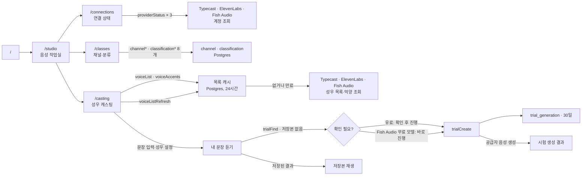

# 프로젝트 개관

이 문서는 서비스의 현재 모습을 적는다. 용어는 `GLOSSARY.md`, 결정 이유는 `docs/adr/`, 대상 사용자와 제품 어조는 `PRODUCT.md`(impeccable 스킬이 만든다)에 둔다. 기능을 바꾼 라운드는 닫기 전에 이 문서를 갱신하거나 대조표에 `N/A: 사유`를 적는다.

갱신은 해당 절의 표와 문장을 고치는 것이다. 날짜별 절이나 진행 경과를 덧붙이지 않는다(경과는 `tasks/archive/`에 남는다). 계획 중인 기능은 `기능` 표에 `계획` 상태로 넣고 스펙을 링크한다. 표의 `용어` 칸에는 `GLOSSARY.md`의 용어를 그대로 적는다.

## 한 줄 요약
개인 콘텐츠 제작자가 Typecast·ElevenLabs·Fish Audio 성우와 대본을 재사용하는 TTS 작업실이다. 현재 앱은 로컬 관리자 모드의 작업실 틀(T1), 공급자 연결 상태(T2), 세 공급자 성우 캐스팅(T3·T4), 성우별 내 문장 듣기(T5), 채널·카테고리·타입 관리(T6)를 제공한다.

## 사용자와 권한
| 역할 | 할 수 있는 일 | 확인 위치 |
|---|---|---|
| 로컬 관리자 | 서버가 정한 `context.ownerId` 한 명만 사용한다. `development`·`test`의 루프백 Host에서만 소유자가 생기며, Better Auth 가입이 열려 있어도 세션은 공급자 권한에 쓰지 않는다. production에서는 보호 프로시저가 모두 거절된다 | `packages/api/src/owner.ts`, `protectedProcedure`, `apps/web/src/context.ts` |

## 주요 흐름
사용자가 목적을 이루는 흐름을 화면(URL)과 프로시저로 그린다. 흐름이 바뀐 라운드에서 고친다.

## 기능
| 기능 | 상태 | 화면 | API | 스펙 |
|---|---|---|---|---|
| 작업실 틀 (로컬 관리자 모드) | 구현 | `/studio` | 없음(`healthCheck`는 동작 점검용) | [T1 스펙](../plans/tasks/T01-app-foundation.md) |
| 공급자 연결 상태 | 구현 | `/connections` | `providerStatus` | [T2 스펙](../plans/tasks/T02-provider-status.md) |
| 성우 캐스팅(세 공급자) | 구현 | `/casting` | `voiceList`, `voiceAccents`, `voiceListRefresh` | [T4 스펙](../plans/tasks/T04-casting-three-providers.md), [T3 스펙](../plans/tasks/T03-typecast-voices.md)(Typecast 판) |
| 내 문장 듣기(시험 생성) | 구현 | `/casting` | `trialModels`, `trialFind`, `trialCreate`, `trialList`, `trialAudio`, `trialDelete` | [T5 스펙](../plans/tasks/T05-my-sentence-listening.md), [T5 계획](../plans/tasks/T05-my-sentence-listening-plan.md) |
| 채널·분류 관리(채널, 카테고리, 타입 만들기·고치기·지우기) | 구현 | `/classes` | `channelList`, `channelCreate`, `channelUpdate`, `channelDelete`, `classificationList`, `classificationCreate`, `classificationUpdate`, `classificationDelete` | [T6 스펙](../plans/tasks/T06-channels-and-classifications.md), [T6 계획](../plans/tasks/T06-channels-and-classifications-plan.md), [채널·분류 브리프](../briefs/classes.md) |
| 로그인 (소유자 전용) | 계획 | 없음 | 없음 | [구현 로드맵 T14](../plans/implementation-roadmap.md) |
| TTS 작업실 (P0) | 계획 | 없음 (HTML 시안 `docs/prototypes/tts-studio/index.html`) | 없음 | [요구사항](../plans/tts-service-requirements.md), [실서비스 기획·설계안](../briefs/tts-app-design.md), [구현 로드맵](../plans/implementation-roadmap.md) |

상태는 `계획`, `구현`, `중단` 가운데 하나다.

## 화면과 URL
| URL | 화면 | 보호 | 파일 |
|---|---|---|---|
| `/` | `/studio`로 이동 | 없음 | `apps/web/src/app/page.tsx` |
| `/studio` | 음성 작업실(제작 흐름 지도: 채널 단계는 `/classes` 링크, 성우 단계는 `/casting` 링크, 연결 상태 링크) | 없음(로컬 관리자 모드) | `apps/web/src/app/(app)/studio/page.tsx` |
| `/connections` | 연결 상태(세 공급자의 연결 상태와 잔여 사용량, 공급자별 다시 확인) | 없음(데이터는 `protectedProcedure`가 막는다. 소유자가 없으면 주소 안내) | `apps/web/src/app/(app)/connections/page.tsx` |
| `/casting` | 성우 캐스팅: 공급자 탭, 출처 전환, 조건 줄, 성우 행·더 보기, 위쪽 문장 바와 행의 '내 문장 듣기', 패널의 이용 조건·내 문장 듣기·내 문장 결과 구역, 유료 생성 확인 창, 기본 샘플 재생 | 없음(데이터는 `protectedProcedure`, 소유자가 없으면 주소 안내) | `apps/web/src/app/(app)/casting/page.tsx` |
| `/classes` | 채널·분류: 채널·카테고리·타입 세 묶음을 위아래로 보이고(이름순), 묶음마다 만들기, 행마다 고치기(입력 창)·지우기(확인 창). 767px 이하 메뉴는 위 막대 4칸 그대로이고 이 화면은 더보기 안 '열린 화면' 줄에 있다 | 없음(데이터는 `protectedProcedure`가 막는다. 소유자가 없으면 주소 안내) | `apps/web/src/app/(app)/classes/page.tsx` |
| (없는 주소) | 페이지를 찾을 수 없어요(앱 틀 안, 작업실로 가기) | 없음 | `apps/web/src/app/not-found.tsx` |
| (화면 오류) | 문제가 생겼어요(앱 틀 안, 다시 시도하기: 실패한 조회를 처음 상태로 되돌려 다시 부름) | 없음 | `apps/web/src/app/(app)/error.tsx` |

## API (oRPC)
| 프로시저 | 용어 | 보호 | 입력 | 설명 |
|---|---|---|---|---|
| `healthCheck` | 해당 없음 | 공개 | 없음 | 상태 확인 |
| `providerStatus` | 연결 상태, 잔여 사용량 | 보호(`protectedProcedure`) | `{ provider: "typecast" \| "elevenlabs" \| "fish_audio" }` | 서버 키로 공급자 계정을 조회해(Fish Audio는 API 충전 잔액 뒤 웹 플랜 크레딧까지 두 번) 연결 상태 8종과 잔여 사용량을 돌려준다. 키가 없으면 공급자를 부르지 않고 `no_key`다. 공급자 문제는 던지지 않고 값으로 돌려준다 |
| `voiceList` | 성우, 성우 카탈로그, 공개 성우 라이브러리, 계정 성우, 공급자 분류(콘텐츠), 기본 샘플, 목록 캐시 | 보호(`protectedProcedure`) | 유니온: `{ provider: "typecast" }` \| `{ provider: "elevenlabs", source: "public", page, query }` \| `{ provider: "elevenlabs", source: "account", cursor, query }` \| `{ provider: "fish_audio", source, page, query }` | 서버 키로 성우 목록 한 페이지(100명씩, Typecast는 공개 성우 전체)를 목록 캐시를 거쳐 돌려준다. 출력은 성우 배열, `next`, `total`, `windowLimited`, 받은 시각 `fetchedAt`, `stale`이다. 공급자가 실패해도 지난 목록(만료 뒤 7일 안)이 있으면 `stale`(사유, 429면 `retryAt`)을 붙여 돌려준다. 계정 목록 행만 소유자별이다. 키가 없으면 공급자와 DB를 부르지 않고 `PRECONDITION_FAILED`. 지난 목록이 없으면 사유(`data.reason`)를 붙여 던진다 |
| `voiceAccents` | 공급자 분류, 목록 캐시 | 보호(`protectedProcedure`) | `{ language }` | ElevenLabs 억양 목록(억양 조건의 선택지). 공개 캐시 행을 쓴다. 입력 검사를 통과하지 못하는 값은 선택지에서 뺀다. 키가 없으면 `PRECONDITION_FAILED`, 지난 목록은 `stale` |
| `voiceListRefresh` | 목록 캐시, 계정 성우 | 보호(`protectedProcedure`) | `{ provider }` | '목록 새로 고침'. 공급자를 부르지 않고 그 공급자의 공개·억양 행과 이 소유자의 계정 행을 만료로 바꾼다(행은 지우지 않아 다시 받기가 실패해도 지난 목록을 보인다). 429 대기 시각 전이면 아무것도 바꾸지 않고 `retryAt`을 돌려준다. 화면이 이어서 그 공급자의 열린 목록(지금 목록과 '전체' 묶음)을 다시 받는다. 조건이 '전체' 묶음과 다르면 공급자 호출이 2회다(최종 리뷰 2026-10-05) |
| `trialModels` | 예상 사용량 | 보호(`protectedProcedure`) | 없음 | ElevenLabs 모델별 크레딧 배율을 목록 캐시에서 읽는다. 일반 조회 실패는 배율 1로 계산하지만, 조회 중 429 또는 새 대기 시각은 시험 생성을 중단한다 |
| `trialFind` | 저장된 결과 | 보호(`protectedProcedure`) | `TrialRequest` | 같은 소유자·공급자·성우·모델·정리된 설정·문장의 완료 결과를 찾는다. 있으면 오디오를 돌려주고 보관 만료를 30일 뒤로 늘린다. 공급자를 부르지 않는다 |
| `trialCreate` | 시험 생성 | 보호(`protectedProcedure`) | `{ requestId, request }` | 키 없음·Fish Audio 무료 기간 종료를 먼저 확인한다. 기존 요청 ID는 429 대기 확인보다 먼저 상태·결과를 재생하고, 새 요청은 429 대기·모델 배율 확인과 기록 선점 뒤 한 번 생성한다. DB 실패면 공급자를 부르지 않으며 자동 재시도하지 않는다. 정상 Fish Audio 무료 모델은 확인 창 없이 생성한다 |
| `trialList` | 저장된 결과 | 보호(`protectedProcedure`) | `{ provider, voiceId }` | 해당 성우의 완료 결과 최신 20개를 오디오 없이 돌려준다 |
| `trialAudio` | 저장된 결과 | 보호(`protectedProcedure`) | `{ id }` | 소유자의 완료 오디오를 돌려주고 보관 만료를 30일 뒤로 늘린다 |
| `trialDelete` | 저장된 결과 | 보호(`protectedProcedure`) | `{ id }` | 진행 중이 아닌 소유자 결과를 앱 DB에서 지운다. 공급자 기록은 지우지 않는다 |
| `channelList` | 채널 | 보호(`protectedProcedure`) | 없음 | 이 소유자의 채널 `{ id, name, memo, url }` 배열. 정렬은 화면이 이름순으로 한다 |
| `channelCreate` | 채널 | 보호(`protectedProcedure`) | `{ name, memo, url }` | 채널을 만든다. 같은 소유자에 대소문자만 다른 같은 이름이 있으면 `CONFLICT`(`data.reason: "duplicate_name"`, 이름 유니크 인덱스 위반만) |
| `channelUpdate` | 채널 | 보호(`protectedProcedure`) | `{ id, name, memo, url }` | 소유자의 채널을 고친다. 없거나 남의 것이면 `NOT_FOUND`(구분하지 않는다). 같은 이름이면 `CONFLICT` |
| `channelDelete` | 채널 | 보호(`protectedProcedure`) | `{ id }` | 소유자의 채널을 지우고 `{ deleted: true }`. 없거나 남의 것이면 `NOT_FOUND` |
| `classificationList` | 분류, 카테고리, 타입 | 보호(`protectedProcedure`) | 없음 | 이 소유자의 카테고리·타입 `{ id, kind, name, memo }` 배열(`kind`는 `category`·`type`). 정렬은 화면이 한다 |
| `classificationCreate` | 분류, 카테고리, 타입 | 보호(`protectedProcedure`) | `{ kind, name, memo }` | 카테고리 또는 타입을 만든다. 같은 소유자·같은 `kind` 안 같은 이름이면 `CONFLICT`(다른 `kind`와는 같아도 된다) |
| `classificationUpdate` | 분류, 카테고리, 타입 | 보호(`protectedProcedure`) | `{ id, name, memo }` | 소유자의 분류를 고친다. `kind`는 바꿀 수 없다. 없거나 남의 것이면 `NOT_FOUND`, 같은 이름이면 `CONFLICT` |
| `classificationDelete` | 분류, 카테고리, 타입 | 보호(`protectedProcedure`) | `{ id }` | 소유자의 분류를 지우고 `{ deleted: true }`. 없거나 남의 것이면 `NOT_FOUND` |

채널·분류 입력 규칙(`packages/api/src/classification-rules.ts`, 화면과 서버가 같이 쓴다)은 아래와 같다. 원문이 1,000자를 넘으면 규칙을 보기 전에 입력 검증이 거절한다. 입력은 서버가 정한 `context.ownerId`로만 소유자를 정하고 `ownerId` 같은 키는 버려진다. 이름 중복 말고 저장소 오류는 `INTERNAL_SERVER_ERROR`로 오류 이름·DB 코드 한 줄만 로그에 남긴다.
- 이름·메모 정리: 보이지 않는 글자(C0·C1 제어 문자, 폭 없는 공백, 단어 결합자, BOM, 양방향 제어 문자 U+202A~202E·U+2066~2069)를 지우고 한글 채움 문자는 공백으로 본다. 이모지를 잇는 ZWJ(U+200D)는 남긴다. 이어서 NFC, 앞뒤 공백 제거, 연속 공백(줄바꿈·탭·전각 공백 포함)을 하나로 바꾼다.
- 길이(코드 포인트): 이름 1~40자, 메모 0~200자(비면 없음), 채널 주소 0~500자.
- 채널 주소: 앞뒤 공백만 지우고 그대로 저장한다(비면 없음). `http:`·`https:`만 받고, 제어 문자가 들어 있으면 거절한다.

## 데이터 모델과 코드 매핑
| 테이블 | 용어 | 스키마 파일 | 소유자 컬럼 | 설명 |
|---|---|---|---|---|
| `user` | 사용자 | `packages/db/src/schema/auth.ts` | 해당 없음 | Better Auth 생성물 (`pnpm auth:generate`) |
| `session`, `account`, `verification` | 해당 없음 | `packages/db/src/schema/auth.ts` | 해당 없음 | Better Auth 내부 테이블 |
| `provider_list_cache` | 목록 캐시(코드 `providerListCache`) | `packages/db/src/schema/provider-cache.ts` | `owner_id`(null 허용, `user` 외래 키 없음) | 공급자 성우 목록 한 페이지를 조건별로 24시간 보관한다([ADR 0003](../adr/0003-postgres-cache.md)). 키는 소유자·공급자·목록 종류(`public`·`account`·`accents`)·정규화한 조건의 해시·계약 판(`CONTRACT_VERSION`)이고 `NULLS NOT DISTINCT` 유니크다. 계정 목록 행만 소유자 id가 있고 공개·억양 행은 null(소유자끼리 함께 씀). 지워도 되는 데이터라 `user` 외래 키를 걸지 않는다. 만료 뒤 7일이 지난 행은 쓰기 때 지운다 |
| `provider_cooldown` | 공급자 대기 시각(코드 `providerCooldown`) | `packages/db/src/schema/provider-cache.ts` | 해당 없음(공급자별 한 행) | 공급자 429 `Retry-After`로 정한 다음 호출 가능 시각(1시간 상한). 그 전에는 그 공급자를 부르지 않는다. 서버 인스턴스끼리 메모리를 나누지 않으므로 DB에 둔다. T4 목록과 T5 시험 생성이 이 표를 쓴다 |
| `channel` | 채널 | `packages/db/src/schema/classification.ts` | `owner_id`(서버가 정한 소유자, `user` 외래 키 없음, [ADR 0004](../adr/0004-channel-classification-storage.md)) | 채널 이름·메모(null 허용)·채널 주소(`url`, null 허용). 같은 소유자 안에서 `lower(name)` 유니크 인덱스 `channel_name`으로 대소문자만 다른 중복을 막는다. 프리셋(T8)·저장 대본(T12)이 하나만 가리킬 예정이다 |
| `classification` | 분류, 카테고리, 타입 | `packages/db/src/schema/classification.ts` | `owner_id`(서버가 정한 소유자, `user` 외래 키 없음, [ADR 0004](../adr/0004-channel-classification-storage.md)) | 카테고리와 타입을 한 표에 `kind`(`category`·`type`, check `classification_kind`)로 둔다. 이름·메모(null 허용). `(owner_id, kind, lower(name))` 유니크 인덱스 `classification_name`이 같은 `kind` 안 중복을 막는다(카테고리 '경제'와 타입 '경제'는 가능). 성우(T7)·저장 대본(T12)에 여러 개 붙일 예정이다 |
| `trial_generation` | 생성 기록, 저장된 결과 | `packages/db/src/schema/trial-generation.ts` | `owner_id`(서버가 정한 소유자) | 요청 ID를 공급자 호출 전에 소유자별로 선점하고 상태·정리된 요청·예상 사용량을 기록한다. 완료된 MP3를 bytea로 저장하며, 완료 결과는 마지막 재생 뒤 30일 보관한다. 만료 행은 새 결과를 저장할 때 정리하고 사용자가 결과를 지울 수 있다. 동시 생성은 소유자별 한 건이다 |

DB 컨테이너(Podman, 5433)가 꺼져 있으면 목록 캐시 없이 동작한다. 연결·질의가 3초 안에 안 되면 `[voiceCache]` 실패 줄만 남기고 목록 공급자를 바로 부르므로, 같은 조건도 매번 공급자를 부른다. 유료 시험 생성은 생성 기록·429 대기 조회가 실패하면 공급자를 부르지 않는다. 채널·분류는 캐시가 아니라 원본이라 DB가 꺼져 있으면 목록 조회와 저장이 실패하고 `/classes`가 오류와 '다시 불러오기'를 보인다.

## 범위 밖
아직 하지 않기로 한 것과 그 이유. 뒤로 미룬 기능도 여기에 옮긴다.

## UI 설계 산출물 (실제 서비스와 구분)

2026-09-26 개인 작업실 우선으로 제품 범위를 확정했다. `PRODUCT.md`가 제품 맥락이며 공개 결제·팀은 후속이다. `docs/prototypes/tts-studio/index.html`은 별도 HTML UI 프로토타입이고 위 Next.js 라우트에 연결되지 않는다. 실제 앱의 현재 기능은 이 문서의 기능·API·데이터 표를 따른다. HTML 시안의 대본 제작 도구와 클론 등 나머지 기능은 해당 로드맵 순서를 따른다.

용어사전은 [GLOSSARY.md](../../GLOSSARY.md)에 정리했다. 전체 성우 탐색(공급자 분류와 개인 타입 구분), 공급자별 즐겨찾기와 자주 사용의 계약은 [요구사항](../plans/tts-service-requirements.md)에 있으며 아직 실제 API·DB 기능은 아니다.

공급자별 생성 옵션과 추천·찾기·체인저·가져오기 흐름의 확장 설계는 [옵션·제작 도구 계획](../plans/tts-provider-options-and-tools.md)에 있다. Vrew식 자막 기능은 후속 요청 대상으로 유지한다.

HTML의 성우 분류는 [확정 브리프](../briefs/tts-voice-classification.md)에 따라 항목 관리·성우별 태그 배정·검색/필터를 연결하고 브라우저 로컬에 보존하는 시연이다. 대본·프리셋 분류 편집과 실제 DB 동기화는 후속이다. 성우 선택 창과 성우 보관함의 조건 줄은 공급자 분류 가운데 그 공급자 목록 API가 조회 조건이나 응답 필드로 주는 것만 보여 준다. 내 보이스 칩만 앱 기록(클론 소유)으로 거른다([공급자별 성우 필터 브리프](../briefs/tts-voice-provider-filters.md)). 실제 목록 조회와 페이지 나눔은 후속이다. 성우 캐스팅 페이지(`#casting`)는 성우를 먼저 고르는 화면이다. 조건이 없을 때는 API가 주는 인기 정렬(ElevenLabs·Fish Audio)과 콘텐츠(use_cases, Fish Audio는 태그)로 묶은 둘러보기를 먼저 보인다. 공급자 성우를 찾고, 기본 샘플과 내 대본으로 한 명씩 시험 생성해 듣고, 채널·카테고리·타입에 넣고 빼고, 작업실 기본 성우로 가져간다([성우 캐스팅 브리프](../briefs/tts-voice-casting.md)). 시험 생성은 시연이다. 실제 앱에서는 유료 생성 호출로 다룬다(REQ-03). 성우 보관함은 분류 정리용으로 남는다.

제작 도구 HTML은 로컬 파일·녹음 원본 준비, TXT/CSV/SRT/DOCX 파싱과 화자 배정, 문단 감정 계획 적용을 포함한다. 추천/유사 검색/변환/클론 결과는 명시적 시연이며 실제 API·DB가 아니다. 상세 범위: [전체 흐름 브리프](../briefs/tts-production-tools.md).

gowith 로그인 작업실 조사를 반영해 HTML 작업실을 문단 중심으로 설계했다. 대본은 늘 문단 카드 목록이고(한 덩어리 대본은 문단 1개), 좌측 레일(문단 일괄 작업·AI 보이스 도구), 우측 레일(작업 요약·역할별 성우·작업 설정·결과), 하단 작업 바(요약·시연 재생·음량·내려받기), 성우·도구 드로어로 구성한다. 프로젝트 보관함과 임시 작업 복구 배너, 보이스 디자인, 녹음 가이드, 사용량 내역, 다크 모드도 포함한다. 검토용 결과 선택(생성·AI 보이스 도구·감정 자동화의 성공과 실패)은 내비 하단 `시연 모드` 한곳에 모았다. 모두 시연이며 실제 기능은 `tasks/todo.md`의 P1-11~16, P2-09, P3-08 등으로 추적한다. 상세: [반영 브리프](../briefs/tts-gowith-reflection.md).

서비스별 공식 재조사와 후속 구현 순서는 [조사 기반 UX 설계](../plans/tts-research-driven-ux.md)에 있다. 제작 도구는 작업실 좌측 레일(좁은 화면은 툴바 `AI 도구`)에 상시 노출하고 드로어에서 열며, 가져오기에서 작업실 대본과 기존 문단 배정을 다시 편집할 수 있다. Vrew 참고 자막·영상 기능은 후속 구현으로 구분한다.

HTML 기준 실제 앱의 화면·상태·데이터 경계와 단계별 완료 조건은 [실서비스 기획·설계안](../briefs/tts-app-design.md)에 정리했다. 검토용 제안이며 현재 라우트·API·DB의 구현 상태는 위 표와 같다.
