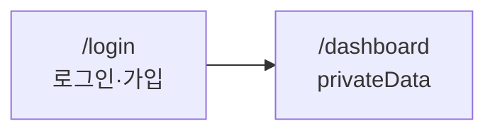

# 프로젝트 개관

이 문서는 서비스의 현재 모습을 적는다. 용어는 `CONTEXT.md`, 결정 이유는 `docs/adr/`, 대상 사용자와 제품 어조는 `PRODUCT.md`(impeccable 스킬이 만든다)에 둔다. 기능을 바꾼 라운드는 닫기 전에 이 문서를 갱신하거나 대조표에 `N/A: 사유`를 적는다.

갱신은 해당 절의 표와 문장을 고치는 것이다. 날짜별 절이나 진행 경과를 덧붙이지 않는다(경과는 `tasks/archive/`에 남는다). 계획 중인 기능은 `기능` 표에 `계획` 상태로 넣고 스펙을 링크한다. 표의 `용어` 칸에는 `CONTEXT.md`의 용어를 그대로 적는다.

## 한 줄 요약
개인 콘텐츠 제작자가 Typecast·ElevenLabs 성우와 대본을 재사용하는 TTS 작업실을 계획 중이며, 현재 앱은 인증 기반 초기 골격과 별도 HTML 시안 단계다.

## 사용자와 권한
| 역할 | 할 수 있는 일 | 확인 위치 |
|---|---|---|
| 방문자 | 로그인, 가입 | `apps/web/src/app/login` |
| 로그인 사용자 | 자기 데이터만 조회와 변경 | `protectedProcedure` |

## 주요 흐름
사용자가 목적을 이루는 흐름을 화면(URL)과 프로시저로 그린다. 흐름이 바뀐 라운드에서 고친다.

## 기능
| 기능 | 상태 | 화면 | API | 스펙 |
|---|---|---|---|---|
| 로그인과 가입 | 구현 | `/login` | Better Auth | 해당 없음 |
| TTS 작업실 (P0) | 계획 | 없음 (HTML 시안 `docs/prototypes/tts-studio/index.html`) | 없음 | [요구사항](../plans/tts-service-requirements.md), [실서비스 기획·설계안](../briefs/tts-app-design.md) |

상태는 `계획`, `구현`, `중단` 가운데 하나다.

## 화면과 URL
| URL | 화면 | 보호 | 파일 |
|---|---|---|---|
| `/` | 홈 | 공개 | `apps/web/src/app/page.tsx` |
| `/login` | 로그인과 가입 | 공개 | `apps/web/src/app/login/page.tsx` |
| `/dashboard` | 대시보드 | 로그인 | `apps/web/src/app/dashboard/page.tsx` |

## API (oRPC)
| 프로시저 | 용어 | 보호 | 입력 | 설명 |
|---|---|---|---|---|
| `healthCheck` | 해당 없음 | 공개 | 없음 | 상태 확인 |
| `privateData` | 사용자 | 로그인 | 없음 | 세션 확인 예시 |

## 데이터 모델과 코드 매핑
| 테이블 | 용어 | 스키마 파일 | 소유자 컬럼 | 설명 |
|---|---|---|---|---|
| `user` | 사용자 | `packages/db/src/schema/auth.ts` | 해당 없음 | Better Auth 생성물 (`pnpm auth:generate`) |
| `session`, `account`, `verification` | 해당 없음 | `packages/db/src/schema/auth.ts` | 해당 없음 | Better Auth 내부 테이블 |

## 범위 밖
아직 하지 않기로 한 것과 그 이유. 뒤로 미룬 기능도 여기에 옮긴다.

## UI 설계 산출물 (실제 서비스와 구분)

2026-09-26 개인 작업실 우선으로 제품 범위를 확정했다. `PRODUCT.md`가 제품 맥락이며 공개 가입·결제·팀은 후속이다. `docs/prototypes/tts-studio/index.html`은 별도 HTML UI 프로토타입이고 위 Next.js 라우트에 연결된 기능이 아니다. 실제 TTS·클론·DB 연결은 아직 구현 전이다. 앱 이관 순서와 검증 기준은 `docs/plans/tts-ui-first-implementation.md`에 있다.

용어사전은 [CONTEXT.md](../../CONTEXT.md)에 정리했다. 전체 성우 탐색(공급자 분류와 개인 타입 구분), 공급자별 즐겨찾기와 자주 사용의 계약은 [요구사항](../plans/tts-service-requirements.md)에 있으며 아직 실제 API·DB 기능은 아니다.

공급자별 생성 옵션과 추천·찾기·체인저·가져오기 흐름의 확장 설계는 [옵션·제작 도구 계획](../plans/tts-provider-options-and-tools.md)에 있다. Vrew식 자막 기능은 후속 요청 대상으로 유지한다.

HTML의 성우 분류는 [확정 브리프](../briefs/tts-voice-classification.md)에 따라 항목 관리·성우별 태그 배정·검색/필터를 연결하고 브라우저 로컬에 보존하는 시연이다. 대본·프리셋 분류 편집과 실제 DB 동기화는 후속이다.

제작 도구 HTML은 로컬 파일·녹음 원본 준비, TXT/CSV/SRT/DOCX 파싱과 화자 배정, 문단 감정 계획 적용을 포함한다. 추천/유사 검색/변환/클론 결과는 명시적 시연이며 실제 API·DB가 아니다. 상세 범위: [전체 흐름 브리프](../briefs/tts-production-tools.md).

서비스별 공식 재조사와 후속 구현 순서는 [조사 기반 UX 설계](../plans/tts-research-driven-ux.md)에 있다. 제작 도구 여섯 메뉴는 작업실 상단에 상시 노출하고, 가져오기에서 작업실 대본과 기존 문단 배정을 다시 편집할 수 있다. Vrew 참고 자막·영상 기능은 후속 구현으로 구분한다.

HTML 기준 실제 앱의 화면·상태·데이터 경계와 단계별 완료 조건은 [실서비스 기획·설계안](../briefs/tts-app-design.md)에 정리했다. 검토용 제안이며 현재 라우트·API·DB의 구현 상태는 위 표와 같다.
