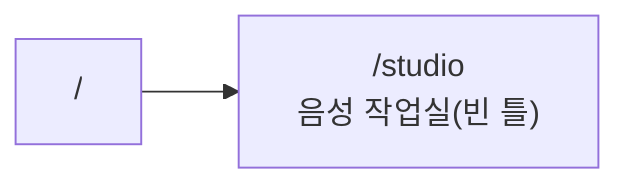

# T1 앱 기반과 공통 틀 (로컬 관리자 모드) 구현 계획

> **For agentic workers:** REQUIRED SUB-SKILL: Use superpowers:subagent-driven-development (recommended) or superpowers:executing-plans to implement this plan task-by-task. Steps use checkbox (`- [ ]`) syntax for tracking.

**Goal:** 로그인 없이 쓰는 작업실 틀과 뒤 TASK가 그대로 쓸 공통 구조(소유자 결정, 요청 보호, 디자인 토큰, 테스트 러너, 린트 기준선)를 만든다.

**Architecture:** 소유자는 `apps/web/src/context.ts`가 `localOwnerId(NODE_ENV, Host)`로 정해 oRPC context의 `ownerId`로 넘긴다. development·test이면서 요청 Host가 루프백일 때만 로컬 관리자이고, 그 밖(production, 다른 도메인 이름으로 들어온 DNS 리바인딩)은 `ownerId`가 없어 `protectedProcedure`가 거절한다. rpc 라우트는 oRPC CSRF 플러그인으로 다른 사이트의 호출을 막고, 개발 서버는 `127.0.0.1`에서만 연다. 화면은 `(app)` 라우트 그룹 레이아웃이 앱 틀(내비게이션, 테마 전환)을 두르고, 첫 페이지 `/studio`는 빈 작업실이다.

**Tech Stack:** Next.js 16.3.6 App Router, oRPC 1.15.4, TanStack Query, next-themes, shadcn(Base UI) `packages/ui`, Tailwind CSS 4, vitest, Biome 2.

**Spec:** [T1 스펙](T01-app-foundation.md), [앱 틀 브리프](../../briefs/app-shell.md), [로드맵 2절](../implementation-roadmap.md).

## Global Constraints

- 커밋은 태스크마다 하지 않는다. 라운드 끝(`bts-dev-cycle` 5절)에 한 번 한다(`AGENTS.md`). 태스크의 마지막 단계는 대조표(`tasks/todo.md` 활성 라운드) 행에 증거를 적는 것이다.
- 공급자 호출, 유료 호출, 운영 DB 접근은 이 TASK에 없다.
- 색, 간격, 반경, 그림자는 토큰과 Tailwind 기본 눈금만 쓴다. 원시 hex와 임의 값(`bg-[#123456]`, `mt-[13px]`, `text-[11px]`)을 새로 넣지 않는다.
- shadcn 프리미티브는 `@tts-pilot-app/ui/components/*`에서 가져온다.
- 화면 문구는 한국어 원티드 보이스(`-어요`)다. 인터랙티브 요소는 44px 이상(`min-h-11`, `size-11`), `focus-visible`이 보이게 한다.
- 파일을 고친 뒤 `pnpm exec biome check --write <파일들>`로 포맷한다(들여쓰기는 탭).
- 앱 패키지 이름은 `web`(`pnpm --filter web …`), API 패키지는 `@tts-pilot-app/api`다.
- `apps/web`은 `typedRoutes: true`다. `<Link href>`에는 존재하는 라우트 리터럴이나 `Route` 타입만 넣는다. 라우트 타입은 `.next/types`에 생성되므로 `check-types`가 먼저 `next typegen`을 실행한다(Task 2).
- 개발 서버 주소: `http://127.0.0.1:3001`(Task 3 뒤). DB는 켜지 않아도 된다.

## Review Focus

- `localhost`가 IPv6(`::1`)로 풀리는 기기에서 `127.0.0.1`에만 연 서버에 접속할 때 → 브라우저가 IPv4로 재시도해 열려야 한다. Task 3 Step 6에서 `http://localhost:3001`과 `http://127.0.0.1:3001` 둘 다 확인한다.
- 옛 주소(`/login`, `/dashboard`)나 오타 주소로 들어올 때 → 오류가 아니라 한국어 "페이지를 찾을 수 없어요"와 작업실로 가는 버튼. Task 5 Step 6.
- 앱 자신의 호출이 CSRF 헤더 없이 나가 모두 403이 되는 경우 → 헤더를 붙인 호출은 200이어야 한다. Task 3 Step 6의 curl 두 건.
- 다크 모드에서 '준비 중' 메뉴와 보조 글자의 대비가 4.5:1 아래로 떨어지는 경우 → 라이트·다크 모두 4.5:1 이상. Task 6 Step 7(브라우저)과 대조표 impeccable audit 행.
- 휴대폰 너비에서 더보기를 연 채 창을 넓히거나, 키보드로 더보기를 여닫을 때 → 넓은 화면에서는 메뉴가 모두 보이고, 버튼의 `aria-expanded`가 상태와 맞는다. Task 6 Step 7.

---

### Task 1: Biome 기준선 (Q-01)

다른 변경보다 먼저 한다. 동작을 바꾸지 않는 포맷·import 정렬만 한다. 현재 오류 73개는 포맷 61개와 `organizeImports` 12개로 모두 자동 수정 대상이다(2026-09-29 확인).

**Files:**
- Modify: `biome check --write`가 고치는 파일(주로 `packages/ui/src/components/*`, `apps/web/src/*`, `apps/web/next.config.ts`, `packages/db/src/*`)

**Interfaces:**
- Consumes: 없음
- Produces: `pnpm exec biome check .`가 오류 0으로 끝나는 기준선. 이후 모든 태스크의 린트 검사가 전체 검사로 통과해야 한다.

- [ ] **Step 1: 현재 상태 기록**

Run: `pnpm exec biome check . 2>&1 | tail -3`
Expected: `Found 73 errors.` 근처의 실패 요약(숫자가 다르면 그 숫자를 증거에 적는다).

- [ ] **Step 2: 자동 수정**

Run: `pnpm exec biome check --write .`
Expected: 파일 여러 개가 고쳐지고 오류가 0이 된다. 경고(`useSortedClasses`, `useImportType`, 시안 CSS의 `noDescendingSpecificity`)는 남아도 된다.

- [ ] **Step 3: 오류 0 확인**

Run: `pnpm exec biome check . ; echo "exit=$?"`
Expected: `exit=0`. 오류가 남으면 규칙 이름과 파일을 적고, 동작을 바꾸지 않는 수정만 직접 한다. 동작을 바꿔야 하는 오류면 멈추고 보고한다.

- [ ] **Step 4: 동작이 그대로인지 확인**

Run: `pnpm check-types && pnpm build`
Expected: 둘 다 성공.

- [ ] **Step 5: 증거 기록**

`git diff --stat | tail -1`의 파일 수와 Step 1·3·4 결과를 대조표 6행(타입·린트)의 증거 초안으로 메모한다(최종 증거는 모든 태스크 뒤에 다시 실행해 채운다).

---

### Task 2: 테스트 러너와 로컬 관리자 소유자

**Files:**
- Create: `packages/api/src/owner.ts`
- Create: `packages/api/src/owner.test.ts`
- Modify: `packages/api/src/context.ts`
- Modify: `packages/api/src/index.ts`
- Modify: `packages/api/src/routers/index.ts`
- Modify: `apps/web/src/context.ts`
- Modify: `apps/web/src/app/api/rpc/[[...rest]]/route.ts` (호출부 두 곳만)
- Delete: `apps/web/src/app/dashboard/` (지우는 `privateData`의 유일한 사용처)
- Modify: `packages/api/package.json`, `apps/web/package.json`(`check-types`), `package.json`, `turbo.json`, `.dev-cycle.json`

**Interfaces:**
- Consumes: 없음
- Produces:
  - `LOCAL_OWNER_ID: "local-admin"` (`@tts-pilot-app/api/owner`)
  - `localOwnerId(nodeEnv: string, host: string | null): string | null` (`@tts-pilot-app/api/owner`)
  - `type Context = { db: Database; ownerId: string | null }` (`@tts-pilot-app/api/context`)
  - `protectedProcedure`: 핸들러의 `context.ownerId`는 `string`
  - `createContext(req: Request): Context` (`apps/web/src/context.ts`)
  - 루트 `pnpm test`, `packages/api`의 `pnpm --filter @tts-pilot-app/api test`

- [ ] **Step 1: vitest 설치와 실행 스크립트**

Run: `pnpm --filter @tts-pilot-app/api add -D vitest`

`packages/api/package.json`의 `scripts`에 더한다:

```json
"test": "vitest run"
```

루트 `package.json`의 `scripts`에 더한다(`check-types` 다음 줄):

```json
"test": "turbo run test",
```

`turbo.json`의 `tasks`에 더한다(`check-types` 다음):

```json
"test": {
  "cache": false
},
```

`apps/web/package.json`의 `check-types`를 다음으로 바꾼다. 지운 라우트가 `.next/types`에 남아 타입 검사가 깨지는 것을 막는다(`typedRoutes`):

```json
"check-types": "next typegen && tsc -b ../../packages/api && tsc --noEmit",
```

`.dev-cycle.json`의 `commands`에 더한다(`build` 다음):

```json
"test": "pnpm test",
```

- [ ] **Step 2: 실패하는 테스트 작성**

`packages/api/src/owner.test.ts`:

```ts
import { createRouterClient } from "@orpc/server";
import { describe, expect, it } from "vitest";

import type { Context } from "./context";
import { protectedProcedure } from "./index";
import { LOCAL_OWNER_ID, localOwnerId } from "./owner";

describe("localOwnerId", () => {
	it("development와 test의 루프백 요청은 로컬 관리자다", () => {
		expect(localOwnerId("development", "127.0.0.1:3001")).toBe(LOCAL_OWNER_ID);
		expect(localOwnerId("development", "localhost:3001")).toBe(LOCAL_OWNER_ID);
		expect(localOwnerId("development", "[::1]:3001")).toBe(LOCAL_OWNER_ID);
		expect(localOwnerId("test", "localhost")).toBe(LOCAL_OWNER_ID);
	});

	it("production과 모르는 NODE_ENV에서는 소유자가 없다", () => {
		expect(localOwnerId("production", "127.0.0.1:3001")).toBeNull();
		expect(localOwnerId("staging", "127.0.0.1:3001")).toBeNull();
		expect(localOwnerId("", "127.0.0.1:3001")).toBeNull();
	});

	it("다른 이름으로 들어온 요청(DNS 리바인딩)이나 Host가 없으면 소유자가 없다", () => {
		expect(localOwnerId("development", "evil.example:3001")).toBeNull();
		expect(localOwnerId("development", "127.0.0.1.evil.example")).toBeNull();
		expect(localOwnerId("development", null)).toBeNull();
	});
});

describe("protectedProcedure", () => {
	const router = {
		whoami: protectedProcedure.handler(({ context }) => context.ownerId),
	};
	// 소유자 검사 미들웨어는 db를 쓰지 않는다.
	const as = (ownerId: string | null) =>
		createRouterClient(router, {
			context: { db: {} as Context["db"], ownerId },
		});

	it("소유자가 없으면 UNAUTHORIZED", async () => {
		await expect(as(null).whoami()).rejects.toMatchObject({
			code: "UNAUTHORIZED",
		});
	});

	it("소유자가 있으면 핸들러가 그 값을 받는다", async () => {
		await expect(as(LOCAL_OWNER_ID).whoami()).resolves.toBe(LOCAL_OWNER_ID);
	});
});
```

- [ ] **Step 3: 실패 확인**

Run: `pnpm --filter @tts-pilot-app/api test`
Expected: FAIL. `./owner`를 찾지 못한다는 오류.

- [ ] **Step 4: 구현**

`packages/api/src/owner.ts`:

```ts
// 로그인(T14) 전까지 쓰는 로컬 관리자 모드의 소유자다. 소유자는 서버가 정하고 클라이언트 입력으로 받지 않는다.
export const LOCAL_OWNER_ID = "local-admin";

const LOOPBACK_HOSTNAMES = new Set(["localhost", "127.0.0.1", "[::1]"]);

// development·test이면서 루프백 Host로 들어온 요청만 소유자를 받는다. 그 밖에는 null이라 protectedProcedure가 거절한다.
// - production(배포 환경): 로그인 없이 배포하지 않기 위해서다.
// - 다른 도메인 이름(DNS 리바인딩): 127.0.0.1로 풀리게 한 남의 사이트는 CSRF 헤더를 붙일 수 있어서 Host로 막는다.
export function localOwnerId(
	nodeEnv: string,
	host: string | null,
): string | null {
	if (nodeEnv !== "development" && nodeEnv !== "test") return null;
	const hostname = host?.replace(/:\d+$/, "") ?? "";
	return LOOPBACK_HOSTNAMES.has(hostname) ? LOCAL_OWNER_ID : null;
}
```

`packages/api/src/context.ts` 전체:

```ts
import type { Database } from "@tts-pilot-app/db";

export type Context = {
	db: Database;
	// 서버가 정한 소유자. 지금은 로컬 관리자(owner.ts), 로그인(T14) 뒤에는 세션 사용자다.
	ownerId: string | null;
};
```

`packages/api/src/index.ts` 전체:

```ts
import { ORPCError, os } from "@orpc/server";

import type { Context } from "./context";

export const o = os.$context<Context>();

export const publicProcedure = o;

const requireOwner = o.middleware(async ({ context, next }) => {
	if (!context.ownerId) {
		throw new ORPCError("UNAUTHORIZED");
	}
	return next({ context: { ownerId: context.ownerId } });
});

export const protectedProcedure = publicProcedure.use(requireOwner);
```

`packages/api/src/routers/index.ts` 전체(`privateData` 삭제):

```ts
import type { RouterClient } from "@orpc/server";

import { publicProcedure } from "../index";

export const appRouter = {
	healthCheck: publicProcedure.handler(() => {
		return "OK";
	}),
};
export type AppRouter = typeof appRouter;
export type AppRouterClient = RouterClient<typeof appRouter>;
```

`apps/web/src/context.ts` 전체:

```ts
import type { Context } from "@tts-pilot-app/api/context";
import { localOwnerId } from "@tts-pilot-app/api/owner";

import { ENV } from "./env.server";
import { db } from "./services";

// 로그인(T14) 전에는 로컬 관리자 모드다. T14에서 이 함수가 세션과 허용 목록으로 소유자를 정한다.
export function createContext(req: Request): Context {
	return { db, ownerId: localOwnerId(ENV.NODE_ENV, req.headers.get("host")) };
}
```

`apps/web/src/app/api/rpc/[[...rest]]/route.ts`에서 `context: await createContext(req),` 두 곳을 `context: createContext(req),`로 바꾼다(라우트 나머지는 Task 3에서 다시 쓴다).

`privateData`를 쓰는 템플릿 대시보드를 지운다:

```bash
rm -r apps/web/src/app/dashboard
```

- [ ] **Step 5: 통과 확인**

Run: `pnpm --filter @tts-pilot-app/api test`
Expected: PASS 5 tests.

Run: `pnpm test`
Expected: turbo가 `@tts-pilot-app/api#test`를 실행하고 PASS.

- [ ] **Step 6: 타입과 포맷**

Run: `pnpm exec biome check --write packages/api apps/web/src/context.ts "apps/web/src/app/api/rpc/[[...rest]]/route.ts" package.json turbo.json .dev-cycle.json && pnpm check-types`
Expected: 성공. `context.session`이나 `privateData`를 쓰는 곳이 남아 있으면 타입 오류로 드러난다. `apps/web/.next/dev/types`에 지운 `/dashboard`가 남아 오류가 나면(`next typegen`이 dev 타입까지 다시 만드는지는 확인 전이다) `rm -rf apps/web/.next/dev`로 개발 캐시를 지우고 다시 실행한다. 로그인 폼과 사용자 메뉴는 `auth-client`(클라이언트 세션)를 쓰므로 이 단계에서는 그대로 컴파일되고, Task 5에서 지운다.

- [ ] **Step 7: 증거 기록**

대조표 0행(vitest 도입): `packages/api` devDependency vitest <설치 버전>, 스크립트·turbo `test`·`commands.test` 경로와 `pnpm test` 통과 출력. 12행(구현): 변경 파일 요약. 11행(zod 계약): `N/A: T1은 입력을 받는 프로시저가 없다(healthCheck만)`.

---

### Task 3: 다른 사이트·다른 기기 차단

**Files:**
- Modify: `apps/web/src/app/api/rpc/[[...rest]]/route.ts` (전체 교체)
- Modify: `apps/web/src/utils/orpc.ts`
- Modify: `apps/web/package.json`, `packages/api/package.json`, `pnpm-workspace.yaml` (의존성 정리)

**Interfaces:**
- Consumes: `createContext(req: Request): Context` (Task 2)
- Produces: `/api/rpc/*`는 `x-csrf-token: orpc` 헤더가 없으면 403 `CSRF_TOKEN_MISMATCH`. 앱의 `client`·`orpc`는 헤더를 자동으로 붙인다. 개발 서버는 `127.0.0.1:3001`.

- [ ] **Step 1: rpc 라우트 교체**

`apps/web/src/app/api/rpc/[[...rest]]/route.ts` 전체:

```ts
import { onError } from "@orpc/server";
import { RPCHandler } from "@orpc/server/fetch";
import { SimpleCsrfProtectionHandlerPlugin } from "@orpc/server/plugins";
import { appRouter } from "@tts-pilot-app/api/routers/index";
import type { NextRequest } from "next/server";

import { createContext } from "../../../../context";

// 로컬 관리자 모드에는 로그인 쿠키가 없다. 다른 사이트가 이 API를 부르지 못하게 JS가 붙이는 헤더를 요구한다.
const rpcHandler = new RPCHandler(appRouter, {
	plugins: [new SimpleCsrfProtectionHandlerPlugin()],
	interceptors: [
		onError((error) => {
			console.error(error);
		}),
	],
});

async function handleRequest(req: NextRequest) {
	const { response } = await rpcHandler.handle(req, {
		prefix: "/api/rpc",
		context: createContext(req),
	});
	return response ?? new Response("Not found", { status: 404 });
}

// RPC 프로토콜은 GET·POST만 쓴다.
export const GET = handleRequest;
export const POST = handleRequest;
```

- [ ] **Step 2: 클라이언트 링크에 CSRF 헤더**

`apps/web/src/utils/orpc.ts`:
- import 추가: `import { SimpleCsrfProtectionLinkPlugin } from "@orpc/client/plugins";`
- `new RPCLink({` 안 첫 줄에 `plugins: [new SimpleCsrfProtectionLinkPlugin()],`를 더한다.
- 서버에서 쓰는 주소 `"http://localhost:3001"`을 `"http://127.0.0.1:3001"`로 바꾼다(서버가 127.0.0.1에서만 듣는다).

- [ ] **Step 3: 쓰지 않게 된 의존성 제거**

Run:
```bash
pnpm --filter web remove @orpc/openapi @orpc/zod
pnpm --filter @tts-pilot-app/api remove @orpc/openapi @orpc/zod
grep -rn "@orpc/openapi\|@orpc/zod" apps packages --include=*.ts --include=*.tsx --include=package.json | grep -v node_modules
```
Expected: grep 결과 없음. 그다음 `pnpm-workspace.yaml`의 `catalog:`에서 `"@orpc/openapi": ^1.15.0`과 `"@orpc/zod": ^1.15.0` 두 줄을 지우고 `pnpm install`을 실행한다. Expected: 성공, lockfile 갱신.

- [ ] **Step 4: 개발 서버 주소 제한**

`apps/web/package.json`의 `dev`를 다음으로 바꾼다:

```json
"dev": "next dev --port 3001 --hostname 127.0.0.1",
```

- [ ] **Step 5: 타입과 포맷**

Run: `pnpm exec biome check --write apps/web packages/api && pnpm check-types`
Expected: 성공.

- [ ] **Step 6: 런타임 확인**

개발 서버를 백그라운드로 켠다: `pnpm --filter web dev` (준비될 때까지 기다린다).

Run:
```bash
lsof -nP -iTCP:3001 -sTCP:LISTEN
curl -s -o /dev/null -w "no-header %{http_code}\n" -X POST http://127.0.0.1:3001/api/rpc/healthCheck -H "content-type: application/json" -d '{}'
curl -s -w "\nwith-header %{http_code}\n" -X POST http://127.0.0.1:3001/api/rpc/healthCheck -H "content-type: application/json" -H "x-csrf-token: orpc" -d '{}'
curl -s -o /dev/null -w "api-reference %{http_code}\n" http://127.0.0.1:3001/api/rpc/api-reference
curl -s -o /dev/null -w "localhost %{http_code}\n" http://localhost:3001/api/rpc/healthCheck -X POST -H "content-type: application/json" -H "x-csrf-token: orpc" -d '{}'
```
Expected:
- `lsof`: `127.0.0.1:3001 (LISTEN)`만 있고 `*:3001`이나 `[::]:3001`이 없다.
- `no-header 403`
- `{"json":"OK"}` 뒤에 `with-header 200`
- `api-reference 404`
- `localhost 200`. 000이면 스펙 8절대로 `localhost`가 IPv6로만 풀리는 경우다. 증거에 적고 사용자 테스트 주소를 `http://127.0.0.1:3001`로 바꾼다.

서버를 끈다.

- [ ] **Step 7: 증거 기록**

Step 6 출력 요약을 대조표 12행(구현) 증거에 덧붙이고, 26행(next-dev-loop 통합 런타임)의 초안으로 메모한다.

---

### Task 4: 디자인 토큰과 공통 프리미티브

**Files:**
- Modify: `packages/ui/src/styles/globals.css`
- Modify: `packages/ui/src/components/button.tsx`
- Modify: `packages/ui/src/components/dropdown-menu.tsx`
- Modify: `packages/ui/src/components/empty.tsx`

**Interfaces:**
- Consumes: 없음
- Produces:
  - shadcn 변수(`--background`, `--primary`, `--sidebar-accent` …)가 `DESIGN.md` 라이트·다크 시맨틱 값이다. 활성 메뉴는 `bg-sidebar-accent text-sidebar-accent-foreground`, 보조 글자는 `text-muted-foreground`다.
  - 반응형 `xl:`은 1200px(75rem)이다(HTML 시안 기준). `md:`는 768px 그대로다.
  - `Button`: 기본 반경 `rounded-lg`(8px), 글자 `text-sm font-bold`, 포커스 3px 링. 크기는 T1이 쓰는 `lg`(48px, `rounded-xl` 12px)와 `icon-lg`(44px)만 맞춘다. 나머지 크기는 처음 쓰는 TASK가 맞춘다.
  - `prefers-reduced-motion: reduce`이면 애니메이션과 전환이 사실상 꺼진다.

- [ ] **Step 1: 토큰 교체**

`packages/ui/src/styles/globals.css`에서 `:root { … }`와 `.dark { … }` 블록을 아래로 바꾼다(차트 변수는 그대로 둔다). 값의 출처는 `DESIGN.md` `colors`의 Semantic alias(라이트·다크)다.

```css
:root {
	/* DESIGN.md Semantic alias — Light */
	--background: oklch(0.972 0.002 286); /* bg-subtle, 페이지 바탕 */
	--foreground: oklch(0.259 0.010 273 / 0.88); /* fg-default */
	--card: oklch(1 0 0); /* bg-surface */
	--card-foreground: oklch(0.259 0.010 273 / 0.88);
	--popover: oklch(1 0 0); /* bg-elevated */
	--popover-foreground: oklch(0.259 0.010 273 / 0.88);
	--primary: oklch(0.563 0.241 261); /* bg-brand */
	--primary-foreground: oklch(1 0 0); /* fg-on-brand */
	--secondary: oklch(0.961 0.002 286); /* bg-muted */
	--secondary-foreground: oklch(0.148 0.004 277); /* fg-strong */
	--muted: oklch(0.961 0.002 286); /* bg-muted */
	--muted-foreground: oklch(0.298 0.010 273 / 0.74); /* fg-secondary, 5.94:1 */
	--accent: oklch(0.961 0.002 286); /* bg-muted, hover */
	--accent-foreground: oklch(0.148 0.004 277);
	--destructive: oklch(0.546 0.220 27); /* fg-danger */
	--border: oklch(0.521 0.018 273 / 0.22); /* border-default */
	--input: oklch(0.521 0.018 273 / 0.35); /* border-strong */
	--ring: oklch(0.563 0.241 261); /* border-brand */
	--chart-1: oklch(0.809 0.105 251.813);
	--chart-2: oklch(0.623 0.214 259.815);
	--chart-3: oklch(0.546 0.245 262.881);
	--chart-4: oklch(0.488 0.243 264.376);
	--chart-5: oklch(0.424 0.199 265.638);
	--radius: 0.5rem; /* radius-8, 컴포넌트 기본 */
	--sidebar: oklch(1 0 0); /* bg-surface */
	--sidebar-foreground: oklch(0.259 0.010 273 / 0.88);
	--sidebar-primary: oklch(0.563 0.241 261);
	--sidebar-primary-foreground: oklch(1 0 0);
	--sidebar-accent: oklch(0.954 0.022 250); /* bg-brand-subtle, 활성 메뉴 */
	--sidebar-accent-foreground: oklch(0.484 0.205 258); /* blue-900. fg-brand는 bg-brand-subtle 위에서 4.25:1이라 한 단계 어둡게(5.77:1) */
	--sidebar-border: oklch(0.521 0.018 273 / 0.22);
	--sidebar-ring: oklch(0.563 0.241 261);
}

.dark {
	/* DESIGN.md Semantic alias — Dark (일부 합성값은 DESIGN.md 주석 그대로) */
	--background: oklch(0.135 0.002 286); /* dark-bg-subtle */
	--foreground: oklch(1 0 0 / 0.88); /* dark-fg-default */
	--card: oklch(0.166 0.005 271); /* dark-bg-surface */
	--card-foreground: oklch(1 0 0 / 0.88);
	--popover: oklch(0.237 0.008 273); /* dark-bg-elevated */
	--popover-foreground: oklch(1 0 0 / 0.88);
	--primary: oklch(0.563 0.241 261);
	--primary-foreground: oklch(1 0 0);
	--secondary: oklch(0.196 0.008 273); /* dark-bg-muted */
	--secondary-foreground: oklch(1 0 0);
	--muted: oklch(0.196 0.008 273);
	--muted-foreground: oklch(1 0 0 / 0.61); /* dark-fg-secondary */
	--accent: oklch(0.196 0.008 273);
	--accent-foreground: oklch(1 0 0);
	--destructive: oklch(0.715 0.220 27); /* dark-fg-danger */
	--border: oklch(1 0 0 / 0.22); /* dark-border-default */
	--input: oklch(1 0 0 / 0.35); /* dark-border-strong */
	--ring: oklch(0.715 0.155 255); /* dark-fg-brand */
	--chart-1: oklch(0.809 0.105 251.813);
	--chart-2: oklch(0.623 0.214 259.815);
	--chart-3: oklch(0.546 0.245 262.881);
	--chart-4: oklch(0.488 0.243 264.376);
	--chart-5: oklch(0.424 0.199 265.638);
	--sidebar: oklch(0.166 0.005 271); /* dark-bg-surface */
	--sidebar-foreground: oklch(1 0 0 / 0.88);
	--sidebar-primary: oklch(0.563 0.241 261);
	--sidebar-primary-foreground: oklch(1 0 0);
	--sidebar-accent: oklch(0.149 0.069 257); /* dark-bg-brand-subtle */
	--sidebar-accent-foreground: oklch(0.715 0.155 255); /* dark-fg-brand */
	--sidebar-border: oklch(1 0 0 / 0.22);
	--sidebar-ring: oklch(0.715 0.155 255);
}
```

`@theme inline { … }` 블록 바로 뒤에 더한다:

```css
/* HTML 시안의 반응형 기준: 768px(md, 기본값)와 1200px(xl) */
@theme {
	--breakpoint-xl: 75rem;
}
```

`@layer base { … }` 블록 뒤에 더한다:

```css
@media (prefers-reduced-motion: reduce) {
	*,
	::before,
	::after {
		animation-duration: 0.01ms !important;
		animation-iteration-count: 1 !important;
		transition-duration: 0.01ms !important;
	}
}
```

- [ ] **Step 2: Button을 DESIGN.md 크기·반경으로**

`packages/ui/src/components/button.tsx`의 `buttonVariants`:
- 기본 클래스 문자열에서 `rounded-none`을 `rounded-lg`로, `text-xs font-medium`을 `text-sm font-bold`로, `focus-visible:ring-1 focus-visible:ring-ring/50`을 `focus-visible:ring-3 focus-visible:ring-ring/30`으로 바꾼다(DESIGN.md 포커스 링 3px, 28%).
- `size`에서 T1이 쓰는 두 값만 DESIGN.md 크기로 바꾼다(lg 48px·반경 12px, 아이콘 버튼 44px 터치 대상):

```ts
lg: "h-12 gap-2 rounded-xl px-7 text-base has-data-[icon=inline-end]:pr-5 has-data-[icon=inline-start]:pl-5",
"icon-lg": "size-11",
```

- `xs`, `sm`, `icon-xs`, `icon-sm`에 붙은 `rounded-none`은 지운다(기본 `rounded-lg`를 따르게). 나머지 크기의 높이는 처음 쓰는 TASK가 DESIGN.md 표(xs 28, sm 32, md 40)에 맞춘다.

(`has-data-[icon=…]`, `[&_svg…]`는 기존 shadcn 선택자이고 값 임의 지정이 아니다.)

- [ ] **Step 3: DropdownMenu와 Empty 모서리**

`packages/ui/src/components/dropdown-menu.tsx`:
- `DropdownMenuContent` 클래스의 `rounded-none`을 `rounded-lg`로.
- `DropdownMenuRadioItem`(197행 부근. 같은 문자열이 있는 161행 `DropdownMenuCheckboxItem`은 건드리지 않는다) 클래스의 `rounded-none py-2 pr-8 pl-2 text-xs`를 `min-h-11 rounded-md py-2 pr-8 pl-2 text-sm`으로.

`packages/ui/src/components/empty.tsx`:
- `Empty` 클래스의 `rounded-none`을 `rounded-xl`로 바꾸고 `border-dashed`를 지운다(DESIGN.md는 실선 헤어라인).
- `emptyMediaVariants`의 `icon` 변형에서 `rounded-none`을 `rounded-lg`로.

(나머지 프리미티브는 처음 쓰는 TASK가 같은 방식으로 맞춘다.)

- [ ] **Step 4: 빌드 확인**

Run: `pnpm exec biome check --write packages/ui && pnpm check-types && pnpm --filter web build`

Biome가 동작 줄이기 CSS의 `!important`를 오류로 지적하면 그 규칙 위에 `/* biome-ignore lint/complexity/noImportantStyles: 동작 줄이기 설정은 모든 애니메이션을 덮어야 한다 */`를 단다.
Expected: 성공. 화면 확인은 Task 6 Step 7에서 한다.

- [ ] **Step 5: 증거 기록**

대조표 18행(구현, bts-ui) 증거 초안: 토큰 매핑 파일과 바꾼 프리미티브 3개.

---

### Task 5: 템플릿 정리와 루트 레이아웃

**Files:**
- Delete: `apps/web/src/app/login/` (폴더)
- Delete: `apps/web/src/components/header.tsx`, `user-menu.tsx`, `sign-in-form.tsx`, `sign-up-form.tsx`, `loader.tsx`
- Delete: `apps/web/src/lib/auth-client.ts` (폴더가 비면 폴더도)
- Modify: `apps/web/src/app/layout.tsx` (전체 교체)
- Modify: `apps/web/src/app/page.tsx` (전체 교체)

**Interfaces:**
- Consumes: 없음
- Produces: 루트 레이아웃(`lang="ko"`, 제목 "TTS Pilot", Pretendard, `Providers`), `/` → `/studio` redirect. 없는 주소 화면은 `/studio`로 가는 링크가 있어 `typedRoutes` 때문에 `/studio`를 만드는 Task 6에서 만든다.

- [ ] **Step 1: 템플릿 파일 삭제**

Run:
```bash
rm -r apps/web/src/app/login apps/web/src/components/header.tsx apps/web/src/components/user-menu.tsx apps/web/src/components/sign-in-form.tsx apps/web/src/components/sign-up-form.tsx apps/web/src/components/loader.tsx apps/web/src/lib/auth-client.ts
grep -rn "auth-client\|sign-in-form\|sign-up-form\|user-menu\|components/header\|components/loader\|privateData" apps/web/src
```
Expected: grep 결과가 `app/layout.tsx`의 `Header` import뿐이다(다음 단계에서 지운다). `lib/` 폴더가 비었으면 `rmdir apps/web/src/lib`.

- [ ] **Step 2: 루트 레이아웃 교체**

`apps/web/src/app/layout.tsx` 전체:

```tsx
import type { Metadata } from "next";
import localFont from "next/font/local";

import "../index.css";
import Providers from "@/components/providers";

// Pretendard v1.3.9 GitHub 릴리스 zip의 web/variable/woff2 (OFL, fonts/Pretendard-LICENSE.txt)
const pretendard = localFont({
	src: "./fonts/PretendardVariable.woff2",
	variable: "--font-pretendard",
	weight: "45 920",
});

export const metadata: Metadata = {
	title: "TTS Pilot",
	description:
		"Typecast·ElevenLabs·Fish Audio 성우로 한국어 음성을 만드는 개인 작업실",
};

export default function RootLayout({
	children,
}: Readonly<{
	children: React.ReactNode;
}>) {
	return (
		<html lang="ko" className={pretendard.variable} suppressHydrationWarning>
			<body className="antialiased">
				<Providers>{children}</Providers>
			</body>
		</html>
	);
}
```

- [ ] **Step 3: `/`를 작업실로**

`apps/web/src/app/page.tsx` 전체:

```tsx
import { redirect } from "next/navigation";

export default function Home() {
	redirect("/studio");
}
```

- [ ] **Step 4: 타입·포맷·빌드**

Run: `pnpm exec biome check --write apps/web/src && pnpm check-types && pnpm --filter web build`
Expected: 성공. 빌드 출력의 라우트 목록에 `/dashboard`, `/login`이 없다.

- [ ] **Step 5: 런타임 확인**

개발 서버를 켜고:

```bash
curl -s -o /dev/null -w "root %{http_code} -> %{redirect_url}\n" http://127.0.0.1:3001/
curl -s -o /dev/null -w "login %{http_code}\n" http://127.0.0.1:3001/login
```
Expected: `root 307 -> http://127.0.0.1:3001/studio`, `login 404`(한국어 없는 주소 화면은 Task 6에서 확인한다). 서버를 끈다.

- [ ] **Step 6: 증거 기록**

대조표 18행(구현) 증거에 삭제 파일 목록과 Step 5 결과를 덧붙인다.

---

### Task 6: 앱 틀(내비게이션, 테마 전환)과 빈 작업실

**Files:**
- Create: `apps/web/src/components/app-nav.tsx`
- Create: `apps/web/src/components/page-header.tsx`
- Modify: `apps/web/src/components/mode-toggle.tsx` (전체 교체)
- Create: `apps/web/src/app/(app)/layout.tsx`
- Create: `apps/web/src/app/(app)/studio/page.tsx`
- Create: `apps/web/src/app/not-found.tsx`

**Interfaces:**
- Consumes: `Button` 크기 `icon-lg`·`lg`, `buttonVariants`, `DropdownMenu*`, `Empty*` (Task 4), `Tooltip*`(`packages/ui`, Base UI), 루트 레이아웃 (Task 5)
- Produces:
  - `AppNav` (`@/components/app-nav`): 메뉴 목록 `NAV_ITEMS`. 화면을 여는 TASK는 해당 항목에 `href`를 채운다.
  - `PageHeader({ title: string; description: string })` (`@/components/page-header`): 모든 `(app)` 페이지의 머리.
  - `(app)` 레이아웃: 본문으로 건너뛰기 링크, `<main id="main-content">`.

- [ ] **Step 1: 테마 전환 교체**

`apps/web/src/components/mode-toggle.tsx` 전체:

```tsx
"use client";

import { Button } from "@tts-pilot-app/ui/components/button";
import {
	DropdownMenu,
	DropdownMenuContent,
	DropdownMenuRadioGroup,
	DropdownMenuRadioItem,
	DropdownMenuTrigger,
} from "@tts-pilot-app/ui/components/dropdown-menu";
import { Moon, Sun } from "lucide-react";
import { useTheme } from "next-themes";

const THEMES = [
	{ value: "system", label: "시스템 설정" },
	{ value: "light", label: "라이트" },
	{ value: "dark", label: "다크" },
] as const;

export function ModeToggle() {
	const { theme, setTheme } = useTheme();

	return (
		<DropdownMenu>
			<DropdownMenuTrigger
				render={
					<Button variant="ghost" size="icon-lg" aria-label="테마 바꾸기" />
				}
			>
				<Sun aria-hidden="true" className="dark:hidden" />
				<Moon aria-hidden="true" className="hidden dark:block" />
			</DropdownMenuTrigger>
			<DropdownMenuContent align="start">
				{/* theme은 서버에서만 undefined다. 메뉴는 열 때만 그려지므로 수화 불일치가 없다. */}
				<DropdownMenuRadioGroup
					value={theme}
					onValueChange={(value) => setTheme(String(value))}
				>
					{THEMES.map((item) => (
						<DropdownMenuRadioItem key={item.value} value={item.value}>
							{item.label}
						</DropdownMenuRadioItem>
					))}
				</DropdownMenuRadioGroup>
			</DropdownMenuContent>
		</DropdownMenu>
	);
}
```

- [ ] **Step 2: 내비게이션**

`apps/web/src/components/app-nav.tsx`:

```tsx
"use client";

import {
	Tooltip,
	TooltipContent,
	TooltipTrigger,
} from "@tts-pilot-app/ui/components/tooltip";
import { cn } from "@tts-pilot-app/ui/lib/utils";
import {
	AudioWaveform,
	Ellipsis,
	FileText,
	Folder,
	Link2,
	type LucideIcon,
	Mic,
	SlidersHorizontal,
	Tag,
	UserRound,
	WandSparkles,
} from "lucide-react";
import type { Route } from "next";
import Link from "next/link";
import { usePathname } from "next/navigation";
import { useState } from "react";

import { ModeToggle } from "./mode-toggle";

type NavItem = {
	label: string;
	icon: LucideIcon;
	// 없으면 아직 만들지 않은 화면('준비 중')이다. 그 화면을 여는 TASK가 채운다.
	href?: Route;
	// 767px 이하 위쪽 막대에 늘 보이는 메뉴. 나머지는 더보기에 들어간다.
	main?: boolean;
};

const NAV_ITEMS: NavItem[] = [
	{ label: "음성 작업실", icon: WandSparkles, href: "/studio", main: true },
	{ label: "성우 캐스팅", icon: AudioWaveform, main: true },
	{ label: "대본 보관함", icon: FileText, main: true },
	{ label: "성우 보관함", icon: UserRound },
	{ label: "프로젝트", icon: Folder },
	{ label: "프리셋", icon: SlidersHorizontal },
	{ label: "채널·분류", icon: Tag },
	{ label: "내 보이스", icon: Mic },
	{ label: "연결 상태", icon: Link2 },
];

// 767px 이하: 위쪽 막대 4칸(아이콘 위, 글자 아래) / 768~1199px: 64px 아이콘 / 1200px 이상: 208px 전체
const itemClass =
	"relative flex min-h-11 flex-col items-center justify-center gap-1 rounded-lg px-1 py-1.5 outline-offset-2 focus-visible:outline-2 focus-visible:outline-ring md:flex-row md:px-0 xl:justify-start xl:gap-3 xl:px-2.5";
// 아이콘 메뉴(768~1199px)에서는 글자를 화면에서 숨기고 스크린 리더에는 남긴다.
const srOnlyAtIconNav = "md:sr-only xl:not-sr-only";
const listClass =
	"grid grid-cols-4 gap-0.5 px-2 py-1 md:flex md:flex-col md:gap-1 md:p-0";

export function AppNav() {
	const pathname = usePathname();
	const [moreOpen, setMoreOpen] = useState(false);

	return (
		<nav
			aria-label="주요 메뉴"
			className="sticky top-0 z-10 border-b bg-sidebar text-sidebar-foreground md:flex md:h-svh md:w-16 md:shrink-0 md:flex-col md:border-r md:border-b-0 md:px-2.5 md:py-5 xl:w-52 xl:px-3 xl:py-6"
		>
			<Link
				href="/studio"
				className="mb-6 hidden min-h-11 items-center justify-center gap-2 rounded-lg font-bold text-base outline-offset-2 focus-visible:outline-2 focus-visible:outline-ring md:flex xl:justify-start xl:px-2.5"
			>
				<span
					aria-hidden="true"
					className="grid size-7 place-items-center rounded-lg bg-primary text-primary-foreground text-sm"
				>
					T
				</span>
				<span className={srOnlyAtIconNav}>TTS Pilot</span>
			</Link>
			<ul className={listClass}>
				{NAV_ITEMS.filter((item) => item.main).map((item) => (
					<NavEntry key={item.label} item={item} pathname={pathname} />
				))}
				<li className="md:hidden">
					<button
						type="button"
						aria-expanded={moreOpen}
						aria-controls="app-nav-more"
						onClick={() => setMoreOpen((open) => !open)}
						className={cn(
							itemClass,
							"w-full text-muted-foreground hover:bg-accent hover:text-accent-foreground",
						)}
					>
						<Ellipsis aria-hidden="true" className="size-4.5 shrink-0" />
						<span className="text-xs">더보기</span>
					</button>
				</li>
			</ul>
			{/* 768px 이상에서는 감싸는 상자가 사라져(contents) 목록과 바닥 줄이 nav 세로 흐름에 그대로 들어간다. */}
			<div
				id="app-nav-more"
				className={cn(moreOpen ? "block" : "hidden", "md:contents")}
			>
				<ul className={cn(listClass, "md:mt-1")}>
					{NAV_ITEMS.filter((item) => !item.main).map((item) => (
						<NavEntry key={item.label} item={item} pathname={pathname} />
					))}
				</ul>
				<div className="flex items-center gap-2 border-t px-3 py-1 md:mt-auto md:flex-col md:border-t-0 md:p-0 xl:flex-row xl:px-1">
					<ModeToggle />
					<span
						title="로그인 없이 이 컴퓨터에서만 쓰는 모드예요"
						className={cn("text-muted-foreground text-xs", srOnlyAtIconNav)}
					>
						로컬 관리자
					</span>
				</div>
			</div>
		</nav>
	);
}

function NavEntry({ item, pathname }: { item: NavItem; pathname: string }) {
	const Icon = item.icon;

	if (!item.href) {
		return (
			<li>
				<span
					title={`${item.label} (준비 중)`}
					className={cn(itemClass, "cursor-default text-muted-foreground")}
				>
					<span className="relative">
						<Icon aria-hidden="true" className="size-4.5 shrink-0" />
						{/* 아이콘 메뉴(768~1199px)에는 '준비 중' 글자가 없으니 점으로 알린다. 색만으로 구분하지 않는다. */}
						<span
							aria-hidden="true"
							className="absolute -top-0.5 -right-1 hidden size-1.5 rounded-full bg-muted-foreground md:block xl:hidden"
						/>
					</span>
					<span className={cn("text-xs xl:text-sm", srOnlyAtIconNav)}>
						{item.label}
					</span>
					<span className={cn("text-xs xl:ml-auto", srOnlyAtIconNav)}>
						준비 중
					</span>
				</span>
			</li>
		);
	}

	const active = pathname === item.href || pathname.startsWith(`${item.href}/`);
	return (
		<li>
			<Tooltip>
				<TooltipTrigger
					render={
						<Link
							href={item.href}
							aria-current={active ? "page" : undefined}
							className={cn(
								itemClass,
								active
									? // 다크에서는 활성 바탕이 옆 바탕과 거의 같아 왼쪽 막대로도 알린다.
										"bg-sidebar-accent font-semibold text-sidebar-accent-foreground md:before:absolute md:before:inset-y-2 md:before:left-0 md:before:w-0.75 md:before:rounded-full md:before:bg-sidebar-primary"
									: "text-foreground hover:bg-accent hover:text-accent-foreground",
							)}
						/>
					}
				>
					<Icon aria-hidden="true" className="size-4.5 shrink-0" />
					<span className={cn("text-xs xl:text-sm", srOnlyAtIconNav)}>
						{item.label}
					</span>
				</TooltipTrigger>
				{/* 이름이 화면에 없는 아이콘 메뉴(768~1199px)에서만 보인다. 마우스와 키보드 포커스 모두에서 뜬다. */}
				<TooltipContent side="right" className="hidden md:inline-flex xl:hidden">
					{item.label}
				</TooltipContent>
			</Tooltip>
		</li>
	);
}
```

- [ ] **Step 3: 페이지 머리**

`apps/web/src/components/page-header.tsx`:

```tsx
export function PageHeader({
	title,
	description,
}: {
	title: string;
	description: string;
}) {
	return (
		<header className="border-b bg-card px-4 py-5 md:px-7 md:py-6">
			<h1 className="font-bold text-xl tracking-tight md:text-2xl">{title}</h1>
			<p className="mt-1 text-muted-foreground text-sm">{description}</p>
		</header>
	);
}
```

- [ ] **Step 4: 앱 틀 레이아웃**

`apps/web/src/app/(app)/layout.tsx`:

```tsx
import { AppNav } from "@/components/app-nav";

export default function AppLayout({ children }: { children: React.ReactNode }) {
	return (
		<div className="min-h-svh md:flex">
			<a
				href="#main-content"
				className="fixed top-2 left-2 z-50 -translate-y-20 rounded-lg bg-card px-4 py-3 outline-ring focus:translate-y-0 focus:outline-2"
			>
				본문으로 건너뛰기
			</a>
			<AppNav />
			<main id="main-content" tabIndex={-1} className="min-w-0 flex-1 outline-none">
				{children}
			</main>
		</div>
	);
}
```

- [ ] **Step 5: 빈 작업실**

`apps/web/src/app/(app)/studio/page.tsx`:

```tsx
import {
	Empty,
	EmptyDescription,
	EmptyHeader,
	EmptyMedia,
	EmptyTitle,
} from "@tts-pilot-app/ui/components/empty";
import { WandSparkles } from "lucide-react";

import { PageHeader } from "@/components/page-header";

export default function StudioPage() {
	return (
		<>
			<PageHeader
				title="음성 작업실"
				description="대본과 성우를 골라 한국어 음성을 만들 곳이에요. 기능은 차례로 열려요."
			/>
			<Empty className="m-4 border bg-card md:m-7">
				<EmptyHeader>
					<EmptyMedia variant="icon">
						<WandSparkles aria-hidden="true" />
					</EmptyMedia>
					<EmptyTitle>성우와 대본 기능은 준비 중이에요</EmptyTitle>
					<EmptyDescription>
						다음 순서로 공급자 연결 상태 확인이 열려요.
					</EmptyDescription>
				</EmptyHeader>
			</Empty>
		</>
	);
}
```

- [ ] **Step 6: 없는 주소 화면**

`apps/web/src/app/not-found.tsx`:

```tsx
import { buttonVariants } from "@tts-pilot-app/ui/components/button";
import Link from "next/link";

export default function NotFound() {
	return (
		<main className="grid min-h-svh place-items-center p-6 text-center">
			<div className="flex flex-col items-center gap-3">
				<h1 className="font-bold text-xl">페이지를 찾을 수 없어요</h1>
				<p className="text-muted-foreground text-sm">
					주소가 바뀌었거나 아직 없는 화면이에요.
				</p>
				<Link href="/studio" className={buttonVariants({ size: "lg" })}>
					작업실로 가기
				</Link>
			</div>
		</main>
	);
}
```

- [ ] **Step 7: 타입·포맷·빌드**

Run: `pnpm exec biome check --write apps/web/src && pnpm check-types && pnpm --filter web build`
Expected: 성공. 라우트 목록에 `/studio`가 있고 `/dashboard`, `/login`이 없다.

- [ ] **Step 8: 브라우저 확인 (ego-browser, 1440·1024·390)**

개발 서버를 켜고 `http://127.0.0.1:3001`에서 확인한다. 스크린샷은 `tasks/evidence/T01/`에 둔다.
- 1440: 좌측 208px 메뉴 9개, '음성 작업실' 활성(파란 바탕), 나머지 8개 옆에 '준비 중', 아래 테마 버튼과 "로컬 관리자". 빈 작업실 머리와 빈 상태.
- 1024: 64px 아이콘 메뉴. 메뉴 글자는 보이지 않는다. '음성 작업실'에 마우스를 올리거나 Tab으로 포커스하면 오른쪽에 이름 툴팁이 뜬다. '준비 중' 항목은 아이콘 옆 점이 있고, 마우스를 올리면 "(준비 중)"이 뜬다. 1440과 390에서는 툴팁이 뜨지 않는다.
- 390: 위쪽 막대에 음성 작업실·성우 캐스팅·대본 보관함·더보기. 더보기를 누르면 나머지 6개와 테마 줄이 열리고 `aria-expanded="true"`. 열린 채로 1440으로 넓히면 메뉴 9개가 한 번씩만 보인다.
- 테마: 시스템 → 라이트 → 다크를 고르고 새로 고침해도 남는다. 라이트·다크 모두 '준비 중' 글자, 보조 글자, 활성 메뉴 글자(활성 바탕 위)의 대비를 브라우저에서 계산해 4.5:1 이상인지 적는다(`page.evaluate`로 계산 색 읽기). 다크에서 활성 메뉴의 왼쪽 막대가 보이는지 스크린샷으로 확인한다.
- 키보드: Tab 첫 정지가 "본문으로 건너뛰기"이고 Enter를 누르면 `main`으로 간다. 이어서 로고, 음성 작업실, 테마 버튼 순으로 포커스가 보인다. '준비 중' 항목에는 포커스가 가지 않는다.
- `<html lang="ko">`, `document.title === "TTS Pilot"`, 네트워크에 `PretendardVariable` woff2 요청이 있다.
- 없는 주소: `/dashboard`, `/login`, `/nope`가 "페이지를 찾을 수 없어요"와 '작업실로 가기' 버튼(404)이고, 버튼을 누르면 `/studio`다.
- 툴팁: 1024에서 툴팁 바탕(`bg-foreground`는 알파 0.88)이 비쳐 보이거나 화살표에 이음새가 보이면 증거에 적고 수정 행(23행)에서 고친다.
- 건너뛰기 링크가 포커스될 때 레이아웃이 밀리지 않는다.

서버를 끈다.

- [ ] **Step 9: 증거 기록**

대조표 18행(구현), 20행(런타임·스크린샷) 증거를 채운다.

---

### Task 7: 규칙 문서와 서비스 문서

**Files:**
- Modify: `AGENTS.md` (TTS Pilot 프로젝트 규칙 절)
- Modify: `.agents/skills/tts-provider/SKILL.md` (35행 문단, 108행 ⑤)
- Modify: `docs/domain/project.md`

**Interfaces:**
- Consumes: Task 2~6의 결과
- Produces: 뒤 TASK와 리뷰어가 읽는 로컬 관리자 모드 규칙

- [ ] **Step 1: AGENTS.md**

"## TTS Pilot 프로젝트 규칙"의 "- 유료이거나 공급자 상태를 바꾸는 호출…" 줄 다음에 한 줄을 더한다:

```markdown
- 로그인(T14) 전에는 로컬 관리자 모드다(`docs/plans/implementation-roadmap.md` 2절). 보안 불변식의 "소유자 id는 세션에서만"과 `bts-api`·`bts-web` 스킬의 `context.session.user.id`는 이 기간에 "서버가 정한 `context.ownerId`에서만"으로 읽고, 클라이언트 입력으로 소유자를 받지 않는다. 소유자는 development·test이면서 루프백 Host인 요청에만 주어진다. production에서는 `protectedProcedure`가 모두 거절하므로 T14 전에는 배포하지 않고 배포 환경에 공급자 키를 넣지 않는다.
```

- [ ] **Step 2: tts-provider 스킬**

35행 문단 전체를 다음으로 바꾼다:

```markdown
- 누가 부를 수 있는지부터 막는다. 모든 사용자가 서버 키 하나를 같이 쓴다. 이 호출들을 여는 프로시저는 `protectedProcedure`로만 만들고, 소유자는 `context.ownerId`에서만 얻는다(REQ-01). 로그인(T14) 전에는 로컬 관리자 모드라서 보호가 네 겹이다. `protectedProcedure`가 production에서 모두 거절하고, 개발 서버는 `127.0.0.1`에서만 열리고, oRPC CSRF 플러그인이 다른 사이트의 호출을 막고, 루프백이 아닌 Host(DNS 리바인딩)에는 소유자를 주지 않는다. 그래서 T14 전에는 배포하지 않고 배포 환경에 공급자 키를 넣지 않는다. T14부터는 공통 미들웨어가 세션 사용자를 서버 환경변수의 허용 목록과 비교해 `FORBIDDEN`을 던지고, 목록이 비면 모두 거부한다. 가입 차단(`disableSignUp`)은 추가 방어일 뿐이다. 가입이 열려 있던 동안 만든 계정은 막지 못하기 때문이다.
```

108행 ⑤를 다음으로 바꾼다:

```markdown
  ⑤ 소유자가 없는 context(`ownerId: null`, production의 로컬 관리자 모드)는 유료 호출 프로시저에서 `UNAUTHORIZED`이고 공급자 호출은 0회다. T14부터는 허용 목록에 없는 세 번째 계정 C가 `FORBIDDEN`이고 공급자 호출은 0회다. ③·④의 A와 B는 context의 `ownerId`로 넣는다(T14 뒤에는 허용 목록에도 넣는다). 그래야 거절보다 소유권 검사까지 도달한다.
```

- [ ] **Step 3: docs/domain/project.md**

- 한 줄 요약의 "현재 앱은 인증 기반 초기 골격과 별도 HTML 시안 단계다."를 "현재 앱은 로컬 관리자 모드의 작업실 틀(T1)과 별도 HTML 시안 단계다."로.
- `사용자와 권한` 표를 다음으로:

```markdown
| 역할 | 할 수 있는 일 | 확인 위치 |
|---|---|---|
| 로컬 관리자 | 로그인 없이 모든 기능. 개발 서버(`127.0.0.1`)에서만. production에서는 보호 프로시저가 모두 거절된다 | `packages/api/src/owner.ts`, `protectedProcedure`, `apps/web/src/context.ts` |
```

- 주요 흐름 mermaid를 다음으로:



- `기능` 표의 "로그인과 가입" 줄을 다음 두 줄로:

```markdown
| 작업실 틀 (로컬 관리자 모드) | 구현 | `/studio` | `healthCheck` | [T1 스펙](../plans/tasks/T01-app-foundation.md) |
| 로그인 (소유자 전용) | 계획 | 없음 | 없음 | [구현 로드맵 T14](../plans/implementation-roadmap.md) |
```

- `화면과 URL` 표를 다음으로:

```markdown
| URL | 화면 | 보호 | 파일 |
|---|---|---|---|
| `/` | `/studio`로 이동 | 없음 | `apps/web/src/app/page.tsx` |
| `/studio` | 음성 작업실(빈 틀) | 없음(로컬 관리자 모드) | `apps/web/src/app/(app)/studio/page.tsx` |
```

- `API (oRPC)` 표에서 `privateData` 줄을 지운다.

- [ ] **Step 4: 증거 기록**

대조표 33행(문서 영향)에 세 파일의 갱신 내역을 적는다. CONTEXT.md는 `N/A: 새 용어 없음`.

---

## 구현 뒤 (대조표 검증 행)

Task 1~7이 끝나면 대조표의 남은 행을 순서대로 한다. 계획 태스크가 아니라 라운드 절차다.
- 5·7·8·9·10행(스키마·마이그레이션·DB 리뷰): `N/A: T1은 스키마 변경이 없다`.
- 13행(2계정 격리): `N/A: T1에는 소유 데이터가 없다(T6부터)`. 소유자 검사 자체는 `owner.test.ts`가 확인한다.
- 6·14·19행: `pnpm check-types`, `pnpm exec biome check .`, `pnpm test`, `pnpm build`를 다시 실행해 채운다.
- 15·27행 `bts-reviewer(code)`와 `ponytail-review`, 34행 `bts-reviewer(security)`(CSRF, 소유자 결정, production 차단, 127.0.0.1).
- 16·21~25행: impeccable context, critique, audit(`ui.auditMin` 16/20, `ui.a11yMin` 3/4), 수정과 polish, 재확인 1회. 25행 DESIGN.md 갱신은 `N/A: 토큰 값을 DESIGN.md에서 가져왔고 바꾸지 않았다`.
- 28행 사용자 흐름 QA, 29~32행 하네스 확인(이 라운드는 dev-cycle 문서를 바꿨다).
- 35행 `[confirm]`: 스펙 7절 사용자 테스트 절차를 드리고 사용자 확인을 받는다.
