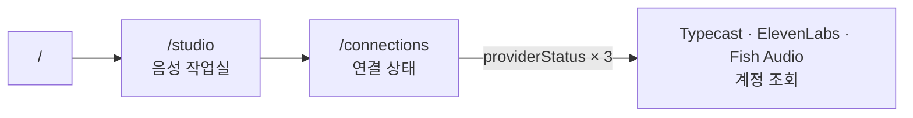

# T2 공급자 연결 상태 구현 계획

> **For agentic workers:** REQUIRED SUB-SKILL: Use superpowers:subagent-driven-development (recommended) or superpowers:executing-plans to implement this plan task-by-task. Steps use checkbox (`- [ ]`) syntax for tracking.

**Goal:** 세 공급자(Typecast·ElevenLabs·Fish Audio)가 서버 키로 연결되는지, 안 되면 무엇이 문제인지 `/connections` 한 화면에서 보고, 뒤 TASK가 그대로 쓸 공급자 모듈 구조·계약·오류 판정을 만든다.

**Architecture:** `packages/api/src/providers/`에 계약(`contract.ts`, zod만 import), 오류 판정과 확인 호출 공통 틀(`errors.ts`), 공급자 모듈 셋, 묶음(`index.ts`의 `createProviders`)을 둔다. `apps/web/src/context.ts`가 소유자가 있는 요청에만 `ENV` 키로 클라이언트를 만들어 context의 `providers`로 넘기고, `providerStatus`(`protectedProcedure`)가 공급자 하나를 확인해 연결 상태 8종 중 하나를 값으로 돌려준다. 화면은 Server Component 페이지 안의 클라이언트 컴포넌트 하나가 `useQueries`로 세 조회를 들고, 표시만 하는 요약 띠와 카드 3장에 결과를 내린다. 앱 틀(T1)은 리디자인한 새 세계 토큰과 메뉴 구성으로 바꾸고, 화면은 승인 시안을 기준으로 comp-led 게이트(impeccable `build-phase`)를 거친다.

**Tech Stack:** Next.js 16.3.6 App Router, oRPC 1.15.4, TanStack Query 5.103.2, zod 4.6.5, vitest 5.0.2, `@neosapience/typecast-js` 0.4.14, `@elevenlabs/elevenlabs-js` 2.70.0, shadcn(Base UI 1.8.0) `packages/ui`, Tailwind CSS 4, Biome 2.

**Spec:** [T2 스펙](T02-provider-status.md)(사용자 확인 2026-09-30, 2026-10-04 리디자인 개정은 사용자 확인 2026-10-04, 구속력 있는 정본), [연결 상태 브리프](../../briefs/provider-status.md)(11절 방향 계약), [앱 틀 브리프](../../briefs/app-shell.md), [리디자인 브리프](../../briefs/redesign.md), 승인 시안 `.impeccable/mocks/decision/assigned.png`(사본 `tasks/evidence/redesign/comp-connections-approved.png`), [사이트맵](../../briefs/site-map.md), [로드맵 2절과 T2](../implementation-roadmap.md), [ADR 0002](../../adr/0002-orpc-only-api.md).

**실행 방식(4행):** superpowers:subagent-driven-development + test-driven-development, ponytail 모드. 태스크마다 `bts-implementer`가 구현하고 코디네이터(메인 세션)가 결과를 확인한다. "코디네이터"라고 적힌 단계는 `bts-implementer`에 맡기지 않는다.

## Global Constraints

- 커밋은 태스크마다 하지 않는다. 라운드 끝(`bts-dev-cycle` 5절)에 한 번 한다. 태스크 끝의 증거 메모는 코디네이터가 대조표(`tasks/todo.md` 활성 라운드) 행에 적는다.
- `apps/web/.env`와 실제 키를 읽거나 출력하지 않는다. 로그·증거·테스트 출력에 키를 남기지 않는다.
- 공급자 API를 실제로 부르지 않는다. 자동 테스트는 `vi.stubGlobal("fetch", …)`로 HTTP 응답만 흉내 낸다(두 SDK 모두 호출 시점의 전역 `fetch`를 쓴다).
- `bts-implementer`는 `/connections`를 브라우저로 열지 않는다. 열면 실제 조회가 3회 나간다. 실제 조회는 메인 세션의 확인과 QA에서만 하고, QA와 재QA를 합쳐 45회, 공급자별 15회 이하다(스펙 9절, 2026-09-30 사용자 승인).
- 유료이거나 상태를 바꾸는 호출(생성, 시험 생성, 클론, 클론 삭제)은 이 TASK에 없다.
- 로컬 관리자 모드(`AGENTS.md`, 로드맵 2절): 소유자는 서버가 정한 `context.ownerId`에서만 얻는다. 공급자 키를 쓰는 코드는 `/api/rpc`의 `protectedProcedure`로만 연다. Server Action과 새 Route Handler를 만들지 않는다. Server Component와 SSR은 db·공급자 모듈을 import하지 않고 `providerStatus`를 부르지 않는다.
- `packages/api/src/providers/contract.ts`는 zod만 import한다(SDK·서버 모듈 금지). 화면은 contract에서 `import type`만 한다(zod와 SDK가 클라이언트 번들에 들어가지 않게).
- 확인 호출은 재시도하지 않는다. ElevenLabs는 요청 옵션 `maxRetries: 0`, Typecast와 Fish Audio는 재시도 코드가 없다. SDK 오류 객체, 오류 메시지, 응답 헤더, 키, 응답 값을 로그에 쓰지 않는다. 확인 실패 로그는 한 줄이고 공급자, 오류 이름, 검증에 실패한 필드 경로만 담는다(스펙 3절).
- 색·간격·반경은 토큰과 Tailwind 기본 눈금만 쓴다. 원시 hex나 임의 값(`ring-[3px]`, `mt-[13px]`)을 새로 넣지 않는다. 상태 색은 새 `success`·`warning` 토큰만, 옅은 청록은 `bg-primary/8`·`bg-sidebar-accent`만 쓴다. 굵기는 `font-normal`·`font-bold` 둘뿐이다(`DESIGN.md` 서체: `font-medium`·`font-semibold`를 새로 쓰지 않는다).
- 새 shadcn 프리미티브는 `.agents/skills/shadcn/SKILL.md` 절차로 `pnpm --filter @tts-pilot-app/ui exec shadcn add badge spinner`로 더한다(코디네이터). 생성 파일은 이 프로젝트 모양(import 경로, 반경, 임의 값 없음)으로 맞춘다.
- `package.json`, `pnpm-lock.yaml`, `turbo.json`, `next.config.ts`, 루트 설정의 변경은 코디네이터가 한다.
- 화면 문구는 브리프와 이 계획의 문구만 쓴다. 구현하는 쪽이 새 문구나 색을 만들지 않는다(브리프 10절). 문구는 `-어요` 보이스다.
- 인터랙티브 요소는 44px 이상이고 `focus-visible`이 보인다.
- 파일을 고친 뒤 `pnpm exec biome check --write <파일들>`로 포맷한다(들여쓰기는 탭).
- 패키지 이름: 앱 `web`, API `@tts-pilot-app/api`, UI `@tts-pilot-app/ui`. API 테스트는 `pnpm --filter @tts-pilot-app/api test [파일]`, 전체는 `pnpm test`다.
- `apps/web`은 `typedRoutes: true`다. `/connections` 링크(메뉴, 작업실 빈 상태)는 페이지를 만든 뒤에 쓴다(Task 8 → Task 9). `pnpm check-types`가 먼저 `next typegen`을 돌린다.
- ponytail: 스펙에 없는 추상화를 만들지 않는다. 의도한 한계는 `ponytail:` 주석으로 남긴다.
- 개발 서버는 `http://127.0.0.1:3001`(`pnpm --filter web dev`). 개발 서버가 도는 동안 `.next`를 지우거나 옮기지 않고, `next build`는 개발 서버를 끈 뒤에 돌린다(next-dev-loop).
- 이 계획의 대조표 행 번호는 보안 리뷰 행이 붙기 전 번호다(아래 "대조표 행과 태스크").

## Review Focus

- ElevenLabs 실제 구독 응답이 SDK 스키마(필수 필드 20개)와 어긋날 때 → 연결된 계정이 '확인 실패'로 보이면 안 된다. Task 4의 "초기화 시각이 null이고 모르는 필드가 더 와도 연결됨이다" 테스트로 null과 추가 필드를 고정한다. S1 실측에서 ElevenLabs가 확인 실패면 서버 로그 한 줄(예: `[providerStatus] elevenlabs 확인 실패: ParseError (response.character_count)`)의 필드 경로로 원인을 찾고, 멈추고 보고한다(스펙 변경이 필요하다).
- 키보드로 '다시 확인하기'를 누른 직후 → 포커스가 그 버튼에 남고(`aria-disabled`), 확인 중에 Enter를 다시 눌러도 호출이 늘지 않는다. Task 8 Step 7(코디네이터 브라우저 확인).
- 같은 결과가 나오는 '다시 확인하기'를 두 번 누를 때 → 알림 영역이 두 번 다 읽힌다(비웠다가 채운다). Task 8 Step 7.
- 390px에서 더보기를 연 채 Tab을 계속 누르거나, 더보기 안 테마 메뉴(포털)에서 Esc를 누르거나 값을 고를 때 → Tab은 더보기 버튼과 펼친 내용 사이만 돌고, 테마 메뉴의 Esc는 테마 메뉴만 닫고, 테마를 골라도 더보기가 닫히지 않는다. 열린 채 768px 이상으로 넓히면 Tab이 갇히지 않는다. Task 9 Step 8.
- 첫 조회가 데이터 없이 실패한 카드(500·연결 끊김)를 다시 확인할 때 → 카드가 스켈레톤으로, 띠가 "확인하고 있어요"로 돌아가지 않는다. Task 8 Step 7(`--abort`).
- 한도 확장으로 잔여가 음수이거나, 10억 이상인 사용량, 긴 공급자 오류 코드 → "0"과 천 단위 구분으로 보이고 320px에서 넘치지 않고 줄바꿈된다. Task 8 Step 7.

## bts-starter-kit v0.9.5 반영 (2026-10-03, 사용자 확인 2026-10-04)

- 카드 버튼 문구는 '다시 확인하기'다(`bts-ui` 이름과 문구: 버튼 문구는 동사로 끝냄, 사용자 결정). 접근 이름은 "{공급자} 다시 확인하기"(Task 8).
- 메뉴의 나머지 '준비 중' 7개는 그대로 둔다(사이트맵 "예외", 사용자 결정). 리디자인으로 접힌 묶음 "다음에 열릴 화면"에 넣는다(Task 9).
- 사용량 숫자와 확인 시각에 `tabular-nums`를 준다(impeccable-map "시각 자산": Operate 화면의 숫자). Task 8.
- 마감 전 링크·버튼 확인(스펙 S16)과 impeccable-map 증거 예시(구현 행의 서체·이미지·모션, 런타임 행의 누른 링크·버튼 수)를 "구현 뒤"에 더했다.
- 휴대폰 더보기가 열린 동안 Tab은 메뉴 안에서만 돈다(impeccable-map 햄버거 메뉴, 사용자 결정 2026-10-03). Task 9에 더한다.
- 새 화면은 이미지 시안부터 만든다(comp-led, 사용자 결정 2026-10-03). 시안은 OpenAI API 키로 그렸다(`impeccable generate-image`, 사용자 선택).
- **구현 전에 `bts-ui` 리디자인을 한다(사용자 요청 2026-10-03).** 지금 화면 진단(스크린샷·critique) → 디자인 카탈로그에서 새 시각 세계 고르기 → 리디자인 브리프 → 이미지 시안 확인 순서다. 그 결과로 브리프·스펙과 Task 7~9(화면)를 다시 쓴다. Task 1~6(서버, 조회 공통)은 시각 세계와 관계없어 그대로 둔다. 그때까지 4행(구현)을 시작하지 않는다. → 2026-10-04 리디자인 단계를 마쳤다(아래 "리디자인 반영").
- S2 앞의 키 비움 확인을 가린 값 출력(`varlock load --agent`)에서 exit만 보는 `varlock run … test -z`로 바꿨다(`bts-ui` "키": 있는지만 볼 때는 exit로 본다). 구현 뒤 29행.

## 리디자인 반영 (2026-10-04, 사용자 확인 2026-10-04)

[리디자인 브리프](../../briefs/redesign.md)의 결과(새 세계 채널톡 문법 + 대표 색 청록 + Pretendard, 5절 표현 바꾸기 모두, 결정 페이지에서 고른 시안 1 "요약 띠 + 카드 세 장")로 Task 7~9를 다시 썼다. Task 1~6과 Task 10의 서버·조회 부분은 그대로다.
- **Task 7(새 세계 토큰과 프리미티브):** `globals.css`의 `:root`·`.dark` 값을 통째로 바꾼다(시맨틱 이름 구조는 그대로). 상태 토큰은 글자색 하나(`--success`, `--warning`)로 줄이고 바탕은 같은 색의 10%로 만든다(이전 계획의 `--success-foreground` 쌍 대신). 기본 전환 150ms. `Badge` 굵게 14px, `Button` `outline` 청록·`lg` 44px, `Card` 그림자와 경계선.
- **Task 8(연결 상태 화면):** 요약 띠(`SummaryBanner`, 화면 컴포넌트 안)를 더하고, 카드를 시안 순서(이름 → 배지 → 원인 → 코드 칩 → 사용량 → 확인 시각 → 너비를 채운 버튼)로 바꿨다. 조회·알림·소유자 없음 처리는 그대로다.
- **Task 9(앱 틀 리디자인):** 이전의 "메뉴 링크와 휴대폰 더보기"를 넓혔다. 메뉴 묶음, 휴대폰 막대 3칸, 더보기 Tab 가두기, 테마 버튼, 페이지 머리, 작업실 흐름 지도, 앱 틀을 루트 레이아웃으로 옮겨 없는 주소도 앱 틀 안에. 더보기 안에 링크가 없어져 링크 이동 뒤 포커스 복귀(`onNavigate`)와 더보기 버튼의 현재 위치 표시는 만들지 않는다(스펙 5절 "만들지 않는 것").
- **바뀐 계획 리뷰 결정:** F4(outline 버튼 중립 글자)는 승인 시안의 청록 테두리 버튼으로, `Badge` 12/600은 14/700(굵기 두 단계)으로, `Card` 본문 14px은 16px로, F10의 작업실 빈 상태 문구는 흐름 지도와 연결 안내 한 줄로 바뀌었다.
- **계획 검토(2026-10-04, 독립 서브에이전트, 읽기 전용, high 0·medium 4·low 7):** 반영 M1 데이터 없이 실패한 조회를 다시 확인할 때 첫 확인 중으로 돌아가는 문제(`toView`, query-core 5.103.2 `fetchState` 확인), M2 더보기 Esc·Tab이 포커스가 body일 때 동작하지 않는 문제(포털 판정을 `event.target`으로), M3 없는 주소에서 '연결 상태'가 활성으로 보이는 문제(같을 때만 활성), M4 `[...missing]`이 `typedRoutes`를 무력화하는 문제(`typegen.js` 확인 → 앱 틀을 루트 레이아웃으로 옮기는 방식으로 바꿈), low 띠·메뉴 8%를 브리프에 맞춤, `EmptyDescription` 굵기, 카드 높이 표현 하나(그림자 뺌), `CardFooter` 경계선은 프리미티브에서 뺌, 버튼 `aria-label`, 휴대폰 가로에서 막대 `max-h-svh overflow-y-auto`, 제목 대안(직접 `<title>` 대신 멈춰 보고). 기각: 테마 메뉴 항목 44px 미달(테마 메뉴는 `DropdownMenuRadioItem`이고 이미 `min-h-11`이다. 지적은 쓰지 않는 `CheckboxItem`).
- **comp-led 게이트:** Task 9 뒤 메인 세션이 `impeccable build-phase`의 spec → (plates 없음) → hero → sections → motion → responsive를 거치고, 마감에서 finish reviewer와 documenter를 부른다("구현 뒤"). 게이트가 내는 크기·간격 차이는 메인 세션이 같은 파일에서 고치고 18·20행 증거에 적는다.

## 계획 리뷰 반영 (2026-09-30, 3행)

- **ponytail-review 반영:** P1 `Badge`는 T2가 쓰는 변형(`secondary`, `success`, `warning`)만 둔다(Task 7). P4 상태 코드 → 사유 표는 `errors.test.ts`가 고정하고, 공급자 테스트는 대표 변환(401, 정수 `Retry-After`를 가진 429)과 ElevenLabs 권한 부족 형태, 200·잔여 0·시간 초과·필드 누락·키/호스트만 본다(Task 1~4). P5 `createProviders`는 작은 도우미 `withKey` 하나로(Task 5). P6 `createQueryClient`를 `getQueryClient`에 합친다. 2026-09-30 확인: `createQueryClient`를 import하는 곳은 없다(`providers.tsx`는 `queryClient`만)(Task 6).
- **ponytail-review 기각 P2:** Card·Skeleton 기본 모양 맞춤은 둔다. T2가 Card를 처음 쓰는 화면이고, 공통 프리미티브는 처음 쓰는 TASK가 `DESIGN.md`에 맞춘다는 규칙이다. 디자인 리뷰가 반경 값을 확인했다.
- **ponytail-review 기각 P3:** `ProviderClient`를 함수로 줄이지 않고 객체로 둔다. T3가 같은 클라이언트에 성우 목록 메서드를 바로 더한다.
- **ponytail-review 기각 P7:** "읽은 스킬과 계획에 반영한 것" 절은 줄이지 않는다. 2행 증거다.
- **plan-design-review 반영:** F1 확인 실패 문구, F2 소유자 없음 설명(`pnpm dev`), F3 같은 날 확인 시각에 초, F4 outline 버튼 라이트 바탕 `bg-card`(Task 7), F5 작업실 링크 포커스, F6 확인 중 버튼 `aria-disabled:pointer-events-none`, F7 Card의 `aria-busy` 삭제, F8 요청 제한 시각 문구, F9 공급자 장애·한도 부족 문구, F10 작업실 빈 상태 문구와 탭 제목 "음성 작업실", F11 ElevenLabs 초과 표시 "한도를 넘겨 사용 중"(요금 문구 없음), F12 상태 토큰 주석. 문구는 아래 "계획에서 정한 것" 표.
- **plan-eng-review 반영:** F2 검증 실패 로그는 필드 경로만(Task 2, 테스트 1개 추가). F3 CSRF curl은 잘못된 입력으로(Task 5 Step 6). F4 `publicProcedure`에서 `context.providers`를 쓰지 않는다는 문구(Task 10)와 security 행 점검 항목. F5 `Retry-After`는 `^[1-9]\d{0,5}$`만(Task 1, 테스트 2줄). F6 Fish 크레딧은 버림 표시(`roundingMode: "trunc"`, Task 8). F7 권한 부족이면 코드 줄에 권한 코드를 먼저(Task 2·4). F8 S2 전에 키 덮어쓰기를 값 없이 확인(구현 뒤 29행).

## 읽은 스킬과 계획에 반영한 것

2행 증거다. 모두 Read로 `.agents/skills/<이름>/`의 프로젝트 판을 읽었다.

- `bts-api`(+ `references/ownership-test.md`): 불변식 1·2 → `providerStatus`는 `protectedProcedure`, 소유자는 `context.ownerId`만. 불변식 4 → `.input(z.object({ provider }))`와 `.output(providerStatusResultSchema)`, 출력에 키 없음(테스트로 고정). 불변식 5 → 던지는 코드는 `UNAUTHORIZED`·`BAD_REQUEST`뿐. 불변식 6·7 → `providers/`·`context.ts`·rpc 라우트가 `authPaths`라 security 리뷰 행을 붙인다. ownership-test의 `createRouterClient` 패턴을 라우터 테스트에 쓰고, 소유 데이터가 없어 2계정 격리(13행)는 AC3 테스트로 대신한다. 프로시저를 더했으니 `docs/domain/project.md` API 표를 같은 작업에서 고친다(Task 10).
- `bts-api` 공식 스킬 연결: `better-auth-best-practices`, `better-auth-security-best-practices`, `email-and-password-best-practices`는 N/A다. T2는 Better Auth 설정·세션·가입을 바꾸지 않는다. `bts-db`도 N/A다(DB 없음).
- `bts-web`: Server Component 기본 → `connections/page.tsx`는 제목 메타데이터만 두고, `"use client"`는 `connection-status.tsx` 하나다. 조회는 `orpc` 유틸과 TanStack Query로 하고 `/api/rpc`를 직접 fetch하지 않는다. 서버 전용 모듈을 클라이언트에서 import하지 않는다 → contract는 `import type`만. loading·empty·error·비인가 상태를 나눈다 → Skeleton, 키 없음, 확인 실패, 소유자 없음 `Empty`. 보호 페이지 redirect 규칙은 로컬 관리자 모드라 쓰지 않는다(`AGENTS.md`). 예시 파일 `app/dashboard/page.tsx`는 T1에서 지워 N/A.
- Next 번들 문서(`apps/web/node_modules/next/dist/docs/`): `01-app/03-api-reference/04-functions/generate-metadata.md` → `title.template`은 자식 세그먼트에만 적용되고 `default`가 필수라 루트에 `{ template: "%s · TTS Pilot", default: "TTS Pilot" }`. `01-app/03-api-reference/02-components/link.md` → `onNavigate`는 SPA 이동 때만 불려 더보기 닫기와 포커스 복귀에 쓴다(수정키 클릭에는 안 불린다). `01-app/02-guides/package-bundling.md` → SDK 번들 경고가 나면 `serverExternalPackages`(Task 8 Step 5 조건부). 외부 스킬과 번들 문서가 어긋난 곳은 없었다.
- `vercel-react-best-practices`: `server-no-shared-module-state` → `QueryClient`를 서버에서는 요청마다, 브라우저에서는 하나(`getQueryClient`, `isServer`). `rerender-move-effect-to-event` → 스크린 리더 알림은 '다시 확인하기' 핸들러에서 `refetch` 결과로 정하고 effect를 쓰지 않는다. `rerender-derived-state-no-effect` → 조회 실패의 표시(`toView`)와 경로 이동 때 더보기 닫기를 렌더 중에 정한다. `rendering-conditional-render` → 사용량 0을 보이려고 `&&` 대신 삼항. `rerender-no-inline-components` → 카드 하위 컴포넌트는 모듈 수준. `js-hoist-regexp` → `Retry-After`·Fish 크레딧 정규식과 `Intl` 포맷터를 모듈 수준에. `client-event-listeners` → Esc·바깥 누르기 리스너는 더보기가 열린 동안에만 하나씩. `bundle-barrel-imports`·`bundle-conditional` → 화면은 contract 타입만 가져가고, 빌드 뒤 클라이언트 청크에 SDK·공급자 호스트 문자열이 없는지 확인한다(Task 8 Step 5). `async-parallel` → `useQueries`로 셋을 병렬로.
- `vercel-composition-patterns`: `architecture-avoid-boolean-props` → 카드 props를 `result`(undefined면 첫 확인 중)와 `checking` 둘로 줄이고, 조회 자체 실패는 `toView`가 확인 실패 결과로 바꿔 넘긴다(`failed` 불리언 없음). `state-lift-state` → 조회·알림 상태는 `ConnectionStatus` 한곳에. `patterns-explicit-variants` → 상태 배지는 `Badge`의 `success`·`warning` 변형으로.
- `next-dev-loop`: 16.3.6 Turbopack이라 요구를 채운다. 20·26행에서 `get_compilation_issues`, `get_errors`, `get_routes`(`/connections` 포함)로 본다. `.next` 보존 규칙 → S8의 production 빌드 전에 개발 서버를 끈다.
- `shadcn`(+ `rules/composition.md`, `customization.md`): 설치 목록부터 확인해 `badge`·`spinner`가 없음을 보고 `add` 한다. dry-run(2026-09-30)으로 생성 파일 2개와 내용(`cn`을 `"cn"`에서 import, `rounded-none`, `ring-[3px]`, 영어 `aria-label="Loading"`)을 확인해 맞출 곳을 Task 7에 적었다. Button 로딩은 `Spinner` + `data-icon` + `disabled`(isPending 없음). 버튼·배지 아이콘은 `data-icon`, 크기 클래스 없음. 상태는 커스텀 span 대신 `Badge`. 사용자 정의 색은 customization.md 방식(`--success`/`--success-foreground` + `@theme inline`). 소유자 없음은 `Empty`. 카드는 `CardHeader`/`CardTitle`/`CardAction`/`CardContent`/`CardFooter` 전체 구성. Base UI 프로젝트의 toast 권고는 기존 sonner를 유지한다(범위 밖).
- `turborepo`: N/A. `turbo.json`을 바꾸지 않는다. 세 키는 이미 `globalEnv`에 있다.
- `bts-ui`(+ `references/impeccable-map.md`): 16행 context 결과를 따른다(새 스타일 고르기 없음). UI 태스크 편집 전에 `.agents/skills/impeccable/reference/craft-floor.md`를 읽는다 → 카드 반경 16px(`rounded-2xl`), 높이 표현은 테두리 하나, 모노 글꼴은 코드(변수 이름, 오류 코드)에만. 리뷰(critique·audit·web-design-guidelines)는 메인 세션에서 한다. `DESIGN.md`는 merge만 한다(25행).
- `bts-verify`(+ `references/browser.md`): 화면+프로시저 변경이라 typecheck·lint·test·build·런타임·desktop/mobile 스크린샷을 모두 한다. 오류 예산 0, ego-browser를 못 쓰면 대안을 증거에 적는다. `bts-implementer`의 런타임 확인은 공급자를 부르지 않는 경로(curl로 403·401·400, SSR HTML)로만 한다.
- `tts-provider`: 구조 → SDK 호출은 `providers/<공급자>.ts`에만, contract는 SDK import 없음. 키와 공식 호스트를 SDK 생성자에 명시하고 빈 키면 클라이언트를 만들지 않는다(테스트에서 환경변수 대체보다 앞서는지 고정). 과금 없는 호출도 `protectedProcedure`. SDK 오류 객체를 로그·`cause`에 넘기지 않는다 → `ProviderHttpError`로 바꿔 담는다. 오류 매핑 표를 `reasonFromHttp`로 옮기고 `no_permission`을 더한다. "먼저 1" → Typecast `llms.txt`를 2026-09-30에 다시 읽어 연동 식별을 정했다(스펙과 다른 점 2). "먼저 2" → SDK 두 개의 타입 선언과 소스를 확인했다(아래).
- `impeccable`(2026-10-03~04, 리디자인): `reference/new-work.md`(표면 범위 구성 추첨, 결정 페이지, 방향 계약, build-phase), `reference/visualize.md`(시안 규율과 승인 기록), `reference/critique.md`. 결정 → 승인 시안 사이드카 `"approved": true`, `build-phase start --comp`(spec 단계 열림), 연결 상태 브리프 11절 방향 계약, "구현 뒤"의 게이트 순서. 서체는 브리프가 Pretendard로 못 박아 `font-match`의 추천 서체로 바꾸지 않는다(SKILL "The brief wins").
- 번들 문서 `03-file-conventions/not-found.md`·`04-functions/not-found.md`(2026-10-04): 루트 `not-found`는 없는 주소 전부를 받고 루트 레이아웃 안에서 그려진다 → 앱 틀을 `(app)/layout.tsx`에서 루트 레이아웃으로 옮겨 없는 주소도 메뉴 안에서 보이게 한다. 모든 경로를 받는 라우트(`[...missing]`)는 `typedRoutes`가 모든 경로를 통과시키게 되어 쓰지 않는다(`typegen.js`의 `CatchAllSlug`, 계획 검토 M4). `not-found`의 `metadata`는 문서에 `global-not-found`만 적혀 있지만 Next 소스(`resolve-metadata.js`)가 오류 규약 모듈의 `metadata`를 모은다. Task 9 Step 7에서 확인한다.
- `supabase-postgres-best-practices`, `neon-*`: N/A. DB 변경이 없다.

**SDK 확인(2026-09-30):** `npm pack`으로 `@neosapience/typecast-js@0.4.14`(npm latest)와 `@elevenlabs/elevenlabs-js@2.70.0`(npm latest)을 scratchpad에 풀어 타입 선언과 소스를 읽었다. 프로젝트에는 설치하지 않았다. 이 계획의 공급자 코드와 테스트를 scratchpad에서 두 SDK, zod 4.6.5, vitest 5.0.2, `@orpc/server` 1.15.4로 실행해 39개(owner 테스트 제외, 계획 리뷰 반영 뒤)가 통과했고, `tsc`(프로젝트 tsconfig 옵션)와 Biome(프로젝트 설정)도 통과했다. `maxRetries`, `abortSignal`, 명시한 호스트, 권한 코드 우선, 필드 경로 로그를 빼면 해당 테스트가 실패하는 것도 확인했다. ElevenLabs `ParseError`의 `errors[].path`는 `response.character_count`처럼 오고, 필수 키 누락은 `response`까지만 온다(키 이름은 메시지에만 있고, 메시지에는 받은 값도 들어 있어 쓰지 않는다). 웹 코드는 `apps/web/node_modules`로 `tsc`가 통과했다.

| 확인한 것 | Typecast 0.4.14 | ElevenLabs 2.70.0 |
|---|---|---|
| 생성자 | `new TypecastClient({ apiKey, baseHost, source, generatedBy })`. `source`·`generatedBy`는 함께 줘야 하고 `generatedBy`가 `[a-z0-9][a-z0-9._-]{0,31}`가 아니면 생성자가 던진다. 빠진 값은 `TYPECAST_API_KEY`·`TYPECAST_API_HOST`로 대체하고 키가 없어도 헤더 없이 보낸다 | `new ElevenLabsClient({ apiKey, environment, baseUrl, timeoutInSeconds, maxRetries, fetch, logging })`. `apiKey`가 없으면 `ELEVENLABS_API_KEY`, 그래도 없으면 생성자가 던진다. `ElevenLabsEnvironment.Production` = `https://api.elevenlabs.io` |
| 확인 호출 | `getMySubscription(): Promise<SubscriptionResponse>`(`plan`, `credits.plan_credits`, `credits.used_credits`). 인자 없음, 취소·시간 제한·재시도 없음, 응답 검사 없음 | `user.subscription.get(requestOptions)`. 요청 옵션 `maxRetries`, `abortSignal`, `timeoutInSeconds`(기본 240초) 확인. 응답은 Fern 스키마로 20개 필수 필드를 검사하고 camelCase로 준다(`characterCount`, `characterLimit`, `maxCreditLimitExtension: number \| "unlimited"`, `nextCharacterCountResetUnix?`). 모르는 필드는 통과, null 초기화 시각은 `undefined` |
| 오류 | `TypecastAPIError`(`statusCode`, `response`는 JSON 본문). 응답 헤더 없음 | 상태 코드 오류는 `ElevenLabsError`(`statusCode`, `body`, `rawResponse.headers`). `abortSignal`로 끊으면 `statusCode` 없는 `ElevenLabsError`. 스키마 불일치는 `ParseError`. SDK 로그는 기본 `silent` |
| HTTP | 호출 시점의 전역 `fetch`, 헤더 `X-API-KEY` | Node 18+에서 호출 시점의 전역 `fetch`, 헤더 `xi-api-key`. 재시도(408·429·5xx)는 `maxRetries: 0`이면 돌지 않는다 |

## 스펙과 다른 점

계획 리뷰에서 나온 다음 네 가지는 스펙 2절 "계획 리뷰에서 바꾼 것" 행에 들어갔다(2026-09-30 사용자 확정). 이 계획은 그 행을 따른다. 사용자가 되돌리면 표시한 태스크만 고친다.
- ① ElevenLabs 응답은 zod 대신 SDK 2.70.0의 응답 스키마 검사로 확인한다. `ParseError`는 `runCheck`가 확인 실패로 바꾸고 필드 경로를 로그에 남긴다(Task 2·4). SDK가 쓰지 않는 필드까지 검사하는 위험은 Review Focus 1번이다.
- ② `refetchOnReconnect: false`(Task 8).
- ③ 전역 알림의 영문 'retry' 버튼 삭제. `query.invalidate()`는 다시 조회하지 않는다(query-core 5.103.2)(Task 6).
- ④ 작업실 탭 제목 "음성 작업실"(Task 8).

아직 스펙에 없는, 이 계획만의 것:
1. **Typecast 연동 식별 값:** research 문서의 `generatedBy: "codex"`는 `llms.txt`의 예시 값이다. 2026-09-30에 다시 읽은 `llms.txt`의 "Coding-Agent Attribution"은 `source=api-docs`와 "연동 코드를 쓴 코딩 에이전트의 소문자 토큰"(예: `codex`, `claude-code`)을 요구한다. 이 연동은 Claude Code가 쓰므로 `source: "api-docs"`, `generatedBy: "claude-code"`로 한다. 나중에 다른 에이전트가 이 연동을 크게 고치면 그 값으로 바꾼다.
2. **확인 호출 공통 틀의 위치:** 10초 제한·경주·실패 판정·로그를 세 모듈에 되풀이하지 않고 `errors.ts`의 `runCheck`와 `ProviderHttpError`에 둔다. 스펙 6절 파일 표의 `errors.ts` 책임을 넓힌 것이고 새 파일은 없다. 세 모듈 모두 같은 타이머와 경주로 끊고, Fish Audio는 그 신호를 `fetch`의 `signal`로, ElevenLabs는 `abortSignal`로도 넘긴다(스펙 3절 그대로).
3. **공급자별 테스트 줄임(ponytail-review P4):** 스펙 8절은 공급자마다 401·403·402·429·503을 보라고 한다. 상태 코드 → 사유 → 연결 상태는 `errors.test.ts`(`reasonFromHttp` 표와 `runCheck` 변환)가 한 번 고정하고, 공급자 테스트는 SDK·`fetch` 오류를 바꿔 담는 대표 경우(401, 정수 `Retry-After`를 가진 429)와 ElevenLabs 권한 부족 두 형태만 본다. `Retry-After` 날짜·헤더 없음·0·너무 큰 값은 `errors.test.ts`에만 둔다. AC2의 판정은 모두 테스트로 남는다.

## 계획에서 정한 것

- **화면 문구:** 브리프 6절과 스펙 4절의 요지를 아래 문장으로 확정한다. 구현은 이 표만 쓴다. 계획 디자인 리뷰(3행)에서 바꿀 수 있다.

| 상태 | 배지 | 원인과 할 일 |
|---|---|---|
| 연결됨 | success, `CircleCheck`, "연결됨" | (없음. 잔여 사용량과 확인 시각) |
| 키 없음 | secondary(neutral), `KeyRound`, "키 없음" | 서버에 키가 없어요. `apps/web/.env`에 `TYPECAST_API_KEY`를 넣고 다시 확인해 주세요. |
| 키 오류 | warning, `TriangleAlert`, "키 오류" | 키가 틀렸거나 만료됐어요. {공급자} 대시보드에서 키를 확인해 주세요. |
| 권한 부족 | warning, `TriangleAlert`, "권한 부족" | 키는 맞지만 사용량 조회 권한이 없어요. {공급자} 대시보드에서 키 권한을 확인해 주세요. |
| 한도 부족 | warning, `TriangleAlert`, "한도 부족" | 남은 사용량이 없어요. {공급자}에서 플랜이나 충전 상태를 확인해 주세요. |
| 요청 제한 | warning, `TriangleAlert`, "요청 제한" | 잠시 뒤 다시 확인해 주세요. 초를 받으면 확인 시각에 더한 시각으로 "오후 3:12:35 이후 다시 확인해 주세요." |
| 공급자 장애 | warning, `TriangleAlert`, "공급자 장애" | {공급자} 서버에 문제가 생겼어요. 잠시 뒤 다시 확인해 주세요. |
| 확인 실패, 조회 자체 실패 | warning, `TriangleAlert`, "확인 실패" | 연결 상태를 확인하지 못했어요. 잠시 뒤 다시 확인해 주세요. |
| 소유자 없음 | (카드 대신 `Empty`) | 제목 "이 주소에서는 공급자 연결을 확인할 수 없어요", 설명 "개발 서버(`pnpm dev`)를 127.0.0.1 또는 localhost 주소로 열어 주세요."(`pnpm dev`는 코드 글꼴) |

- **공급자 오류 코드 줄:** 권한 부족이면 권한 코드(`missing_permissions`·`insufficient_permissions`)를 먼저 보인다. 그 밖의 ElevenLabs는 `detail.code`(없으면 `detail.status`), 나머지는 `HTTP 503`처럼 상태 코드다. Typecast 본문 `{"detail":"Invalid API key"}`는 코드가 아니라 문장이라 쓰지 않는다.
- **사용량 줄:** 브리프 7절 형식이다. 남은 값이 음수면 0으로 보인다(Typecast 초과 사용, ElevenLabs 한도 확장). 한도 확장으로 잔여가 0 이하인 ElevenLabs 연결됨은 "… · 한도를 넘겨 사용 중"이고 요금 문구는 쓰지 않는다(공급자 문서 근거 없음). 숫자는 `Intl.NumberFormat("ko-KR", { maximumFractionDigits: 2, roundingMode: "trunc" })`라 Fish Audio 12.349는 "12.34"(버림)다. 확인 시각은 같은 날이면 초까지(`second: "2-digit"`), 다른 날이면 날짜와 분까지다. "오후 3:12:05", "9월 30일 오후 3:12", "10월 12일", "12.34"가 나오는 것을 Node 26으로 확인했다.
- **'다시 확인하기' 버튼:** `variant="outline" size="lg"`(44px), 카드 너비를 채운다. 승인 시안대로 청록 테두리와 글자, hover는 옅은 청록이다(Task 7, 2026-10-04 리디자인으로 F4를 바꿈). 이름은 "{공급자} 다시 확인하기", 확인 중에는 "{공급자} 확인 중"이다. Base UI `focusableWhenDisabled`로 확인 중에도 포커스를 남기고 누르기만 막으며, `aria-disabled:pointer-events-none`으로 포인터도 막는다. `:disabled` 스타일(투명도 50%)이 걸리지 않아 "확인 중" 글자 대비도 지킨다(`DESIGN.md` button-disabled 4.5:1). Card에는 `aria-busy`를 두지 않는다.
- **토큰 대비(계산, 2026-10-04, oklch → sRGB, 투명 값은 그 아래 바탕과 섞어 계산):**

| 쌍 | 라이트 | 다크 |
|---|---|---|
| 본문 글자(`foreground`) / 카드 | black-85, 15.08:1 | white-90, 12.78:1 |
| 보조 글자(`muted-foreground`) / 카드·바탕·`muted` | black-60, 5.74·5.62·5.50:1 | white-60, 6.48·6.80·6.20:1 |
| 청록 글자(`primary`) / 카드·바탕 | brand-500, 5.52·5.15:1 | brand-350, 8.07·8.76:1 |
| 1차 버튼 글자 / `primary` | 흰색 5.52:1 | grey-900 8.76:1 |
| 요약 띠: 청록 / `primary-subtle`(2026-10-04 finish 리뷰로 8% 알파에서 바꿈) | 4.73:1 | 6.75:1 |
| 요약 띠: 보조 글자 / 같은 바탕 | 5.48:1 | 5.72:1 |
| 활성 메뉴: `sidebar-accent-foreground` / `sidebar-accent`(= `primary-subtle`) | 4.73:1 | 6.75:1 |
| 상태 `success` / 카드, `success-subtle` | 5.71, 4.83:1 | 6.95, 5.58:1 |
| 상태 `warning` / 카드, `warning-subtle` | 5.76, 4.88:1 | 7.05, 5.63:1 |
| 회색 배지(`muted-foreground` / `muted`) | 5.50:1 | 6.20:1 |
| `destructive` / 카드, 10% 바탕 | 5.49, 4.74:1 | 5.85, 5.01:1 |
| 포커스 윤곽(`ring`) / 카드·바탕(3:1 기준) | 5.52·5.15:1 | 8.07·8.76:1 |
- **작업실 빈 상태(스펙 5절 10번, 2026-10-04 리디자인):** 카드 제목 "음성을 만드는 순서", 단계 다섯(채널 "영상 채널과 분류를 정해요", 성우 "공급자 성우를 듣고 골라요", 대본 "원문과 발음용 대본을 써요", 검수 "생성 전에 숫자 발음을 확인해요", 생성 "음성을 만들고 내려받아요")에 번호와 '준비 중'. 아래 "공급자 연결은 [연결 상태]에서 확인할 수 있어요."([연결 상태]는 밑줄 있는 청록 링크). 탭 제목은 "음성 작업실 · TTS Pilot"(AC14).
- **요약 띠 문구(브리프 5절):** "연결 상태를 확인하고 있어요" / "3개 모두 연결됨" / "3개 중 {N}개 연결됨" + "{공급자} {상태 이름}"을 " · "로 이은 회색 목록. 공급자 이름은 카드 순서로 고른다.
- **키 교체 반영(스펙 3절):** 에이전트는 `.env`를 고치지 않으므로 사용자 테스트 3단계에서 확인한다. 반영되지 않으면 키 없음 문구를 "…를 넣고 개발 서버를 다시 켠 뒤 다시 확인해 주세요."로, 스펙 10절 3단계 앞에 "개발 서버를 다시 켠다"를 넣고 30행에서 다시 확인한다.

## 파일 구조

| 파일 | 책임 | 태스크 |
|---|---|---|
| `packages/api/src/providers/contract.ts` (신규) | 공급자 id·상태 8종·잔여 사용량·연결 상태 결과의 zod 스키마와 타입. zod만 import | 1 |
| `packages/api/src/providers/errors.ts` (신규) | `reasonFromHttp`, `retryAfterSeconds`(1). `ProviderHttpError`, `runCheck`, `ProviderClient`(2) | 1, 2 |
| `packages/api/src/providers/fish-audio.ts` (신규) | `fetch`로 `GET /wallet/self/api-credit` | 2 |
| `packages/api/src/providers/typecast.ts` (신규) | SDK `getMySubscription()` | 3 |
| `packages/api/src/providers/elevenlabs.ts` (신규) | SDK `user.subscription.get()` | 4 |
| `packages/api/src/providers/index.ts` (신규) | `createProviders(키)`: 키가 있는 공급자만 | 5 |
| `packages/api/src/providers/*.test.ts` (신규 4개) | 판정 표(`errors.test.ts`)와 `fetch`를 흉내 낸 공급자 테스트 | 1~4 |
| `packages/api/src/routers/provider-status.test.ts` (신규) | `createRouterClient`로 AC3·AC4 | 5 |
| `packages/api/src/context.ts`, `routers/index.ts`, `owner.test.ts` | `providers` 필드, `providerStatus`, 테스트 context에 `providers: null` | 5 |
| `packages/api/package.json`, `pnpm-lock.yaml` | 두 SDK (코디네이터) | 3 |
| `apps/web/src/context.ts` | 소유자가 있을 때만 요청마다 `createProviders(ENV 키)` | 5 |
| `apps/web/src/app/api/rpc/[[...rest]]/route.ts` | 로그 정책(AF-11) | 5 |
| `apps/web/src/utils/orpc.ts`, `apps/web/src/components/providers.tsx` | 한국어 전역 알림과 `meta.toast`, 요청별 `QueryClient` | 6 |
| `packages/ui/src/styles/globals.css` | 새 세계 토큰(라이트·다크), `success`·`warning`, 기본 전환 | 7 |
| `packages/ui/src/components/badge.tsx`·`spinner.tsx` (shadcn 추가), `card.tsx`, `skeleton.tsx`, `button.tsx`(outline, lg) | 프리미티브와 DESIGN.md 모양 | 7 |
| `apps/web/src/app/(app)/connections/page.tsx` (신규) | Server Component, 제목 | 8 |
| `apps/web/src/components/connection-status.tsx` (신규) | `useQueries`, 소유자 없음, 요약 띠, 알림 | 8 |
| `apps/web/src/components/provider-status-card.tsx` (신규) | 카드 표시만 | 8 |
| `apps/web/src/app/layout.tsx`, `apps/web/src/app/(app)/studio/page.tsx` | 제목 템플릿, 작업실 제목(8), 작업실 흐름 지도(9) | 8, 9 |
| `apps/web/src/components/app-nav.tsx`, `mode-toggle.tsx`, `page-header.tsx` | 메뉴 묶음·막대·더보기, 글자 로고, 테마 버튼, 페이지 머리 | 9 |
| `apps/web/src/app/layout.tsx`(앱 틀), `apps/web/src/app/not-found.tsx`, `apps/web/src/app/(app)/layout.tsx` (삭제) | 앱 틀을 루트 레이아웃으로, 앱 틀 안의 없는 주소와 제목 | 9 |
| `.agents/skills/tts-provider/SKILL.md`, `docs/domain/project.md`, `docs/plans/implementation-roadmap.md` | 문서 | 10 |

`services.ts`, `.env.schema`, `turbo.json`, `GLOSSARY.md`는 바꾸지 않는다. `GLOSSARY.md`의 연결 상태·잔여 사용량은 1행에서 이미 더했다.

## 대조표 행과 태스크

`packages/api/src/providers/` 파일이 생기면 `pnpm dev-cycle audit`이 security 리뷰 행 누락을 알린다. Task 2가 끝나면 코디네이터가 `pnpm dev-cycle table F --write --upgrade`로 행을 붙인다(증거는 보존된다). 공통 행(문서 영향, 사용자 확인) 앞에 붙으므로 그 뒤 번호가 하나씩 밀린다. 아래 번호는 붙이기 전 번호다.

| 행 | 증거의 출처 |
|---|---|
| 2 | 이 계획(`superpowers:writing-plans` → 이 파일)과 "읽은 스킬과 계획에 반영한 것" |
| 3 | 계획 리뷰(코디네이터): plan-eng-review, plan-design-review, ponytail-review |
| 4 | 위 "실행 방식"과 태스크별 위임 내역 |
| 5, 7~10 | `N/A: T2는 DB 스키마·마이그레이션이 없다(스펙 5절)` |
| 6 | Task 5 끝의 `pnpm check-types`, `pnpm exec biome check .` |
| 11 | Task 1 `providers/contract.ts`(`providerIdSchema`, `providerStatusResultSchema`) + Task 5 `providerStatus`의 `.input`·`.output` |
| 12 | Task 1~5 변경 파일과 읽은 스킬(`bts-api`, `tts-provider`) |
| 13 | `N/A: 소유 데이터 없음 → AC3로 대신` + Task 5 `provider-status.test.ts`의 "소유자가 없으면 UNAUTHORIZED이고 공급자를 부르지 않는다" 통과 출력 |
| 14 | Task 5 뒤 `pnpm check-types`, `pnpm exec biome check .`, `pnpm test` |
| 15 | Task 1~5 diff에 `bts-reviewer(code)` |
| security(추가) | Task 1~6 diff에 `bts-reviewer(security)`(아래 "구현 뒤") |
| 16, 17 | 이미 채움 |
| 18 | Task 6~9 변경 파일과 읽은 스킬(`bts-web`, `bts-ui`, `shadcn`, `vercel-react-best-practices`, `vercel-composition-patterns`, craft-floor, impeccable new-work) + comp-led 게이트(spec·hero·sections·motion·responsive) 결과 |
| 19 | Task 9 뒤 `pnpm check-types`, `pnpm exec biome check .`, `pnpm build` |
| 20 | 구현 뒤 코디네이터: next-dev-loop + 스크린샷 + 최종 `comp-diff` |
| 21~24 | 메인 세션: impeccable critique, audit + web-design-guidelines, finish reviewer 판정, polish, 재확인, `build-phase finish` |
| 25 | 메인 세션: impeccable documenter로 `DESIGN.md` merge(상태 토큰, 버튼·배지·요약 띠·메뉴, 다크 표면. 아래 "구현 뒤"의 메모)와 `.impeccable/design.json` |
| 26 | 구현 뒤 코디네이터: 통합 런타임 |
| 27, 28 | 코디네이터: ponytail-review, 최종 `bts-reviewer(code)` |
| 29, 30 | 메인 세션: QA S1~S15, 수정과 재QA |
| 31~33 | `pnpm agents:check`, `pnpm skills:check`, `pnpm dev-cycle case`·`status` |
| 34 | Task 10이 `tts-provider` 본문을 바꾼다. 코디네이터가 `bts-dev-cycle` 규칙으로 eval 재실행 여부를 정한다 |
| 35 | Task 10 + 백로그 AF-01·AF-11 체크(QA 통과 뒤) |
| 36 | 스펙 10절 사용자 테스트 |

---

### Task 1: 공급자 계약과 오류 사유 판정

**읽을 스킬:** `.claude/skills/tts-provider/SKILL.md`(오류 매핑 표), `.agents/skills/bts-api/SKILL.md`(불변식 4·5).

**Files:**
- Create: `packages/api/src/providers/contract.ts`
- Create: `packages/api/src/providers/errors.ts`
- Test: `packages/api/src/providers/errors.test.ts`

**Interfaces:**
- Consumes: 없음
- Produces:
  - `providerIdSchema`(`z.enum(["typecast","elevenlabs","fish_audio"])`), `type ProviderId`
  - `connectionStatusSchema`(8종), `type ConnectionStatus`
  - `remainingQuotaSchema`, `type RemainingQuota = { remaining: number; total: number | null; plan: string | null; resetAt: string | null; overageAllowed: boolean }`
  - `providerStatusResultSchema`, `type ProviderStatusResult = { provider; status; quota: RemainingQuota | null; providerCode: string | null; retryAfterSeconds: number | null; checkedAt: string }`
  - `reasonFromHttp(status: number, codes?: readonly string[]): ProviderErrorReason | null`
  - `retryAfterSeconds(header: string | null): number | null` — `^[1-9]\d{0,5}$`(1~999999초)만 숫자, 나머지는 null
  - `type ProviderErrorReason = "provider_auth" | "no_permission" | "quota" | "rate_limit" | "provider_input" | "provider_error"`

- [ ] **Step 1: 실패하는 테스트 작성**

`packages/api/src/providers/errors.test.ts`:

```ts
import { describe, expect, it } from "vitest";

import { reasonFromHttp, retryAfterSeconds } from "./errors";

describe("reasonFromHttp", () => {
	it("상태 코드를 tts-provider 표의 사유로 바꾼다", () => {
		expect(reasonFromHttp(401)).toBe("provider_auth");
		expect(reasonFromHttp(403)).toBe("provider_auth");
		expect(reasonFromHttp(402)).toBe("quota");
		expect(reasonFromHttp(429)).toBe("rate_limit");
		expect(reasonFromHttp(400)).toBe("provider_input");
		expect(reasonFromHttp(422)).toBe("provider_input");
		expect(reasonFromHttp(500)).toBe("provider_error");
		expect(reasonFromHttp(503)).toBe("provider_error");
	});

	it("401·403에 권한 부족 코드가 있으면 no_permission이다", () => {
		expect(reasonFromHttp(401, ["missing_permissions"])).toBe("no_permission");
		expect(reasonFromHttp(403, ["insufficient_permissions"])).toBe(
			"no_permission",
		);
		expect(reasonFromHttp(401, ["invalid_api_key"])).toBe("provider_auth");
		// 권한 코드라도 401·403이 아니면 권한 부족이 아니다.
		expect(reasonFromHttp(429, ["missing_permissions"])).toBe("rate_limit");
	});

	it("표에 없는 상태는 null이다", () => {
		expect(reasonFromHttp(404)).toBeNull();
		expect(reasonFromHttp(302)).toBeNull();
	});
});

describe("retryAfterSeconds", () => {
	it("1~999999초의 정수만 받는다", () => {
		expect(retryAfterSeconds("12")).toBe(12);
		expect(retryAfterSeconds(" 7 ")).toBe(7);
		expect(retryAfterSeconds("999999")).toBe(999_999);
		expect(retryAfterSeconds("0")).toBeNull();
		expect(retryAfterSeconds("1000000")).toBeNull();
		expect(retryAfterSeconds("Wed, 21 Oct 2015 07:28:00 GMT")).toBeNull();
		expect(retryAfterSeconds("1.5")).toBeNull();
		expect(retryAfterSeconds("-1")).toBeNull();
		expect(retryAfterSeconds("")).toBeNull();
		expect(retryAfterSeconds(null)).toBeNull();
	});
});
```

- [ ] **Step 2: 실패 확인**

Run: `pnpm --filter @tts-pilot-app/api test src/providers/errors.test.ts`
Expected: FAIL. `./errors`를 불러오지 못한다는 오류.

- [ ] **Step 3: 구현**

`packages/api/src/providers/contract.ts`:

```ts
import { z } from "zod";

// 화면과 서버가 함께 쓰는 공급자 계약이다. SDK와 서버 모듈을 import하지 않는다.
// 화면은 이 파일에서 타입만 가져간다(import type). zod가 클라이언트 번들에 들어가지 않게 하기 위해서다.
export const providerIdSchema = z.enum([
	"typecast",
	"elevenlabs",
	"fish_audio",
]);
export type ProviderId = z.infer<typeof providerIdSchema>;

// 연결 상태 8종(스펙 4절)
export const connectionStatusSchema = z.enum([
	"connected",
	"no_key",
	"provider_auth",
	"no_permission",
	"quota",
	"rate_limit",
	"provider_error",
	"check_failed",
]);
export type ConnectionStatus = z.infer<typeof connectionStatusSchema>;

// 잔여 사용량. 공급자가 준 값만 담는다. 단위는 공급자마다 다르다(Typecast 크레딧, ElevenLabs 글자, Fish Audio API 크레딧).
export const remainingQuotaSchema = z.object({
	remaining: z.number(),
	total: z.number().nullable(), // Fish Audio는 전체 값이 없다
	plan: z.string().nullable(), // Typecast만
	resetAt: z.iso.datetime().nullable(), // ElevenLabs만
	overageAllowed: z.boolean(), // ElevenLabs 한도 확장(max_credit_limit_extension이 0이 아님)
});
export type RemainingQuota = z.infer<typeof remainingQuotaSchema>;

export const providerStatusResultSchema = z.object({
	provider: providerIdSchema,
	status: connectionStatusSchema,
	quota: remainingQuotaSchema.nullable(),
	providerCode: z.string().nullable(), // 공급자가 준 오류 코드. 없으면 "HTTP 503" 꼴
	retryAfterSeconds: z.number().int().nonnegative().nullable(),
	checkedAt: z.iso.datetime(),
});
export type ProviderStatusResult = z.infer<typeof providerStatusResultSchema>;
```

`packages/api/src/providers/errors.ts`(이 태스크에서는 여기까지. Task 2가 뒤에 더한다):

```ts
// 공급자 HTTP 실패의 사유. tts-provider 오류 매핑 표의 reason에 no_permission을 더했다. T3부터 목록·생성 호출도 이 판정을 쓴다.
export type ProviderErrorReason =
	| "provider_auth"
	| "no_permission"
	| "quota"
	| "rate_limit"
	| "provider_input"
	| "provider_error";

// ElevenLabs 키 권한 부족. 403 insufficient_permissions는 공식 오류 표, 401 missing_permissions는 비공식 자료다(미실측).
const PERMISSION_CODES = new Set([
	"missing_permissions",
	"insufficient_permissions",
]);

// 표에 없는 상태 코드(3xx, 404 등)는 null이다. 확인 호출에서는 확인 실패로 보인다.
export function reasonFromHttp(
	status: number,
	codes: readonly string[] = [],
): ProviderErrorReason | null {
	if (status === 401 || status === 403) {
		return codes.some((code) => PERMISSION_CODES.has(code))
			? "no_permission"
			: "provider_auth";
	}
	if (status === 402) return "quota";
	if (status === 429) return "rate_limit";
	if (status === 400 || status === 422) return "provider_input";
	if (status >= 500 && status <= 599) return "provider_error";
	return null;
}

const RETRY_SECONDS = /^[1-9]\d{0,5}$/;

// Retry-After는 1~999999초의 정수일 때만 쓴다. 0, 너무 큰 값, HTTP 날짜 형식이거나 없으면 null이다.
export function retryAfterSeconds(header: string | null): number | null {
	const value = header?.trim() ?? "";
	return RETRY_SECONDS.test(value) ? Number(value) : null;
}
```

- [ ] **Step 4: 통과 확인**

Run: `pnpm --filter @tts-pilot-app/api test src/providers/errors.test.ts`
Expected: PASS 4 tests.

- [ ] **Step 5: 포맷과 타입**

Run: `pnpm exec biome check --write packages/api/src/providers && pnpm --filter @tts-pilot-app/api check-types`
Expected: 둘 다 성공.

- [ ] **Step 6: 증거 메모(코디네이터)**

11행 초안: `packages/api/src/providers/contract.ts`(`providerIdSchema`, `connectionStatusSchema`, `providerStatusResultSchema`). 12행: 파일 3개.

---

### Task 2: 확인 호출 공통 틀과 Fish Audio

**읽을 스킬:** `tts-provider`(유료·상태 변경 호출의 로그 규칙, 사용량 표시), `bts-api`.

**Files:**
- Modify: `packages/api/src/providers/errors.ts` (import 추가, 끝에 추가)
- Create: `packages/api/src/providers/fish-audio.ts`
- Test: `packages/api/src/providers/fish-audio.test.ts`
- Test: `packages/api/src/providers/errors.test.ts` (import 교체, `runCheck` 블록 추가)

**Interfaces:**
- Consumes: Task 1의 contract 타입, `reasonFromHttp`, `retryAfterSeconds`
- Produces:
  - `class ProviderHttpError extends Error { status: number; codes: readonly string[]; retryAfter: string | null }` — `new ProviderHttpError(status, codes?, retryAfter?)`
  - `type CheckOutcome = { status: "connected" | "quota"; quota: RemainingQuota }`
  - `type ProviderClient = { checkStatus: () => Promise<ProviderStatusResult> }`
  - `CHECK_TIMEOUT_MS = 10_000`
  - `runCheck(provider: ProviderId, call: (signal: AbortSignal) => Promise<CheckOutcome>): Promise<ProviderStatusResult>` — 던지지 않는다. 권한 부족이면 `providerCode`에 권한 코드를 먼저 담는다. 시간 초과가 아닌 예외는 `[providerStatus] <공급자> 확인 실패: <오류 이름>( (<필드 경로>, …))` 한 줄만 `console.error`한다
  - `createFishAudio(apiKey: string): ProviderClient`

- [ ] **Step 1: 실패하는 테스트 작성**

`packages/api/src/providers/errors.test.ts`의 `./errors` import 줄(`import { reasonFromHttp, retryAfterSeconds } from "./errors";`)을 다음으로 바꾼다(`vitest` import는 그대로):

```ts
import {
	ProviderHttpError,
	reasonFromHttp,
	retryAfterSeconds,
	runCheck,
} from "./errors";
```

같은 파일 끝에 더한다(상태 코드 → 사유 → 연결 상태 변환은 여기서 한 번 고정한다):

```ts
describe("runCheck", () => {
	it("공급자 HTTP 실패를 연결 상태로 바꾼다(입력 거절과 표에 없는 상태는 확인 실패)", async () => {
		const expected = [
			[402, "quota"],
			[503, "provider_error"],
			[422, "check_failed"],
			[404, "check_failed"],
		] as const;
		for (const [status, connection] of expected) {
			await expect(
				runCheck("fish_audio", async () => {
					throw new ProviderHttpError(status, [], "30");
				}),
			).resolves.toMatchObject({
				status: connection,
				providerCode: `HTTP ${status}`,
				// Retry-After는 요청 제한일 때만 담는다.
				retryAfterSeconds: null,
			});
		}
	});
});
```

`packages/api/src/providers/fish-audio.test.ts`:

```ts
import { afterEach, beforeEach, describe, expect, it, vi } from "vitest";

import { createFishAudio } from "./fish-audio";

const KEY = "fish-test-key-0001";
const fetchMock = vi.fn<typeof fetch>();
const json = (
	status: number,
	body: unknown,
	headers?: Record<string, string>,
) =>
	new Response(JSON.stringify(body), {
		status,
		headers: { "content-type": "application/json", ...headers },
	});
const check = () => createFishAudio(KEY).checkStatus();

beforeEach(() => {
	fetchMock.mockReset();
	vi.stubGlobal("fetch", fetchMock);
});
afterEach(() => {
	vi.useRealTimers();
	vi.unstubAllGlobals();
	vi.restoreAllMocks();
});

// 상태 코드 → 사유 표 전체는 errors.test.ts가 고정한다. 여기서는 fetch 응답을 바꿔 담는 것만 본다.
describe("Fish Audio 연결 확인", () => {
	it("200이면 연결됨과 API 크레딧 잔액, 요청은 공식 호스트에 Bearer 키로 1회", async () => {
		fetchMock.mockResolvedValue(
			json(200, { credit: "12.345", has_free_credit: false }),
		);
		const result = await check();
		expect(result).toMatchObject({
			provider: "fish_audio",
			status: "connected",
			quota: {
				remaining: 12.345,
				total: null,
				plan: null,
				resetAt: null,
				overageAllowed: false,
			},
			providerCode: null,
			retryAfterSeconds: null,
		});
		expect(Number.isNaN(Date.parse(result.checkedAt))).toBe(false);
		expect(fetchMock).toHaveBeenCalledTimes(1);
		const [url, init] = fetchMock.mock.calls[0] ?? [];
		const target = new URL(String(url));
		expect(target.origin).toBe("https://api.fish.audio");
		expect(target.pathname).toBe("/wallet/self/api-credit");
		expect(new Headers(init?.headers).get("authorization")).toBe(
			`Bearer ${KEY}`,
		);
	});

	it("잔액 0이어도 연결됨이다(한도 부족은 402뿐)", async () => {
		fetchMock.mockResolvedValue(json(200, { credit: "0" }));
		await expect(check()).resolves.toMatchObject({
			status: "connected",
			quota: { remaining: 0 },
		});
	});

	it("401이면 키 오류이고 재시도하지 않는다", async () => {
		fetchMock.mockImplementation(async () =>
			json(401, { message: "x", status: 401 }),
		);
		await expect(check()).resolves.toMatchObject({
			status: "provider_auth",
			quota: null,
			providerCode: "HTTP 401",
		});
		expect(fetchMock).toHaveBeenCalledTimes(1);
	});

	it("429면 요청 제한이고 Retry-After 초를 담으며 재시도하지 않는다", async () => {
		fetchMock.mockImplementation(async () =>
			json(429, { message: "x" }, { "retry-after": "30" }),
		);
		await expect(check()).resolves.toMatchObject({
			status: "rate_limit",
			retryAfterSeconds: 30,
		});
		expect(fetchMock).toHaveBeenCalledTimes(1);
	});

	it.each([
		["필드 누락", {}],
		["숫자 아님", { credit: 12 }],
		["빈 문자열", { credit: "" }],
		["숫자 모양 아님", { credit: "abc" }],
	])(
		"응답 검증 실패(%s)는 확인 실패이고 필드 경로를 남긴다",
		async (_name, body) => {
			const log = vi.spyOn(console, "error").mockImplementation(() => {});
			fetchMock.mockResolvedValue(json(200, body));
			await expect(check()).resolves.toMatchObject({
				status: "check_failed",
				quota: null,
			});
			expect(log).toHaveBeenCalledWith(
				"[providerStatus] fish_audio 확인 실패: ZodError (credit)",
			);
		},
	);

	it("검증 실패 로그에는 필드 경로만 있고 값과 키는 없다", async () => {
		const log = vi.spyOn(console, "error").mockImplementation(() => {});
		fetchMock.mockResolvedValue(json(200, { credit: "secret-looking-value" }));
		await check();
		const logged = JSON.stringify(log.mock.calls);
		expect(logged).toContain("(credit)");
		expect(logged).not.toContain("secret-looking-value");
		expect(logged).not.toContain(KEY);
	});

	it("연결이 끊기면 확인 실패이고 로그에는 공급자와 오류 이름만 남는다", async () => {
		const log = vi.spyOn(console, "error").mockImplementation(() => {});
		fetchMock.mockRejectedValue(new TypeError(`fetch failed ${KEY}`));
		await expect(check()).resolves.toMatchObject({ status: "check_failed" });
		expect(log).toHaveBeenCalledTimes(1);
		expect(log).toHaveBeenCalledWith(
			"[providerStatus] fish_audio 확인 실패: TypeError",
		);
	});

	it("10초 안에 답이 없으면 요청을 끊고 확인 실패다", async () => {
		vi.useFakeTimers();
		const log = vi.spyOn(console, "error").mockImplementation(() => {});
		fetchMock.mockImplementation(
			(_url, init) =>
				new Promise((_resolve, reject) => {
					init?.signal?.addEventListener("abort", () =>
						reject(new DOMException("aborted", "AbortError")),
					);
				}),
		);
		const pending = check();
		await vi.advanceTimersByTimeAsync(10_000);
		await expect(pending).resolves.toMatchObject({ status: "check_failed" });
		expect(fetchMock.mock.calls[0]?.[1]?.signal?.aborted).toBe(true);
		expect(log).not.toHaveBeenCalled();
	});
});
```

- [ ] **Step 2: 실패 확인**

Run: `pnpm --filter @tts-pilot-app/api test src/providers/fish-audio.test.ts`
Expected: FAIL. `./fish-audio`를 불러오지 못한다는 오류.

Run: `pnpm --filter @tts-pilot-app/api test src/providers/errors.test.ts`
Expected: FAIL. `runCheck`(또는 `ProviderHttpError`)가 export되지 않았다는 오류.

- [ ] **Step 3: 구현**

`packages/api/src/providers/errors.ts` 맨 위에 import를 더한다:

```ts
import type {
	ConnectionStatus,
	ProviderId,
	ProviderStatusResult,
	RemainingQuota,
} from "./contract";
```

같은 파일 끝에 더한다:

```ts
// 공급자가 HTTP 오류로 답했다는 사실만 담는다. SDK 오류 객체(요청 헤더와 키가 들어 있을 수 있다)를 밖으로 넘기지 않으려고 바꿔 담는다.
export class ProviderHttpError extends Error {
	override name = "ProviderHttpError";
	readonly status: number;
	readonly codes: readonly string[];
	readonly retryAfter: string | null;

	constructor(
		status: number,
		codes: readonly string[] = [],
		retryAfter: string | null = null,
	) {
		super(`HTTP ${status}`);
		this.status = status;
		this.codes = codes;
		this.retryAfter = retryAfter;
	}
}

export type CheckOutcome = {
	status: "connected" | "quota";
	quota: RemainingQuota;
};

export type ProviderClient = {
	checkStatus: () => Promise<ProviderStatusResult>;
};

export const CHECK_TIMEOUT_MS = 10_000;

// 응답 검증 실패의 필드 경로만 뽑는다(zod issues[].path, ElevenLabs SDK ParseError errors[].path). 값과 메시지는 뽑지 않는다.
function invalidPaths(error: unknown): string[] {
	const { issues, errors } = (error ?? {}) as {
		issues?: unknown;
		errors?: unknown;
	};
	const list = Array.isArray(issues)
		? issues
		: Array.isArray(errors)
			? errors
			: [];
	const paths = list.flatMap((item: { path?: unknown }) =>
		Array.isArray(item?.path) ? [item.path.join(".")] : [],
	);
	return [...new Set(paths)];
}

// 확인 호출 공통 틀: 10초 제한, 재시도 없음, 공급자 문제는 던지지 않고 상태 값으로 돌려준다(스펙 4절).
export async function runCheck(
	provider: ProviderId,
	call: (signal: AbortSignal) => Promise<CheckOutcome>,
): Promise<ProviderStatusResult> {
	const controller = new AbortController();
	// AbortSignal.timeout()은 vitest 가짜 타이머로 진행되지 않아 setTimeout을 쓴다.
	const timer = setTimeout(() => controller.abort(), CHECK_TIMEOUT_MS);
	// 신호를 받지 못하는 SDK(Typecast)도 같은 시각에 끊기도록 경주시킨다.
	const timedOut = new Promise<never>((_, reject) => {
		controller.signal.addEventListener(
			"abort",
			() => reject(new Error("check timeout")),
			{ once: true },
		);
	});
	const empty = {
		provider,
		quota: null,
		providerCode: null,
		retryAfterSeconds: null,
	};
	try {
		const outcome = await Promise.race([call(controller.signal), timedOut]);
		return { ...empty, ...outcome, checkedAt: new Date().toISOString() };
	} catch (error) {
		const checkedAt = new Date().toISOString();
		if (error instanceof ProviderHttpError) {
			const reason = reasonFromHttp(error.status, error.codes);
			// 확인 호출의 입력 거절(400·422)과 표에 없는 상태는 확인 실패다.
			const status: ConnectionStatus =
				reason === null || reason === "provider_input"
					? "check_failed"
					: reason;
			return {
				...empty,
				status,
				// 권한 부족 코드가 있으면 그것을 먼저 보인다(공급자 오류 코드 줄).
				providerCode:
					error.codes.find((code) => PERMISSION_CODES.has(code)) ??
					error.codes[0] ??
					`HTTP ${error.status}`,
				retryAfterSeconds:
					status === "rate_limit" ? retryAfterSeconds(error.retryAfter) : null,
				checkedAt,
			};
		}
		// 시간 초과가 아닌 예상 밖 예외(연결 끊김, 응답 검증 실패 등)는 공급자, 오류 이름, 검증에 실패한 필드 경로만 한 줄 남긴다. 오류 객체·값·메시지는 남기지 않는다.
		if (!controller.signal.aborted) {
			const name = error instanceof Error ? error.name : typeof error;
			const paths = invalidPaths(error);
			console.error(
				`[providerStatus] ${provider} 확인 실패: ${name}${paths.length > 0 ? ` (${paths.join(", ")})` : ""}`,
			);
		}
		return { ...empty, status: "check_failed", checkedAt };
	} finally {
		clearTimeout(timer);
	}
}
```

`packages/api/src/providers/fish-audio.ts`:

```ts
import { z } from "zod";

import { type ProviderClient, ProviderHttpError, runCheck } from "./errors";

// Fish Audio는 SDK가 초기판이라 REST를 직접 부른다(ADR 0002).
const FISH_AUDIO_HOST = "https://api.fish.audio";

// credit은 문자열로 온다. 숫자 모양일 때만 받는다. z.coerce.number()는 ""를 0으로 바꾸므로 쓰지 않는다.
const creditSchema = z.object({ credit: z.string().regex(/^\d+(\.\d+)?$/) });

export function createFishAudio(apiKey: string): ProviderClient {
	return {
		checkStatus: () =>
			runCheck("fish_audio", async (signal) => {
				const response = await fetch(
					`${FISH_AUDIO_HOST}/wallet/self/api-credit`,
					{
						headers: { Authorization: `Bearer ${apiKey}` },
						signal,
					},
				);
				if (!response.ok) {
					throw new ProviderHttpError(
						response.status,
						[],
						response.headers.get("retry-after"),
					);
				}
				const { credit } = creditSchema.parse(await response.json());
				return {
					// 잔액 0도 연결됨이다. 무료 크레딧과 패키지 잔액이 따로 있어 이 값만으로는 생성 가능 여부를 모른다. 한도 부족은 402뿐이다.
					status: "connected",
					quota: {
						remaining: Number(credit),
						total: null,
						plan: null,
						resetAt: null,
						overageAllowed: false,
					},
				};
			}),
	};
}
```

- [ ] **Step 4: 통과 확인**

Run: `pnpm --filter @tts-pilot-app/api test src/providers`
Expected: PASS 16 tests(errors 5, fish-audio 11).

- [ ] **Step 5: 포맷과 타입**

Run: `pnpm exec biome check --write packages/api/src/providers && pnpm --filter @tts-pilot-app/api check-types`
Expected: 둘 다 성공.

- [ ] **Step 6: 보안 리뷰 행 붙이기(코디네이터)**

Run: `pnpm dev-cycle audit`
Expected: 빈 칸과 함께 "필수 행 누락: [review] bts-reviewer(security) …"가 나온다. `pnpm dev-cycle table F --write --upgrade`를 실행하고 다시 `pnpm dev-cycle audit`에서 그 누락이 사라졌는지 본다(기존 증거 보존 확인).

---

### Task 3: Typecast 확인 호출

**읽을 스킬:** `tts-provider`(먼저 2, 구조, SDK 동작 표), `bts-api`.

**Files:**
- Modify: `packages/api/package.json`, `pnpm-lock.yaml` (코디네이터, Step 0)
- Create: `packages/api/src/providers/typecast.ts`
- Test: `packages/api/src/providers/typecast.test.ts`

**Interfaces:**
- Consumes: `runCheck`, `ProviderHttpError`, `ProviderClient`(Task 2)
- Produces: `createTypecast(apiKey: string): ProviderClient`

- [ ] **Step 0: SDK 두 개 설치(코디네이터)**

Run: `pnpm --filter @tts-pilot-app/api add @neosapience/typecast-js @elevenlabs/elevenlabs-js`
그다음:

```bash
grep '"version"' packages/api/node_modules/@neosapience/typecast-js/package.json packages/api/node_modules/@elevenlabs/elevenlabs-js/package.json
grep -n "interface ClientConfig" -A 5 packages/api/node_modules/@neosapience/typecast-js/lib/index.d.ts
grep -n "getMySubscription" packages/api/node_modules/@neosapience/typecast-js/lib/index.d.ts
grep -n "maxRetries\|abortSignal" packages/api/node_modules/@elevenlabs/elevenlabs-js/BaseClient.d.ts
```

Expected: 0.4.14와 2.70.0. `ClientConfig`에 `baseHost`, `apiKey`, `source`, `generatedBy`가 있고, `getMySubscription(): Promise<SubscriptionResponse>`, `BaseRequestOptions`에 `maxRetries`와 `abortSignal`이 있다. 판이 다르면 위 "SDK 확인" 표의 항목을 그 판의 타입 선언으로 다시 확인하고 다른 점을 12행에 적은 뒤 진행한다(`tts-provider` 먼저 2). pnpm 공급망 정책(`minimumReleaseAge` 등)으로 설치가 막히면 우회하지 않고 멈춰 보고한다.

- [ ] **Step 1: 실패하는 테스트 작성**

`packages/api/src/providers/typecast.test.ts`:

```ts
import { afterEach, beforeEach, describe, expect, it, vi } from "vitest";

import { createTypecast } from "./typecast";

const KEY = "typecast-test-key-0001";
const fetchMock = vi.fn<typeof fetch>();
const json = (status: number, body: unknown) =>
	new Response(JSON.stringify(body), {
		status,
		headers: { "content-type": "application/json" },
	});
const subscription = (plan_credits: number, used_credits: number) => ({
	plan: "plus",
	credits: { plan_credits, used_credits },
	limits: { concurrency_limit: 5 },
});
const check = () => createTypecast(KEY).checkStatus();

beforeEach(() => {
	fetchMock.mockReset();
	vi.stubGlobal("fetch", fetchMock);
});
afterEach(() => {
	vi.useRealTimers();
	vi.unstubAllGlobals();
	vi.unstubAllEnvs();
	vi.restoreAllMocks();
});

// 상태 코드 → 사유 표 전체는 errors.test.ts가 고정한다. 여기서는 SDK 오류를 바꿔 담는 것만 본다.
describe("Typecast 연결 확인", () => {
	it("200이면 연결됨과 남은 크레딧, 요청은 공식 호스트에 키와 연동 식별을 붙여 1회", async () => {
		// 명시한 키와 호스트가 환경변수 대체보다 앞서는지 본다.
		vi.stubEnv("TYPECAST_API_KEY", "env-key");
		vi.stubEnv("TYPECAST_API_HOST", "https://env-host.example");
		fetchMock.mockResolvedValue(json(200, subscription(10_000, 1_234)));
		await expect(check()).resolves.toMatchObject({
			provider: "typecast",
			status: "connected",
			quota: { remaining: 8_766, total: 10_000, plan: "plus", resetAt: null },
		});
		expect(fetchMock).toHaveBeenCalledTimes(1);
		const [url, init] = fetchMock.mock.calls[0] ?? [];
		const target = new URL(String(url));
		expect(target.origin).toBe("https://api.typecast.ai");
		expect(target.pathname).toBe("/v1/users/me/subscription");
		const headers = new Headers(init?.headers);
		expect(headers.get("x-api-key")).toBe(KEY);
		expect(headers.get("user-agent")).toContain(
			"typecast-integration/1 (source=api-docs; generated_by=claude-code)",
		);
	});

	it("잔여가 0 이하면 한도 부족이고 사용량을 함께 준다", async () => {
		fetchMock.mockResolvedValue(json(200, subscription(10_000, 10_000)));
		await expect(check()).resolves.toMatchObject({
			status: "quota",
			quota: { remaining: 0, total: 10_000 },
		});
	});

	it("401이면 키 오류이고 재시도하지 않는다", async () => {
		fetchMock.mockImplementation(async () =>
			json(401, { detail: "Invalid API key" }),
		);
		await expect(check()).resolves.toMatchObject({
			status: "provider_auth",
			providerCode: "HTTP 401",
		});
		expect(fetchMock).toHaveBeenCalledTimes(1);
	});

	it("429면 요청 제한이다. SDK 오류에 응답 헤더가 없어 Retry-After는 null이다", async () => {
		fetchMock.mockImplementation(
			async () =>
				new Response(JSON.stringify({ detail: "x" }), {
					status: 429,
					headers: { "content-type": "application/json", "retry-after": "30" },
				}),
		);
		await expect(check()).resolves.toMatchObject({
			status: "rate_limit",
			retryAfterSeconds: null,
		});
		expect(fetchMock).toHaveBeenCalledTimes(1);
	});

	it.each([
		["필드 누락", { plan: "plus" }],
		[
			"숫자 아님",
			{ plan: "plus", credits: { plan_credits: "10", used_credits: 0 } },
		],
	])("응답 검증 실패(%s)는 확인 실패다", async (_name, body) => {
		vi.spyOn(console, "error").mockImplementation(() => {});
		fetchMock.mockResolvedValue(json(200, body));
		await expect(check()).resolves.toMatchObject({ status: "check_failed" });
	});

	it("연결이 끊기면 확인 실패다", async () => {
		const log = vi.spyOn(console, "error").mockImplementation(() => {});
		fetchMock.mockRejectedValue(new TypeError("fetch failed"));
		await expect(check()).resolves.toMatchObject({ status: "check_failed" });
		expect(log).toHaveBeenCalledWith(
			"[providerStatus] typecast 확인 실패: TypeError",
		);
	});

	it("SDK가 끊지 못해도 10초에 확인 실패로 끝난다", async () => {
		vi.useFakeTimers();
		fetchMock.mockReturnValue(new Promise<Response>(() => {}));
		const pending = check();
		await vi.advanceTimersByTimeAsync(10_000);
		await expect(pending).resolves.toMatchObject({ status: "check_failed" });
	});
});
```

- [ ] **Step 2: 실패 확인**

Run: `pnpm --filter @tts-pilot-app/api test src/providers/typecast.test.ts`
Expected: FAIL. `./typecast`를 불러오지 못한다는 오류.

- [ ] **Step 3: 구현**

`packages/api/src/providers/typecast.ts`:

```ts
import { TypecastAPIError, TypecastClient } from "@neosapience/typecast-js";
import { z } from "zod";

import { type ProviderClient, ProviderHttpError, runCheck } from "./errors";

// Typecast SDK는 응답을 검사하지 않는다. 쓰는 필드만 검사한다.
const subscriptionSchema = z.object({
	plan: z.string(),
	credits: z.object({ plan_credits: z.number(), used_credits: z.number() }),
});

export function createTypecast(apiKey: string): ProviderClient {
	// 키와 공식 호스트를 명시한다. 빠지면 SDK가 TYPECAST_API_KEY·TYPECAST_API_HOST로 대체한다.
	// source·generatedBy는 Typecast llms.txt의 연동 식별 규약이다(사용자 정보는 넣지 않는다).
	const client = new TypecastClient({
		apiKey,
		baseHost: "https://api.typecast.ai",
		source: "api-docs",
		generatedBy: "claude-code",
	});
	return {
		checkStatus: () =>
			// ponytail: SDK에 취소 옵션이 없어 runCheck의 10초 경주로만 끊는다. 끊긴 요청은 뒤에서 끝까지 돈다(상태를 바꾸지 않는 조회라 괜찮다). 목록·생성(T3·T8)은 끊는 방법을 그때 다시 정한다.
			runCheck("typecast", async () => {
				const raw = await client.getMySubscription().catch((error: unknown) => {
					// SDK 오류는 응답 헤더를 주지 않는다(Retry-After 없음).
					throw error instanceof TypecastAPIError
						? new ProviderHttpError(error.statusCode)
						: error;
				});
				const { plan, credits } = subscriptionSchema.parse(raw);
				const remaining = credits.plan_credits - credits.used_credits;
				return {
					status: remaining <= 0 ? "quota" : "connected",
					quota: {
						remaining,
						total: credits.plan_credits,
						plan,
						resetAt: null,
						overageAllowed: false,
					},
				};
			}),
	};
}
```

- [ ] **Step 4: 통과 확인**

Run: `pnpm --filter @tts-pilot-app/api test src/providers/typecast.test.ts`
Expected: PASS 8 tests.

- [ ] **Step 5: 포맷과 타입**

Run: `pnpm exec biome check --write packages/api/src/providers && pnpm --filter @tts-pilot-app/api check-types`
Expected: 둘 다 성공.

---

### Task 4: ElevenLabs 확인 호출

**읽을 스킬:** `tts-provider`(중복 과금 막기의 `maxRetries: 0`, SDK 동작 표), `bts-api`.

**Files:**
- Create: `packages/api/src/providers/elevenlabs.ts`
- Test: `packages/api/src/providers/elevenlabs.test.ts`

**Interfaces:**
- Consumes: `runCheck`, `ProviderHttpError`, `ProviderClient`(Task 2), SDK(Task 3 Step 0)
- Produces: `createElevenLabs(apiKey: string): ProviderClient`

- [ ] **Step 1: 실패하는 테스트 작성**

`packages/api/src/providers/elevenlabs.test.ts`:

```ts
import { afterEach, beforeEach, describe, expect, it, vi } from "vitest";

import { createElevenLabs } from "./elevenlabs";

const KEY = "sk_elevenlabs_test_0001";
const fetchMock = vi.fn<typeof fetch>();
const json = (
	status: number,
	body: unknown,
	headers?: Record<string, string>,
) =>
	new Response(JSON.stringify(body), {
		status,
		headers: { "content-type": "application/json", ...headers },
	});
// SDK가 필수로 검사하는 필드를 모두 채운 구독 응답이다(2.70.0 serialization/types/Subscription).
const subscription = (over: Record<string, unknown> = {}) => ({
	tier: "creator",
	character_count: 1_000,
	character_limit: 100_000,
	max_credit_limit_extension: 0,
	can_extend_character_limit: false,
	allowed_to_extend_character_limit: false,
	next_character_count_reset_unix: 1_760_227_200,
	voice_slots_used: 0,
	professional_voice_slots_used: 0,
	professional_voice_slots_used_in_workspace: 0,
	voice_limit: 30,
	voice_add_edit_counter: 0,
	professional_voice_limit: 1,
	can_extend_voice_limit: false,
	can_use_instant_voice_cloning: true,
	can_use_professional_voice_cloning: true,
	current_overage: { amount: "0", currency: "usd" },
	status: "active",
	open_invoices: [],
	has_open_invoices: false,
	...over,
});
const detail = (code: string, status = code) => ({
	detail: {
		type: "authentication_error",
		code,
		message: "x",
		status,
		request_id: "r1",
	},
});
const check = () => createElevenLabs(KEY).checkStatus();

beforeEach(() => {
	fetchMock.mockReset();
	vi.stubGlobal("fetch", fetchMock);
});
afterEach(() => {
	vi.useRealTimers();
	vi.unstubAllGlobals();
	vi.unstubAllEnvs();
	vi.restoreAllMocks();
});

// 상태 코드 → 사유 표 전체는 errors.test.ts가 고정한다. 여기서는 SDK 오류를 바꿔 담는 것과 권한 부족 형태만 본다.
describe("ElevenLabs 연결 확인", () => {
	it("200이면 연결됨과 남은 글자·초기화 시각, 요청은 공식 호스트에 키를 붙여 1회", async () => {
		vi.stubEnv("ELEVENLABS_API_KEY", "env-key");
		fetchMock.mockResolvedValue(json(200, subscription()));
		await expect(check()).resolves.toMatchObject({
			provider: "elevenlabs",
			status: "connected",
			quota: {
				remaining: 99_000,
				total: 100_000,
				plan: null,
				resetAt: new Date(1_760_227_200 * 1000).toISOString(),
				overageAllowed: false,
			},
		});
		expect(fetchMock).toHaveBeenCalledTimes(1);
		const [url, init] = fetchMock.mock.calls[0] ?? [];
		const target = new URL(String(url));
		expect(target.origin).toBe("https://api.elevenlabs.io");
		expect(target.pathname).toBe("/v1/user/subscription");
		expect(new Headers(init?.headers).get("xi-api-key")).toBe(KEY);
	});

	it("초기화 시각이 null이고 모르는 필드가 더 와도 연결됨이다", async () => {
		fetchMock.mockResolvedValue(
			json(
				200,
				subscription({
					next_character_count_reset_unix: null,
					field_added_later: { any: "shape" },
				}),
			),
		);
		await expect(check()).resolves.toMatchObject({
			status: "connected",
			quota: { resetAt: null },
		});
	});

	it("잔여 0 이하는 확장이 0일 때만 한도 부족이다", async () => {
		fetchMock.mockImplementation(async () =>
			json(200, subscription({ character_count: 100_000 })),
		);
		await expect(check()).resolves.toMatchObject({
			status: "quota",
			quota: { remaining: 0, overageAllowed: false },
		});
		fetchMock.mockImplementation(async () =>
			json(
				200,
				subscription({
					character_count: 100_500,
					max_credit_limit_extension: 5_000,
				}),
			),
		);
		await expect(check()).resolves.toMatchObject({
			status: "connected",
			quota: { remaining: -500, overageAllowed: true },
		});
		fetchMock.mockImplementation(async () =>
			json(
				200,
				subscription({
					character_count: 100_000,
					max_credit_limit_extension: "unlimited",
				}),
			),
		);
		await expect(check()).resolves.toMatchObject({ status: "connected" });
	});

	it.each([
		[401, detail("invalid_api_key"), "provider_auth", "invalid_api_key"],
		[
			403,
			detail("insufficient_permissions"),
			"no_permission",
			"insufficient_permissions",
		],
		// 비공식 자료의 형태: code는 다르고 status에 권한 코드가 온다. 코드 줄에는 권한 코드를 먼저 보인다.
		[
			401,
			detail("unauthorized", "missing_permissions"),
			"no_permission",
			"missing_permissions",
		],
	] as const)(
		"HTTP %i(%j)이면 %s, 코드 %s이고 재시도하지 않는다",
		async (status, body, expected, code) => {
			fetchMock.mockImplementation(async () => json(status, body));
			await expect(check()).resolves.toMatchObject({
				status: expected,
				providerCode: code,
			});
			expect(fetchMock).toHaveBeenCalledTimes(1);
		},
	);

	it("429면 요청 제한이고 Retry-After 초를 담으며 재시도하지 않는다", async () => {
		fetchMock.mockImplementation(async () =>
			json(429, detail("rate_limit_exceeded"), { "retry-after": "7" }),
		);
		await expect(check()).resolves.toMatchObject({
			status: "rate_limit",
			retryAfterSeconds: 7,
			providerCode: "rate_limit_exceeded",
		});
		expect(fetchMock).toHaveBeenCalledTimes(1);
	});

	it.each([
		["필드 누락", subscription({ character_limit: undefined })],
		["숫자 아님", subscription({ character_count: "1000" })],
	])(
		"응답 검증 실패(%s)는 확인 실패이고 SDK가 준 경로만 남긴다",
		async (_name, body) => {
			const log = vi.spyOn(console, "error").mockImplementation(() => {});
			fetchMock.mockResolvedValue(json(200, body));
			await expect(check()).resolves.toMatchObject({ status: "check_failed" });
			expect(log).toHaveBeenCalledTimes(1);
			expect(log.mock.calls[0]?.[0]).toMatch(
				/^\[providerStatus\] elevenlabs 확인 실패: ParseError \(response/,
			);
			// ParseError 메시지에는 받은 값이 들어 있어 남기지 않는다.
			expect(JSON.stringify(log.mock.calls)).not.toContain('"1000"');
		},
	);

	it("연결이 끊기면 확인 실패이고 로그에 키가 없다", async () => {
		const log = vi.spyOn(console, "error").mockImplementation(() => {});
		fetchMock.mockRejectedValue(new TypeError("fetch failed"));
		await expect(check()).resolves.toMatchObject({ status: "check_failed" });
		expect(log).toHaveBeenCalledWith(
			"[providerStatus] elevenlabs 확인 실패: ElevenLabsError",
		);
		expect(JSON.stringify(log.mock.calls)).not.toContain(KEY);
	});

	it("10초 안에 답이 없으면 abortSignal로 요청을 끊고 확인 실패다", async () => {
		vi.useFakeTimers();
		fetchMock.mockImplementation(
			(_url, init) =>
				new Promise((_resolve, reject) => {
					init?.signal?.addEventListener("abort", () =>
						reject(new DOMException("aborted", "AbortError")),
					);
				}),
		);
		const pending = check();
		await vi.advanceTimersByTimeAsync(10_000);
		await expect(pending).resolves.toMatchObject({ status: "check_failed" });
		expect(fetchMock.mock.calls[0]?.[1]?.signal?.aborted).toBe(true);
	});
});
```

- [ ] **Step 2: 실패 확인**

Run: `pnpm --filter @tts-pilot-app/api test src/providers/elevenlabs.test.ts`
Expected: FAIL. `./elevenlabs`를 불러오지 못한다는 오류.

- [ ] **Step 3: 구현**

`packages/api/src/providers/elevenlabs.ts`:

```ts
import {
	ElevenLabsClient,
	ElevenLabsEnvironment,
	ElevenLabsError,
} from "@elevenlabs/elevenlabs-js";
import { z } from "zod";

import { type ProviderClient, ProviderHttpError, runCheck } from "./errors";

// 오류 본문 {"detail":{"code","status",...}}에서 코드 후보를 뽑는다(권한 부족은 둘 중 하나에 온다).
const errorBodySchema = z.object({
	detail: z.object({
		code: z.string().optional(),
		status: z.string().optional(),
	}),
});

function detailCodes(body: unknown): string[] {
	const parsed = errorBodySchema.safeParse(body);
	if (!parsed.success) return [];
	const { code, status } = parsed.data.detail;
	return [code, status].filter((value): value is string => Boolean(value));
}

export function createElevenLabs(apiKey: string): ProviderClient {
	// 키와 공식 호스트를 명시한다. 키가 빠지면 SDK가 ELEVENLABS_API_KEY로 대체하고, 그래도 없으면 생성자가 던진다.
	const client = new ElevenLabsClient({
		apiKey,
		environment: ElevenLabsEnvironment.Production,
	});
	return {
		checkStatus: () =>
			runCheck("elevenlabs", async (signal) => {
				// SDK가 응답 전체를 검사한다. 필수 필드가 없거나 숫자가 아니면 ParseError를 던져 확인 실패가 된다.
				// 재시도는 끈다(기본 2회). 시간 제한은 SDK timeoutInSeconds 대신 runCheck의 신호로 한다.
				const subscription = await client.user.subscription
					.get({ maxRetries: 0, abortSignal: signal })
					.catch((error: unknown) => {
						throw error instanceof ElevenLabsError &&
							error.statusCode !== undefined
							? new ProviderHttpError(
									error.statusCode,
									detailCodes(error.body),
									error.rawResponse?.headers.get("retry-after") ?? null,
								)
							: error;
					});
				const { characterCount, characterLimit, maxCreditLimitExtension } =
					subscription;
				const remaining = characterLimit - characterCount;
				// 확장("unlimited" 또는 0이 아닌 수)이 있으면 한도를 넘어도 생성될 수 있어 한도 부족이 아니다.
				const overageAllowed = maxCreditLimitExtension !== 0;
				const resetUnix = subscription.nextCharacterCountResetUnix;
				return {
					status: remaining <= 0 && !overageAllowed ? "quota" : "connected",
					quota: {
						remaining,
						total: characterLimit,
						plan: null,
						resetAt:
							resetUnix === undefined
								? null
								: new Date(resetUnix * 1000).toISOString(),
						overageAllowed,
					},
				};
			}),
	};
}
```

- [ ] **Step 4: 통과 확인**

Run: `pnpm --filter @tts-pilot-app/api test src/providers`
Expected: PASS 35 tests(errors 5, fish-audio 11, typecast 8, elevenlabs 11).

- [ ] **Step 5: 포맷과 타입**

Run: `pnpm exec biome check --write packages/api/src/providers && pnpm --filter @tts-pilot-app/api check-types`
Expected: 둘 다 성공.

---

### Task 5: 공급자 묶음, context, `providerStatus`, rpc 로그 정책

**읽을 스킬:** `bts-api`(불변식 전체, `references/ownership-test.md`), `tts-provider`(구조, 유료·상태 변경 호출 1번째 줄), `bts-web`(서버 전용 모듈).

**Files:**
- Create: `packages/api/src/providers/index.ts`
- Test: `packages/api/src/routers/provider-status.test.ts`
- Modify: `packages/api/src/context.ts` (전체 교체)
- Modify: `packages/api/src/routers/index.ts` (전체 교체)
- Modify: `packages/api/src/owner.test.ts` (context에 `providers: null`)
- Modify: `apps/web/src/context.ts` (전체 교체)
- Modify: `apps/web/src/app/api/rpc/[[...rest]]/route.ts` (import 한 줄과 `onError` 본문)

**Interfaces:**
- Consumes: `createTypecast`, `createElevenLabs`, `createFishAudio`, `ProviderClient`, contract 스키마
- Produces:
  - `createProviders(keys: ProviderKeys): Providers` (`@tts-pilot-app/api/providers/index`)
  - `type ProviderKeys = Partial<Record<ProviderId, string | undefined>>`, `type Providers = Partial<Record<ProviderId, ProviderClient>>`
  - `type Context = { db: Database; ownerId: string | null; providers: Providers | null }`
  - `providerStatus`: 입력 `{ provider: ProviderId }`, 출력 `ProviderStatusResult`. 화면은 `orpc.providerStatus.queryOptions({ input: { provider } })`로 부른다

- [ ] **Step 1: 실패하는 테스트 작성**

`packages/api/src/routers/provider-status.test.ts`:

```ts
import { createRouterClient } from "@orpc/server";
import { afterEach, beforeEach, describe, expect, it, vi } from "vitest";

import type { Context } from "../context";
import { createProviders } from "../providers/index";
import { appRouter } from "./index";

const KEY = "fish-router-test-key-0001";
const fetchMock = vi.fn<typeof fetch>();
const as = (ownerId: string | null, providers: Context["providers"]) =>
	createRouterClient(appRouter, {
		context: { db: {} as Context["db"], ownerId, providers },
	});

beforeEach(() => {
	fetchMock.mockReset();
	vi.stubGlobal("fetch", fetchMock);
});
afterEach(() => {
	vi.unstubAllGlobals();
});

describe("providerStatus", () => {
	it("소유자가 없으면 UNAUTHORIZED이고 공급자를 부르지 않는다", async () => {
		await expect(
			as(null, createProviders({ fish_audio: KEY })).providerStatus({
				provider: "fish_audio",
			}),
		).rejects.toMatchObject({ code: "UNAUTHORIZED" });
		expect(fetchMock).not.toHaveBeenCalled();
	});

	it("키가 없거나 공백이면 no_key이고 공급자를 부르지 않는다", async () => {
		const client = as(
			"local-admin",
			createProviders({ typecast: "", elevenlabs: "  " }),
		);
		for (const provider of ["typecast", "elevenlabs", "fish_audio"] as const) {
			await expect(client.providerStatus({ provider })).resolves.toMatchObject({
				provider,
				status: "no_key",
				quota: null,
			});
		}
		expect(fetchMock).not.toHaveBeenCalled();
	});

	it("없는 공급자 id는 BAD_REQUEST다", async () => {
		await expect(
			as("local-admin", createProviders({})).providerStatus({
				provider: "openai" as never,
			}),
		).rejects.toMatchObject({ code: "BAD_REQUEST" });
		expect(fetchMock).not.toHaveBeenCalled();
	});

	it("결과에 키 문자열이 없다(성공과 키 오류 모두)", async () => {
		const client = as("local-admin", createProviders({ fish_audio: KEY }));
		fetchMock.mockResolvedValueOnce(
			new Response(JSON.stringify({ credit: "1.5" }), { status: 200 }),
		);
		const ok = await client.providerStatus({ provider: "fish_audio" });
		fetchMock.mockResolvedValueOnce(
			new Response(JSON.stringify({ message: `bad key ${KEY}`, status: 401 }), {
				status: 401,
			}),
		);
		const denied = await client.providerStatus({ provider: "fish_audio" });
		expect(ok.status).toBe("connected");
		expect(denied.status).toBe("provider_auth");
		expect(JSON.stringify([ok, denied])).not.toContain(KEY);
	});
});
```

- [ ] **Step 2: 실패 확인**

Run: `pnpm --filter @tts-pilot-app/api test src/routers/provider-status.test.ts`
Expected: FAIL. `../providers/index`를 불러오지 못한다는 오류.

- [ ] **Step 3: 구현**

`packages/api/src/providers/index.ts`:

```ts
import type { ProviderId } from "./contract";
import { createElevenLabs } from "./elevenlabs";
import type { ProviderClient } from "./errors";
import { createFishAudio } from "./fish-audio";
import { createTypecast } from "./typecast";

export type ProviderKeys = Partial<Record<ProviderId, string | undefined>>;
export type Providers = Partial<Record<ProviderId, ProviderClient>>;

// 키가 있는 공급자만 클라이언트를 만든다. 빈 키나 공백 키로 SDK를 만들면 process.env로 대체하므로 만들지 않는다(tts-provider).
const withKey = (
	key: string | undefined,
	create: (key: string) => ProviderClient,
) => (key?.trim() ? create(key.trim()) : undefined);

export function createProviders(keys: ProviderKeys): Providers {
	return {
		typecast: withKey(keys.typecast, createTypecast),
		elevenlabs: withKey(keys.elevenlabs, createElevenLabs),
		fish_audio: withKey(keys.fish_audio, createFishAudio),
	};
}
```

`packages/api/src/context.ts` 전체:

```ts
import type { Database } from "@tts-pilot-app/db";

import type { Providers } from "./providers/index";

export type Context = {
	db: Database;
	// 서버가 정한 소유자. 지금은 로컬 관리자(owner.ts), 로그인(T14) 뒤에는 세션 사용자다.
	ownerId: string | null;
	// 키가 든 공급자 클라이언트. 소유자가 있는 요청에만 만든다(apps/web/src/context.ts). 소유자가 없으면 null이다.
	providers: Providers | null;
};
```

`packages/api/src/routers/index.ts` 전체:

```ts
import type { RouterClient } from "@orpc/server";
import { z } from "zod";

import { protectedProcedure, publicProcedure } from "../index";
import {
	providerIdSchema,
	providerStatusResultSchema,
} from "../providers/contract";

export const appRouter = {
	healthCheck: publicProcedure.handler(() => {
		return "OK";
	}),
	// 공급자 하나의 연결 상태. 공급자 문제는 던지지 않고 상태 값으로 돌려준다. 던지는 것은 UNAUTHORIZED·BAD_REQUEST뿐이다.
	providerStatus: protectedProcedure
		.input(z.object({ provider: providerIdSchema }))
		.output(providerStatusResultSchema)
		.handler(({ input, context }) => {
			const client = context.providers?.[input.provider];
			if (!client) {
				// 키가 없으면 공급자를 부르지 않는다.
				return {
					provider: input.provider,
					status: "no_key" as const,
					quota: null,
					providerCode: null,
					retryAfterSeconds: null,
					checkedAt: new Date().toISOString(),
				};
			}
			return client.checkStatus();
		}),
};
export type AppRouter = typeof appRouter;
export type AppRouterClient = RouterClient<typeof appRouter>;
```

`packages/api/src/owner.test.ts`에서 `context: { db: {} as Context["db"], ownerId },`를 `context: { db: {} as Context["db"], ownerId, providers: null },`로 바꾼다(새 필드가 없으면 `tsc -b`가 실패한다).

`apps/web/src/context.ts` 전체:

```ts
import type { Context } from "@tts-pilot-app/api/context";
import { localOwnerId } from "@tts-pilot-app/api/owner";
import { createProviders } from "@tts-pilot-app/api/providers/index";

import { ENV } from "./env.server";
import { db } from "./services";

// 로그인(T14) 전에는 로컬 관리자 모드다. T14에서 이 함수가 세션과 허용 목록으로 소유자를 정한다.
export function createContext(req: Request): Context {
	const ownerId = localOwnerId(ENV.NODE_ENV, req.headers.get("host"));
	return {
		db,
		ownerId,
		// 키가 든 공급자 클라이언트는 소유자가 있는 요청에만 만든다. 요청마다 ENV를 읽어 .env의 키 교체를 반영한다.
		providers: ownerId
			? createProviders({
					typecast: ENV.TYPECAST_API_KEY,
					elevenlabs: ENV.ELEVENLABS_API_KEY,
					fish_audio: ENV.FISH_AUDIO_API_KEY,
				})
			: null,
	};
}
```

`apps/web/src/app/api/rpc/[[...rest]]/route.ts`:
- `import { onError } from "@orpc/server";`를 `import { ORPCError, onError } from "@orpc/server";`로 바꾼다.
- `interceptors`를 다음으로 바꾼다:

```ts
	interceptors: [
		onError((error) => {
			// 의도한 4xx 거절(CSRF 403, UNAUTHORIZED, BAD_REQUEST)은 남기지 않는다(AF-11). 그 밖의 오류만 남긴다.
			if (error instanceof ORPCError && error.status < 500) return;
			console.error(error);
		}),
	],
```

- [ ] **Step 4: 통과 확인**

Run: `pnpm --filter @tts-pilot-app/api test`
Expected: PASS 44 tests(providers 35, provider-status 4, owner 5).

Run: `pnpm test`
Expected: turbo가 `@tts-pilot-app/api#test`를 실행하고 PASS.

- [ ] **Step 5: 타입과 포맷**

Run: `pnpm exec biome check --write packages/api apps/web/src/context.ts "apps/web/src/app/api/rpc/[[...rest]]/route.ts" && pnpm check-types && pnpm exec biome check .`
Expected: 모두 성공. `Context`를 만드는 곳이 더 있으면 `providers` 누락으로 타입 오류가 난다.

- [ ] **Step 6: 런타임 확인(공급자를 부르지 않는 경로만)**

개발 서버를 백그라운드로 켜고 로그를 파일로 받는다: `pnpm --filter web dev > "${TMPDIR:-/tmp}/t2-dev.log" 2>&1`(run_in_background). 로그에 `Ready`가 뜰 때까지 기다린다.

```bash
curl -s -o /dev/null -w "csrf %{http_code}\n" -X POST http://127.0.0.1:3001/api/rpc/providerStatus -H "content-type: application/json" -d '{"json":{"provider":"openai"}}'
curl -s -o /dev/null -w "host %{http_code}\n" -X POST http://127.0.0.1:3001/api/rpc/providerStatus -H "Host: evil.example:3001" -H "x-csrf-token: orpc" -H "content-type: application/json" -d '{"json":{"provider":"typecast"}}'
curl -s -o /dev/null -w "input %{http_code}\n" -X POST http://127.0.0.1:3001/api/rpc/providerStatus -H "x-csrf-token: orpc" -H "content-type: application/json" -d '{"json":{"provider":"openai"}}'
grep -c "ORPCError\|^    at " "${TMPDIR:-/tmp}/t2-dev.log"
```

Expected: `csrf 403`, `host 401`, `input 400`, 마지막 수 `0`(스택이 로그에 없다, AC11). CSRF 요청은 잘못된 입력을 보내므로 CSRF 막기가 빠지면 403 대신 400이 나와 드러나고, 어느 쪽이든 공급자를 부르지 않는다. 세 요청 모두 공급자 모듈까지 가지 않는다. 올바른 공급자 id와 루프백 Host로는 부르지 않는다(실제 조회). 서버를 끈다.

- [ ] **Step 7: 증거 메모(코디네이터)**

6행·14행: Step 4·5 출력. 11행: `providerStatus` `.input`·`.output` 위치. 13행: `N/A: 소유 데이터 없음(스펙 5절) → AC3: provider-status.test.ts "소유자가 없으면 UNAUTHORIZED이고 공급자를 부르지 않는다" 통과`. 12행: Task 1~5 파일 요약과 Step 6 결과. 그다음 15행 `bts-reviewer(code)`를 Task 1~5 diff에 받는다.

---

### Task 6: 조회 공통(전역 알림, 요청별 QueryClient)

**읽을 스킬:** `bts-web`, `.agents/skills/vercel-react-best-practices/rules/server-no-shared-module-state.md`.

**Files:**
- Modify: `apps/web/src/utils/orpc.ts`
- Modify: `apps/web/src/components/providers.tsx`

**Interfaces:**
- Consumes: 없음
- Produces:
  - `getQueryClient(): QueryClient` (`@/utils/orpc`). `queryClient`·`createQueryClient` export는 없어진다(`createQueryClient`는 `getQueryClient` 안으로 합친다)
  - 조회의 `meta: { toast: false }`는 전역 알림을 띄우지 않는다

- [ ] **Step 0: 합쳐도 되는지 확인**

Run: `grep -rn "createQueryClient\|queryClient" apps/web/src packages/*/src`
Expected: `apps/web/src/utils/orpc.ts`(정의)와 `apps/web/src/components/providers.tsx`(`queryClient` import)뿐이다(2026-09-30 확인). 다른 곳이 `createQueryClient`를 import하면 합치지 말고 멈춰 보고한다.

- [ ] **Step 1: orpc.ts**

`apps/web/src/utils/orpc.ts`에서:
- `import { QueryCache, QueryClient } from "@tanstack/react-query";`를 `import { isServer, QueryCache, QueryClient } from "@tanstack/react-query";`로 바꾼다.
- `export function createQueryClient() { … }`부터 `export const queryClient = createQueryClient();`까지를 다음으로 바꾼다(`link`, `client`, `orpc`는 그대로):

```ts
let browserQueryClient: QueryClient | undefined;

// 서버에서는 요청마다 새로 만들어 SSR 요청끼리 캐시가 섞이지 않게 하고(server-no-shared-module-state), 브라우저에서는 하나를 쓴다.
export function getQueryClient() {
	const create = () =>
		new QueryClient({
			queryCache: new QueryCache({
				onError: (_error, query) => {
					// meta.toast가 false인 조회는 화면이 오류를 직접 보인다(연결 상태 카드).
					if (query.meta?.toast === false) return;
					toast.error(
						"데이터를 불러오지 못했어요. 잠시 뒤 다시 시도해 주세요.",
					);
				},
			}),
		});
	if (isServer) return create();
	browserQueryClient ??= create();
	return browserQueryClient;
}
```

- [ ] **Step 2: providers.tsx**

`apps/web/src/components/providers.tsx`에서:
- `import { queryClient } from "@/utils/orpc";`를 `import { getQueryClient } from "@/utils/orpc";`로 바꾼다.
- `Providers` 함수 본문 첫 줄에 `const queryClient = getQueryClient();`를 더한다(JSX는 그대로).

- [ ] **Step 3: 확인**

Run: `grep -rn "createQueryClient\|import { queryClient" apps/web/src; pnpm exec biome check --write apps/web/src/utils/orpc.ts apps/web/src/components/providers.tsx && pnpm check-types`
Expected: grep 결과 없음. 포맷과 타입 성공.

---

### Task 7: 새 세계 토큰과 프리미티브

**읽을 스킬:** `bts-ui`, `.agents/skills/shadcn/SKILL.md`(+ `rules/composition.md`, `rules/styling.md`, `customization.md`), `.agents/skills/impeccable/reference/craft-floor.md`, `DESIGN.md`의 Colors·Typography·Rounded 절과 "TTS Pilot" 하위 절. `shadcn`은 Skill 도구로 부르지 않는다(`CLAUDE.md`).

**Files:**
- Create(코디네이터, shadcn): `packages/ui/src/components/badge.tsx`, `packages/ui/src/components/spinner.tsx`
- Modify: `packages/ui/src/styles/globals.css`
- Modify: `packages/ui/src/components/badge.tsx`, `spinner.tsx`(생성 뒤 맞춤), `card.tsx`, `skeleton.tsx`, `button.tsx`, `empty.tsx`

**Interfaces:**
- Consumes: 없음
- Produces:
  - 새 세계 토큰(라이트·다크). 시맨틱 이름은 그대로이고 값만 바뀐다. 새 이름은 `success`·`warning`(상태 글자색, Tailwind `text-success`·`bg-success/10`)뿐이다
  - 옅은 청록: `bg-primary/8`(요약 띠), `bg-sidebar-accent`(활성 메뉴, 대표 색 8%)
  - 기본 전환 150ms `cubic-bezier(0.3,0,0,1)`(`transition-colors` 등 시간을 적지 않은 전환 전부)
  - `Badge`(`@tts-pilot-app/ui/components/badge`) 변형은 `secondary`(기본, 회색), `success`, `warning`뿐
  - `Button` `variant="outline"`은 청록 테두리·글자(hover 옅은 청록), `size="lg"`는 44px·반경 8px·14px 굵게
  - `Spinner`(`@tts-pilot-app/ui/components/spinner`)
  - `Card`: 반경 16px, 높이 표현은 경계선 하나(craft-floor), 안쪽 20px, 본문 16px, `CardTitle` 18px 굵게, `CardFooter` 경계선 없음. `Skeleton`: 반경 8px. `EmptyDescription` 보통 굵기

- [ ] **Step 1: shadcn 추가(코디네이터)**

Run: `pnpm --filter @tts-pilot-app/ui exec shadcn add badge spinner`
Expected: `src/components/badge.tsx`, `src/components/spinner.tsx` 생성. `git diff --stat packages/ui/package.json pnpm-lock.yaml`로 의존성 변화를 본다(`cn`은 이미 있어 변화가 없어야 한다). 변화가 있으면 12행 대신 18행 증거에 적는다. dry-run(2026-09-30)과 내용이 다르면 멈추고 보고한다.

- [ ] **Step 2: 토큰 값 바꾸기**

`packages/ui/src/styles/globals.css`의 `:root { … }` 블록 전체를 다음으로 바꾼다(`--chart-*` 다섯 줄은 쓰는 곳이 없어 지금 값 그대로 두고 아래 자리에 옮긴다):

```css
:root {
	/* DESIGN.md(2026-10-03 교체: 채널톡 문법 + TTS Pilot 청록) — Light. 대비는 T2 계획 "계획에서 정한 것"의 토큰 표 */
	--background: oklch(0.976 0.001 286); /* grey-100, 페이지 바탕 */
	--foreground: oklch(0 0 0 / 0.85); /* black-85 */
	--card: oklch(1 0 0);
	--card-foreground: oklch(0 0 0 / 0.85);
	--popover: oklch(1 0 0);
	--popover-foreground: oklch(0 0 0 / 0.85);
	--primary: oklch(0.51 0.085 200); /* brand-500, 흰 바탕 5.52:1 */
	--primary-foreground: oklch(1 0 0);
	--secondary: oklch(0.952 0.001 286); /* grey-200 */
	--secondary-foreground: oklch(0 0 0 / 0.85);
	--muted: oklch(0.952 0.001 286); /* grey-200 */
	--muted-foreground: oklch(0 0 0 / 0.6); /* black-60, grey-200 위 5.50:1 */
	--accent: oklch(0 0 0 / 0.05); /* hover */
	--accent-foreground: oklch(0 0 0 / 0.85);
	--destructive: oklch(0.541 0.166 21); /* red-500, 5.49:1 */
	--border: oklch(0 0 0 / 0.08); /* black-8 */
	--input: oklch(0 0 0 / 0.15);
	--ring: oklch(0.51 0.085 200);
	--chart-1: oklch(0.809 0.105 251.813);
	--chart-2: oklch(0.623 0.214 259.815);
	--chart-3: oklch(0.546 0.245 262.881);
	--chart-4: oklch(0.488 0.243 264.376);
	--chart-5: oklch(0.424 0.199 265.638);
	--radius: 0.5rem; /* radius-8, 버튼·입력 */
	--sidebar: oklch(1 0 0);
	--sidebar-foreground: oklch(0 0 0 / 0.85);
	--sidebar-primary: oklch(0.51 0.085 200);
	--sidebar-primary-foreground: oklch(1 0 0);
	--sidebar-accent: oklch(0.51 0.085 200 / 0.08); /* 활성 메뉴, 흰 바탕 위 */
	--sidebar-accent-foreground: oklch(0.51 0.085 200); /* 활성 메뉴 바탕 위 4.94:1 */
	--sidebar-border: oklch(0 0 0 / 0.08);
	--sidebar-ring: oklch(0.51 0.085 200);
	--tooltip: oklch(0.232 0.006 286); /* grey-900 */
	--tooltip-foreground: oklch(1 0 0);
	/* 상태 글자와 아이콘. 바탕은 같은 색의 10%(bg-success/10). green-500·orange-500은 흰 바탕 4.39·4.15:1이라 한 단계 짙게 */
	--success: oklch(0.5 0.1 155); /* 흰 바탕 5.71:1, 10% 바탕 4.98:1 */
	--warning: oklch(0.52 0.12 50); /* 5.76:1, 5.01:1 */
	color-scheme: light;
}
```

`.dark { … }` 블록 전체를 다음으로 바꾼다:

```css
.dark {
	/* DESIGN.md — Dark. 표면은 grey-900(바탕) < grey-850(카드·사이드바) < grey-800(떠 있는 것) */
	--background: oklch(0.232 0.006 286); /* grey-900 */
	--foreground: oklch(1 0 0 / 0.9);
	--card: oklch(0.261 0.004 286); /* grey-850 */
	--card-foreground: oklch(1 0 0 / 0.9);
	--popover: oklch(0.283 0.007 286); /* grey-800 */
	--popover-foreground: oklch(1 0 0 / 0.9);
	--primary: oklch(0.78 0.105 198); /* brand-350 */
	--primary-foreground: oklch(0.232 0.006 286); /* grey-900, 8.76:1 */
	--secondary: oklch(0.283 0.007 286);
	--secondary-foreground: oklch(1 0 0 / 0.9);
	--muted: oklch(0.283 0.007 286);
	--muted-foreground: oklch(1 0 0 / 0.6); /* grey-800 위 6.20:1 */
	--accent: oklch(1 0 0 / 0.06);
	--accent-foreground: oklch(1 0 0 / 0.9);
	--destructive: oklch(0.72 0.15 23); /* grey-850 위 5.85:1, 10% 바탕 5.01:1 */
	--border: oklch(1 0 0 / 0.12); /* white-12 */
	--input: oklch(1 0 0 / 0.2);
	--ring: oklch(0.78 0.105 198);
	--chart-1: oklch(0.809 0.105 251.813);
	--chart-2: oklch(0.623 0.214 259.815);
	--chart-3: oklch(0.546 0.245 262.881);
	--chart-4: oklch(0.488 0.243 264.376);
	--chart-5: oklch(0.424 0.199 265.638);
	--sidebar: oklch(0.261 0.004 286); /* grey-850 */
	--sidebar-foreground: oklch(1 0 0 / 0.9);
	--sidebar-primary: oklch(0.78 0.105 198);
	--sidebar-primary-foreground: oklch(0.232 0.006 286);
	--sidebar-accent: oklch(0.78 0.105 198 / 0.08);
	--sidebar-accent-foreground: oklch(0.78 0.105 198); /* 6.6:1 이상 */
	--sidebar-border: oklch(1 0 0 / 0.12);
	--sidebar-ring: oklch(0.78 0.105 198);
	--tooltip: oklch(0.952 0.001 286); /* grey-200 */
	--tooltip-foreground: oklch(0.232 0.006 286);
	--success: oklch(0.732 0.157 150); /* green-300, 카드 위 6.95:1, 10% 바탕 5.81:1 */
	--warning: oklch(0.764 0.148 58); /* orange-300, 7.05:1, 5.88:1 */
	color-scheme: dark;
}
```

`@theme inline { … }` 안 `--color-tooltip-foreground` 줄 다음에 더한다:

```css
	--color-success: var(--success);
	--color-warning: var(--warning);
```

`@theme { --breakpoint-xl: 75rem; }` 블록에 두 줄을 더한다(시간을 적지 않은 `transition-*`의 기본값. `DESIGN.md` 모션):

```css
	--default-transition-duration: 150ms;
	--default-transition-timing-function: cubic-bezier(0.3, 0, 0, 1);
```

- [ ] **Step 3: badge.tsx를 프로젝트 모양으로**

생성된 `packages/ui/src/components/badge.tsx` 전체를 다음으로 맞춘다. 생성본과 다른 곳은 `cn` import 경로, `rounded-none`→`rounded-md`(6px), `h-5`→`min-h-7`, `font-medium text-xs`→`font-bold text-sm`(굵기는 400·700 두 단계), `ring-[3px]`→`ring-3`(임의 값 제거), 변형은 T2가 쓰는 `secondary`·`success`·`warning`만 두고 기본값을 `secondary`로 한 것이다(다른 변형은 처음 쓰는 TASK가 더한다):

```tsx
import { mergeProps } from "@base-ui/react/merge-props";
import { useRender } from "@base-ui/react/use-render";
import { cn } from "@tts-pilot-app/ui/lib/utils";
import { cva, type VariantProps } from "class-variance-authority";

const badgeVariants = cva(
	"group/badge inline-flex min-h-7 w-fit shrink-0 items-center justify-center gap-1 overflow-hidden whitespace-nowrap rounded-md border border-transparent px-2.5 py-0.5 font-bold text-sm transition-all focus-visible:border-ring focus-visible:ring-3 focus-visible:ring-ring/50 has-data-[icon=inline-end]:pr-2 has-data-[icon=inline-start]:pl-2 aria-invalid:border-destructive aria-invalid:ring-destructive/20 dark:aria-invalid:ring-destructive/40 [&>svg]:pointer-events-none [&>svg]:size-3.5!",
	{
		variants: {
			// T2가 쓰는 변형만 둔다. 다른 변형은 처음 쓰는 TASK가 더한다.
			variant: {
				// 회색(키 없음)
				secondary: "bg-muted text-muted-foreground",
				// DESIGN.md "연한 틴트 + 진한 동색 글자": 같은 색의 10% 바탕 위 같은 색 글자
				success: "bg-success/10 text-success",
				warning: "bg-warning/10 text-warning",
			},
		},
		defaultVariants: {
			variant: "secondary",
		},
	},
);

function Badge({
	className,
	variant = "secondary",
	render,
	...props
}: useRender.ComponentProps<"span"> & VariantProps<typeof badgeVariants>) {
	return useRender({
		defaultTagName: "span",
		props: mergeProps<"span">(
			{
				className: cn(badgeVariants({ variant }), className),
			},
			props,
		),
		render,
		state: {
			slot: "badge",
			variant,
		},
	});
}

export { Badge, badgeVariants };
```

- [ ] **Step 4: spinner.tsx**

생성된 `packages/ui/src/components/spinner.tsx` 전체를 다음으로 맞춘다(`cn` import 경로, 한국어 이름. 움직임은 `globals.css`의 동작 줄이기 규칙이 멈춘다):

```tsx
import { cn } from "@tts-pilot-app/ui/lib/utils";
import { Loader2Icon } from "lucide-react";

function Spinner({ className, ...props }: React.ComponentProps<"svg">) {
	return (
		<Loader2Icon
			data-slot="spinner"
			role="status"
			aria-label="불러오는 중"
			className={cn("size-4 animate-spin", className)}
			{...props}
		/>
	);
}

export { Spinner };
```

- [ ] **Step 5: Card와 Skeleton(T1에서 미룬 "처음 쓰는 TASK가 맞춘다")**

`packages/ui/src/components/card.tsx`:
- `Card` 클래스에서 `rounded-none`→`rounded-2xl`(16px), `text-xs/relaxed`→`text-base`, `ring-foreground/10`→`ring-border`(높이 표현은 경계선 하나, 그림자 없음), `[--card-spacing:--spacing(4)]`→`[--card-spacing:--spacing(5)]`(안쪽 20px). `*:[img:…]:rounded-none`은 그대로 둔다.
- `CardHeader` 클래스에서 `rounded-none `을 지운다.
- `CardTitle` 클래스 `"cn-font-heading font-medium text-sm group-data-[size=sm]/card:text-sm"`를 `"cn-font-heading font-bold text-lg group-data-[size=sm]/card:text-base"`로(18/700).
- `CardFooter` 클래스 `"flex items-center rounded-none border-t p-(--card-spacing)"`를 `"flex items-center p-(--card-spacing)"`로(승인 시안의 카드 바닥에 경계선이 없다. 쓰는 곳은 연결 상태 카드 하나다).

`packages/ui/src/components/skeleton.tsx`: `"animate-pulse rounded-none bg-muted"`를 `"animate-pulse rounded-lg bg-muted"`로(8px).

`packages/ui/src/components/empty.tsx`: `EmptyDescription` 클래스 앞의 `font-medium `을 지운다(굵기는 400·700 두 단계. 소유자 없음 안내가 쓴다).

- [ ] **Step 6: 버튼 outline과 lg**

`packages/ui/src/components/button.tsx`에서 두 곳을 바꾼다(다른 변형과 크기는 그대로):
- `outline` 변형 문자열 전체를 `"border-primary bg-card text-primary hover:bg-primary/8 aria-expanded:bg-primary/8"`로. 승인 시안의 청록 테두리 버튼이다(2026-09-30 계획 리뷰 F4의 중립 글자는 리디자인으로 바뀌었다). 글자 대비는 라이트 카드 위 5.52:1, hover 바탕 위 4.6:1 이상, 다크 8.07:1이다.
- `lg` 크기 문자열 전체를 `"h-11 gap-2 px-5 has-data-[icon=inline-end]:pr-4 has-data-[icon=inline-start]:pl-4"`로. 44px, 반경은 기본 `rounded-lg`(8px), 글자는 기본 14px 굵게다. 지금 `lg`를 쓰는 곳은 없는 주소 화면의 '작업실로 가기' 하나다(2026-10-04 확인).

- [ ] **Step 7: 확인**

Run: `pnpm exec biome check --write packages/ui && pnpm check-types && grep -nE "\[#|-\[[0-9]+px\]|rounded-none|from \"cn\"|font-medium|font-semibold" packages/ui/src/components/badge.tsx packages/ui/src/components/spinner.tsx packages/ui/src/components/skeleton.tsx packages/ui/src/components/empty.tsx`
Expected: 포맷·타입 성공, grep 결과 없음.

Run: `grep -rn -e 'variant="outline"' -e 'size: "lg"' -e 'size="lg"' apps/web/src packages/ui/src | grep -v components/button.tsx`
Expected: `apps/web/src/app/not-found.tsx`의 `size: "lg"` 한 줄뿐이다(Task 9가 옮긴다). 다른 곳이 나오면 모양이 바뀌는 곳이라 증거에 적는다.

---

### Task 8: 연결 상태 화면(요약 띠 + 카드 3장)과 페이지 제목

**읽을 스킬:** `bts-web`, `bts-ui`, `.agents/skills/impeccable/reference/craft-floor.md`, `.agents/skills/vercel-react-best-practices/rules/`의 `rerender-move-effect-to-event.md`·`rerender-derived-state-no-effect.md`·`rendering-conditional-render.md`·`rerender-no-inline-components.md`, `.agents/skills/vercel-composition-patterns/SKILL.md`, `.agents/skills/shadcn/rules/composition.md`, 번들 문서 `generate-metadata.md`의 `title.template`. 승인 시안 `tasks/evidence/redesign/comp-connections-approved.png`를 연다(`.impeccable/mocks/decision/assigned.png`의 사본).

**Files:**
- Create: `apps/web/src/app/(app)/connections/page.tsx`
- Create: `apps/web/src/components/connection-status.tsx`
- Create: `apps/web/src/components/provider-status-card.tsx`
- Modify: `apps/web/src/app/layout.tsx`
- Modify: `apps/web/src/app/(app)/studio/page.tsx`(제목 메타데이터 한 줄. 본문은 Task 9)

**Interfaces:**
- Consumes: `orpc.providerStatus`(Task 5), `getQueryClient`와 `meta.toast`(Task 6), `Badge`·`Spinner`·`Card*`·`Skeleton`·`Button`(`focusableWhenDisabled`)·`Empty*`·`bg-primary/8`(Task 7), contract 타입(`import type`), `PageHeader`(지금 것. 모양은 Task 9가 바꾼다)
- Produces:
  - `/connections` 라우트, 탭 제목 "연결 상태 · TTS Pilot", 루트 `title.template`
  - `ConnectionStatus`(`@/components/connection-status`)
  - `ProviderStatusCard({ provider, result, checking, onRecheck })`, `PROVIDER_LABEL`, `STATUS_LABEL`(`@/components/provider-status-card`)

- [ ] **Step 1: 카드**

`apps/web/src/components/provider-status-card.tsx`:

```tsx
import type {
	ConnectionStatus,
	ProviderId,
	ProviderStatusResult,
	RemainingQuota,
} from "@tts-pilot-app/api/providers/contract";
import { Badge } from "@tts-pilot-app/ui/components/badge";
import { Button } from "@tts-pilot-app/ui/components/button";
import {
	Card,
	CardContent,
	CardFooter,
	CardHeader,
	CardTitle,
} from "@tts-pilot-app/ui/components/card";
import { Skeleton } from "@tts-pilot-app/ui/components/skeleton";
import { Spinner } from "@tts-pilot-app/ui/components/spinner";
import { CircleCheck, KeyRound, TriangleAlert } from "lucide-react";

export const PROVIDER_LABEL: Record<ProviderId, string> = {
	typecast: "Typecast",
	elevenlabs: "ElevenLabs",
	fish_audio: "Fish Audio",
};

// 키 없음 안내에 보이는 변수 이름(apps/web/.env.schema). 키 값은 어디에도 보이지 않는다.
const ENV_KEY: Record<ProviderId, string> = {
	typecast: "TYPECAST_API_KEY",
	elevenlabs: "ELEVENLABS_API_KEY",
	fish_audio: "FISH_AUDIO_API_KEY",
};

export const STATUS_LABEL: Record<ConnectionStatus, string> = {
	connected: "연결됨",
	no_key: "키 없음",
	provider_auth: "키 오류",
	no_permission: "권한 부족",
	quota: "한도 부족",
	rate_limit: "요청 제한",
	provider_error: "공급자 장애",
	check_failed: "확인 실패",
};

// 문장 안의 변수 이름·경로와 오류 코드. 긴 코드는 320px에서 줄바꿈된다.
const codeClass = "rounded-md bg-muted px-1.5 py-0.5 font-mono text-sm";

// 소수는 둘째 자리까지 버림으로 보인다(실제보다 크게 보이지 않게, 브리프 7절).
const numberFormat = new Intl.NumberFormat("ko-KR", {
	maximumFractionDigits: 2,
	roundingMode: "trunc",
});
const dayFormat = new Intl.DateTimeFormat("ko-KR", {
	month: "long",
	day: "numeric",
});
// 같은 날은 초까지 보여 같은 결과가 다시 와도 확인이 돌았는지 알 수 있다.
const timeFormat = new Intl.DateTimeFormat("ko-KR", {
	hour: "numeric",
	minute: "2-digit",
	second: "2-digit",
});
const dayTimeFormat = new Intl.DateTimeFormat("ko-KR", {
	month: "long",
	day: "numeric",
	hour: "numeric",
	minute: "2-digit",
});

function timeText(at: Date): string {
	const today = at.toDateString() === new Date().toDateString();
	return (today ? timeFormat : dayTimeFormat).format(at);
}

// 브리프 6절 문구. 연결됨과 키 없음은 따로 그린다.
function reasonText(
	provider: ProviderId,
	{ status, retryAfterSeconds, checkedAt }: ProviderStatusResult,
): string | null {
	const name = PROVIDER_LABEL[provider];
	switch (status) {
		case "provider_auth":
			return `키가 틀렸거나 만료됐어요. ${name} 대시보드에서 키를 확인해 주세요.`;
		case "no_permission":
			return `키는 맞지만 사용량 조회 권한이 없어요. ${name} 대시보드에서 키 권한을 확인해 주세요.`;
		case "quota":
			return `남은 사용량이 없어요. ${name}에서 플랜이나 충전 상태를 확인해 주세요.`;
		case "rate_limit":
			// 기다릴 초를 받으면 확인 시각에 더한 시각을 보인다.
			return retryAfterSeconds === null
				? "잠시 뒤 다시 확인해 주세요."
				: `${timeText(new Date(Date.parse(checkedAt) + retryAfterSeconds * 1000))} 이후 다시 확인해 주세요.`;
		case "provider_error":
			return `${name} 서버에 문제가 생겼어요. 잠시 뒤 다시 확인해 주세요.`;
		case "check_failed":
			return "연결 상태를 확인하지 못했어요. 잠시 뒤 다시 확인해 주세요.";
		default:
			return null;
	}
}

// 브리프 7절 형식. 남은 값이 0 아래로 내려가도 0으로 보인다.
function quotaText(provider: ProviderId, quota: RemainingQuota): string {
	const remaining = numberFormat.format(Math.max(0, quota.remaining));
	const total = quota.total === null ? "" : numberFormat.format(quota.total);
	if (provider === "fish_audio") return `API 크레딧 잔액 ${remaining}`;
	if (provider === "typecast") {
		return `${quota.plan} 플랜 · 남은 크레딧 ${remaining} / 전체 ${total}`;
	}
	const characters = `남은 글자 ${remaining} / 전체 ${total}`;
	if (quota.overageAllowed && quota.remaining <= 0) {
		// 요금 문구는 공급자 문서 근거가 없어 쓰지 않는다.
		return `${characters} · 한도를 넘겨 사용 중`;
	}
	return quota.resetAt === null
		? characters
		: `${characters} · ${dayFormat.format(new Date(quota.resetAt))} 초기화`;
}

function StatusBadge({ status }: { status: ConnectionStatus }) {
	// 색만으로 구분하지 않는다. 아이콘 모양과 글자가 함께 바뀐다.
	const [variant, Icon] =
		status === "connected"
			? (["success", CircleCheck] as const)
			: status === "no_key"
				? (["secondary", KeyRound] as const)
				: (["warning", TriangleAlert] as const);
	return (
		<Badge variant={variant}>
			<Icon data-icon="inline-start" aria-hidden="true" />
			{STATUS_LABEL[status]}
		</Badge>
	);
}

// 공급자 이름과 변수 이름은 카드의 provider로, 사용량 형식은 결과의 provider로 고른다(흉내 낸 응답 하나로 세 카드를 볼 때도 어긋나지 않는다).
function Details({
	provider,
	result,
}: {
	provider: ProviderId;
	result: ProviderStatusResult;
}) {
	const reason = reasonText(provider, result);
	return (
		<>
			{result.status === "no_key" ? (
				<p>
					서버에 키가 없어요. <code className={codeClass}>apps/web/.env</code>에{" "}
					<code className={`${codeClass} select-all`}>{ENV_KEY[provider]}</code>
					를 넣고 다시 확인해 주세요.
				</p>
			) : null}
			{reason === null ? null : <p>{reason}</p>}
			{result.providerCode === null ? null : (
				<p>
					<code className={`${codeClass} break-all text-muted-foreground`}>
						{result.providerCode}
					</code>
				</p>
			)}
			{result.quota === null ? null : (
				<p className="font-bold tabular-nums">
					{quotaText(result.provider, result.quota)}
				</p>
			)}
		</>
	);
}

// 결과를 표시만 한다. 조회와 알림은 ConnectionStatus가 한다.
export function ProviderStatusCard({
	provider,
	result,
	checking,
	onRecheck,
}: {
	provider: ProviderId;
	// undefined면 아직 첫 확인이 끝나지 않았다.
	result: ProviderStatusResult | undefined;
	checking: boolean;
	onRecheck: () => void;
}) {
	const name = PROVIDER_LABEL[provider];
	return (
		<Card>
			<CardHeader className="gap-3">
				<CardTitle>
					<h2>{name}</h2>
				</CardTitle>
				{result ? (
					<StatusBadge status={result.status} />
				) : (
					<Skeleton className="h-7 w-20" />
				)}
			</CardHeader>
			<CardContent className="flex flex-col gap-2">
				{result ? (
					<>
						<Details provider={provider} result={result} />
						<p className="text-muted-foreground text-sm tabular-nums">
							{timeText(new Date(result.checkedAt))} 확인
						</p>
					</>
				) : (
					<>
						<Skeleton className="h-4 w-full" />
						<Skeleton className="h-4 w-2/3" />
						<Skeleton className="h-4 w-24" />
					</>
				)}
			</CardContent>
			{/* 시안처럼 버튼이 카드 바닥에 붙어 세 카드에서 한 줄에 선다 */}
			<CardFooter className="mt-auto pt-0">
				{/* 확인 중에도 포커스는 남기고(focusableWhenDisabled) 누르기만 막는다. 같은 공급자로 두 번째 호출이 나가지 않는다 */}
				<Button
					variant="outline"
					size="lg"
					className="w-full aria-disabled:pointer-events-none"
					aria-label={`${name} ${checking ? "확인 중" : "다시 확인하기"}`}
					focusableWhenDisabled
					disabled={checking}
					onClick={onRecheck}
				>
					{checking ? (
						<Spinner data-icon="inline-start" aria-hidden="true" />
					) : null}
					{checking ? "확인 중" : "다시 확인하기"}
				</Button>
			</CardFooter>
		</Card>
	);
}
```

- [ ] **Step 2: 화면(조회 한곳, 요약 띠)**

`apps/web/src/components/connection-status.tsx`:

```tsx
"use client";

import { ORPCError } from "@orpc/client";
import { useQueries } from "@tanstack/react-query";
import type {
	ProviderId,
	ProviderStatusResult,
} from "@tts-pilot-app/api/providers/contract";
import {
	Empty,
	EmptyDescription,
	EmptyHeader,
	EmptyMedia,
	EmptyTitle,
} from "@tts-pilot-app/ui/components/empty";
import { Info, Link2 } from "lucide-react";
import { useState } from "react";

import { orpc } from "@/utils/orpc";

import {
	PROVIDER_LABEL,
	ProviderStatusCard,
	STATUS_LABEL,
} from "./provider-status-card";

const PROVIDER_ORDER = [
	"typecast",
	"elevenlabs",
	"fish_audio",
] as const satisfies readonly ProviderId[];

type QueryState = {
	data?: ProviderStatusResult;
	isError: boolean;
	errorUpdatedAt: number;
};

// 조회 자체가 실패하면(자체 서버 500, 연결 끊김, CSRF 403) 확인 실패와 같은 모양으로 보인다(스펙 4절).
// 데이터 없이 실패한 조회를 다시 확인하는 동안 query-core(5.103.2 fetchState)는 오류를 지우고 pending으로 돌린다.
// errorUpdatedAt은 남으므로 그때도 확인 실패를 유지한다(첫 확인 중으로 돌아가지 않게, 브리프 6절).
function toView(
	provider: ProviderId,
	query: QueryState,
): ProviderStatusResult | undefined {
	const failed =
		query.isError || (query.data === undefined && query.errorUpdatedAt > 0);
	if (!failed) return query.data;
	return {
		provider,
		status: "check_failed",
		quota: null,
		providerCode: null,
		retryAfterSeconds: null,
		checkedAt: new Date(query.errorUpdatedAt).toISOString(),
	};
}

const isUnauthorized = (error: unknown) =>
	error instanceof ORPCError && error.code === "UNAUTHORIZED";

// 브리프 5절 표. 공급자 이름은 카드 순서(provider)로 고른다. 다시 확인 중에는 이전 결과로 센다.
function SummaryBanner({
	views,
}: {
	views: { provider: ProviderId; view: ProviderStatusResult | undefined }[];
}) {
	const pending = views.some(({ view }) => view === undefined);
	const problems = views.filter(({ view }) => view?.status !== "connected");
	const title = pending
		? "연결 상태를 확인하고 있어요"
		: problems.length === 0
			? `${views.length}개 모두 연결됨`
			: `${views.length}개 중 ${views.length - problems.length}개 연결됨`;
	return (
		<div className="flex items-center gap-3 rounded-xl bg-primary/8 px-5 py-4">
			<Info
				aria-hidden="true"
				className="size-5 shrink-0 fill-primary text-primary-foreground"
			/>
			<p className="flex flex-wrap items-baseline gap-x-3 gap-y-1">
				<strong className="font-bold text-lg text-primary">{title}</strong>
				{pending || problems.length === 0 ? null : (
					<span className="text-muted-foreground text-sm">
						{problems
							.map(
								({ provider, view }) =>
									`${PROVIDER_LABEL[provider]} ${view ? STATUS_LABEL[view.status] : ""}`,
							)
							.join(" · ")}
					</span>
				)}
			</p>
		</div>
	);
}

// 세 공급자의 조회를 한곳에서 든다. 소유자 없음 판단과 스크린 리더 알림을 여기서만 한다.
export function ConnectionStatus() {
	const queries = useQueries({
		queries: PROVIDER_ORDER.map((provider) =>
			orpc.providerStatus.queryOptions({
				input: { provider },
				// 5분 안에 다시 열면 이전 결과를 쓴다. 그 밖의 확인은 '다시 확인하기' 버튼으로만 한다(스펙 2절).
				staleTime: 5 * 60 * 1000,
				retry: false,
				refetchOnWindowFocus: false,
				refetchOnReconnect: false,
				meta: { toast: false },
			}),
		),
	});
	const [announcement, setAnnouncement] = useState("");

	if (queries.some((query) => isUnauthorized(query.error))) {
		return (
			<Empty className="border bg-card">
				<EmptyHeader>
					<EmptyMedia variant="icon">
						<Link2 aria-hidden="true" />
					</EmptyMedia>
					<EmptyTitle>이 주소에서는 공급자 연결을 확인할 수 없어요</EmptyTitle>
					<EmptyDescription>
						개발 서버(<code className="font-mono">pnpm dev</code>)를 127.0.0.1
						또는 localhost 주소로 열어 주세요.
					</EmptyDescription>
				</EmptyHeader>
			</Empty>
		);
	}

	const views = PROVIDER_ORDER.map((provider, index) => ({
		provider,
		view: toView(provider, queries[index]),
	}));

	return (
		<div className="flex flex-col gap-7">
			<SummaryBanner views={views} />
			<div className="grid gap-4 md:grid-cols-2 xl:grid-cols-3">
				{views.map(({ provider, view }, index) => {
					const query = queries[index];
					return (
						<ProviderStatusCard
							key={provider}
							provider={provider}
							result={view}
							checking={query.isFetching}
							onRecheck={async () => {
								// 사용자가 누른 확인의 결과만 알린다. 비웠다가 채워 같은 문장도 다시 읽히게 한다.
								setAnnouncement("");
								const next = toView(provider, await query.refetch());
								if (next) {
									setAnnouncement(
										`${PROVIDER_LABEL[provider]}: ${STATUS_LABEL[next.status]}`,
									);
								}
							}}
						/>
					);
				})}
			</div>
			<p role="status" className="sr-only">
				{announcement}
			</p>
		</div>
	);
}
```

- [ ] **Step 3: 페이지와 제목**

`apps/web/src/app/(app)/connections/page.tsx`(본문 여백은 Task 9의 `PageHeader`와 같은 가로 여백이다):

```tsx
import type { Metadata } from "next";

import { ConnectionStatus } from "@/components/connection-status";
import { PageHeader } from "@/components/page-header";

export const metadata: Metadata = { title: "연결 상태" };

// Server Component. 공급자·db 모듈을 부르지 않는다. 조회는 ConnectionStatus가 브라우저에서 /api/rpc로 한다.
export default function ConnectionsPage() {
	return (
		<>
			<PageHeader
				title="연결 상태"
				description="공급자 키는 서버 환경변수에서 관리해요. 이 화면에서는 키를 입력하거나 보여 주지 않아요."
			/>
			<div className="px-4 pb-10 md:px-11">
				<ConnectionStatus />
			</div>
		</>
	);
}
```

`apps/web/src/app/layout.tsx`의 `metadata`에서 `title: "TTS Pilot",`을 다음으로 바꾼다(번들 문서: 템플릿에는 `default`가 필수):

```ts
	// 페이지는 제목만 정하고 뒤에 " · TTS Pilot"이 붙는다(WCAG 2.4.2).
	title: { template: "%s · TTS Pilot", default: "TTS Pilot" },
```

`apps/web/src/app/(app)/studio/page.tsx`: `import { WandSparkles } from "lucide-react";` 다음 줄에 `import type { Metadata } from "next";`를 더하고, `export default function StudioPage()` 위에 `export const metadata: Metadata = { title: "음성 작업실" };`을 더한다(메뉴·페이지 제목과 같다, 스펙 2절 ④). 본문은 Task 9가 바꾼다.

- [ ] **Step 4: 타입과 포맷**

Run: `pnpm exec biome check --write apps/web/src && pnpm check-types`
Expected: 성공. `next typegen`이 `/connections`를 만들어 `typedRoutes` 링크(Task 9)가 통과할 수 있다.

- [ ] **Step 5: 빌드와 번들 확인(개발 서버는 꺼 둔다)**

Run: `pnpm --filter web build 2>&1 | tee "${TMPDIR:-/tmp}/t2-build.log" | tail -30`
Expected: 성공. 라우트 목록에 `/connections`와 `/studio`가 있다.

Run: `grep -iE "bufferutil|utf-8-validate|command-exists|Module not found|can't be external" "${TMPDIR:-/tmp}/t2-build.log"; grep -rlE "api\.fish\.audio|typecast-js|elevenlabs-js|xi-api-key" apps/web/.next/static`
Expected: 둘 다 결과 없음. 클라이언트 청크에 공급자 코드가 없다.

첫 grep에 결과가 있으면(ElevenLabs SDK의 `ws`·`command-exists` 번들 경고) 멈추고 코디네이터가 한다: `pnpm --filter web add @elevenlabs/elevenlabs-js`(프로젝트에서 외부 모듈로 풀리게), `apps/web/next.config.ts`의 `nextConfig`에 `serverExternalPackages: ["@elevenlabs/elevenlabs-js"],`를 더하고 다시 빌드한다. 증거에 경고 원문과 조치를 적는다.

- [ ] **Step 6: 런타임 확인(공급자를 부르지 않는 경로만)**

개발 서버를 Task 5 Step 6처럼 켠다.

```bash
curl -s http://127.0.0.1:3001/connections | grep -o "<title>[^<]*</title>"
curl -s http://127.0.0.1:3001/studio | grep -o "<title>[^<]*</title>"
grep -c "providerStatus" "${TMPDIR:-/tmp}/t2-dev.log"
```

Expected: `<title>연결 상태 · TTS Pilot</title>`, `<title>음성 작업실 · TTS Pilot</title>`(AC14), 마지막 수 `0`(SSR은 공급자를 부르지 않는다, AC8). 서버를 끈다.

- [ ] **Step 7: 브라우저 확인(코디네이터, 흉내 낸 응답, 실제 조회 0회)**

개발 서버를 켜고, agent-browser로 앱 주소를 **열기 전에** 경로를 가로챈다(명령 문법은 `agent-browser skills get core`로 설치 판을 확인한다). 한 번에 한 응답만 쓰므로 카드 셋이 같은 결과를 보인다. RPC 응답 본문은 `{"json": <결과>}`다.

```bash
agent-browser open about:blank
agent-browser network route "**/api/rpc/providerStatus" --body '{"json":{"provider":"elevenlabs","status":"connected","quota":{"remaining":-500,"total":1000000000,"plan":null,"resetAt":null,"overageAllowed":true},"providerCode":null,"retryAfterSeconds":null,"checkedAt":"2026-09-30T06:12:00.000Z"}}'
agent-browser open http://127.0.0.1:3001/connections
```

확인한다(Review Focus 2·3·5, AC18 일부):
- 요약 띠가 "3개 모두 연결됨"이고 회색 목록이 없다.
- 카드 사용량 줄이 "남은 글자 0 / 전체 1,000,000,000 · 한도를 넘겨 사용 중"이고 320·390 너비에서 넘치지 않는다(가로 스크롤 없음). 확인 시각 줄은 QA 날짜가 2026-09-30(KST)이면 "오후 3:12:00 확인", 다른 날이면 "9월 30일 오후 3:12 확인"이다.
- `agent-browser network unroute` 뒤 `status`를 `"rate_limit"`, `quota`를 `null`, `providerCode`를 `"rate_limit_exceeded_with_a_very_long_provider_error_code_for_wrapping"`, `retryAfterSeconds`를 `30`으로 바꾼 본문으로 다시 가로채고 새로 고친다. 요약 띠가 "3개 중 0개 연결됨"과 "Typecast 요청 제한 · ElevenLabs 요청 제한 · Fish Audio 요청 제한"이다. 카드에 "오후 3:12:30 이후 다시 확인해 주세요."(다른 날이면 "9월 30일 오후 3:12 이후 …")와 긴 코드가 320px에서 줄바꿈된다.
- 그 상태에서 Tab으로 첫 카드의 '다시 확인하기'에 가서 Enter를 누르고, 끝나면 한 번 더 누른다. 누른 뒤 `document.activeElement`가 그 버튼이고, 확인 중에는 `aria-disabled="true"`이며 요약 띠 문구가 그대로다. `role="status"` 문단이 두 번 모두 "Typecast: 요청 제한"으로 채워진다(사이에 빈 문자열을 거친다). `agent-browser network requests --filter providerStatus`의 새 요청이 누른 횟수를 넘지 않는다.
- `agent-browser network unroute` 뒤 `agent-browser network route "**/api/rpc/providerStatus" --abort`로 끊고 새로 고친다. 세 카드가 확인 실패이고 띠가 "3개 중 0개 연결됨"이다. 첫 카드의 '다시 확인하기'를 누르는 동안과 끝난 뒤에도 그 카드가 스켈레톤으로 돌아가지 않고 띠 문구가 그대로다(Review Focus, 데이터 없는 실패의 다시 확인).
- 경로를 모두 지운다: `agent-browser network unroute`. 서버를 끈다.

결과는 18행 증거 초안이고, 화면 전체의 시안 대조·너비·테마·스크린샷은 Task 9 뒤 "구현 뒤"의 comp-led 게이트와 20행에서 한다.

---

### Task 9: 앱 틀 리디자인(메뉴 묶음, 휴대폰 막대와 더보기, 테마 버튼, 페이지 머리, 작업실 흐름 지도, 앱 틀 안의 없는 주소)

**읽을 스킬:** `bts-web`, `bts-ui`, `.agents/skills/impeccable/reference/craft-floor.md`, `.agents/skills/vercel-react-best-practices/rules/rerender-derived-state-no-effect.md`·`client-event-listeners.md`, 번들 문서 `03-file-conventions/not-found.md`(루트 `not-found`는 루트 레이아웃 안에서 그려진다)·`03-file-conventions/layout.md`. [앱 틀 브리프](../../briefs/app-shell.md)와 승인 시안의 사이드바.

**Files:**
- Modify: `apps/web/src/components/app-nav.tsx`(전체 교체)
- Modify: `apps/web/src/components/mode-toggle.tsx`
- Modify: `apps/web/src/components/page-header.tsx`
- Modify: `apps/web/src/app/(app)/studio/page.tsx`
- Modify: `apps/web/src/app/layout.tsx`(앱 틀을 루트 레이아웃으로), `apps/web/src/app/not-found.tsx`
- Delete: `apps/web/src/app/(app)/layout.tsx`

**Interfaces:**
- Consumes: `/connections` 라우트(Task 8), Task 7 토큰(`bg-sidebar-accent`, `text-sidebar-accent-foreground`, `Button` `lg`), `Card*`
- Produces: 메뉴 '연결 상태' 링크, "다음에 열릴 화면" 묶음, 휴대폰 막대 3칸, 더보기(경로 이동·Esc·바깥 누르기로 닫힘, Esc 뒤 포커스는 더보기 버튼, 열린 동안 Tab 가두기), 고른 값을 보이는 테마 버튼, 띠 없는 `PageHeader`, 작업실 흐름 지도, 앱 틀 안의 없는 주소 화면과 탭 제목

- [ ] **Step 1: 메뉴**

`apps/web/src/components/app-nav.tsx` 전체를 다음으로 바꾼다:

```tsx
"use client";

import {
	Tooltip,
	TooltipContent,
	TooltipProvider,
	TooltipTrigger,
} from "@tts-pilot-app/ui/components/tooltip";
import { cn } from "@tts-pilot-app/ui/lib/utils";
import {
	AudioWaveform,
	ChevronDown,
	Ellipsis,
	FileText,
	Folder,
	Link2,
	type LucideIcon,
	Mic,
	SlidersHorizontal,
	Tag,
	UserRound,
	WandSparkles,
} from "lucide-react";
import type { Route } from "next";
import Link from "next/link";
import { usePathname } from "next/navigation";
import { useEffect, useRef, useState } from "react";

import { ModeToggle } from "./mode-toggle";

// 열린 화면. 767px 이하에서는 위 막대에 늘 보인다.
const OPEN_ITEMS: { label: string; icon: LucideIcon; href: Route }[] = [
	{ label: "음성 작업실", icon: WandSparkles, href: "/studio" },
	{ label: "연결 상태", icon: Link2, href: "/connections" },
];

// 아직 만들지 않은 화면('준비 중', 사이트맵 "예외"). 그 화면을 여는 TASK가 OPEN_ITEMS로 옮긴다.
const UPCOMING_ITEMS: { label: string; icon: LucideIcon }[] = [
	{ label: "성우 캐스팅", icon: AudioWaveform },
	{ label: "대본 보관함", icon: FileText },
	{ label: "성우 보관함", icon: UserRound },
	{ label: "프로젝트", icon: Folder },
	{ label: "프리셋", icon: SlidersHorizontal },
	{ label: "채널·분류", icon: Tag },
	{ label: "내 보이스", icon: Mic },
];

// 767px 이하: 위 막대 칸(아이콘 위, 글자 아래) / 768~1199px: 64px 아이콘 / 1200px 이상: 256px 전체
const itemClass =
	"flex min-h-11 flex-col items-center justify-center gap-1 rounded-md px-1 py-1.5 outline-offset-2 transition-colors focus-visible:outline-2 focus-visible:outline-ring md:flex-row xl:justify-start xl:gap-3 xl:px-3";
// 더보기 안과 사이드바의 줄(아이콘 왼쪽, 글자 오른쪽)
const rowClass =
	"flex min-h-11 w-full items-center gap-3 rounded-md px-3 outline-offset-2 transition-colors focus-visible:outline-2 focus-visible:outline-ring md:justify-center md:px-0 xl:justify-start xl:px-3";
// 아이콘 메뉴(768~1199px)에서는 글자를 화면에서 숨기고 스크린 리더에는 남긴다.
const srOnlyAtIconNav = "md:sr-only xl:not-sr-only";
const iconTooltipClass = "hidden md:inline-flex xl:hidden";


export function AppNav() {
	const pathname = usePathname();
	const [moreOpen, setMoreOpen] = useState(false);
	// 접힌 채 시작하고, 레이아웃에 있어 페이지를 옮겨도 펼친 상태가 남는다.
	const [upcomingOpen, setUpcomingOpen] = useState(false);
	// 경로가 바뀌면 더보기를 닫는다. effect 대신 렌더 중에 이전 경로와 비교한다(React 문서 "prop이 바뀔 때 state 조정").
	const [lastPathname, setLastPathname] = useState(pathname);
	if (lastPathname !== pathname) {
		setLastPathname(pathname);
		setMoreOpen(false);
	}
	const navRef = useRef<HTMLElement>(null);
	const moreButtonRef = useRef<HTMLButtonElement>(null);
	const morePanelRef = useRef<HTMLDivElement>(null);

	// 더보기가 열린 동안만 듣는다. Esc는 닫고 포커스를 더보기 버튼으로 돌린다.
	// Tab은 더보기 버튼과 펼친 내용 안에서만 돈다(2026-10-03 사용자 결정). 바깥을 누르면 닫는다.
	// 포커스가 body에 있어도(누른 버튼에 포커스를 주지 않는 Safari, 글자를 누른 뒤) 처리한다.
	useEffect(() => {
		if (!moreOpen) return;
		function onKeyDown(event: KeyboardEvent) {
			// 테마 메뉴(포털의 role="menu")에서 누른 키는 그 메뉴가 처리한다.
			if ((event.target as Element).closest('[role="menu"]')) return;
			if (event.key === "Escape") {
				setMoreOpen(false);
				moreButtonRef.current?.focus();
				return;
			}
			const button = moreButtonRef.current;
			// 768px 이상으로 넓혀 더보기 버튼이 숨으면 가두지 않는다.
			if (event.key !== "Tab" || !button?.checkVisibility()) return;
			const focusables: HTMLElement[] = [
				button,
				...(morePanelRef.current?.querySelectorAll<HTMLElement>(
					"a[href], button:not([disabled])",
				) ?? []),
			];
			const first = focusables[0];
			const last = focusables[focusables.length - 1];
			const current = document.activeElement as HTMLElement;
			if (!focusables.includes(current)) {
				event.preventDefault();
				first.focus();
			} else if (event.shiftKey && current === first) {
				event.preventDefault();
				last.focus();
			} else if (!event.shiftKey && current === last) {
				event.preventDefault();
				first.focus();
			}
		}
		function onPointerDown(event: PointerEvent) {
			const target = event.target as Element;
			// 테마 메뉴(포털의 role="menu")를 누르는 것은 바깥 누르기가 아니다.
			if (navRef.current?.contains(target) || target.closest('[role="menu"]'))
				return;
			setMoreOpen(false);
		}
		document.addEventListener("keydown", onKeyDown);
		document.addEventListener("pointerdown", onPointerDown);
		return () => {
			document.removeEventListener("keydown", onKeyDown);
			document.removeEventListener("pointerdown", onPointerDown);
		};
	}, [moreOpen]);

	return (
		<TooltipProvider>
			<nav
				ref={navRef}
				aria-label="주요 메뉴"
				className="sticky top-0 z-10 max-h-svh overflow-y-auto border-b bg-sidebar text-sidebar-foreground md:flex md:h-svh md:w-16 md:shrink-0 md:flex-col md:overflow-y-auto md:border-r md:border-b-0 md:px-2 md:py-5 xl:w-64 xl:px-3 xl:py-8"
			>
				<Link
					href="/studio"
					translate="no"
					className="mb-8 hidden min-h-11 items-center rounded-md px-3 font-bold text-2xl tracking-tight outline-offset-2 focus-visible:outline-2 focus-visible:outline-ring xl:flex"
				>
					TTS Pilot
				</Link>
				<ul className="grid grid-cols-3 gap-0.5 px-2 py-1 md:flex md:flex-col md:gap-1 md:p-0">
					{OPEN_ITEMS.map((item) => {
						const Icon = item.icon;
						// 하위 경로가 없다. 없는 주소(/connections/x)에서 '연결 상태'가 현재 페이지로 보이지 않게 같을 때만 활성이다.
						const active = pathname === item.href;
						return (
							<li key={item.href}>
								<Tooltip>
									<TooltipTrigger
										render={
											<Link
												href={item.href}
												aria-current={active ? "page" : undefined}
												className={cn(
													itemClass,
													// 색만으로 구분하지 않는다. 활성은 굵기와 aria-current로도 알린다.
													active
														? "bg-sidebar-accent font-bold text-sidebar-accent-foreground"
														: "text-foreground hover:bg-accent hover:text-accent-foreground",
												)}
											/>
										}
									>
										<Icon aria-hidden="true" className="size-4.5 shrink-0" />
										<span className={cn("text-xs xl:text-base", srOnlyAtIconNav)}>
											{item.label}
										</span>
									</TooltipTrigger>
									{/* 이름이 화면에 없는 아이콘 메뉴(768~1199px)에서만 보인다. */}
									<TooltipContent
										side="right"
										sideOffset={12}
										className={iconTooltipClass}
									>
										{item.label}
									</TooltipContent>
								</Tooltip>
							</li>
						);
					})}
					<li className="md:hidden">
						<button
							ref={moreButtonRef}
							type="button"
							aria-expanded={moreOpen}
							aria-controls="app-nav-more"
							onClick={() => setMoreOpen((open) => !open)}
							className={cn(
								itemClass,
								"w-full text-muted-foreground hover:bg-accent hover:text-accent-foreground aria-expanded:bg-sidebar-accent aria-expanded:font-bold aria-expanded:text-sidebar-accent-foreground",
							)}
						>
							<Ellipsis aria-hidden="true" className="size-4.5 shrink-0" />
							<span className="text-xs">더보기</span>
						</button>
					</li>
				</ul>
				{/* 768px 이상에서는 감싸는 상자가 사라져(contents) 묶음과 바닥 줄이 nav 세로 흐름에 그대로 들어간다. */}
				<div
					id="app-nav-more"
					ref={morePanelRef}
					className={cn(
						moreOpen ? "flex" : "hidden",
						"flex-col gap-1 border-t px-2 py-2 md:contents",
					)}
				>
					<div className="md:mt-6">
						<Tooltip>
							<TooltipTrigger
								render={
									<button
										type="button"
										aria-expanded={upcomingOpen}
										aria-controls="app-nav-upcoming"
										onClick={() => setUpcomingOpen((open) => !open)}
										className={cn(
											rowClass,
											"gap-1 text-muted-foreground text-sm hover:bg-accent hover:text-accent-foreground",
										)}
									/>
								}
							>
								<span className={srOnlyAtIconNav}>다음에 열릴 화면</span>
								<ChevronDown
									aria-hidden="true"
									className={cn("size-4 shrink-0", upcomingOpen && "rotate-180")}
								/>
							</TooltipTrigger>
							<TooltipContent
								side="right"
								sideOffset={12}
								className={iconTooltipClass}
							>
								다음에 열릴 화면
							</TooltipContent>
						</Tooltip>
						<ul
							id="app-nav-upcoming"
							hidden={!upcomingOpen}
							className="mt-1 flex flex-col gap-1"
						>
							{UPCOMING_ITEMS.map((item) => {
								const Icon = item.icon;
								return (
									<li key={item.label}>
										<Tooltip>
											{/* 링크가 아니라 누를 수 없다. '준비 중'은 글자(767px 이하·1200px 이상)와 툴팁·접근 이름(768~1199px)으로 알린다 */}
											<TooltipTrigger
												render={
													<span
														className={cn(
															rowClass,
															"cursor-default text-muted-foreground",
														)}
													/>
												}
											>
												<Icon aria-hidden="true" className="size-4.5 shrink-0" />
												<span className={cn("text-sm xl:text-base", srOnlyAtIconNav)}>
													{item.label}
												</span>
												<span className={cn("ml-auto text-xs", srOnlyAtIconNav)}>
													준비 중
												</span>
											</TooltipTrigger>
											<TooltipContent
												side="right"
												sideOffset={12}
												className={iconTooltipClass}
											>
												{item.label} · 준비 중
											</TooltipContent>
										</Tooltip>
									</li>
								);
							})}
						</ul>
					</div>
					<div className="flex items-center gap-2 border-t px-1 pt-2 md:mt-auto md:flex-col md:border-t-0 md:px-0 md:pt-0 xl:flex-row xl:px-1">
						<ModeToggle />
						<span
							title="로그인 없이 이 컴퓨터에서만 쓰는 모드예요"
							className={cn("text-muted-foreground text-sm", srOnlyAtIconNav)}
						>
							로컬 관리자
						</span>
					</div>
				</div>
			</nav>
		</TooltipProvider>
	);
}
```

- [ ] **Step 2: 테마 버튼**

`apps/web/src/components/mode-toggle.tsx`:
- import를 `import { Monitor, Moon, Sun } from "lucide-react";`와 `import { useSyncExternalStore } from "react";`로 바꾸고 더한다.
- `THEMES`를 다음으로 바꾼다:

```tsx
const THEMES = [
	{ value: "system", label: "시스템 설정", icon: Monitor },
	{ value: "light", label: "라이트", icon: Sun },
	{ value: "dark", label: "다크", icon: Moon },
] as const;

// 고른 값은 브라우저(localStorage)에만 있다. 수화가 끝나기 전(서버 렌더와 첫 렌더)에는 false라 둘이 같다.
const noSubscribe = () => () => {};
```

- `ModeToggle` 본문의 `const { theme, setTheme } = useTheme();` 다음에 더한다:

```tsx
	const hydrated = useSyncExternalStore(
		noSubscribe,
		() => true,
		() => false,
	);
	const current = hydrated
		? THEMES.find((item) => item.value === theme)
		: undefined;
	const Icon = current?.icon;
```

- `DropdownMenuTrigger`의 `render`와 자식(해·달 두 아이콘)을 다음으로 바꾼다:

```tsx
			<DropdownMenuTrigger
				render={
					<Button
						variant="ghost"
						size="icon-lg"
						aria-label={
							current ? `테마 바꾸기, 현재 ${current.label}` : "테마 바꾸기"
						}
					/>
				}
			>
				{Icon ? (
					<Icon aria-hidden="true" />
				) : (
					<span aria-hidden="true" className="size-4" />
				)}
			</DropdownMenuTrigger>
```

메뉴 내용(`DropdownMenuRadioGroup`)은 그대로 둔다.

- [ ] **Step 3: 페이지 머리**

`apps/web/src/components/page-header.tsx`의 JSX를 다음으로 바꾼다(띠 바탕과 경계선을 없애고 페이지 바탕 위에 둔다. 가로 여백 `md:px-11`은 본문과 같다):

```tsx
		<header className="px-4 pt-6 pb-5 md:px-11 md:pt-11 md:pb-8">
			<h1 className="font-bold text-2xl tracking-tight md:text-3xl">{title}</h1>
			<p className="mt-2 text-muted-foreground text-sm md:text-base">
				{description}
			</p>
		</header>
```

- [ ] **Step 4: 작업실 흐름 지도**

`apps/web/src/app/(app)/studio/page.tsx` 전체를 다음으로 바꾼다(Task 8의 `metadata`를 포함한다):

```tsx
import {
	Card,
	CardContent,
	CardHeader,
	CardTitle,
} from "@tts-pilot-app/ui/components/card";
import { ChevronDown, ChevronRight } from "lucide-react";
import type { Metadata } from "next";
import Link from "next/link";

import { PageHeader } from "@/components/page-header";

export const metadata: Metadata = { title: "음성 작업실" };

// 열리지 않은 단계는 '준비 중'(사이트맵 "예외"). 단계를 여는 TASK가 링크로 바꾼다.
const STEPS = [
	{ name: "채널", text: "영상 채널과 분류를 정해요" },
	{ name: "성우", text: "공급자 성우를 듣고 골라요" },
	{ name: "대본", text: "원문과 발음용 대본을 써요" },
	{ name: "검수", text: "생성 전에 숫자 발음을 확인해요" },
	{ name: "생성", text: "음성을 만들고 내려받아요" },
] as const;

export default function StudioPage() {
	return (
		<>
			<PageHeader
				title="음성 작업실"
				description="대본과 성우를 골라 한국어 음성을 만들 곳이에요."
			/>
			<div className="flex flex-col gap-5 px-4 pb-10 md:px-11">
				<Card>
					<CardHeader>
						<CardTitle>
							<h2>음성을 만드는 순서</h2>
						</CardTitle>
					</CardHeader>
					<CardContent>
						<ol className="flex flex-col gap-2 xl:flex-row">
							{STEPS.map((step, index) => (
								<li
									key={step.name}
									className="flex flex-col gap-2 xl:flex-1 xl:flex-row xl:items-center"
								>
									<div className="flex-1 rounded-xl bg-muted p-4">
										<p className="flex items-center gap-2 font-bold">
											<span className="tabular-nums">{index + 1}</span>
											{step.name}
											<span className="ml-auto font-normal text-muted-foreground text-xs">
												준비 중
											</span>
										</p>
										<p className="mt-1 text-muted-foreground text-sm">
											{step.text}
										</p>
									</div>
									{/* 순서는 번호 목록이 알린다. 화살표는 장식이다 */}
									{index < STEPS.length - 1 ? (
										<>
											<ChevronRight
												aria-hidden="true"
												className="hidden size-4 shrink-0 self-center text-muted-foreground xl:block"
											/>
											<ChevronDown
												aria-hidden="true"
												className="size-4 shrink-0 self-center text-muted-foreground xl:hidden"
											/>
										</>
									) : null}
								</li>
							))}
						</ol>
					</CardContent>
				</Card>
				<p className="text-muted-foreground">
					공급자 연결은{" "}
					<Link
						href="/connections"
						className="rounded-sm font-bold text-primary underline underline-offset-4 outline-offset-2 focus-visible:outline-2 focus-visible:outline-ring"
					>
						연결 상태
					</Link>
					에서 확인할 수 있어요.
				</p>
			</div>
		</>
	);
}
```

- [ ] **Step 5: 앱 틀을 루트 레이아웃으로(없는 주소도 앱 틀 안에서)**

루트 `not-found`는 없는 주소 전부를 받고 루트 레이아웃 안에서 그려진다(번들 문서). 그래서 앱 틀을 루트 레이아웃으로 옮기면 없는 주소도 메뉴 안에서 보인다. 모든 경로를 받는 `[...missing]` 라우트는 쓰지 않는다(`typedRoutes`가 모든 경로를 통과시키게 된다).

`apps/web/src/app/layout.tsx`: `import Providers from "@/components/providers";` 위에 `import { AppNav } from "@/components/app-nav";`를 더하고, `<Providers>{children}</Providers>`를 다음으로 바꾼다(`apps/web/src/app/(app)/layout.tsx`의 내용을 옮긴 것이다):

```tsx
				<Providers>
					{/* 앱 틀. 없는 주소 화면(루트 not-found)도 이 안에서 그린다 */}
					<div className="min-h-svh md:flex">
						<a
							href="#main-content"
							className="fixed top-2 left-2 z-50 -translate-y-20 rounded-lg bg-card px-4 py-3 outline-ring focus:translate-y-0 focus:outline-2"
						>
							본문으로 건너뛰기
						</a>
						<AppNav />
						<main
							id="main-content"
							tabIndex={-1}
							className="min-w-0 flex-1 outline-none"
						>
							{children}
						</main>
					</div>
				</Providers>
```

Run: `git rm "apps/web/src/app/(app)/layout.tsx"`(`(app)` 폴더는 주소에 나타나지 않는 묶음이라 그대로 둔다)

`apps/web/src/app/not-found.tsx` 전체를 다음으로 바꾼다:

```tsx
import { buttonVariants } from "@tts-pilot-app/ui/components/button";
import type { Metadata } from "next";
import Link from "next/link";

import { PageHeader } from "@/components/page-header";

export const metadata: Metadata = { title: "페이지를 찾을 수 없어요" };

// 없는 주소 전부. 루트 레이아웃의 앱 틀(메뉴) 안에서 그려진다.
export default function NotFound() {
	return (
		<>
			<PageHeader
				title="페이지를 찾을 수 없어요"
				description="주소가 바뀌었거나 아직 없는 화면이에요."
			/>
			<div className="px-4 pb-10 md:px-11">
				<Link href="/studio" className={buttonVariants({ size: "lg" })}>
					작업실로 가기
				</Link>
			</div>
		</>
	);
}
```

- [ ] **Step 6: 타입·포맷·빌드**

Run: `pnpm exec biome check --write apps/web/src && pnpm check-types && pnpm --filter web build`(개발 서버는 꺼 둔다)
Expected: 성공. 라우트 목록에 `/studio`, `/connections`, `/_not-found`가 있다.

- [ ] **Step 7: 런타임 확인(공급자를 부르지 않는 경로만)**

개발 서버를 켠다.

```bash
curl -s -o /dev/null -w "missing %{http_code}\n" http://127.0.0.1:3001/connections/x
curl -s http://127.0.0.1:3001/connections/x | grep -o "<title>[^<]*</title>"
curl -s http://127.0.0.1:3001/connections/x | grep -c "주요 메뉴"
curl -s -o /dev/null -w "root %{http_code}\n" http://127.0.0.1:3001/
curl -s -o /dev/null -w "rpc %{http_code}\n" -X POST http://127.0.0.1:3001/api/rpc/healthCheck
```

Expected: `missing 404`, `<title>페이지를 찾을 수 없어요 · TTS Pilot</title>` 하나, 메뉴 수 1 이상(앱 틀 안, AC16), `root 307`(`/studio`로 보냄. T1과 같은 값이면 된다), `rpc`는 T1·Task 5와 같은 값(CSRF 헤더가 없어 403).

제목이 다르면(`not-found`의 `metadata`가 적용되지 않으면) `<title>`을 직접 넣지 않는다(루트 기본 제목과 둘이 되기 쉽다). 멈춰 보고하고, 탭 제목은 "TTS Pilot"으로 두고 AC14의 해당 부분을 사용자와 정한다.

서버를 끈다.

- [ ] **Step 8: 브라우저 확인(코디네이터, 실제 조회 0회)**

개발 서버를 켜고 `agent-browser open about:blank` 다음 `agent-browser network route "**/api/rpc/providerStatus" --abort`로 조회를 끊은 뒤 앱을 연다(카드는 확인 실패로 보이고 서버로 조회가 가지 않는다).
- 너비 390(Review Focus 4, AC9, S10): 위 막대가 3칸이다. 더보기를 열고 Tab·Shift+Tab을 열 번씩 눌러 `document.activeElement`가 더보기 버튼, "다음에 열릴 화면" 버튼, 테마 버튼 셋 사이만 도는지 본다. Esc: 닫히고 포커스가 더보기 버튼. 다시 열고 본문 누르기: 닫힌다. 다시 열고 막대의 '연결 상태': `/connections`로 가며 닫힌다. 더보기 안 테마 버튼으로 메뉴를 열고 '다크'를 고른다: 테마가 바뀌고, 더보기는 열려 있다(포털 메뉴 누르기는 바깥 누르기가 아니다). 원래 테마로 되돌린다.
- 너비 1440과 1024(AC15, S18): "다음에 열릴 화면"이 접혀 있고 누르면 7개가 펼쳐지며 `aria-expanded="true"`다. 펼친 채 '음성 작업실'로 옮겨도 펼쳐져 있다. 1024에서 '준비 중' 아이콘에 마우스를 올리면 "{이름} · 준비 중" 툴팁이 뜨고 회색 점이 없다. 1024에서 메뉴 '연결 상태'를 누르면 포커스가 누른 링크에 남는다.
- 테마(AC17, S19): 테마를 시스템 설정·라이트·다크로 바꾸고 새로 고친다. 버튼 접근 이름이 "테마 바꾸기, 현재 …"이고 콘솔에 수화 경고가 없다. 원래 테마로 되돌린다.
- `/studio`: 흐름 지도 다섯 단계와 '준비 중', [연결 상태] 링크가 `/connections`로 간다. `/connections/x`: 메뉴 안에 없는 주소 화면, '작업실로 가기'가 `/studio`로 간다.
- 끝나면 `agent-browser network unroute`, 서버를 끈다.

결과를 18행 증거에 덧붙인다.

---

### Task 10: 문서

**읽을 스킬:** `tts-provider`, `bts-api`("프로시저를 더하면 project.md API 표"), `bts-web`("페이지를 더하면 화면과 URL 표"), `.agents/skills/domain-modeling/SKILL.md`(용어 칸).

**Files:**
- Modify: `.agents/skills/tts-provider/SKILL.md`
- Modify: `docs/domain/project.md`
- Modify: `docs/plans/implementation-roadmap.md`

**Interfaces:**
- Consumes: Task 1~9 결과
- Produces: T3부터 읽을 공급자 규칙과 현재 서비스 모습

- [ ] **Step 1: tts-provider 스킬**

"## 구조"의 키 줄(`- 키는 \`apps/web/.env.schema\`에 …`로 시작) 전체를 다음으로 바꾼다:

```markdown
- 키는 `apps/web/.env.schema`에 `@sensitive`로 선언된 값을 varlock `ENV`로 읽는다. 공급자 클라이언트는 소유자가 있는 요청마다 `apps/web/src/context.ts`가 `createProviders(키)`(`packages/api/src/providers/index.ts`)로 만들어 context의 `providers`로 넘긴다. 요청마다 만들어 `.env`의 키 교체가 반영된다. 소유자가 없는 요청에는 만들지 않는다. 루프백 요청이면 `publicProcedure`의 context에도 `providers`가 들어 있으므로 `publicProcedure`에서 `context.providers`를 쓰지 않는다. `packages/api`에서 `process.env`를 읽지 않는다.
```

"## 구조"의 테스트 줄(`- 테스트는 context에 가짜 공급자를 넣는다. …`) 전체를 다음으로 바꾼다:

```markdown
- 테스트는 `vi.stubGlobal("fetch", …)`로 HTTP 응답만 흉내 내어 SDK의 오류 처리까지 지나게 한다(두 SDK 모두 호출 시점의 전역 `fetch`를 쓴다). context의 `providers`에는 `createProviders({ … })`로 만든 클라이언트를 넣는다. `bts-api`의 `references/ownership-test.md`가 `db`를 넣는 방식과 같다.
```

"## 오류 매핑" 표에서 `| 401·403 (서버 키 문제) | …` 행 다음에 더한다:

```markdown
| 401·403이면서 본문 `detail.code`·`detail.status`가 `missing_permissions`·`insufficient_permissions` (키 권한 부족) | `BAD_GATEWAY` | `no_permission` |
```

같은 절의 표 아래 첫 줄 앞에 더한다:

```markdown
- 판정은 `packages/api/src/providers/errors.ts`의 `reasonFromHttp`가 한다. SDK 오류는 `ProviderHttpError`(상태 코드, 공급자 오류 코드, `Retry-After`)로 바꿔 담는다.
- 연결 확인(`providerStatus`)은 던지지 않고 연결 상태 값으로 돌려준다(`runCheck`). 입력 거절(400·422)과 표에 없는 상태는 `check_failed`다. 조회의 시간 초과·연결 끊김은 `unknown_outcome`이 아니라 `check_failed`다. 상태를 바꾸지 않는 조회라 처리 여부를 따질 필요가 없다.
```

"## 확인한 SDK 동작 (2026-09-28, npm 패키지 소스)" 제목을 "## 확인한 SDK 동작 (2026-09-28, 2026-09-30, npm 패키지 소스)"로 바꾸고 표의 두 행을 다음으로 바꾼다:

```markdown
| `@elevenlabs/elevenlabs-js` | 2.70.0 | 기본 `maxRetries` 2, 408·429·5xx 재시도(요청 옵션 `maxRetries: 0`으로 끈다). 키가 없으면 `process.env.ELEVENLABS_API_KEY`, 그래도 없으면 생성자가 예외. 요청 옵션 `maxRetries`·`abortSignal`·`timeoutInSeconds`(기본 240초). 구독 조회 `user.subscription.get()`은 응답 전체(필수 필드 20개)를 스키마로 검사하고(어긋나면 `ParseError`) camelCase로 준다. HTTP 오류는 `ElevenLabsError`(`statusCode`, `body`, `rawResponse.headers`), `abortSignal`로 끊으면 `statusCode` 없는 `ElevenLabsError`. SDK 로그는 기본으로 꺼져 있다. HTTP는 호출 시점의 전역 `fetch` |
| `@neosapience/typecast-js` | 0.4.14 | 키가 없으면 `process.env.TYPECAST_API_KEY`(없어도 헤더 없이 요청), 호스트는 `TYPECAST_API_HOST`. 생성자 `{ apiKey, baseHost, source, generatedBy }`에서 `source`와 `generatedBy`는 함께 줘야 하고 형식이 틀리면 생성자가 예외(연동 식별은 `source: "api-docs"`, 작성 에이전트 토큰). 시간 제한·취소·재시도·응답 검증이 없다. 구독 조회 `getMySubscription()`. HTTP 오류는 `TypecastAPIError`(`statusCode`, `response`)이고 응답 헤더는 없다. 클론 파일 상한 25MB, 문자열 인자를 파일 경로로 읽음. HTTP는 호출 시점의 전역 `fetch` |
```

- [ ] **Step 2: docs/domain/project.md**

- 한 줄 요약의 "현재 앱은 로컬 관리자 모드의 작업실 틀(T1)과 별도 HTML 시안 단계다."를 "현재 앱은 로컬 관리자 모드의 작업실 틀(T1), 공급자 연결 상태 화면(T2), 별도 HTML 시안 단계다."로.
- 주요 흐름 mermaid를 다음으로:



- `기능` 표의 "작업실 틀" 행 다음에 더한다:

```markdown
| 공급자 연결 상태 | 구현 | `/connections` | `providerStatus` | [T2 스펙](../plans/tasks/T02-provider-status.md) |
```

- `화면과 URL` 표의 `/studio` 행 설명 "음성 작업실(빈 틀)"을 "음성 작업실(제작 흐름 지도, 연결 상태 링크)"로, `(없는 주소)` 행의 설명에 "앱 틀 안"을 더한다(파일은 그대로 `apps/web/src/app/not-found.tsx`).
- `화면과 URL` 표의 `/studio` 행 다음에 더한다:

```markdown
| `/connections` | 연결 상태(세 공급자의 연결 상태와 잔여 사용량, 공급자별 다시 확인) | 없음(데이터는 `protectedProcedure`가 막는다. 소유자가 없으면 주소 안내) | `apps/web/src/app/(app)/connections/page.tsx` |
```

- `API (oRPC)` 표의 `healthCheck` 행 다음에 더한다:

```markdown
| `providerStatus` | 연결 상태, 잔여 사용량 | 보호(`protectedProcedure`) | `{ provider: "typecast" \| "elevenlabs" \| "fish_audio" }` | 서버 키로 공급자 계정을 한 번 조회해 연결 상태 8종과 잔여 사용량을 돌려준다. 키가 없으면 공급자를 부르지 않고 `no_key`다. 공급자 문제는 던지지 않고 값으로 돌려준다 |
```

- [ ] **Step 3: 로드맵**

`docs/plans/implementation-roadmap.md`:
- 4절 표 T2 행의 상태 `대기`를 `진행 중(2026-09-30)`으로(닫을 때 코디네이터가 `완료(<날짜>)`로 바꾼다).
- 4절 아래 공통 구조 표 T2 행의 "서버 키로 공급자 클라이언트 만들기(`services.ts`)"를 "서버 키로 공급자 클라이언트 만들기(소유자가 있는 요청마다 `apps/web/src/context.ts`)"로.

- [ ] **Step 4: 확인**

Run: `pnpm exec biome check . && git diff --stat -- .agents/skills/tts-provider docs/domain/project.md docs/plans/implementation-roadmap.md`
Expected: Biome 성공(문서는 검사 대상이 아니다), 세 파일이 바뀌었다.

- [ ] **Step 5: 증거 메모(코디네이터)**

35행 초안: 세 파일 갱신 내역. `GLOSSARY.md`는 `N/A: 연결 상태·잔여 사용량은 1행에서 더했다`. 백로그 AF-01·AF-11은 QA(29행) 통과 뒤 체크한다. 34행: `tts-provider` 본문이 바뀌었다.

---

## 구현 뒤 (대조표 검증 행, 코디네이터와 메인 세션)

Task 1~10이 끝나면 대조표의 남은 행을 순서대로 한다. 계획 태스크가 아니라 라운드 절차다.

- **14·19행:** `pnpm check-types`, `pnpm exec biome check .`, `pnpm test`, `pnpm build`를 다시 실행해 채운다.
- **security 행:** `bts-reviewer(security)`에 Task 1~6 파일을 넘긴다. `tts-provider`의 security 항목을 본다: 유료·조회 호출을 부를 수 있는 주체(`protectedProcedure`, 소유자 없음이면 공급자 0회), 키 노출(결과 JSON, 로그, 클라이언트 청크, SDK의 `process.env` 대체), 재시도와 시간 제한, 입력(`provider` enum), rpc 로그 정책, 검증 실패 로그에 값·메시지가 없는지. 점검 항목: `apps/web/src/context.ts`의 분기(`providers: ownerId ? createProviders(…) : null`)가 소유자 없는 요청에 클라이언트를 만들지 않는지, `publicProcedure`(`healthCheck`)가 `context.providers`를 쓰지 않는지.
- **comp-led 게이트(Task 9 뒤, 메인 세션, 18행):** `impeccable build-phase`가 연 순서대로 하고 단계마다 `build-phase advance`로 닫는다(exit 2면 출력된 이유를 고치고 다시).
  - spec: `impeccable comp-spec --comp .impeccable/mocks/decision/assigned.png --grid` → `regions.json`(사이드바, 글자 로고, 메뉴, 제목, 설명, 요약 띠, 카드 셋과 그 안 글자·배지·버튼을 각각 영역으로. 사진·질감이 없어 plate 영역은 없다) → `--regions`. 서체는 `font-match --measure`로 크기만 재고 Pretendard를 유지한다(브리프 고정).
  - hero: `build-phase scaffold` → 1536×1024에서 첫 화면을 캡처해 `.impeccable/review/hero-repro.png` → `build-phase record hero` → `advance`(통과선 72%, hard veto 없음). 시안 상태는 키 덮어쓰기 서버로 만든다: `ELEVENLABS_API_KEY=invalid FISH_AUDIO_API_KEY= pnpm --filter web dev`(Typecast는 실제 키). 캡처 한 번에 실제 조회 2회(Typecast, ElevenLabs)가 나가므로 게이트 전체 캡처를 5회 이하로 하고 서버 로그로 세어 스펙 9절 상한에 더한다. 시안의 예시 숫자(Pro 플랜, 8,420 / 10,000, 확인 시각)와 다른 것은 실제 값이라 차이로 두고, 크기·위치·굵기 차이만 고친다.
  - sections·motion·responsive: 1440·1024·390·320과 라이트·다크. 다크는 시안이 없으므로 토큰 표의 대비와 critique로 본다.
- **18행 증거:** impeccable-map 예시처럼 서체(Pretendard 그대로, 굵기 400·700), 이미지(없음. 승인 시안은 `.impeccable/mocks/decision/assigned.png`), 모션(Spinner·Skeleton, 150ms 색 전환, reduced-motion에서 멈춤)과 게이트 결과(hero 점수, 남은 advisory)를 함께 적는다.
- **20행:** next-dev-loop(`get_compilation_issues`, `get_routes`에 `/connections`, `get_errors`)와 desktop 1440·mobile 390 스크린샷(`tasks/evidence/T02/`, 라이트·다크). 스크린샷은 흉내 낸 응답으로 찍고, 실제 조회는 S1 한 번으로 본다. `impeccable comp-diff --comp .impeccable/mocks/decision/assigned.png --build .impeccable/review/desktop.png --spec .impeccable/build/spec.json --out-dir .impeccable/review/diff/final`의 영역 행과 짝 크롭을 증거로 본다. 오류 예산 0.
- **21~24행:** 메인 세션에서 `.agents/skills/impeccable/SKILL.md`를 Read로 읽고 critique·audit를 `docs/briefs/provider-status.md`와 `docs/briefs/app-shell.md`를 넘겨 실행한다. `web-design-guidelines`로 코드 검사. 기준 audit 16/20, 접근성 3/4. 이어서 `impeccable-finish-reviewer`를 새로(대화 이력 없이) 띄워 원래 요청, 사용자 답, 화면 경로, 스크린샷, 방향 계약(브리프 11절), 승인 시안, `.impeccable/build/state.json`, spec, diff 폴더(hero, final), craft-floor 경로를 넘기고 판정을 받는다. polish 뒤 `build-phase finish --disposition <ship|fix|rebuild|recapture>`를 기록한다.
- **25행:** `impeccable-documenter`(없으면 `degraded/documenter.md`)로 `DESIGN.md`에 merge한다(2026-10-03에 교체한 채널톡 문서에 더하고 덮어쓰지 않는다). 전후 `pnpm dlx @google/design.md lint DESIGN.md`(교체 때 오류 1: 원문 `radius-42-p`)와 `diff`(removed 없음). `.impeccable/design.json`도 만든다(커밋하지 않는다).
  - 상태 토큰: 라이트 success oklch(0.5 0.1 155), warning oklch(0.52 0.12 50), 다크 green-300·orange-300. 쓰임 메모: 상태 글자와 아이콘은 `text-success`·`text-warning`, 바탕은 같은 색의 10%. 대표 색 틴트는 8%(2026-10-04 계획 검토 뒤 "TTS Pilot 대표 색" 절의 틴트 문장을 고쳤다).
  - 다크 표면 단계(grey-900 바탕 < grey-850 카드·사이드바 < grey-800 떠 있는 것)와 다크 1차 액션(brand-350 + grey-900 글자).
  - 컴포넌트: outline 버튼(청록 테두리·글자, hover 8%), 버튼 lg 44px, 배지(14/700, 6px, 10% 바탕), 요약 띠(대표 색 8% 바탕, 12px, 채운 정보 아이콘), 활성 메뉴(대표 색 8% + 굵은 청록), 카드(16px, 경계선 + 옅은 그림자).
- **26행:** 통합 런타임. 개발 서버 재시작 뒤 첫 로드와 새로 고침(S13)의 오류 예산.
- **27·28행:** 이번 라운드가 바꾼 디렉터리에 `ponytail:ponytail-review`(Skill 도구). 라우트 크기와 새 의존성(SDK 2개, shadcn 2개) 확인. 그다음 전체 diff에 `bts-reviewer(code)`.
- **29행 QA(S1~S19):** S16은 사이트맵 표대로 링크와 버튼을 모두 누르고 누른 수와 404·콘솔 오류·반응 없는 버튼 수를 적는다(impeccable-map 런타임 행 예시). '준비 중' 7개는 누를 수 없는 것이 기대 동작이고, '다시 확인하기'는 흉내 낸 응답으로 누른다(실제 조회 0회). 실제 조회는 서버 로그에서 세어 누계를 적는다(합계 45회, 공급자별 15회 이하). 흉내로 볼 수 있는 상태(S7)는 `agent-browser network route`로 본다. HTTP 500처럼 상태 코드가 필요한 흉내는 `--body`로 만들 수 없으므로 ego-browser의 가로채기 기능이나 `--abort`(연결 끊김)로 대신하고, 못 하면 그렇게 적는다. S2의 "세 키를 모두 비운 서버"는 `TYPECAST_API_KEY= ELEVENLABS_API_KEY= FISH_AUDIO_API_KEY= pnpm --filter web dev`로 띄운다. 띄우기 전에 같은 덮어쓰기로 세 키가 비는지 출력 없이 exit로 확인한다(`bts-ui` "키" 규칙): `cd apps/web && TYPECAST_API_KEY= ELEVENLABS_API_KEY= FISH_AUDIO_API_KEY= ./node_modules/.bin/varlock run --filter "TYPECAST_API_KEY,ELEVENLABS_API_KEY,FISH_AUDIO_API_KEY" -- sh -c 'test -z "${TYPECAST_API_KEY}${ELEVENLABS_API_KEY}${FISH_AUDIO_API_KEY}"'`. exit 0이면 세 키가 모두 비었으니 위 방법으로 띄운다. 0이 아니면(키가 남았거나 varlock 오류) S2 서버를 띄우지 않고 그 결과를 적는다. 어느 쪽이든 키 값은 출력하지 않는다. S8은 개발 서버를 끈 뒤 `pnpm --filter web build && pnpm --filter web start`, 끝나면 되돌린다. QA 앞뒤로 사용자에게 공급자 대시보드 사용량을 봐 달라고 한다.
- **30~33행:** QA 수정과 재QA, `pnpm agents:check`, `pnpm skills:check`, `pnpm dev-cycle case`·`status`.
- **35행:** Task 10 결과와 `tasks/todo.md` 백로그 AF-01·AF-11 체크(QA 통과 뒤).
- **36행 `[confirm]`:** 스펙 10절 사용자 테스트 절차를 드린다. 키 교체가 자동으로 반영되는지 여기서 확인한다("계획에서 정한 것"의 대안 문구). ElevenLabs 권한 부족 판정은 범위 제한 키로 실측하지 못했으면 그렇다고 적는다.
